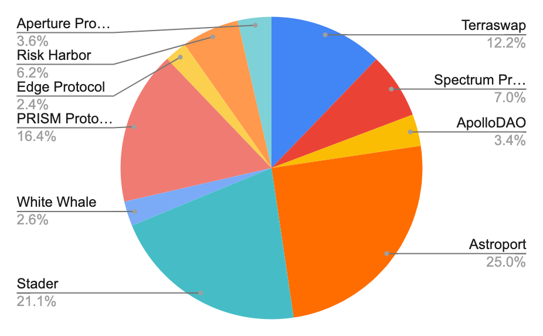
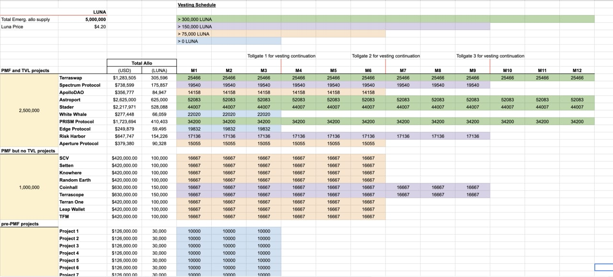
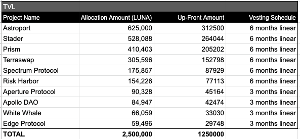
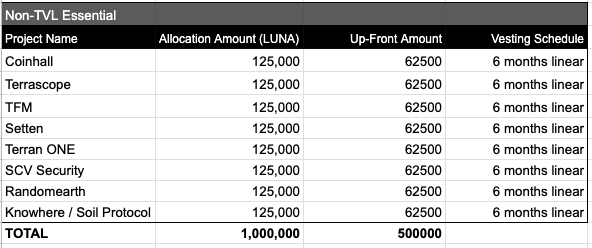
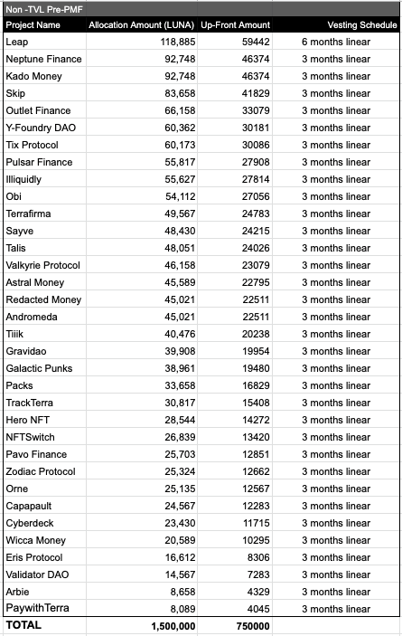

# Proposed distribution method for 0.5% emergency LUNA allocation VERSION 3

- **Thread ID:** 5332
- **Author:** Cephii (`terra1e6gwlmccanjue9zdeys9hhytwgwh9d52kpe2th`)
- **Created:** 2022-06-07T23:59:27.173Z
- **Last edited:** -
- **Stage:** discussion
- **Views:** 28106
- **Reactions:** 7
- **Comments:** 8
- **Source:** https://common.xyz/terra/discussion/5332-proposed-distribution-method-for-0-5-emergency-luna-allocation-version

---

**This proposal is being made on behalf of a diverse group of Terra community members (including representatives of community members, validators, TFL, and others), and is intended to supplement the [Terra Ecosystem Revival Plan 2](https://agora.terra.money/t/terra-ecosystem-revival-plan-2-passed-gov/18498) (the “Plan”)**

**Over the past few days there has been fervent dialogue around how to appropriately distribute the 0.5% emergency LUNA allocation. As a reminder, the Terra Ecosystem Revival Plan 2 specified 10% of LUNA supply to be earmarked to incentivize developers on Terra 2.0 as follows: **
1. _**Emergency allocation (0.5% of total supply (the “Emergency Fund”)): immediately after network launch to provide for runway while they build out product. Commit to returning funds if product has not been launched in 1 year.**_
2. _**Developer Alignment Program (1.5% of total supply): Protocol teams that were live in Terra Classic divide this allocation weighted by the last 30 day TVL from Pre-attack snapshot - 1 year cliff, 3 year vesting thereafter. Accommodations will be made for apps where TVL is not applicable.**_
3. _**Developer Mining Program (8% of total supply): Essential app developers earn a share of the mining program proceeds pro-rata to the amount of TVL every quarter for 4 years.**_

**While the Plan was descriptive of how the “Developer Alignment” and “Developer Mining” funds should be distributed, it did not specify how to allocate the Emergency Fund. As a result, guidance is needed from LUNA governance to determine an appropriate determination of this aspect of the Plan. **

**There has been ample discussion regarding the Emergency Fund, and taking the community’s feedback and input, this proposal represents what we believe to be the best path forward. **

**Goals **

**As we see it, there are three cohorts eligible to receive the Emergency Fund: **

- **Projects who launched on Terra Classic and achieved product-market fit and TVL**
- **Projects who launched on Terra Classic and achieved product-market fit but have no measurable TVL **
- **Projects (pre- and post-launch) who have not yet achieved product-market fit (pre-PMF)**

**We want to ensure that projects who achieved product-market fit have the support and incentives to continue to build on Terra 2.0. We also want to ensure that the long-tail of projects who have not yet achieved product-market fit have support to continue building until an opportunity to secure funding from traditional means arises.**

**Proposed distribution**

**As the name “Emergency Fund” suggests, we believe it makes sense to start bottoms-up by figuring out what smaller projects need as their runway. In order to do this, it’s important to define: 1) a minimum amount that all eligible projects should receive and 2) a target number of projects that should receive this amount.  **

**Polls taken within the community chats indicate projects require between $100-300K for 6 months of runway. Looking at the various lists compiled such as [this](https://docs.google.com/spreadsheets/d/1OgCMN8BIot6NBgd-qf1M29Dlv2vEU535o6n19bWEhJg/edit?usp=sharing), there are around 50 projects looking to qualify for this emergency funding. **

**As a result, we suggest a distribution of 25,000 to 75,000 of LUNA to each eligible pre-PMF team. Eligibility and allocations would be determined by a council consisting of longstanding Terra community members: Karma, Panterra0x, Cephii, Seb, and GJ. Each individual has vowed to recuse him or herself in the event of any potential conflict of interest on specific projects.**

**In addition to this, we suggest that teams who had launched and achieved product market fit or added value to tooling and infrastructure receive an additional 75,000 to 200,000 in LUNA. As an initial suggestion, we put forth Coinhall, Terrascope, Setten, SCV, Terran One, Random Earth, Knowhere, and TFM to be in this cohort.**

**To summarize, 1.5M LUNA would be distributed across the long tail of pre-PMF teams, an additional 1M LUNA would be distributed across teams with PMF but no TVL, for a total of 2.5M LUNA. This would leave precisely 50% to distribute to projects who had achieved product market fit and TVL on Terra Classic and are committed to building on Terra 2.0.**

**For these projects who achieved PMF and had TVL, we suggest pre-depeg Terra Classic TVL as the best metric in defining their value to the network and resulting share of the Emergency Fund. We suggest the 2.5M LUNA is distributed pro-rata based on contribution to TVL, with a max cap set at 25% of the allocation for any individual project and any remainder above that cap being uniformly distributed to the other projects. **

**Based on the above criteria and our current understanding of Terra 2 builder commitments, we currently anticipate that the TVL-based allocation of the Emergency Fund would look like this:**

****

**Raw Weight**
**TVL Based Comp**
**(Luna)**
**Astro Cap Distributed**
**(Luna)**
**New Totals**
**(LUNA)**
**Terraswap**
**10.50%**
**262,579**
**43,017**
**305,596**
**Spectrum Protocol**
**5.3%**
**132,840**
**43,017**
**175,857**
**ApolloDAO**
**1.7%**
**41,930**
**43,017**
**84,947**
**Astroport**
**40.5%**
**1,012,152**

**625,000**
**Stader**
**19.4%**
**485,071**
**43,017**
**528,088**
**White Whale**
**0.9%**
**23,042**
**43,017**
**66,059**
**PRISM Protocol**
**14.7%**
**367,386**
**43,017**
**410,403**
**Edge Protocol**
**0.7%**
**16,478**
**43,017**
**59,495**
**Risk Harbor**
**4.45%**
**111,209**
**43,017**
**154,226**
**Aperture Protocol**
**1.89%**
**47,312**
**43,017**
**90,328**

**In summary, 5M of Luna would be distributed as follows:**
- **2.5M of Luna across projects who launched on Terra Classic and achieved product-market fit and TVL (PMF and TVL)**
- **1M of Luna across projects who launched on Terra Classic and achieved product-market fit but have no measurable TVL (PMF but no TVL)**
- **1.5M of Luna across projects (pre- and post-launch) who have not yet achieved product-market fit (pre-PMF)**

**Performance Conditions**

**As stated in Terra Ecosystem Revival Plan 2, each team will be required to sign a pledge committing to:**

- **Use its portion of the emergency fund to help fund development on Terra 2.0 for at least one year **
- **Launch some product on Terra 2.0 within 3 months of receiving the allocation**
- **Provide transparency to the community in the form of quarterly public reporting on Agora on its progress and use of funds **

**If a team fails to fulfill these requirements, it is expected that they will return the LUNA received such that it can be allocated to other builders.**

**Distribution**
** **
**We suggest distributing 50% of the funds now, optimizing for speed of execution and getting a baseline distribution, and the remaining 50% to be vested over a period conditional to the size of the allocation to align incentives. For the latter 50% to be vested, a proposed schedule follows:**

- **< 75,000 Luna = vested in 3 months**
- **75,001 - 150,000 Luna = vested over 6 months**
- **150,001 - 300,000 Luna = vested over 9 months**
- **> 300,000 Luna = vested over 12 months**

****

**Ahead of the first vesting continuation phase in 3 months, the Council will review progress made by each team to determine whether the vesting and allocations should continue. **

**Next Steps**

**To expedite the distribution of this emergency allocation, the Council will be taking information from teams using this form. ([https://docs.google.com/forms/d/e/1FAIpQLSfVWkgY_-ktvRcEWBHldNxo191uLv6-OlUeWWAdaKjPDzfLpw/viewform?usp=sf_link).](https://docs.google.com/forms/d/e/1FAIpQLSfVWkgY_-ktvRcEWBHldNxo191uLv6-OlUeWWAdaKjPDzfLpw/viewform?usp=sf_link).) **

**Please submit information by Friday, June 10, 2022, UTC 0:00. **

**Acknowledgement of this proposal’s imperfection — and call to action **

**This proposal represents best efforts to incorporate widely ranging feedback from over 300 contributors to Terra space, including validators, teams, and community representatives. **
**It attempts the impossible – to distribute value among a diversified range of projects and contributors, in unprecedented circumstances, and under heavy time constraints. **

**The proposed framework has one goal, which is to retain builders on Terra. It does so by:**

**A) providing monetary incentives to high TVL projects that have already received competitive offers from other ecosystems**
**B) providing capital for mid- to smaller size teams to redeploy, repivot or change PMF and introduce their projects to Terra. **

**While we are open to feedback and constructive improvement suggestions, we urge everyone to remain mindful that many improvement attempts would require a framework of evaluation that doesn't exist yet. **

**Please note that the final amount of grant for each project can differ from the preview outlined above, due to market dynamics and other factors. In case of new developments and necessary adjustments, the decision-making process will be led by the Council outlined in the proposal to assure timely resolution.**

---

## Comments (8)

**Anonymous (`terra19vmgfrn36yr44afxgpjrt58sz8s7x9sc4tgeyk`)** — 2022-06-08T00:11:25.787Z — 👍 1

Shouldn't Angel be included in the **PMF** team distribution?

disclaimer: I'm on Angel's core team.

**Terra (`terra16qr5h8gmj37jp337y8jeg6rv4vuqakp23mh4vc`)** — 2022-06-08T02:52:05.222Z — 👍 1

Thanks Cephii for doing God's work. :D

**Anonymous (`terra1u5juf6y5enghj3e0hcxcnjlkcjk550f5g64ulj`)** — 2022-06-08T04:19:53.034Z (edited 2022-06-08T04:21:43.787Z)

What about projects that were on Pylon Gateway, some had 15+ millions of UST locked in and their runway was destroyed when the locked UST was unlocked,  think they  should get more equal than the other teams on the prePMF list.

**Anonymous (`terra17uncwru68z3n0kl543r6rdd5q9jpvwxdxvfe66`)** — 2022-06-08T09:30:05.600Z (edited 2022-06-08T09:30:56.739Z)

Thanks for creating this proposal, [@Cephii](/terra/account/terra1e6gwlmccanjue9zdeys9hhytwgwh9d52kpe2th). However, Nexus just announced that they're moving on from Terra v2 ([Tweet from @NexusProtocol (1533…728)](https://twitter.com/NexusProtocol/status/1533870972767305728?s=20&t=_IpshKkmuX-ofUQGGt6nTg)) which will allow Nexus' allocation to be distributed to the rest of the TVL + PMF protocols.

However, I'd also like to highlight that few TVL + PMF protocols have yet to make an announcement on their intention to build on Terra v2.

1. Angel - **Official Announcement needed**. Indicated ([Tweet from @angelprotocol (1534…072)](https://twitter.com/angelprotocol/status/1534170791574659072?s=20&t=_IpshKkmuX-ofUQGGt6nTg))
2. Apollo - **Official Announcement needed** for Apollo Vaults. Apollo Safe is a non-TVL, PMF project. Announced launch on Osmosis ([Tweet from @ApolloDAO (1532…513)](https://twitter.com/ApolloDAO/status/1532704841038016513?s=20&t=_IpshKkmuX-ofUQGGt6nTg))
3. Astroport - **Live**
4. Edge - Launching on Terra v2 ([Tweet from @EdgeProtocol (1530…875)](https://twitter.com/EdgeProtocol/status/1530376077079887875?s=20&t=_IpshKkmuX-ofUQGGt6nTg))
5. Mars - Awaiting for higher liquidity on Terra before launching. Since the launch is dependent on the liquidity of Terra v2, separate vesting schedule might be fair for the other protocols, subject to governance laid out here.
6. Nexus - Not Launching (link to announcement above)
7. Prism - Official Announcement needed. Indicated ([Tweet from @TerraBuildersU (1526…361)](https://twitter.com/TerraBuildersU/status/1526848412749967361))
8. Risk Harbour - Launching on Terra v2 ([Tweet from @riskharbor (1527…833)](https://twitter.com/riskharbor/status/1527386414102392833?s=20&t=raU5bEiGASX4wSNXJaRbaQ))
9. Spectrum - Launching on Terra v2 ([Tweet from @SpecProtocol (1528…889)](https://twitter.com/SpecProtocol/status/1528772120926629889?s=20&t=raU5bEiGASX4wSNXJaRbaQ))
10. Stader - Live
11. Terraswap - Live
12. White Whale - Launching on Terra v2 ([Tweet from @WhiteWhaleTerra (1532…672)](https://twitter.com/WhiteWhaleTerra/status/1532385884711964672?s=20&t=raU5bEiGASX4wSNXJaRbaQ))

It'll be great if each of the protocols above support this proposal & indicate that they're building on Terra v2. It'll be unfair for protocols that have made official announcements to continue waiting for this emergency allocation, hence, it'll be good for us to set a deadline for the protocols above to announce their intention to continue building.

> **Kulivoko (`terra1gpsmt2wkdagxg9hv5qz9gjzc9gstc5lh3ggvew`)** — 2022-06-08T11:52:03.657Z
> 
> I hate to see any projects leave, this is sad.

**Bels (`terra13u2cvjfvn6htke5p943p6u7wpk8mcz3mem986m`)** — 2022-06-08T11:54:53.501Z

Now teams will enter Terra2 solely for profit :(

**Rune | zerosumprotocol (`terra1ettjrqla8cpmx0wvdurjynn7776gurx5ywfufx`)** — 2022-06-09T18:45:12.950Z

Hello, I strongly agree with this proposal.

Our project won 2nd place at Terra Hackathon in October 2020, but we were delaying the launch due to lack of funds.

So I've been saving a lot of money but the Terra Classic collapsed in vain a few months before the launch.

All the funds evaporated... I'd like to get through the proposal and start a new way

**Panterra0x (`terra1uxcwrg6wlmkskaq8xump3u0vdcy6qjkvspfynn`)** — 2022-06-16T15:35:29.011Z — 👍 1

# Introduction

The governance proposal “1623 | Terra Builders Alliance: Rebirth Terra Network”
leading to the birth of Terra 2.0 has earmarked 0.5% of LUNA supply (equalling 5 Million Luna tokens) for Emergency allocation for teams committing to build on Terra 2.0. It has not outlined the way to distribute these funds. 

This necessitated the creation and voting on the proposal “446 - Establish Emergency Allocation Distribution Method” to define parameters of distribution and execute the steps necessary for collection and assessment of team applications.

This post provides an overview of the steps taken in the past days and outlines the methods employed to weight the distribution of funds, expanding on the blueprint of proposal 446. 

# Overview

The goal of this distribution is to provide sufficient runway for teams to continue building on Terra while seeking additional grant funding, if necessary. It is a supplement to the grants process, not a replacement. 

A robust grants framework is not yet in place, but is in the works. This “bridge” funding is intended to provide projects with enough runway to keep building until that framework is developed.

# Distribution Methods

The Emergency Allocation was distributed among three defined groups:

1. TVL based group (2.5 Million LUNA total)
2. Non TVL “essential” group (1 Million LUNA total)
3. Non TVL group, and pre-product market fit (PMF) (1.5 Million LUNA Total)

## TVL group

Amount total: 50% of Emergency allocation pool. 2.5 Million LUNA distributed among 11 projects.

Reasoning: The majority of blockspace value creation can be attributed to a small group of projects consistently attracting capital. The emergency pool aims to support emerging liquidity of the new chain by supporting projects and teams with a proven track record.

Execution: TVL for each essential team was drawn from DeFi Llama and verified by 0xDef1 and Flipside, based on a request for neutral assessment from a third party. In most cases, the Llama approach was verified as correct; in one or two cases, necessary adjustments were made to optimise for accuracy.

**Final Distribution**

## Non-TVL “Essential” Group

Amount total: 20% of Emergency allocation pool. 1 Million LUNA distributed among 8 projects.

Reasoning: This category aims to distribute funds to projects that were live on Luna Classic, widely served other projects to be successful, but cannot have TVL of their own, and would result in critical deficiencies to the ecosystem were they missing. Allocation of funds to these teams serves to ensure substantial runway, redeployment and improvement of services that many other teams rely upon. 

Execution: The characteristic of this group makes definition of hard set parameters impossible, as different sub-communities may consider different protocols essential. Nevertheless, a soft consensus was established among a wide range of builders involved in emergency allocation discussions, with the 8 projects outlined here being consistently named as essential by multiple teams from across the ecosystem. 

**Final Distribution**

## Non-TVL Pre-PMF Group

Amount total: 30% of Emergency allocation pool. 1.5 Million LUNA distributed amongst 34 projects.

Reasoning: This category aims to provide the long-tail of projects who have not yet achieved product-market fit the support to continue building until an opportunity to secure funding from traditional means arises. Similarly, it incentivizes teams that were in early stages of their Product- Market fit on Luna Classic to redeploy and contribute to the growth of different aspects of Terra 2.0 ecosystem. 

Note: Angel Protocol has applied for Emergency allocation in this group, however, they are not included in this distribution as a separate proposal is being prepared, taking into account their particular situation and charities involved.

Execution: The nature of the Emergency allocation is such that it optimises for quick distribution in unprecedented circumstances, and thus precludes formation of lengthy verification processes. The variety of teams applying for funding under the umbrella of this category necessitated a more subjective approach in the distribution and allocation of funds. 

Teams were invited to provide supporting material to justify their application via the for linked in the initial proposal; in cases where this supporting material was inadequate or entirely lacking, the council sought to conduct research on available public-domain materials. 

This research was heavily constrained by time. In certain cases, applications with scarce context led to a lower allocation. In cases where funding was not granted, this should not be read as an indictment of a team or its value proposition, but rather as a judgement on the insufficiency of available materials to justify an allocation. 

Five council members chosen in the initial proposal have assessed applications separately and distributed funds among the teams. Following that, multiple meetings were held with all council members present, to compare results and calculate the average amount for every team. 

In cases of any perceived conflict of interest, council members recused themselves from judgement. The final distribution thus reflects not personal opinions but an average calculated range of multiple assessments. 

**Final Distribution**

**Note on Vesting**

All teams receive 50% of their allocation upfront. The remaining amount is vested linearly, without a cliff, for 6 months for projects receiving over 100k LUNA and 3 months for projects receiving under 100k LUNA.

These shorter vesting periods were chosen to reflect the change in price of LUNA when compared to the initial proposal, and to ensure the funds provide ample runway for teams in changed market conditions.

