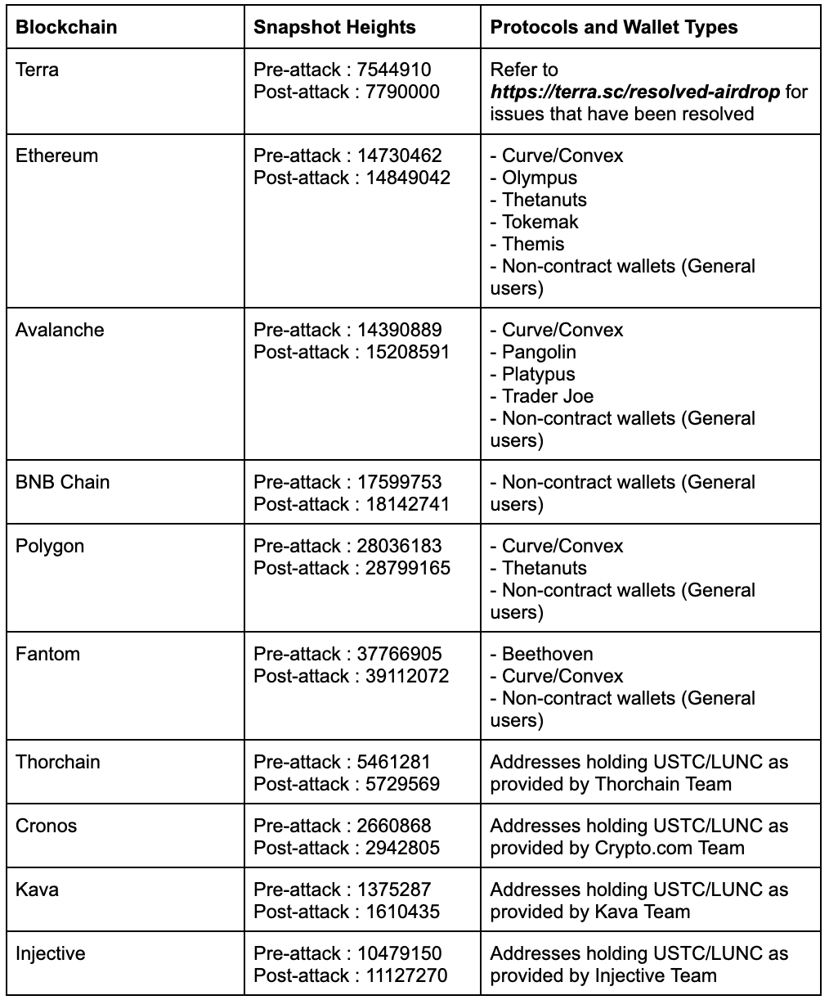
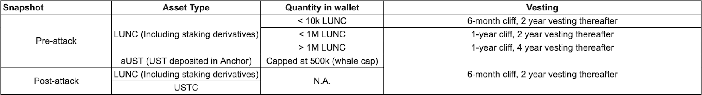
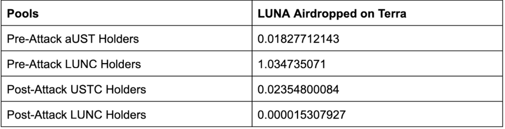
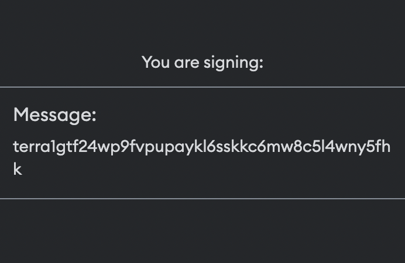
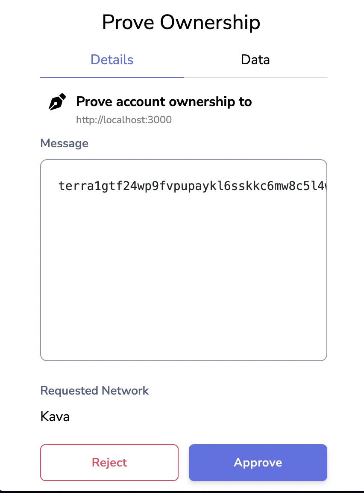
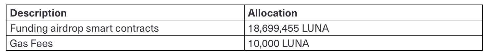
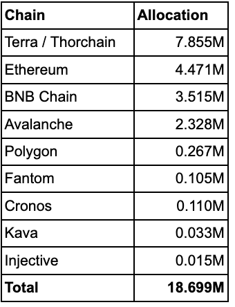
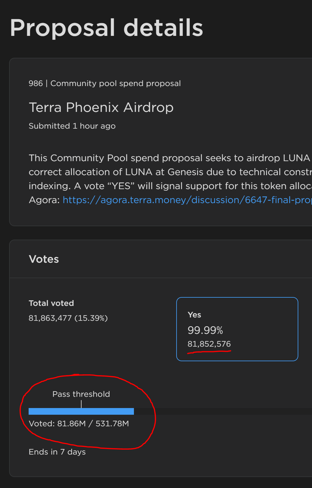

# Final Proposal: Terra Phoenix Airdrop

- **Thread ID:** 6647
- **Author:** mc_ust (`terra1t3xp8c9nvvqu6e5kc63qztmk8v2xlvmuwnwdjv`)
- **Created:** 2022-08-16T07:00:00.872Z
- **Last edited:** -
- **Stage:** discussion
- **Views:** 69492
- **Reactions:** 4
- **Comments:** 38
- **Source:** https://common.xyz/terra/discussion/6647-final-proposal-terra-phoenix-airdrop

---

_Disclaimer – I am employed by Terraform Labs (TFL)_

**Purpose**
This proposal aims to request **18,709,455 LUNA** from the Community Pool to execute an airdrop to users who either did not receive the correct allocation of LUNA at Genesis due to technical constraints or issues associated with indexing.

**Airdrop Eligibility**
The table below outlines the blockchains, protocols, and wallet types eligible for this airdrop, along with the corresponding snapshot heights for each chain. A small number of chains are not listed due to inabilities to properly index, technical complexities, or small amounts of USTC, aUST, or LUNC held on-chain at the snapshot height.

Non-Terra exchange addresses that have received the airdrop at Genesis will also not be eligible for this airdrop.

Extract: [List of issues that have been resolved on Terra](https://terra.sc/resolved-airdrop)

_Table 1: Eligibility - Blockchains, Protocols, and Wallet Types with Corresponding Snapshot Heights_

**Vesting Periods and Airdrop Calculation**
The vesting schedules and airdrop calculations will follow that of the LUNA airdrop at Genesis, with one key difference:
- To avoid market liquidity instability upon distribution, all LUNA airdropped to holders of less than 10k Pre-attack LUNC, any Pre-attack aUST, or any Post-attack LUNC and/or USTC will vest over 2 years with a 6-month cliff. 

_Table 2: LUNA Vesting Schedules for Eligible Wallets_

_Table 3: LUNA Airdrop Ratios_

For more information on the LUNA airdrop, please refer to the following articles:
- [LUNA Airdrop Medium Article](https://medium.com/terra-money/terra-2-0-luna-airdrop-cd08a6d9cfcd)
- [LUNA Airdrop Calculation Logic](https://medium.com/terra-money/terra-2-0-luna-airdrop-calculation-logic-3eb752c25837)

**Cross-Chain Airdrop Indexing Logic**
Given the complexities of indexing every cross-chain protocol for the airdrop, we have worked directly with cross-chain protocols and foundation teams to gather indexed data so that we can distribute the LUNA airdrop accordingly.

_For EVM-Based Chains (Ethereum, BNB Chain, Polygon, Avalanche, and Fantom)_
1. Use CovalentHQ’s API to retrieve USTC/LUNC/aUST balances at block heights for each chain based on the Terra snapshot time
2. Remove exchange addresses that have received airdrop at Genesis
3. Remove addresses that are contracts
4. Include indexed data from protocols
5. Calculate allocations

_For IBC-Based Chains (Kava, Injective, Cronos, and Thorchain)_
The indexed data for each chain was provided by the foundation teams. For Thorchain, the LUNA allocated will be associated with the Terra deposit address.

**Airdrop Claim Mechanism and Timeline**
Assuming this proposal passes Governance, users will have one month, from **28 Aug 2022 to 28 Sep 2022**, to claim their airdrop. To claim, eligible users should interact with the airdrop claim interface and go through the following 5-step sequence:
1. User connects their Terra Station, Metamask, or Keplr wallet to phoenix-airdrop.terra.money
2. The amount of LUNA that is claimable by the user will appear
3. User provides a new Terra wallet address (without any prior transaction history) to receive the LUNA in
4. User signs a transaction using their wallet from step 1 to claim their airdrop. Do note that a small amount of LUNA will be deducted from the airdrop amount to account for gas fees for those claiming from non-Terra chains
5. **IMPORTANT**: The transaction body users should see when completing this transaction can be found below. Users are encouraged to compare this transaction body to the one on the claim interface to avoid any loss of funds via potential phishing scams:
6. For Ethereum (Metamask) and Cosmos chains (Keplr):
7. The message should be the `new Terra wallet address`

- For Terra:

{
  "claim": {
    "proofs": [
      "d724ad9010771f02dcf468d5ff95ca987e5661bc37415ae9ff77f116e6d9da1f",
      "1126ed8d9796de00776a717a5d7c13b854c3e884024dd30cf866484d1187a3c3",
      "345b37493a047a0918eb3c27db261680406180bfd79a53c9a4d032a03ae23377",
      "60fc2e8082e0313734c685d350d19dd525af7bec54df514370002f8075a158a7",
      "e8c9b21b2ca7d7ddf977986f2b61ea131b9c0e9009341e5e8f85a39eddacfebf",
      "d919fa80fca29afe0ee1ec8d04a078d8e5ddd2ba7458b9a4ad94af9a7332ad9b",
      "64825b346894aea1f03d0843dbac07c960960c4e13a70d145c555c893a9f8a21",
      "c9aaf1ce0f1ab1033554c7b7875b73925790be8c87f0f56e449f28af51243f11",
      "f9ed9cdbba80fdbece97452ed5fb89e936db7ce57c77b0a9240a46bf4bf72d4b",
      "2b9e119a19ba69899f64573dcd3939b9b9b2b0db87499ec2a4bd7a6e8b39d6a7",
      "10bcce59da72ee5ff291969eefa68898abe21bdb43bcf705aaae686b8be41b49",
      "8696906cad582edca83684b9efaa107a5966f88bcdc1ed90493bcc0bc8efaf85",
      "8cbd5056732a47bef4b6b1c1d74416b9005840f60cb8205adb4478afc85b144b",
      "6720401a9a21d43c1fdb954416df69c1aa404109886cdcb16f0964797c34e732",
      "403c2fe2c92d4d945f4d0cbcc681b969ed673de0cf901b323fb8e79e20499e46"
    ],
    "message": "terra1gtf24wp9fvpupaykl6sskkc6mw8c5l4wny5fgk",
    "signature": "terra1gtf24wp9fvpupaykl6sskkc6mw8c5l4wny5fgk",
    "allocation": "terra12m8njvjxhm53h0fjgwm7454ywypknm9ztxmf9r,300025,175014,525044,0,0"
  }
}
- IMPORTANT: Verify the accuracy of the website URL you sign transactions on to avoid loss of funds: 
- Claim interface URL: [**phoenix-airdrop.terra.money**](https://phoenix-airdrop.terra.money)
- LUNA airdrop is sent and will be vested at the new Terra wallet address provided in step 3

**Note: LUNA not claimed by 28 Sep 2022 will be returned to the Community Pool.**
**This includes any unused gas fees. **

**Disclaimer:** TFL is providing support to the community through the provision of indexing services to support the airdrop, as outlined in the Governance proposal 1623 on Terra Classic. TFL is contributing as part of the community and is not responsible for operating Terra or providing airdrops.

**Community Pool Spend Allocation**

The **18,709,455 LUNA **will be used to fund a new multisig ([terra1909pplsp2hfgtm4w2c8lcmf577lud9t2zmsn95zrplxqhx7crqlssgp8c0](https://terrasco.pe/mainnet/address/terra1909pplsp2hfgtm4w2c8lcmf577lud9t2zmsn95zrplxqhx7crqlssgp8c0)) that has the following signers:
1. GJ Flannery (Flipside) - terra1ky3ayzkeu9ffcm2h452u3tk3d293gjsnu9gvkj
2. Karma (Illiquid Labs) - terra1red3ps27cku9v7lv8c222rkzw47qre7h2j45g6
3. Jowella (Coinhall) - terra1435avvnyllw9dkd0jmcssv3938uapxh3zt9ym4
4. Mark Chan (TFL) - terra19sft3gk3enekjkw34zgmnrqq2zcvt2t6ueqhac
5. Terence (TFL) - terra10w7jc4ch6w8pjtfrq29uh22ws6cxnd6t89my7c

One smart contract will be created per chain for the airdrop. LUNA from the multisig will be used to fund these smart contracts with the following distribution:

**Distribution Per Chain**

_Table 4: LUNA Distribution Breakdown by Chain_

Please refer to [Phoenix Airdrop Distribution](https://docs.google.com/spreadsheets/d/1_k6cBd4ErHv6wNOw3dg-6zQZnFcbKN-eWxeqrQp-c0o/edit?usp=sharing) for actual distribution per address

---

## Comments (38)

**Karma (`terra1ts7lekdxct5qse00zx78hu2wtkfpa8tepclu2s`)** — 2022-08-16T13:53:42.703Z — 👍 1

Fully support the proposal, and I am really happy to see the following note "LUNA not claimed by 28 Sep 2022 will be returned to the Community Pool. This includes any unused gas fees." - really good to see a claim function, as it allows the community pool to retain some of the spending power for other ventures in the future, instead of airdropping them to wallets that are possibly no longer active.

**NoMoney (`terra12rl24u9axgg64sds5s4umg4hpm3e7hdkrlsel7`)** — 2022-08-16T13:57:33.262Z

Hi, StLuna that was on Loop LPs didn't seem to receive the right allocation in the previous airdrop, is this not being treated?

> **mc_ust (`terra1t3xp8c9nvvqu6e5kc63qztmk8v2xlvmuwnwdjv`)** — 2022-08-17T06:03:31.977Z
> 
> Hi [@NoMoney](/terra/account/terra12rl24u9axgg64sds5s4umg4hpm3e7hdkrlsel7) 
> 
> Thanks for raising your question. This has also been addressed this time around. We've updated the [list of issues that have been resolved on Terra](https://docs.google.com/spreadsheets/d/1hFQhrDkbrqR949wXricmzOZRvlqp52xvhC-wNRtyDFw/edit?usp=sharing) to reflect the same. Thank you.

**1v1 (`terra1x0egdsn2rgqwgrv239k0a98vx002yvpddeadd6`)** — 2022-08-16T16:57:09.586Z

I still believe I am missing lot of Luna as staked luna under different platform are not being counted such as spec protocol, or prism or staderlabs etc etc . had around 4000 Luna before the crash and received only 1180 and 372 on the sheet for future airdrop so missing almost 2500 luna (if 1:1) so someone really needs to go into the chain explorer and look at the snapshot of a particular wallet and see where the asset was staked before the crash.

> **Anonymous (`terra1renja35xxy4tkf9n6qwntqp9n2jx48jncrw46k`)** — 2022-08-16T19:43:23.424Z (edited 2022-08-16T19:44:44.865Z)
> 
> It wasn't 1:1 and there are two articles you should review before making a claim like this, together the articles cover exactly how the airdrop worked and was calculated. It is apparent you did not read them, otherwise you could have used the information to determine how much you should have received.
> 
> https://medium.com/terra-money/terra-2-0-luna-airdrop-cd08a6d9cfcd
> 
> https://medium.com/terra-money/terra-2-0-luna-airdrop-calculation-logic-3eb752c25837

**Anonymous (`terra1renja35xxy4tkf9n6qwntqp9n2jx48jncrw46k`)** — 2022-08-16T19:46:50.838Z

Great proposal but I have one thing to add. This 1 month claim period is not long enough and there will be intense blowback if there is not a large scale marketing scheme to get the word out to every possible affected party. If there is no intent or willpower to have said large scale marketing effort, then the claim time should be extended to at least 6 months, potentially even 1 year.

> **Anonymous (`terra1renja35xxy4tkf9n6qwntqp9n2jx48jncrw46k`)** — 2022-09-02T18:17:59.988Z
> 
> [@mc_ust](/terra/account/terra1t3xp8c9nvvqu6e5kc63qztmk8v2xlvmuwnwdjv) 
> 
> Very disappointed that you did not take the time to respond or consider my feedback. 1 month is too short and will on further the blowback on this airdrop.

> **Anonymous (`terra189yex0xzez5g9n5nud33f4ukexvfzhkynnhkjk`)** — 2022-10-04T14:59:15.617Z
> 
> I am very disappointed that I missed the airdrop. Is there a way you could consider an extension? [@mc_ust](/terra/account/terra1t3xp8c9nvvqu6e5kc63qztmk8v2xlvmuwnwdjv)

**Orion Money (`terra17j7q3k4ycw8k77dffy3ccj0whswymyw7xjuhvn`)** — 2022-08-16T20:39:33.245Z

@mc_ust Please also add Orion Money to the list on Ethereum. Orion.Money users' deposits were kept as aUST on Ethereum and so far we haven't received any LUNA airdrops for this.
We can help with the snapshot data for Orion Money on Ethereum. Please ping us on Twitter or in the Terra Rebirth League (TRL) Telegram group to connect about this.

Thanks for the proposal!

> **mc_ust (`terra1t3xp8c9nvvqu6e5kc63qztmk8v2xlvmuwnwdjv`)** — 2022-08-17T06:04:00.096Z
> 
> Hi [@Orion Money](/terra/account/terra17j7q3k4ycw8k77dffy3ccj0whswymyw7xjuhvn) team,
> 
> We've reached out to you via DM on Telegram to learn more.
> 
> Thank you.

**Narsej (`terra1wrrvycaas49fxd289g2rghaa4vjamf8nyrvq38`)** — 2022-08-17T07:43:01.673Z

Hi, in spreadsheet on terra protocol there is still missing nluna-psi farm on spectrum. Only mentioned is nluna farm. Can you include nluna-psi? Because we got nothing

> **hikari042 (`terra14ce2gfwp3gp9qv8ef9xkd9shegy0mhm5zrys07`)** — 2022-08-18T12:54:15.530Z (edited 2022-08-26T14:05:52.514Z)
> 
> Hi, Hikari from Spectrum Protocol here, we are aware of the situation and it was due to the incorrect contract address provided. Unfortunately, we aren't able to include it in this distribution. We are working with TFL on the resolution.
> 
> As of 25 Aug 2022, nLuna-Psi is included in this distribution.

**Cypher (`terra109ushyxp87puhs8ev6mt9ceqd4uvpgpcmjv40n`)** — 2022-08-17T18:02:03.218Z

The biggest, and most important ones to make sure are done correctly are Pylon and Stader.  By a long shot.

**bPsi24mDp holder (`terra1ycquqgv8fqsaswfjkf5jenamvr0p6nhzc9dzar`)** — 2022-08-17T18:50:43.949Z

Pylon users are fucked.
bPsi24mDP is one pool in pylon.
I hold both bPsi24mDP and aUST at pre attack block.
I get the part of airdrop at Genesis(only aUST, no airdrop for bPsi24mDP).
Still not eligible in this new airdrop list.
Feel disappointed at Pylon.
Feel disappointed at Terra v2.

> **mc_ust (`terra1t3xp8c9nvvqu6e5kc63qztmk8v2xlvmuwnwdjv`)** — 2022-08-19T09:59:28.592Z
> 
> Hi, we looked into what you have raised and what transpired here is that the wallet did not possess bPsi24mDP at the post-attack snapshot.

**mc_ust (`terra1t3xp8c9nvvqu6e5kc63qztmk8v2xlvmuwnwdjv`)** — 2022-08-18T03:04:55.122Z

Hi [@bPsi24mDp holder](/terra/account/terra1ycquqgv8fqsaswfjkf5jenamvr0p6nhzc9dzar) , can you please provide your description of issues, wallet address, and contact details [here](https://forms.gle/1YLDbZREbcoGA7VY8)?

Thank you.

> **bPsi24mDp holder (`terra1ycquqgv8fqsaswfjkf5jenamvr0p6nhzc9dzar`)** — 2022-08-18T04:27:08.266Z
> 
> Pylon bPsiDP-24m:https://finder.terra.money/classic/address/terra1zsaswh926ey8qa5x4vj93kzzlfnef0pstuca0y
> 
> Nexus Protocol get interest from Pylon to improve its economic situation, Pylon users get Nexus' token PSI in return in the next 24 months and get their UST back.
> 
> Nexus and Pylon are not responsible, no more news from June.
> 
> I‘m glad I didn't put all my money in Pylon.
> 
> Feel sad for Pylon users.

> > **bPsi24mDp holder (`terra1ycquqgv8fqsaswfjkf5jenamvr0p6nhzc9dzar`)** — 2022-08-18T04:34:44.373Z
> > 
> > bPsiDP-24m token:terra1zsaswh926ey8qa5x4vj93kzzlfnef0pstuca0y
> > contract:terra1fmnedmd3732gwyyj47r5p03055mygce98dpte2

> > **mc_ust (`terra1t3xp8c9nvvqu6e5kc63qztmk8v2xlvmuwnwdjv`)** — 2022-08-18T06:07:48.148Z
> > 
> > Hi [@bPsi24mDp holder](/terra/account/terra1ycquqgv8fqsaswfjkf5jenamvr0p6nhzc9dzar) ,
> > 
> > Thanks for this context. We will still need your wallet address in order to understand the specific issues you're facing. 
> > 
> > If you don't want to share it publicly, you may communicate it [here](https://forms.gle/1YLDbZREbcoGA7VY8).

**Colin Talks Crypto (`terra1ft4y720qwq7rwwfe0gjg835hkzgzawy3482lk8`)** — 2022-08-21T20:41:37.783Z (edited 2022-08-21T20:43:05.899Z)

First of all, thank you very much [@mc_ust](/terra/account/terra1t3xp8c9nvvqu6e5kc63qztmk8v2xlvmuwnwdjv) for drafting this proposal. I was one of the people who did not receive the correct amount of airdrop and have been waiting in hope for months for a correction to the issue. So I'm very happy to see this.

Has bLUNA (specifically bLUNA in the 21-day unbonding process) been corrected in the indexing? I saw no mention of it in the list. I had a large amount of unbonding bLUNA and I don’t think I was credited for it.

I also held LUNAx in a LP which was not credited, but it looks like all Stader Labs issues will be fixed.

Lastly, does your proposal have to go up for vote in the on-chain governance before being activated? I couldn’t find any record of it here: [https://station.terra.money/gov#PROPOSAL_STATUS_VOTING_PERIOD](https://station.terra.money/gov#PROPOSAL_STATUS_VOTING_PERIOD)

Thanks again.

> **mc_ust (`terra1t3xp8c9nvvqu6e5kc63qztmk8v2xlvmuwnwdjv`)** — 2022-08-22T02:38:00.768Z — 👍 1
> 
> Hi [@Colin Talks Crypto](/terra/account/terra1ft4y720qwq7rwwfe0gjg835hkzgzawy3482lk8) 
> 
> Thanks for reaching out. 
> 
> You should have received the allocation for bLUNA (even for unbonding) at Genesis. 
> LUNAx in LPs have also been resolved in this airdrop. 
> 
> The proposal has not been pushed on-chain for voting, but it will be published soon.

> > **Colin Talks Crypto (`terra1ft4y720qwq7rwwfe0gjg835hkzgzawy3482lk8`)** — 2022-08-22T19:04:35.133Z — 👍 1
> > 
> > Thank you for the answer! Looking forward to this being rectified, as I'm sure many are. Appreciate your help.

**NoMoney (`terra12rl24u9axgg64sds5s4umg4hpm3e7hdkrlsel7`)** — 2022-08-25T10:08:07.212Z

Where is the link to governance voting anyway?

> **mc_ust (`terra1t3xp8c9nvvqu6e5kc63qztmk8v2xlvmuwnwdjv`)** — 2022-08-25T13:41:34.170Z — 👍 1
> 
> Hi [@NoMoney](/terra/account/terra12rl24u9axgg64sds5s4umg4hpm3e7hdkrlsel7) , we will be pushing it on-chain for a vote tomorrow.

**Colin Talks Crypto (`terra1ft4y720qwq7rwwfe0gjg835hkzgzawy3482lk8`)** — 2022-08-25T14:44:50.345Z (edited 2022-08-25T16:29:02.941Z)

Once again, thank you for doing this.

One question: Why is the claim period being limited to 1 month before it expires? 

There may be holders out there who don't check their wallets often or aren't initially aware of this effort. There also may be some who don't realize they were short-changed in the airdrop (due to the various indexing failures). These people may realize at a later date. Some might be on vacation or travelling. A month just isn't very long.

Wouldn't it be more appropriate to allow _at least_ several months to claim? imo 6 months or even 1 year would be most appropriate for rectifying those users who originally made LUNA what it was**—** especially if this is a one-time recovery effort that will never have to be repeated.

**Colin Talks Crypto (`terra1ft4y720qwq7rwwfe0gjg835hkzgzawy3482lk8`)** — 2022-08-26T15:38:13.474Z

Proposal passed in less than 2 hours! Congrats!

**1v1 (`terra1x0egdsn2rgqwgrv239k0a98vx002yvpddeadd6`)** — 2022-08-26T17:44:00.091Z

Dont assume I didnt read those two blogs before posting here. I calculated my staked Luna and saw there are still lot of missing. More than Half actually. So apparatently the logic is not right when its comes to calculating the eligible airdrops. And if you are assuming that whatever is posted in these two blogs then you are wrong. As there are mistakes done for the calculations and this proposal was created to correct SOME of the them and NOT ALL.

> **Colin Talks Crypto (`terra1ft4y720qwq7rwwfe0gjg835hkzgzawy3482lk8`)** — 2022-08-27T00:15:56.357Z
> 
> Not quite sure what the point of this comment was.
> 
> All people here obviously know that the calculation of LUNA airdrop was incorrect for some users. That's the entire purpose of this proposal-- to fix the airdrop for as many users as possible.
> 
> It seems your post really boils down to saying there are other instances of missed airdrops.
> 
> So what are they? Why didn't you give specifics?

**Anonymous (`terra14dhpuhqda8fqdfja7snnmy0su7t3fnphwu3h04`)** — 2022-08-30T06:28:10.262Z

Hello admin, can you help me please. My osmosis address is osmo1z273yh762f47ylvsdtza8gvu3jg6ltp70shszw,I can see that I hold during terra Snapshot Height: 7790000 (2022–05–26 16:38:08 UTC) There are 305941USTs. But my corresponding terra address terra1z273yh762f47ylvsdtza8gvu3jg6ltp7p07qku did not get the airdrop.

**trapangle (`terra1s6w2n4kz77q3gq9vr6ryfp0eveuta0384knju6`)** — 2022-09-01T12:52:07.261Z

Hi, my case is about Post-Attack USTC holders.
I owned USTC on Genesis, May 27th, they were in Anchor Protocol EARN. Before Genesis, we asked the Luna team if it was better to leave them on anchor EARN or to withdraw them to Terra wallet : https://classic-agora.terra.money/t/ust-in-anchor-protocol/38383 The answer was that it didn't matter.
At Genesis, I received 0.02354800084 * my aUST amount for the Post-Attack USTC. I should have received 0.02354800084 * my USTC amount, as at that time, 1 aUST had the same value as 1.259 USTC.

**Colin Talks Crypto (`terra1ft4y720qwq7rwwfe0gjg835hkzgzawy3482lk8`)** — 2022-09-04T19:52:00.561Z

I successfully claimed my lost LUNA 2.0 airdrop. They are now vesting (just like the original batch I received).

Thank you very much!

**Geo Foundation (`terra16crcj2j79fgf6t658k523dmr3almw44m8h8xa7`)** — 2022-09-09T17:36:46.892Z

Well, I think it's time to write this post about how you shouldn't trust Mr. Do Kwon's Twitter, author of such memorable quotes as: "I don't debate the poor on Twitter, and sorry I don't have any change on me for her at the moment." 

For now, based on the above, he wouldn't even debate with me, one of the "lunatics," since I was left practically penniless. And even the latest airdrop on the Ether network has not made things better.

Let me start at the beginning: For the past year, I've been holding most of my savings in the UNISWAP protocol in the liquid pair ETH-LUNA(wLUNA). And it has been quite profitable for me. The commission from the liquidity pool pretty much covered my monthly expenses. 

But one fine spring day, THIS began.

A precipitous fall, followed by the triggering of that "much-loved" death spiral turned almost all of my savings into a pumpkin in a few hours. At the moment of the fall, I was closely following the "first-hand" news - a tweet from Terra Foundation and Mr’s. Do Kwon, who unanimously assured me not to panic, to hold the coin and wait for the situation to turn around. But what did we get out of it? Billions of "printed" moons and millions of people left with empty pockets. 

Everyone hoped for a quick fix for the announced airdrop. But sadly, there was no miracle for me. The first airdrop completely bypassed the Ether network. Let me remind, all of my tokens were in the Ether network (wLUNA), and have not been touched to this day, because it is not clear how the algorithm for determining the date of purchase of these tokens would work for me. The risk of my tokens falling into the "post-attack" category was too great. So I had patience and began to wait for new announcements, because there were quite a few holders like me. In the meantime, I sent my LUNA(wLUNA) tokens to Metamask.

And I awaited. Airdrop on the ether network was announced, moreover I was promised to get back all my savings in tokens almost 1:1. It was just a wait for the magic date - September 5. 
And now the day has come. At the appointed time, I connect my Metamask to the airdrop site in expectation of getting the coins owed to me. To which I receive THIS:

There is no airdrop to be claimed for address
0x02034342cff1b02ae918c95d4c731934b52acc50
from chain
Ethereum

What now? Does this mean I've just been cheated out of my money? Does this mean that Do Kwon simply forgot about the wLUNA (by the way, at the moment the name of tokens in Metamask has changed to “LUNA-S”, while on Etherscan everything remains unchanged. Contract address: 0xd2877702675e6cEb975b4A1dFf9fb7BAF4C91ea9) holders and left them by the wayside, since most of the other holders acquiesced to the compensation assigned to them?

Dear community, all those who faced the same injustice and just caring lunatics, I ask you to support me in this post and make Do Kwon himself to read this and be convinced once again of the complexity of the whole situation. That you can't give a couple of interviews with an apology and an confession of guilt months later and hope to resolve the situation in a snap of your fingers after that. It's a good idea to sort out all the previous skeletons in the closet before flying further towards "the most technologically advanced blockchains."
I'm done.

> **NoMoney (`terra12rl24u9axgg64sds5s4umg4hpm3e7hdkrlsel7`)** — 2022-09-26T15:17:09.262Z
> 
> Yeah I agree with you on the point of 
> 
> > a tweet from Terra Foundation and Mr’s. Do Kwon, who unanimously assured me not to panic, to hold the coin and wait for the situation to turn around. But what did we get out of it? Billions of "printed" moons and millions of people left with empty pockets.
> 
> That was terrible response management.

**moonshot validator (`terra17d4k29qat2vgy9vcnnel4ucztda5z2r32vuc5a`)** — 2022-09-24T15:44:21.756Z

[@mc_ust](/terra/account/terra1t3xp8c9nvvqu6e5kc63qztmk8v2xlvmuwnwdjv) can you fix the airdrop link in your post?  Display is correct but the link is misspelled.

> **mc_ust (`terra1t3xp8c9nvvqu6e5kc63qztmk8v2xlvmuwnwdjv`)** — 2022-09-24T15:49:45.072Z
> 
> [@moonshot validator](/terra/account/terra17d4k29qat2vgy9vcnnel4ucztda5z2r32vuc5a) Fixed. Thank you.

> > **Tikamolo (`terra1nzd33pa0gvpa8nkm84fvmeg3rlfk6vxk523qfx`)** — 2022-11-05T09:59:36.520Z
> > 
> > Please help me. I want to get my airdrop. I was in the hospital and I had no knowledge of it. I lost more than 100K $ in this project. Please make up for it. I had a UST token on my metamask wallet

**Anonymous (`terra189yex0xzez5g9n5nud33f4ukexvfzhkynnhkjk`)** — 2022-10-04T14:57:30.838Z (edited 2022-11-06T10:29:39.039Z) [deleted]

_[deleted]_

**cryptome (`terra16fmgcpzckt0l4nlsleg70jqmyrt793zrugtu7g`)** — 2022-11-09T02:12:19.424Z

Is there a possibility to extend this?

I have about 120.000 UST (part of it in Binance) but didn´t get any LUNA trough this second airdrop.

I had about 30.000 of my UST in a Binance account. Does the airdrop somehow arrive to the Binance account too?

