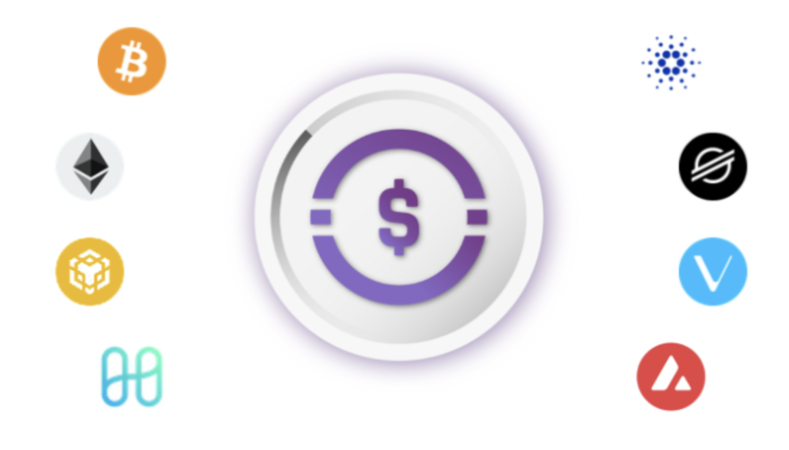
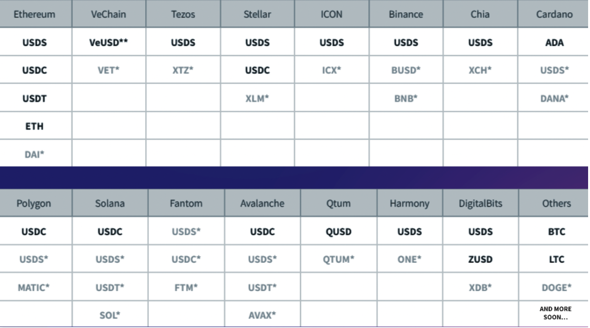
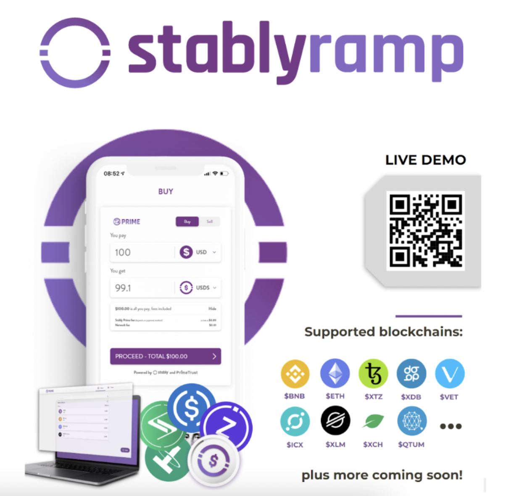

# Terra Stablecoin Infrastructure Proposal by Stably

- **Thread ID:** 6700
- **Author:** lachlan (`terra1md3a9adgyz2mny5j09fa4v963yhzmnw00cshf7`)
- **Created:** 2022-08-19T16:37:22.389Z
- **Last edited:** -
- **Stage:** discussion
- **Views:** 4332
- **Reactions:** 0
- **Comments:** 3
- **Source:** https://common.xyz/terra/discussion/6700-terra-stablecoin-infrastructure-proposal-by-stably

---

Dear Terra Community,

My name is Lachlan and I’m a Sales Engineer at Stably.

Our team has always been big supporters of the Terra Luna ecosystem, having partnered in the past and acknowledging the incredible community that drove it forward to become one of the most prominent blockchains projects out there. Despite the recent events that have transpired, we are still firm believers in both your mission and your community. We would like to help Terra rebuild trust in the ecosystem and prove that it was always the community that was your most valuable asset.

The first way we can help is through our **fully compliant stablecoin Stably USD (USDS). **USDS is a US Dollar stablecoin backed 1-to-1 by bank deposits held in a trust for the benefit of token holders by our **regulated trustee partner Prime Trust**, a Nevada state-chartered trust company and SEC-qualified custodian. Stably is a stablecoin technology provider to Prime Trust and we do not have access to the USD collateral. We also publish monthly attestation for USDS from Cohen & Company, an independent auditor who ensures that USDS is always fully collateralized. Additionally, **our fiat-to-stablecoin & crypto on/off ramps** provide fast and affordable access from TradFi to DeFi. This will increase Terra’s adoption by lowering user friction and increasing liquidity in turn.

All of this can be done **100% compliantly across 200+ supported countries**, creating trust and transparency while allowing almost anyone in the world to reap the benefits of a partnership between Stably and Terra. 

We are very excited at the prospect of working with the Terra community and we look forward to hearing from you soon 🤝

Below we’ll expand on all of the above.
** **
**About Stably:** Stably provides stablecoin and fiat on-ramp infrastructure for emerging blockchain networks and Web3 wallets/applications, including DeFi protocols, NFT marketplaces and metaverse projects. Our mission is to bridge the gap between traditional bank accounts and DeFi by enabling the next billion Web3 users and powering the top 1,000 blockchains during this decade.

Our flagship product, Stably Ramp, provides any Web3 user the ability to efficiently buy/sell stablecoins on any blockchain with traditional banking and card payment methods. Our stablecoin, Stably USD (USDS), is a USD-collateralized token as well as multichain stablecoin bridge that is integrated with 10+ emerging blockchain networks. Each USDS token is legally backed and redeemable for 1 USD held in trust accounts managed by our regulated trustee partners. Monthly attestations are also conducted by an independent auditor to ensure transparency and 1-to-1 reserve backing for USDS at all times.

**Our Solutions**

**1. [STABLY USD (USDS)](http://www.stably.io/usds/) — Multichain USD Stablecoin for Terra**

In addition to our USDS integration with large cap blockchain networks (e.g. Polygon, BNB Chain), Stably is expanding our USDS stablecoin to emerging blockchain networks as well (e.g. ICON, VeChain). By natively expanding USDS issuance/redemption onto Terra, users on your ecosystem will also be able to seamlessly transfer USD liquidity from other blockchains to Terra and vice versa. This will significantly enhance interoperability between the Terra blockchain and other ecosystems.
** **
**USDS Features:**

- **100% USD-Backed Stablecoin: **USDS is issued via Stably and [Prime Trust](https://www.primetrust.com/), our regulated trust company partner and SEC-qualified custodian. Every USDS token is fully backed 1:1 with USD funds held in bank accounts by Prime Trust for the benefit of token holders. Additionally, [Cohen & Co.](https://www.cohencpa.com/), an industry leader in stablecoin auditing, conducts monthly attestations for USDS across all blockchain networks it lives on to ensure 1:1 collateralization at all times. Please note that USDS can also be white-labeled under different names for some Stably clients. For example, USDS is white-labeled as “[VeUSD](https://vechainstats.com/veusd-stablecoin/)” for its VeChain expansion.

- **Automated Stablecoin Mint & Redeem:** Easy-to-use UI with zero fees and 24/7 minting support. Here are [video examples](https://www.youtube.com/watch?v=q4_BUQdE3OA&list=PLi-ZGwPAMvq7fU_xcZpUuwvDU0BUfwbln&index=4) on how to mint/redeem VeUSD on VeChain using Stably Prime.

- **Multichain Stablecoin Bridge:** Bridge liquidity from other chains to Terra securely and efficiently.

- **Example Flows: **
- **Redeem & Mint: **_Harmony USDS_ → REDEEM → _USD_ → MINT → _**Terra USDS **_
- **Redeem & Buy:** _Tezos USDS_ → REDEEM  → _USD _ → BUY → **LUNA**
- **Sell & Mint:** _BTC_ → SELL  → _USD _ → MINT → _**TERRA USDS**_

- **10+ Supported Blockchains:** Ethereum, Binance Chain, VeChain, ICON, Tezos, Stellar, Chia Network, QTUM, Harmony, and DigitalBits (more coming soon).

**2. [STABLY RAMP](http://stably.io/ramp) — Crypto & Stablecoin Fiat Ramp Widget**

Stably Ramp is a multichain crypto and stablecoin fiat on-ramp widget powered by Stably and our US-regulated partner Prime Trust, an SEC-qualified digital asset custodian and funds processor. Our widget allows users to buy/sell tokens efficiently at competitive rates directly from any Web3 applications that integrate Stably Ramp.

- **Payment Methods (USD): **Fedwire, SWIFT, ACH, credit/debit cards, crypto/stablecoins.

- **Plug & Play Widget: **Direct integration with Terra dApps and wallets with intuitive UI/UX.

- **Global Onboarding:** KYC/AML onboarding support for 200+ countries (for both individuals & entities).

- **Multichain Assets: **10+ stablecoins and 20+ cryptocurrencies across 20+ blockchains (for a full list of supported assets/chains, click [here](https://drive.google.com/file/d/1_aUgZT_q-75HurrkvGmpOORims64xWkY/view?usp=drivesdk)).

- **Competitive Rates: **Better fiat on-ramp rates vs. other providers (e.g. Simplex, MoonPay, Transak).

*Coming soon.
**VeUSD = White-labeled USDS on VeChain

**3. [STABLY PRIME](http://stably.io/stably-prime) — Terra USDS Listing**

An account-based UI version of Stably Ramp that also supports USD, cryptocurrency and stablecoin custody.

- **US Dollar Custody: **USD funds are held by Prime Trust, a regulated trust company and SEC-qualified custodian, in US-based bank accounts for the benefit of Stably Prime users. Holding USD in Stably Prime is just like in any other US banking accounts. Additionally, we support both first-party and third-party deposit/disbursements.

- **Crypto Custody: **Cryptocurrencies are held in cold storage via Prime Trust’s custodial wallets (powered by Fireblocks) for the benefit of Stably Prime users. Support for Terra assets in Stably Prime is possible if those assets are already listed by Fireblocks.

- **P2P Transfer & Settlement (24/7): **Users may settle funds and digital assets with each other 24/7 internally within Stably Prime instantly.

**4. [STABLY BRIDGE](http://stably.io/stably-prime) — Cross-Chain Custodial Token Bridge **

Not only can Stably provide a multichain bridge via USDS, our stablecoin technology and infrastructure also allow us to create a cross-chain token bridge powered by Prime Trust. As a result, Stably can help Terra users bridge major digital assets, such as BTC and ETH (and potentially more), from their native blockchains to Terra as wrapped tokens (similar to Bitgo’s WBTC). 

- **100% Crypto-Backed Tokens: **Wrapped tokens are issued via Stably and [Prime Trust](https://www.primetrust.com/), our regulated trust company partner and SEC-qualified custodian. Every wrapped token is fully backed 1:1 with the native digital asset held in cold storage by Prime Trust for the benefit of token holders. Additionally, [Cohen & Co.](https://www.cohencpa.com/), an industry leader in stablecoin auditing, shall conduct monthly attestations for Stably’s wrapped tokens across all blockchain networks they live on to ensure 1:1 collateralization at all times. 

- **Automated Wrapped Token Mint & Redeem: **Easy-to-use UI with zero fees and 24/7 minting support. 

- **Cross-Chain Token Bridge:** Wrap tokens from their native chains to Tera securely and efficiently.
- **Example Flows: **
- **Mint**: _BTC_ →  DEPOSIT → MINT  → _Terra BTCS_
- **Redeem**: _Terra BTCS_ → BURN → WITHDRAW → _BTC_

**Deliverables & Pricing**

Please note that the below are customizable. For example, Stably could expand $USDS onto Terra (which would also include free listing of assets on Stably Ramp & Stably Prime) but it would not require other services such as cross-chain token bridging. If this is submitted for a vote, we could only include items of interest.

Additionally, it’s worth noting that Stably is flexible and open to a mutually beneficial discussion in regards to payment schedules between both organizations. 

**1. Native USDS stablecoin expansion onto Terra and listing Terra USDS on Stably Ramp and Prime:**
- **Milestone 1: **project kickoff → $100,000 
- **Milestone 2: **deployment of $USDS on Terra and listing of Terra USDS on Stably Ramp and Prime → $100,000 

**Total: **$200,000 worth of $LUNA tokens
**Timeline: **1-2 months

**2. Listing Assets on Stably Prime + Stably Ramp:**
- **$USDS (Terra) --> **Free
- **$BTCS (Terra) --> **Free
- **$ETHS (Terra) --> **Free
- **$LUNA (Terra) --> **$50,000
- **Additional assets, per token --> **$50,000

**3, Cross-Chain Custodial Bridges**
- **BTC (Bitcoin) to BTCS (LUNA)** --> $150,000
- **ETH (Ethereum) to ETHS (LUNA) **--> $150,000
- **Other bridged assets, per token** --> $100,000

**Justification**

- In order for the Terra blockchain ecosystem to grow larger, more efficient fiat-to-stablecoin ramps are needed.
- Stably has a proven track-record on delivering such integrations based on our past works with Harmony, Tezos, Stellar, VeChain, ICON, etc. We estimate this project will take less than 2 months to complete.
- While there are other fiat on-ramp solutions today on the market, Stably is a much better choice because we differentiate by:
- Focusing on stablecoins
- Providing superior stablecoin rates
- Providing a multichain stablecoin bridge to other emerging blockchain ecosystem
- Accepting more than just card payments (e.g. Wire, ACH)
- Supporting institutional/business users
- Supporting KYC for 200+ countries
- By directly collaborating with Terraform Labs and community, Stably aims to establish itself as the premier fiat-to-stablecoin & crypto on/off-ramp for the Terra ecosystem 
- An additional potential future collaboration includes listing LUNA on Stably Ramp and Prime (Fireblocks support required).

**Metrics for Success**

- Stably fiat on/off-ramping volume for Terra USDS (can be broken down by addresses and dApps)
- New Stably users interacting with the Terra ecosystem
- Terra USDS market capitalization
- Custodial cross-chain bridging volume

**Concluding Remarks**
We are really excited at the possibility of working with the Terra community to develop the products and services outlined above. We truly think that they will enable the Terra ecosystem to scale safely and securely, and to become interoperable with other blockchains through both multichain and cross-chain bridging.

We look forward to feedback from the community and look forward to addressing any questions or concerns.

**External links: [https://linktr.ee/stably](https://linktr.ee/stably)**

---

## Comments (3)

**codeNoodle (`terra1hmrmqf2aszlnzdgz2crxr3d9vw6t6k68dxmjw2`)** — 2022-08-31T23:08:30.051Z (edited 2022-08-31T23:37:50.265Z)

Hi [@lachlan](/terra/account/terra1md3a9adgyz2mny5j09fa4v963yhzmnw00cshf7)!

Has Stably previously proposed a governance poll requesting funding on any of the other chains mentioned above? My guess is that either I was simply unable to find any record, they were agreements made by centralized entities representing those chains' interests rather than voted on, or there were no costs involved in launching on those chains.

Would you mind going into a bit more detail of the finances and why this would cost Terra $200k in order to be implemented? For example, I noticed that the "project kickoff" accounts for $100k, but I have no idea what that means and why it would require so much.

Also, it appears StablyRamp is in Early Access. How much longer is it planned to be in this status, as I think it could deter regular users?

> **lachlan (`terra1md3a9adgyz2mny5j09fa4v963yhzmnw00cshf7`)** — 2022-09-06T19:36:51.653Z — 👍 1
> 
> Hi codeNoodle,
> 
> We recently created 2 similar proposals for [Harmony](https://talk.harmony.one/t/harmony-stablecoin-infrastructure-proposal-by-stably/18559) (approved) and [Evmos](https://commonwealth.im/evmos/discussion/6688-preproposal-evmos-stablecoin-infrastructure-proposal-by-stably) (pending). To date, we have natively issued stablecoins across 10+ blockchains through development grants or similar commercial agreements. The only blockchain we integrated without any grant was Ethereum when we founded Stably back in 2018.
> 
> We provide our Stablecoin-as-a-Service solution to emerging blockchain ecosystems in exchange for an initial grant to justify our costs of launching/operating USDS in a regulatory-compliant manner as well as providing ongoing support to their users.
> 
> Stably is a blockchain and financial technology service provider registered in Delaware (File No. 7223458). We are also a FinCEN-registered MSB and financial institution through our wholly-owned subsidiary (Registration No. 31000219855769).
> 
> Our team consists of 30+ members, including engineering, operation, support, and compliance personnel. One engineer for our Seattle office alone could cost [over $200k annually](https://apply.workable.com/stably/j/151EE5749B/). Operating our stablecoin on a new blockchain securely and efficiently often involves several team members across different departments, not just one engineer. We also have to account for potential costs from emerging blockchain risks (as opposed to building on an established chain like Ethereum).
> 
> As for Stably Ramp, it will be launching officially toward the end of this month. Developing USDS on Terra could take up to 2 months anyway.I hope this helps! Feel free to let me know if you have other questions.
> 
> ~Lachlan

> > **codeNoodle (`terra1hmrmqf2aszlnzdgz2crxr3d9vw6t6k68dxmjw2`)** — 2022-09-10T16:19:56.195Z
> > 
> > Thanks for the additional info Lachlan. I hope the Stably Ramp launch goes smoothly as well!

