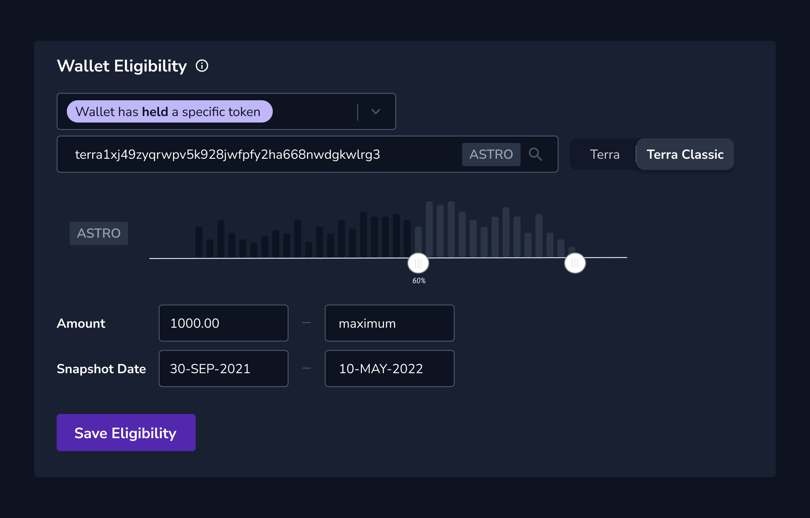
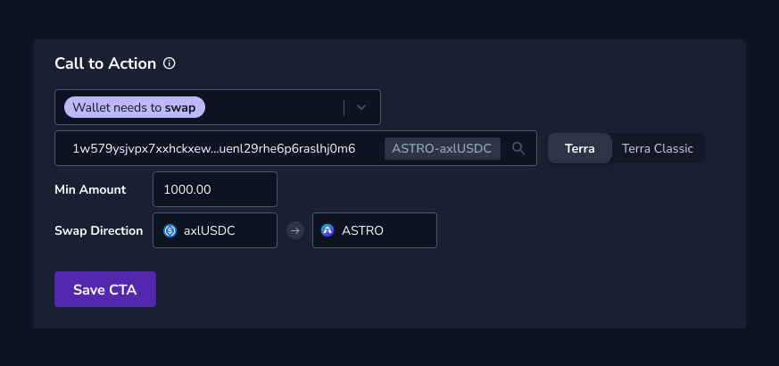
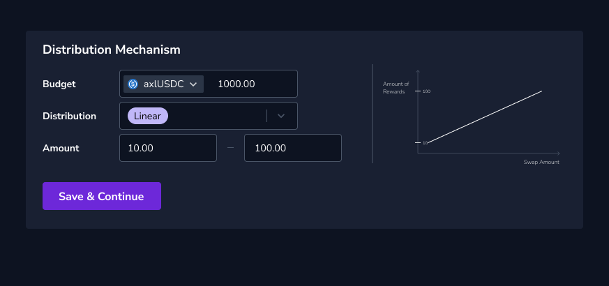
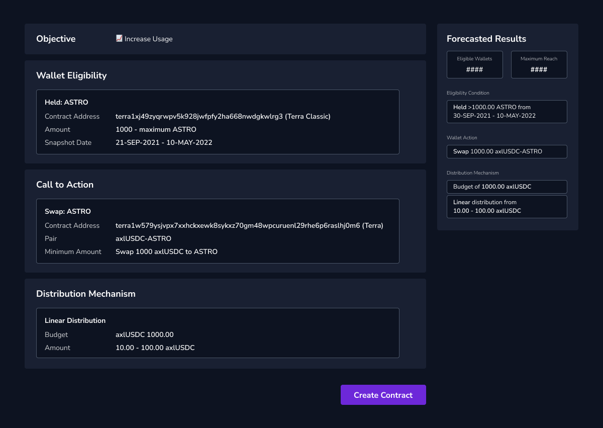
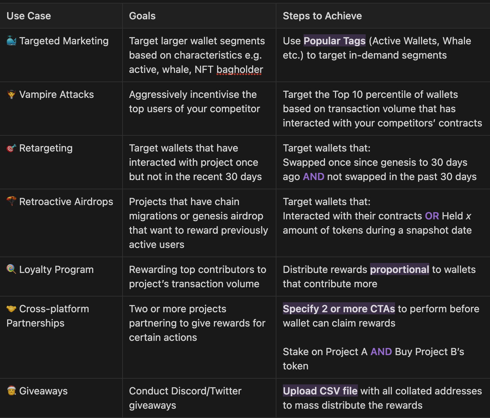

# 🧞 Genie: Rewards Distribution Platform Community Grant by Coinhall

- **Thread ID:** 7144
- **Author:** Coinhall (`terra1ge3vqn6cjkk2xkfwpg5ussjwxvahs2f6aytr5j`)
- **Created:** 2022-10-04T05:55:36.596Z
- **Last edited:** -
- **Stage:** discussion
- **Views:** 2709
- **Reactions:** 0
- **Comments:** 3
- **Source:** https://common.xyz/terra/discussion/7144-genie-rewards-distribution-platform-community-grant-by-coinhall

---

## Overview - Problem Statement

In Web2, businesses execute targeted marketing strategies via platforms like Google and Facebook that have user data and this results in a more cost-efficient Customer Acquisition Cost (CAC) as the targeted users have a higher propensity to purchase based on their profile. 

Current Web3 projects distribute rewards inefficiently as they haven’t been able to effectively profile ideal users and stakeholders. Projects adopt on-chain strategies (e.g liquidity mining) and off-chain ones (i.e Gleam campaigns or Discord engagement farming) to determine their ‘Active’ or ‘Ideal’ user. However, these are subjected to Sybil attacks, bots, dumpers, etc. Capital and effort are wasted when rewards fall into the hands of users that do not benefit the community. 

The missing factor here is accounting for **onchain wallet behaviour**, allowing projects to efficiently profile and incentivise users.

The good news is, while Web2 user data is controlled by a few centralised parties, Web3 wallet data is objective, permissionless, and easily accessible via the blockchain. Unfortunately, most projects have yet to do so as existing data platforms require SQL expertise, and are hence unfriendly to marketing/community managers folks who are typically the ones trying to engage their community.

## Solution

Enter _Genie_ by Coinhall, a **rewards distribution platform** that allows projects to meaningfully group wallets based on desirable wallet behaviour, and then incentivise them through rewards. 

Our implementation will consist of 2 parts
- Rewards **Protocol, t**he underlying, claim-based smart contract (backend)
- No-code **Web Application** to create the rewards contract and campaign in a permissionless manner (frontend)

There are 3 components to be determined when creating each rewards contract: 
- **Wallet Eligibility (WE):** Criteria that the wallet must meet to be considered eligible. E.g. _Collectors of_ _Galactic Punks on Terra Classic_ / _Held 1,000 $ASTRO before depeg, Deposited 100,000 $USTC on Anchor_ 

- **Call-to-action (CTA):** On-chain actions such as _deposit, swap, provide liquidity _can be set by projects before wallets can claim the rewards 

- **Distribution Mechanism (DM):** Beyond flat rewards distribution, projects have the flexibility to adopt different reward mechanisms. E.g. Reward distributed linearly with targeted CTA. _The more you swap, the more rewards you are eligible to claim _

## 
The experience will be as simple as making a wish to a Genie: 
> “I wish to target the Top 10 percentile of Astroport wallets based on their historic transaction volume (WE), if they swap >$1,000 worth on my DEX in the next 7 days (CTA), I want to reward them linearly on a pro-rata basis with a $100 reward cap (DM)”

## 
With these 3 components, projects can customise parameters to achieve their goals. Some _possible_ use cases are:
- 🐳 Targeted Marketing
- 🧛 Vampire Attacks
- 🪂 Retroactive Airdrops
- 🎯 Retargeting inactive users
- 🍭 Loyalty Program
- 🤝 Cross-platform Partnerships
- 🎅 Giveaways

## Benefits to the Terra Community

- (Ecosystem) Stronger incentive alignment mechanisms, increased market efficiency through competition
- (Projects) Lower customer acquisition cost (CAC), more efficient spending to incentivise wallets that will likely exhibit more favourable behaviour
- (Projects) Track and optimise the performance of your marketing spend
- (Users) Get rewarded for your loyalty and wallet behaviour 

## Grant Proposal & Timeline

We are asking for **50,000 LUNA**.

- 40,000 LUNA (80%) of the grant go towards manpower costs required to build up the required data pipelines and development for frontend, backend, and smart contract until Genie v1.0 is completed (Dec 2022)
- 10,000 LUNA (20%) will be used to fund server costs of running full nodes to ensure that the data is presented in real-time for at least a year
- *_Part of the costs has already been spent since the genesis of the idea_

The following address will be used as the recipient reflected on the on-chain community pool spend proposal: **terra18stcc5du0rvzps4069vkhrf92tf9jtq29w38pg **

**Timeline**
- [x] July 2022: R&D
- [x] Aug 2022: Architected the requirements
- [ ] Sep-Oct 2022: Building data pipelines and backend and designing UIUX
- [ ] Oct-Nov 2022: Building smart contract and developing frontend
- [ ] Nov-Dec 2022: ✨ Launch beta testing with selected projects and users
- [ ] Dec’22 / Jan’23: 🌔 Launch Genie v1.0 🧞 for public use
- [ ] 2023: Accommodate cross-chain campaigns

## FAQs
_Why a claim-based contract and not a direct send transaction to the targeted wallets?_
- We want to prevent bad actors from leveraging the platform to easily spam or send malicious tokens to a large number of wallets as this might create a lot of unnecessary noise
- Claim based means that users will always make a conscious decision whether to claim a reward from a campaign that they qualify for, evaluating their own risk/return

_Will it be that only whales benefit from distributions?_
- Not at all. Projects would want to attract active, committed users and your wallet behaviour would objectively reflect that

_How do we know it’s safe to use this platform?_
- We will utilise our verification system so that a campaign that claims it is distributing axlUSDC will indeed only allow for claiming of said token
- We will hold no custody of the funds or tokens so only the creator of the contract holds the private keys to the contract
- To prevent projects from prematurely ending the campaign and withdrawing the rewards, a multi-sig will be required before they can withdraw the remaining rewards
- Projects will have to tie their Twitter account to their wallet before a campaign can be published

_How do you prevent Sybil attacks on the campaign?_
- We plan to include more parameters such as querying wallet-age. There is sufficient flexibility for the projects to set up campaigns with wallet eligibility AND call-to-action which significantly mitigates this 

_How different are you from other Campaign-type of platforms?_
- Most platforms currently do not accommodate arbitrary querying of historic wallet behaviour and only rely on a call-to-action

_How sustainable is this platform?_
- We will offer a forever-free tier as a public good for projects / creators to leverage while commercialising with premium paid plans for enterprise users with more complicated needs

_Are you open-sourced?_
- Our rewards distribution smart contract will be open-sourced

## **About Coinhall**

Coinhall ([coinhall.org](http://coinhall.org)) is the unified data and trading hub for Cosmos, currently deployed on Terra, Osmosis, Juno, and Kujira. Users can access realtime price charts and LP Analytics. We are also an active community validator, deeply involving ourselves in the growth of the ecosystems, providing [ecosystem guides](https://www.notion.so/Public-Resources-e00674b99f3d48379437978ccebfb5b8) and taking part in AMAs with community leaders.

Key highlights:
- Monthly Active users peaked at 120k prior to UST depeg
- Hallswap transaction volume: US$1,886,408,122
- Pioneered Stake-to-subscribe model where users can stake to our validator which then becomes their subscription for Coinhall products

Telegram: [https://t.me/coinhall_org](https://t.me/coinhall_org)
Medium: [https://medium.com/@Coinhall](https://medium.com/@Coinhall)
Twitter: [https://twitter.com/coinhall_org](https://twitter.com/coinhall_org)
LinkedIn: [https://www.linkedin.com/company/coinhall](https://www.linkedin.com/company/coinhall)

---

## Comments (3)

**Anonymous (`terra17uncwru68z3n0kl543r6rdd5q9jpvwxdxvfe66`)** — 2022-10-04T13:23:48.468Z

Thanks for the proposal, Coinhall. I have a few questions: 

1. Will there be an audit for the Smart Contracts?
2. Could you clarify on "To prevent projects from prematurely ending the campaign and withdrawing the rewards, a multi-sig will be required before they can withdraw the remaining rewards", who will be part of this multi-sig? Should the multi-sig be managed by a few team members, the campaign can still be pre-maturely ended.

> **Coinhall (`terra1ge3vqn6cjkk2xkfwpg5ussjwxvahs2f6aytr5j`)** — 2022-10-05T13:13:47.905Z
> 
> Hey Max! Thanks for your questions. 
> 
> _Will there be an audit for the Smart Contracts?_
> - Yes, we will get the reward smart contract audited
> 
> 
> _Could you clarify on "To prevent projects from prematurely ending the campaign and withdrawing the rewards, a multi-sig will be required before they can withdraw the remaining rewards", who will be part of this multi-sig? Should the multi-sig be managed by a few team members, the campaign can still be pre-maturely ended._
> - The current multi-sig design involves 2 parties - the project and the Genie admin wallet. The rationale is to protect end users from a situation whereby a project announces a generous campaign for $1M in rewards but ends up withdrawing the entire amount after farming social media engagement
> 
> 
> Hope this helps to clarify!

**Coinhall (`terra1ge3vqn6cjkk2xkfwpg5ussjwxvahs2f6aytr5j`)** — 2022-10-05T13:12:40.710Z (edited 2022-10-06T08:57:40.963Z)

Dear Terra community, we’re grateful for the feedback so far and are happy to share additional info and responses to some of your questions:

_Quick background about the team behind Genie for those unfamiliar with us_

- Genie is built by Coinhall, a 12 people team headquartered in Singapore, consisting of 8 engineers.
- The Coinhall platform currently consists of the following components (with differing progress of features across chains):
- (i) Data indexers to parse raw onchain data into analytics
- (ii) Realtime charts and transaction table via our UI
- (iii) Alerts: Telegram bot which pushes recurring price alerts and notifications for newly created liquidity pairs on supported DEXes
- (iv) Stake2Sub which requires wallet connections and coordinating our frontend + backend to support a fully web3 native subscription system
- (v) Hallswap - DEX Aggregator
- (vi) Validators

- Prior to the depeg, our entire data/trading platform was modelled solely for Terra Classic. To allow our users to access all the features across multiple chains (including Terra, and other Cosmos chains), it has taken months to progressively rebuild Components (i) to (v) 
- We’re now building Genie, our new rewards distribution platform, and are in parallel working on Hallswap v3 for Terra 

_Why should the community fund 50k LUNA for Coinhall to build Genie?_

- Genie is an entirely new product that we are building, birthed to tackle the following problems: (a) specific parsed data is not easy to obtain (projects were asking us for data of their own protocols) (b) reward distribution is suboptimal as a result of this
- Genie does not define what is ‘good’ or ‘bad’ wallet behavior, our platform allows projects to look at the past behaviour of wallets, and adjust their own parameters to incentivise selected segments
- This could mean that any protocol can leverage Genie to incentivise users in an easy way
- Genie is requesting funding as it is not an easy problem to tackle and heavy engineering resources will be invested to develop this idea which can then be assessed permissionlessly by any Terra user

_Didn’t the team behind Genie receive an emergency allocation of 125k LUNA, shouldn’t that be more than enough?_

- During the USTC depeg, we lost >US$400k which consisted of our capital plus past revenue from ads, Hallswap and our Terra Classic validator
- 93,748/125,000 LUNA have been unlocked from the emergency allocation which has been used to fund the team’s operations. As of LUNA’s price on 5 Oct 2022, that would amount ~ $234k. This amount plugged some gaps and allowed us to continue funding the team but Genie is a new ambitious product outside of Coinhall’s current offerings that would require us to devote more resources build and subsequently maintain

_Can the team use Coinhall's Terra validator revenue to fund development instead? _

- Currently, our Terra validator generates about 4,000+ LUNA monthly - Conservatively, this is about US$10k revenue before factoring manpower and infra costs, and insufficient to fund our operations

_Will Genie be cross-chain?_

- The MVP is targeted for Q4 with support for Terra 2 for the rewards contract and both Terra Classic & Terra for the historic wallet data. We do aim to support more chains outside of Terra eventually so that it will be a robust platform for incentivising users and distributing cross-chain rewards

