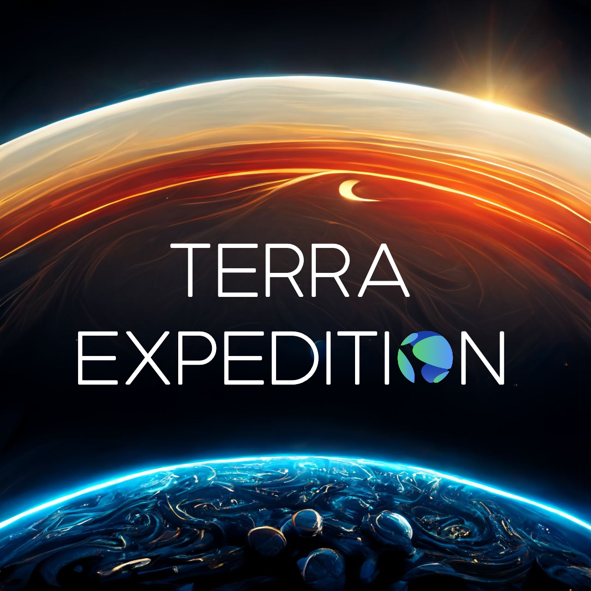
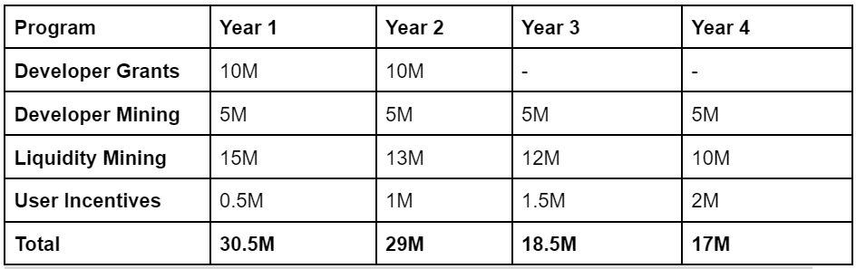
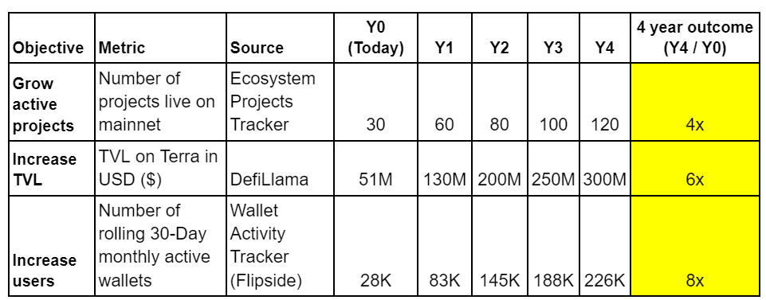
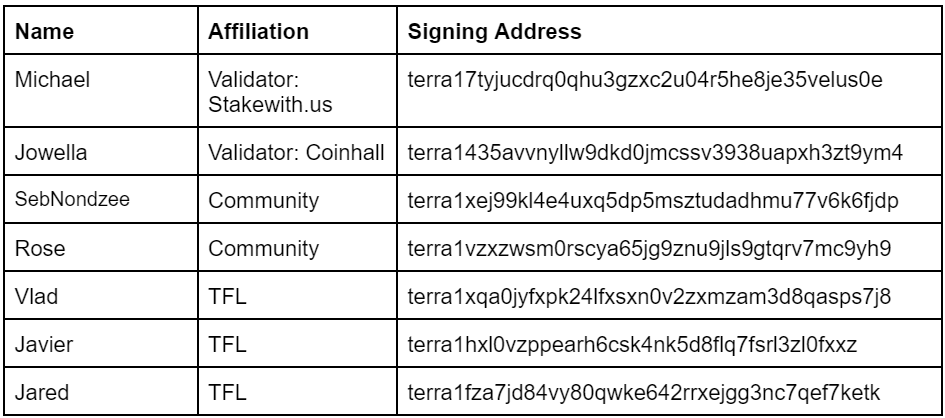

# Terra Expedition | An Ecosystem Expansion Program

- **Thread ID:** 7257
- **Author:** Somethingelse (`terra1scku27w5rsg4392zcaf2y9gnrh0w62t578ez7p`)
- **Collaborators:** mc_ust
- **Created:** 2022-10-17T15:46:37.136Z
- **Last edited:** -
- **Stage:** discussion
- **Views:** 20153
- **Reactions:** 6
- **Comments:** 31
- **Source:** https://common.xyz/terra/discussion/7257-terra-expedition-an-ecosystem-expansion-program

---

**Terra Expedition | An Ecosystem Expansion Program**

Summary: The Terra Expedition is a revised iteration of the Developer Mining Program and Developer Alignment Program initially defined at the launch of the Terra blockchain. The original proposal suggested that 9.5% of the total LUNA supply be distributed based on TVL, but given the current state of the Terra ecosystem, TVL-based allocation would mainly benefit a few protocols and would not have the intended effect of kick-starting the Terra ecosystem. This revised proposal aims to better align incentives across the ecosystem and focus on attracting developers, onboarding users, and promoting deep liquidity. 

**Recap of Original Proposal**

Essential app developers committing to launch on Terra will receive:

1. [_In process of distribution_] **Emergency allocation **(0.5% of total supply): immediately after network launch to provide for runway while they build out product. Commit to returning funds if product has not been launched in 1 year. 
2. **Developer Alignment Program** (1.5% of total supply): Protocol teams that were live in Terra Classic divide this allocation weighted by the last 30 day TVL from Pre-attack snapshot - 1 year cliff, 3 year vesting thereafter. Accommodations will be made for apps where TVL is not applicable.
3. **Developer Mining Program** (8% of total supply): Essential app developers earn a share of the mining program proceeds pro-rata to the amount of TVL every quarter for 4 years.

**Issues with the Original Proposal**

**The Developer Alignment Program (1.5% of total supply)**

- The value that Protocols bring to the Ecosystem should not be judged solely by one metric (TVL). 
- Weighing the distribution by TVL will not accurately reflect the value these dApps brought to the ecosystem and will weigh heavily in favor of DEXes that launched on Terra Classic who may not currently be actively contributing to Terra mainnet. 
- For example, on Terraswap, the value of mAssets would count towards TVL, but this is actually being double-counted because the value of mAssets are derived from assets held in Mirror Protocol CDPs. Current grant allocation methods are inefficient as teams can receive funding without demonstrating value 
- As the emergency allocation program is nearing an end, it has become clear that projects will “_signal commitment_” to building on Terra to receive funding, but there are those that will deliver the bare minimum or not deliver at all because this does not affect the funding they ultimately receive.

**The Developer Mining Program (8% of total supply)**

- The Developer Mining program on the original proposal aims to incentivize projects to ship on Terra and compete for TVL. However, in order for this to be effective, there needs to be a strong underlying ecosystem of projects willing to compete. In the Terra ecosystem’s current state, there are only a handful of projects with TVL, and most of this is concentrated within the top 2 protocols.
- As reported in [DefiLlama](https://defillama.com/chain/Terra2), Astroport and Risk Harbor currently hold a majority of the total TVL on-chain. Proceeding with these incentives in the earlier proposed format would result in these protocols receiving more in value from the rewards than the actual TVL within these protocols - this is an extremely inefficient distribution of incentives.
- The current structure of the developer mining program is neither effective in attracting developers or supporting development on Terra, as it positions TVL as the single metric used to measure value. This limits the scope of what projects may want to build on Terra and disproportionately favors DEXes (or other TVL-heavy DeFi protocols).

**Revised Proposal - Terra Expedition**

****

The **Terra Expedition** is a 4-year program aimed at growing the Terra ecosystem through a series of initiatives with 3 main objectives, namely: 

**A) Incentivising developers to build on Terra**

**B) Deepening liquidity on Terra**

**C) Onboarding users to Terra**
** **
This program will be funded with the 9.5% of the total LUNA supply that was earmarked at the launch of the new Terra chain. This incentive program will run for 4 years and will be managed by a community-elected committee that will be evaluated every 12 months.

**Terra Expedition** will consist of the following 4 programs:

**1. Developer Grants Program | 20 million LUNA**

1. Targeted bounty program that aims to incentivize essential app development on Terra to be paid upon successful audit and project launch on mainnet. The payout from this bounty program will be subjected to vesting terms. Some examples include:
- Lending market
- DEX with bribes/flywheel tokenomics
- Leverage yield farming 
- CDP stablecoin
- Financial derivatives protocol 
2. Smart contract audit reimbursements
- To reimburse audits up to $40,000 for projects launched on mainnet. Projects must request at least two quotes from two different auditing partners to be eligible for the grant.
3. Grants for public goods, ecosystem initiatives and other special programs 
- Grants that will fund public good infrastructure and services.
- Ecosystem initiatives such as tutorials, workshops, etc.
- Other special initiatives such as marketing, hackathons, etc.  

Note: Participants who received LUNA from the Emergency allocation and have yet to deliver their product will have their bounty payout reduced accordingly.

**2. Developer Mining Program | 20 million LUNA **

This program will directly incentivize developers building on Terra. Any essential project which has launched an app on Terra mainnet will qualify for these incentives. These incentives will be distributed on a quarterly basis. Projects that are still eligible for vesting from the Emergency allocation will be excluded from consideration for this program.

- Capped distribution per project per year will be 125,000 LUNA - Max capacity of 40 projects assuming full distribution.
- In order to qualify for this distribution, teams must commit to actively developing their project and providing quarterly milestones that the committee will review and approve on a per-project basis. Prior to each distribution, the committee will review the project's milestones.

Terra Expedition committee members will use the following three criteria as a guide to determine the LUNA allocation for each project.

- **Open-Source:  **Whether the source code for the dApp is made freely available to the community for possible modification and redistribution.

- **Value-add to the Terra ecosystem: **Determined by the committee. The committee will rate each project’s value-add and determine the portion of this distribution factor a project shall receive.
- This qualifier will consider many factors, such as if the dApp has a strong product market fit in the Terra ecosystem, whether it is unique, if it has the potential to garner a strong user base, and if it creates value through attracting users,TVL, and activity to the chain. 
- **QoQ Growth (KPI determined by type of project)**: Verifiable data to be provided by the developer/project.

*The committee reserves the right to update these qualifiers as it deems appropriate.

**3. Liquidity Mining Incentive Program | 50 million LUNA distributed over 4 years **

Objectives:

- Incentivize DEX and money market liquidity
- Incentivize stablecoin liquidity on Terra
- Work with DEXes on Terra to attract liquidity and drive organic volume/activity. 
- Incentivize liquidity for different stablecoins (USDT, USDC) from multiple bridges 
- Incentivize Terra native stablecoin liquidity, CDP stablecoins, and stablecoins issued natively.
- Encourage arbitrage by incentivizing stablecoin-stablecoin pairs, as well as stablecoin-LUNA pairs. This should create volume between stablecoin-stablecoin pairs as a result of arbitrageurs trading the LUNA-stablecoin pairs.

The committee will collaborate with DEXes and lending markets in the Terra ecosystem who can support external pool incentives. 

**4. User Incentive Program | 5 million LUNA**

An incentive program aimed at increasing end-user adoption on Terra. This program will be more experimental and open to new ideas. Some examples of possible initiatives include:

- **Terra Expedition Moonwalkers: Evolving NFTs**
- Shortlisted group of dApps for users to engage with.
- Provide users with an NFT that evolves with constant engagement over the full duration of the incentive program. Users that complete all actions within the duration of the program will receive a fully-evolved NFT.
- **Bridge Incentives**
- As an example, offer small incentives for users bridging in tokens, each time a user bridges assets into Terra.
- This incentive program may also be expanded to on-ramps pending partnerships.

**Funding Schedule **

_Note: Subject to change based on the price of LUNA as the committee requests for funding each year_

**Goals of the _Terra Expedition_**

The Terra Expedition program aims to expand and strengthen the Terra ecosystem in a few key areas. The table below outlines conservative goals which the committee will strive to achieve. The committee will provide regular updates on its progress in meeting these goals.

Links to sources:
- [Ecosystem Projects Tracker](https://www.terra.money/ecosystem) (Excluding Bridges)
- [DefiLlama | Terra](https://defillama.com/chain/Terra2)
- [Wallet Activity Tracker | Flipside](https://terra.sc/ecosystemdashboard)

**Committee Oversight**

Given the requirements of indexing, processing, and assessing individual protocol impact and user activity for the 4 incentive programs above, we move to propose that the** _Terra Expedition_ **program will be staffed by a 7-person committee consisting of:
 
1. [GJ Flannery](https://twitter.com/GJFlannery19) (Flipside | Community)
2. Something Else (Community)
3. [Rebel Defi](https://twitter.com/rebel_defi) (Orbital Command | Validator)
4. [The Babylonians](https://twitter.com/The_Babylonians) (Ex-Research @ Coinbase & Huobi | Analytics)
5. [MC](https://twitter.com/mc_ust) (TFL)
6. [Papi](https://twitter.com/CryptoKnight944) (TFL)
7. [Tero0x](https://twitter.com/tero0x) (TFL)

The responsibilities of the committee include:

- Identifying gaps in the Terra ecosystem to propose dApp bounties for
- Evaluating submissions from project teams in consideration for grants, bounties, and other incentives 
- Determining the types of assets that the Terra ecosystem requires liquidity for
- Assessing the suitability of incentive distribution across assets 
- Evaluating the effectiveness of incentive programs and proposing changes to existing, or new, programs when necessary

Committee members will be expected to commit at least 10 hours per week to attend committee meetings, engage with the community and projects, perform data analytics, etc. 

All committee members, except for those within TFL, will receive a monthly compensation of 1,000 LUNA. This will be provisioned in the budget for grants for public goods.

To prevent any conflict of interest, all committee members are required to declare if they have any affiliations with projects who stand to receive any incentives from these programs. Where a conflict of interest exists, these committee members will recuse themselves from the evaluation of these protocols. 

**Accountability and Transparency**

Upon the passing of this proposal, the committee will be appointed for 1 year. This time period is proposed to ensure continuity of relationships and processes among stakeholders (community, projects, committee). To ensure committee members are held accountable, an on-chain governance vote (text proposal) will occur every 12 months to renew or revise committee composition. 

All actions performed by the committee will be communicated transparently, and any fund disbursements will be voted on by the committee. The results of these votes will be made public to the community through regular updates on Agora. The committee will prepare a monthly summary of decisions taken and funds disbursed.

The committee requests for discretion in the allocation of funds within the programs to allow for optimization of LUNA deployment as we assess program effectiveness over time. This is especially the case for the Developer Grants program as we would like to protect the interests of projects who may be building new solutions/dApps and may not want to disclose their model until it is ready for mainnet deployment.

**Treasury Management (5/7 Multisig)**

The multisig will be managed by a separate group that will act on behalf of the community and committee. The multisig will be staffed by 7 trusted members of the community. This will include 2 validators, 2 community members, and 3 members of TFL. The multisig members of the treasury will only execute transactions at the direction of the _Terra Expedition_ committee.

The address of the Treasury Management’s multisig that will be used as the recipient reflected on the on-chain community pool spend proposal: 

**terra1chj36sy5j4p0pu4qudurrckx73qfm6udk5a2apx7lcrdsc0nelxs87zr4f**

The 5 out of 7 multisig will consist of the following members:

**Community Pool Funding Proposal & Timeline**

We will be requesting funding from the community pool in yearly tranches. Based on our projections, we will need** 30.5M LUNA **in the first year. This requested amount will be reflected on the upcoming on-chain proposal. The committee will then request for the remaining funds on an annual basis based on the funding schedule outlined above. 

Upon the passing of the on-chain Community Pool Spend proposal, funds will be transferred to the treasury multisig address as reflected above, i.e. **terra1chj36sy5j4p0pu4qudurrckx73qfm6udk5a2apx7lcrdsc0nelxs87zr4f**

Please provide any thoughts or feedback in the comments below.

---

## Comments (31)

**Rose | Phoenix Foundation (`terra1vzxzwsm0rscya65jg9znu9jls9gtqrv7mc9yh9`)** — 2022-10-18T01:34:53.446Z — 👍 2

Keen to hear the community's thoughts on this! It feels like a step in the right direction moving away from TVL-based grants. Good to entice more developers to come build on Terra.

**Anonymous (`terra1alxk3fmhcl0ga80gl9yj9zp3ezjm4sdh8a9l9c`)** — 2022-10-18T20:11:46.565Z — 👍 4

This is a great proposal.

The previous one was too focused on TVL and the builders.
I really like that we will actively incentivize getting users on and using Terra.

It allows for flexibility to submit and discuss proposals with the committee that benefit the general community by grants for dev, infra, protocol quality and audits. And also incentivize specific missing apps.

It allows devs to focus on building protocols and not each writing their own governance proposal and fighting for TVL.

It allows onboarding users on Terra and start growing the community again.

> **Anonymous (`terra1alxk3fmhcl0ga80gl9yj9zp3ezjm4sdh8a9l9c`)** — 2022-10-28T15:02:19.457Z
> 
> Okay, after seeing many discussions in the TG, let's try to tackle them in a productive way.
> 
> So let's attack each point of the proposal and try to find solutions / improvements.
> Let's brainstorm together, and everyone calling out a problem, should also try to formulate a possible solution or idea.
> 
> Short background on my opinion:
> 
> I'm a senior dev / architect / lead / PO and coming with a trad-fi background in banking.
> I'm no business developer or having experience in the growth of a 1 B$ blockchain project.
> 
> The TVL version was money wise great for teams focusing on TVL, and for us in Eris our goal was to get a 10% TVL share of the pie, so the goalpost was quite high. But there are a lot of projects that do not have a TVL and it would mean we would loose good teams building on Terra.
> 
> So while we had a bigger goal and reward possibility in the previous proposal, it incentivizes the wrong thing. It is not only about TVL, but about network + ecosystem + user growth and instead of teams fighting for TVL the focus should be more on collab, rebuild and integrations.
> 
> I also think we will not be able to find the perfect proposal, as there are too many different view points on how to grow the network and I would like to leave it to pros like Do to formulate it.
> 
> We want champion builders but also many different people and teams building on Terra.
> We want users, but not over incentivize DEXes.
> We want developers that focus on Terra, but bring in other communities aswell.
> (Please feel free to add more goals we want to formulate, so that we have a common set of goals, and I will add them here)
> 
> 
> 1. Developer Grants Program
> For me this part is some kind of wildcard to give the council the flexibility to fund projects / products / infra in an easy uncomplicated way. If a community member misses something in the ecosystem, it should be easy to add it to the list of TODOs for the developer community, but it will need be evaluated by some business people if there is really a need or a market. I'm a big fan of these bounty programs and always liked the challenge for going into these kind of Astroport bounties. Deliver first, receive funding after audit / delivery / launch.
> 
> We could even extend the requirements of getting into the Developer Mining Programm, so that any new team would need to fulfill a bounty first before getting some continued funding. We should incentivize builders for continuously developing on Terra.
> 
> Open questions:
> - Who can propose? Community?
> - Who decides the list? Committee?
> - Who decides how much the bounty is worth? Time wise or potential wise?
> - What will happen if multiple teams go for the same bounty, developing multiple solutions? I would reward both.
> 
> Developers should be able to focus on building and it should not be a popularity contest, what sometimes can be seen in governance votes. We have a lot of builders also in the validators and validators trying to build. Also I really like something Do said some time ago for the Emergency Allocation and why a committee has been decided. Devs and Validators are not the best business / growth people. And we have generally too many validators not involved in decision taking or voting to abstain.
> 
> So I like some kind of representation of different backgrounds (Devs, Validators, Business, Growth, TFL) in the committee.
> 
> 
> 2. Developer Mining Program
> 
> The biggest attack point for me is, that the amount of 125,000 LUNA per year is way too low to get champions building on Terra and while we will have a lot of teams building, I would raise this limit to allow people that continue delivering also be rewarded for their loyalty. Something like some kind of shoot-out over 4 years. Teams will drop out, new teams will emerge. Only an example: Something like each quarter or year, when new teams emerge they should have the chance to enter the "active" set, while inactive teams drop out.
> 
> It could also be some kind of series, so first quarter a team can receive up to 10000 LUNA, next 15000, ... so teams building long term on Terra while delivering are incentivized with greater rewards.
> 
> 
> 3. Liquidity Mining Incentive
> Super focused on DEX incentives. Maybe the issue is that the distribution is just too high right now and should be changed up a little bit.
> The question is, how do we get more people interacting with the chain and using Terra DeFi.
> 
> In my opinion the first way would be to reduce transaction fees, but when proposed in the validator channel, usually gets shut down. But paying 0.2-0.3 LUNA per simple DeFi transaction feels too high for me, especially when in TradFi many actions, like moving money between accounts or deposit into savings often are for free.
> 
> Second I would like to allow the protocols to make proposals on how to incentivize the usage of their protocol itself, instead of only going for liquidity, let's go for subsidizing utilities. In case of Eris I could think of something like each time you execute a manual slow burn arbitrage you will receive 1 LUNA bonus or the winner of a TerraPoker round when played receives a bonus of 5 LUNA (Super basic examples, but only to show what could work, and should be made sure that they can't be gamed). Giving incentives for slow burn arbitrage makes the network more robust as it allows for better liquidations and exit prices. Off topic: That is also one of the main reasons we are going for this multi product approach to keep everything in balance.
> 
> But we need to focus some funds to bringing in more people and keeping them here for the terra experience.
> 
> 
> Committee
> 
> I do not want to discuss the backgrounds of the committee, and yes they should present themselves as they will have a lot of power through the proposal, but they are all known community members that I would trust.
> 
> Having a committee is necessary to make better decisions for the growth, as crowdsourcing all decisions is inefficient and is not always beneficial to the ecosystem. Right now governance on Terra is hold only by validators. Most received a big genesis delegation, of which many funds are from people not even active on the Terra chain anymore. I would really love to see a statistic about that btw. So right now directly asking for funding is being decided by validators alone and many of them not active on Terra or often vote abstain / yes.
> 
> Let's try to focus on the proposal instead of the committee and their background, as this can be changed the easiest way and we should select the members based on their tasks / our goals for Terra. So proposal first, committee later.
> 
> We should also list some requirements what we expect of them aswell:
> - I would love to have them present monthly / quarterly reports on the state of each project and there should be enough time for them to also talk to the projects themselves.
> - They should host open AMAs each month
> - They should make it public when they do not take part in a decision process because of conflict of interest
> - They should make it public from which companies they receive funds / hold tokens above x k$
> Transparency is key for me here, if we place the trust in them.
> Please also remember taking part as a committee will be a lot of work and commitment over 4 years and they would not do it if they don't have Terra's best interest at heart.
> 
> Hope this gives the entry to a good and productive brainstorming session.

**GoblinMiner (`terra1d0rvshf9qwduvdwujml07uzjnsgy2yzeaghg30`)** — 2022-10-18T23:53:12.704Z — 👍 2

[@Somethingelse](about:blank) This is a _different_ proposal than what we saw a few months ago. There are some interesting ideas here and some obvious biases. It seems evident that significant thought has gone into this proposal, and the authors merit appreciation.

I agree that TVL is not the sole metric, as dexes benefit the most. Another interesting framework is to understand how much TVL each category of Dapps should meet to be considered successful - dexes, liq staking, lending protocol, derivates by looking at category numbers on other L1s. 

Here are a few concerns of mine.
1. If we constantly keep evolving the trajectory of funds allocation, there is less certainty for teams to operate in Terra & make good on their promises (when of course we aren't following through our past fund allocation structure). In light of this, _we should guarantee a fund allocation structure for at least 6 months so teams can be aligned on how to prioritize. _This should apply retroactively since May 2022.
2. This proposal prioritizes a select few ideas that seem to receive a bulk of incentives. For ex, evolving NFTs. Can we at least get to PMF that the committee sets up than assuming this "experimental" setup needs a chunk of Luna? Same with dexes. Why not incentivize dexes on other chains to migrate than invest in new teams that have to go through product/release life-cycle. This proposal, although an improvement, makes Terra 2.0 just another L1 with no clear edge over competitors and even chains like Neutron that are competing within cosmos to take up Terra 1.0 position.
3. Before we approve & give over power to this committee, can we at least see a detailed report on what you think is Terra's future? Rather, what makes this committee a good fit to lead a ~$3B blockchain? Who in the panel has built valuable protocols or led ecosystem growth (not an accusation but general curiosity)?
4. Why is it that we haven't taken a strict stance on protocols that haven't even put out a dapp on testnet yet? Are we kneeling too much to “equitable” growth to satisfy as many as possible than get that 1/2 blockbusters that will give Terra a competitive edge?

> **Somethingelse (`terra1scku27w5rsg4392zcaf2y9gnrh0w62t578ez7p`)** — 2022-10-20T02:55:49.140Z — 👍 1
> 
> [@GoblinMiner](/terra/account/terra1d0rvshf9qwduvdwujml07uzjnsgy2yzeaghg30) 
> 
> Thank you for the kind words. The committee appreciates your thoughtful response.
> 
> 1. In this regard, the Emergency Builder’s Allocation provided a consistent allocation structure for the term in which the program ran. Projects have been receiving funds under the Emergency Builder’s Allocation for the past 4 months and will continue to do so for the remainder of the 6-month period covering May 2020 - November 2022. The plan we have outlined in the proposal will similarly remain consistent over the time period specified in the proposal. 
> 2. These are solely suggestions to illustrate what we hope to accomplish through the user incentive program. To be clear, the 5M LUNA requested for this program is meant to run over 4 years and will not be fully allocated to the 2 sample initiatives we shared in the proposal. The committee will dedicate more time to fully design the program at a later date as the implementation of the user incentive program would likely come after we have built a mature ecosystem through the successful implementation of the other 3 programs within Terra Expedition. 
> 3. To clarify, the committee’s mandate is to oversee the optimal deployment of this 95M LUNA towards the 3 objectives outlined above (i.e. Grow TVL, users and number of projects) - it is not to lead Terra nor replace the Foundation. We see Terra as the general application blockchain with a best-in-class user experience and an emphasis on adoption by crypto and non-crypto natives alike. To accomplish this, we will first ‘fill in the gaps’ for both DeFi and non-DeFi applications on Terra when comparing against other general application blockchains (e.g. ensuring we have good DeFi primitives, oracles, on-ramp solutions etc), and thereafter create unique experiences only available on Terra by funding ambitious projects from the developer community.
> 4. We have structured the Developer Grants program to only provide a payout to projects that have shipped their product on mainnet. We are not funding teams upfront. As for the Developer Mining Program, we expect teams to have already shipped products, and provide milestones for future development.

**impenetrablelol (`terra1a2jega645625kkfrfg0na6kqp3frqnxlcd268k`)** — 2022-10-19T03:52:26.977Z (edited 2022-10-19T17:16:11.895Z)

**Disclaimer: Intent of criticism is to examine facts and encourage better debate around critical pieces than to discourage the effort.**

**Firstly, there is a lot that is being said in the proposal. At the outset, it is great that such initiative has been taken. Commend the team and individuals who have done this and brought this to shape. Like the theme of encouraging the developer activity on Terra 2.0 overall yet disagree on several critical areas.**

**However, there are several critical components of the proposal that are more destructive than value accretive.**

**4-year Goals for the Expedition program: **

**	**Stated goals are:
1. 300 Mn USD TVL
2. 220k users
3. 120 total projects building on Terra

1. The proposal draft misses the bigger picture of really rebuilding Terra and making it a Chain worthy of being in search of stopping incentives to TVL based projects. One can only say that the goals set for the Terra expedition program are way too incremental and hardly make any difference compared to current levels. 
2. Examining facts: Near and Algo with 300 Mn TVL level today (18th Oct’22) are trading at similar FDV as Terra 2.0. One can only hazard a guess on where the TVL target of 300 Mn for Terra 2.0 in 4 years puts us in terms of FDV and developer intent to build in 4 years from now.
3. We should at least aim to be in the top 5 chains in terms of TVL, users and projects being built. E.g. Polygon (Top 5 chain) is at 1.25 Bn TVL, 322 protocols, >500k users and a lot of adoption among web 2 companies incl. Starbucks, Draftkings etc.

**Who did the team consult before drafting the proposal? **

Would like to understand who are the stakeholders that have been consulted or involved as the proposal was drafted. The current committee doesn’t have builders who have experience building protocols or ecosystem builders who have experience building large ecosystems etc.

Would encourage a better consultation with key stakeholders across the ecosystem. In the current form, the proposal sounds like an extremely rushed draft with a limited consultation. 

**Betraying the trust in a Trustless web-3**

Developer alignment and Dev mining program had clear guidelines and criteria for disbursement of developer incentives. And it has hardly been ~3 months since the original proposal had passed and the proposal is to revamp the entire contours of the program. 
I think this is completely going against the ethos of web-3. One would wonder what else will change in the next 3 months. Which strong protocol or team will build on Terra knowing that the rules of the game are changed every 3 months. 

Will we go back to TVL based incentives if the state of the ecosystem doesn’t improve in 3 months or will we keep changing this every 3 months?

**No focus on innovation:**

The proposal doesn’t focus on encouraging innovation. It only looks to incentivise protocols that exist elsewhere like CDP stables, ve DEXs, derivatives etc. Crypto has seen these cycles play out across all L1s now. 

Important question is how do we encourage and experiment with innovation? Protocols or project teams need to have outsized incentives if their experiments are successful while minimizing downside with basic grants. 

And why would such strong teams build on Terra 2.0 (with a bad history) vis-a-vis some of the hyped up chains like Aptos, Mysten or Cosmos? The answer is quite simple - we have to incentivise them with outsized and extraordinary incentives.

**Why do we need Superstars?**

Take any aspect of life, there is a pareto that exists. There will be a handful of superstars that are essential to drive the narrative and move the world forward. BTC and Eth constitute 70%+ crypto market cap. A handful of protocols on Eth and other L1s have an outsized amount of TVL and users. Rest are all followers.

We need a few superstars, innovators that should grow very big on Terra 2.0 to drive the narrative and propel the ecosystem forward. 

Such teams that have the potential to build superstars need to be incentivised heavily to grow, stay on Terra 2.0 and make their protocol very big and drive the ecosystem forward. 

Have we found such superstars? Not sure.
Should we encourage such superstars? Yes, even at the cost of giving incentives for a few quarters.

In crypto, TVL is a key metric and probably active users is another good metric for protocols like NFT marketplaces, play-to-earn etc. The current flipside definition of MAUs is flawed and can be easily gamed by bots etc. We should find a much better definition to MAUs (with better thresholds etc.)	

**In conclusion, the key question that we should answer as a community is “Where do we take Terra 2.0”? **

- **Going by the proposal, if we plan to take Terra to 300 Mn TVL (Clain #15 Kava with an FDV of 420 Mn today has a TVL of 300 Mn USD), then the proposal makes sense.**
- As a strong Lunatic and key builder, I would like Terra 2.0 to aim for multiple billion USD TVL and millions of users in 4 years. To achieve that, I don’t think the proposal does any justice and in fact it is value destructive. 

**We should think through what the future for Terra is and how we want to shape it before coming to hasty conclusions; otherwise we run the risk of losing what we have today.**

> **Sunslinger (`terra1ky3ayzkeu9ffcm2h452u3tk3d293gjsnu9gvkj`)** — 2022-10-19T15:41:34.604Z
> 
> _Note: replying as myself (GJ) here, to answer a specific technical question. My views only, i.e. not representing the council here._
> "The current flipside definition of MAUs is flawed and can be easily gamed by bots etc."
> Wanted to weigh in on this. Fully agree that precise definition of MAUs is really important to get right. That said: I'm at Flipside and I don't know what you mean by "current Flipside definition of MAUs". We _have_ done a _lot _of work on anti-sybil measures at scale, and we established the LUNAtic Score to help qualify users based on on-chain activity ([http://science.flipsidecrypto.com/lunatics/)](http://science.flipsidecrypto.com/lunatics/)). But, we haven't proposed a singular definition for MAU that I'm aware of. This proposal doesn't outline that, either - all it does is target 220k users.
> 
> So - what definition are you objecting to, and what definition are you proposing?
> 
> To be clear: there's important work to be done to define what constitutes a "user", and to ensure that sybil users don't predominate. This is challenging! But it's contingent on us to make sure it gets done right - and we will.

> > **impenetrablelol (`terra1a2jega645625kkfrfg0na6kqp3frqnxlcd268k`)** — 2022-10-20T23:11:14.558Z
> > 
> > The original post doesn't reference the definition of MAUs as per the link of original Terra 1.0"[http://science.flipsidecrypto.com/lunatics/)](http://science.flipsidecrypto.com/lunatics/))". Are you going to apply the definition as is ? Are these parameters relevant and robust enough to be applied to Terra 2.0?

> **Rebel Defi (`terra17w74x9vrqq4a338ssh9y9r4m9s3f6zef7wy5ms`)** — 2022-10-20T15:24:15.707Z — 👍 2
> 
> **4-year Goals for the Expedition program**
> 
> The targets were modeled based on the spend / impact of each of the incentive programs. We would agree these targets are conservative but fair and attainable based on our modeling. I don't agree that these goals hardly make a difference. The lack of apps, derivatives, lending markets and liquidity severely limit the scope of what can be built on Terra today.
> 
> If you look at NEAR and ALGO they’ve both had large incentive programs to get them to where they are [800M](https://www.coindesk.com/tech/2021/10/25/near-protocol-offers-800m-in-grants-in-bid-for-defi-mindshare/) and [300M](https://www.prnewswire.com/news-releases/algorand-foundation-launches-300-million-usd-fund-to-support-defi-innovation-301373155.html) respectively. While it’s a noble goal to become a top 5 chain, there is a large dependency on the underlying ecosystem. Our goal with this proposal is to build a foundation of dApps with sufficient activity and liquidity to be a chain worth building on.
> 
> 
> **Betraying the trust in a Trustless web-3**
> 
> The committee believes that democracy is a core value of web3. For better or worse this means the stakeholders in governance can indeed change how things will proceed at any time by voting. The committee is presenting an alternative vision on how these funds can be allocated to further the ecosystem. If that is the direction the community agrees to go in, then we believe that many builder would want to be part of an ecosystem that values being nimble and responsive to the changing times via a democratic, transparent process. 
> 
> 
> **No focus on innovation:**
> 
> While we’ve provided examples of some of the apps that could receive incentives through grants, grants are not limited to these applications. But even so, most innovative DeFi applications rely on a base layer of DEXes, lending markets, and deep liquidity in order to build innovative new DeFi apps.
> 
> While most of these types of dApps have existed before, they are a breeding ground for new innovative DeFi apps. To your point though, if a team proposes a new innovative idea and asks for a grant or support from this committee, we are more than happy to support them within the bounds of this program.
> 
> 
> ** Why do we need Superstars?**
> 
> This proposal seeks to fill in the gaps and form a base of dApp primitives, deep liquidity and active users so that more builders are able to leverage off of these primitives to build new innovative ideas. We agree that we should aim for the moon, but we’ve set goals here that we believe are attainable based on the allocation we are requesting, over a sustained 4-year period.
> 
> 
> _Personal addendum (Rebel Defi - not representing the council) - I am attracted to the idea of Superstar projects. The Developer Grants part of this proposal is one funding route, another would be for potential superstars to create governance proposals of their own. What other suggestions do you propose for potential Superstar funding?_

> > **impenetrablelol (`terra1a2jega645625kkfrfg0na6kqp3frqnxlcd268k`)** — 2022-10-20T23:04:24.178Z
> > 
> > **To your response on "4-year Goals"**:
> > - Please look at the FDV of the protocols that have 300 Mn TVL (Kava with FDV of 300 Mn is trading at 450 Mn today and in 4 years, it will probably be trading at 100 Mn in 4 years if the TVL continues to be at 300 Mn). Do you want Luna 2.0 to go down to that FDV (which it will as you are almost doubling the circulating supply with 9.5% incentives)?
> > - Even Emergency funding (a decent % of which was given out on a TVL basis) has a much better RoI within 3 months as we spent 0.5% of Luna 2.0 (12.5 Mn USD at $2.5 Luna) to get USD 45 Mn TVL in 3 months. You could do the math on RoI. 
> > - If the goal of the Expedition is to enable basic apps, please refine the proposal for a much lower spend and test for 3-4 months and show the results vis-a-vis asking for a rehaul of the structure and 9.5% funds.
> > - Using failed examples as a justification to current spends and RoI doesn't lead us anywhere. You could look at great web 2 marketing campaigns or potentially other successful examples to find the RoI. At the current goals you have set-up, you are asking for a spend on $1 to get a TVL of $1. Instead, you could just get the 300 Mn TVL by directly depositing the 9.5% in the protocols. It gives me a sense that the committee hasn't exercised thorough financial due diligence before putting this proposal.
> > 
> > **To your response on "Betraying the trust in a Trustless web-3"**:
> > - Exactly my point. You are going against the ethos of web-3. You are centralising the decision making on funding protocols among a set of committee members instead of creating objective metrics that drive the decisions.
> > - Web 3 came out as an alternative to the Centralised decision making and changing the rules of the system (e.g. App store, Play store that change the rules of the system like what you are proposing within 3 months)
> > - It is not about getting 10000 builders to build apps that have no relevance or users etc. Please look at the long tail of protocols that have got emergency funding. How many have launched a product and how many have TVL or users etc.? 
> > 
> > **To your response on "No focus on Innovation"**:
> > - Why is the committee asking for 9.5% to fund and build basic protocols? If there are specific protocols that a set of individuals want to build and need upfront support, that should go via community pool as it is going today.
> > - The protocols that are building should get incentives based on objective criteria and not by centralised parties/ committees. If you examine this carefully, there are outsized benefits for protocols with large TVL. If this hasn't brought out the protocols to build, why will funding multiple protocols with a small amount of Luna lead to outsized TVL?
> > - Instead, make the protocols that have already built on Terra 2.0 use a % of their dev mining incentives to drive growth. 
> > 
> > _**To your response on "Why do we need Superstars"**:_
> > - While I commend the effort and respect the initiative very much, I strongly believe that the ask for 9.5% (250 Mn USD worth of Luna) is gargantuan while the ambitions, financial diligence and thought exercised by the committee are questionable and value destructive.
> > - A better alternative is to make a list of basic protocols that you want to fund and ask for the relevant funding from the Community pool. And fund those teams and show the results in 3-6 months before restructuring the entire program and asking for outsized amounts. Please share credible background of the Committee members among you proving such achievement in the past with any ecosystem as you ask for credentials from a project before funding them.
> > - Super stars will come out sooner than later if the incentives are big and that attracts more talent to build on Terra 2.0. My suggestion is 1-2 rounds of dev mining incentives to large TVL/ user protocols drives competition and pulls more builders. Today, most builders are uncertain regarding the leadership of Terra 2.0 and how the rules of the game are changed every 3 months. I can say this to you as a builder myself as I wouldn't be keen to invest in an ecosystem that changes the rules of the game every few months.

**M.B. Aegir (`terra1p94rfadldvrctr6ffsmjkwfq6da3hwk27zklzl`)** — 2022-10-19T04:39:07.082Z (edited 2022-10-19T04:42:00.757Z) — 👍 1

This proposal deserves community support. Thank you to those who worked on putting it together.

Just providing an initial comment now on the oversight committee and compensation aspect, which people tend to narrow in on, and a comment on the mechanism for communication with the community:

Regarding compensation, my thought on this was that 1000 LUNA per month while only a modest amount, it is not unreasonable given what will be involved. I was more concerned about the anticipated 10 hours work per week estimate which I feel is very much on the low side. If the full annual allocation is given out each year, to perhaps as many as 40 projects, each of which needs to be tracked and assessed, have quarterly reviews etc, and if you consider additional coordination of activities like hackathons, we are talking about a lot of work. Committee members would also very much need to allocate time to stay well connected on all other ecosystem wide developments and activity in order to be able to assess the project fit of the grant applications properly. I can not see this being less than a 20 hour commitment, possibly more. As long as committee members are aware of the significant time being asked of them here and are able to commit to this then it should be fine. Perhaps scope this timing aspect out better in the proposal.

Payment in LUNA versus USDC as a base currency would also seem to make sense in better aligning committee members with the objective: helping incubate high value adding projects on Terra, which if successful should be reflected in TVL and Luna price growth.

I have no issue with the nominated committee members myself and am more or less familiar with their skill sets and past contributions to Terra. Perhaps it would be reasonable though to make available a backgrounder/rationale on their nomination so that others are up to speed as well.

I also notice that these positions are initially 12 month tenures, which will be reviewed each period via a governance vote which. Depending on the positive or negative community feedback on how the program is progressing, the community would vote to renew or not the committee members tenure. There are also monthly progress updates provided by the committee which are important.  It would be helpful if these were posted in a dedicated forum where the community could comment and provide feedback. So this is the mechanism for communication and community interaction with the program. The effectiveness of these monthly updates would largely determine the confidence or not that the community has in the committee when the annual tenure renewal vote occurs.  

So transparency and effective communications of the programs activities including rationale for grants, changes or cancellations of grants, and overall progress is key to making this a success and maintaining community support. Add strong communications to the work/skillsets the committee members need as well.

I would also suggest that lessons can be learned from the community feedback on the work of the Terra Emergency Fund committee. Not at all taking away from this group's significant contributions, under pressure of course, but their communications game could be better - perhaps there are reasons and one might be that the required time originally asked of that committee's members reached the limits of what they could reasonably contribute, given whatever other commitments they had. Then there is the question of whether they were correctly compensated or not.

> **mc_ust (`terra1t3xp8c9nvvqu6e5kc63qztmk8v2xlvmuwnwdjv`)** — 2022-10-20T08:55:00.855Z — 👍 2
> 
> Thanks for your feedback, [@M.B. Aegir](/terra/account/terra1p94rfadldvrctr6ffsmjkwfq6da3hwk27zklzl) 
>  
> Yes, the current requirement for the number of hours stated here is the minimum we expect from every member. But I know that myself, along with the 2 other TFL representation on the committee will definitely be dedicating many more hours than that - especially at the inception of the Terra Expedition, should this pass Governance. The bottomline is that all members of the committee are fully committed to seeing the Terra Expedition succeed both as part of, and on behalf of everyone in the community.
>  
> As this committee has committed itself to transparency, we will definitely be exploring different channels to provide updates. A section on Agora seems like an interesting idea and is definitely possible.

**Anonymous (`terra19v62f65v9kdy05c48v6fgnf4yvrqsjvqqyp8n0`)** — 2022-10-19T16:31:57.932Z — 👍 1

I think it is a great idea.

It would be nice also to gather all the processes and tools the committee uses to approve a grant for a project and use this know how as the minimun required info for a funding proposal to be approved (we had a little bit of problems with money given to proposals that apport little or no info about the work they will be doing).

I also suggest to focus more on projects that offers something new more than on dexes and similar that only rewards people who gives liquidity giving them an useless governance token. The defi times are behind us and as days go by people start to understand that governance tokens real value is a shit.

We lead the way on defi with mirror and anchor and we will lead the way on the next wave, thats why we should grant money to the visionaries, not copiers, we need to provide resources to the people who want to make LUNA ecosystem a referent and not who just want to make a name and then go anywhere else.

I hope the committee have all this things in mind. 

Thank you.

> **mc_ust (`terra1t3xp8c9nvvqu6e5kc63qztmk8v2xlvmuwnwdjv`)** — 2022-10-20T09:01:40.136Z — 👍 1
> 
> Hi [@pablogarcor](/terra/account/terra19v62f65v9kdy05c48v6fgnf4yvrqsjvqqyp8n0) ,
> 
> Thanks for the kind words. 
> 
> Yes, we intend to put together more details behind each program as we roll them out so that developers and the community alike are clear as to how we intend to run the program. Additionally, we will require all projects who are beneficiaries of this program to declare clear milestones and progress updates which will be shared transparently to the community, where possible. In my mind, these should include self-updating capabilities so that the community may also assist to hold projects accountable. 
> 
> Fully agree on your comment on needing innovative projects. Our first focus is to fill out the gaps of dApp primitives on Terra (such as lending markets) which would then be used as a base to build new innovative products.

**Anonymous (`terra1lzhq945tgr7c7e9tk2y9gk7x6p0xxc77ed5gyx`)** — 2022-10-20T11:02:30.612Z

I am Cristiano, I already worked with several projects on Terra Classic and provided support in Product & Community Management. I already posted this in the TG channel and received some positive feedback and was asked to repost it on the forum: 
> The general approach is correct. Distributing Luna according to TVL wasn't a good idea from the beginning. Stader, Prism and Astroport got a large chunk of the emergency funding while delivering little value to the chain itself. Liquid staking derivatives and DEXs were the first products on the new chain, because they are comparatively easy to implement. $STEAK for example is open source (shout out to @PFC_validator) and didn't cost the community a cent and neither PRISM nor stader add any value compared to it, while they got hundreds of thousands of dollars. so distributing funding mainly according to TVL is not a good idea. 
> Furthermore, it is a good to idea to not rely on validators to handle our community fund. Past proposals suggest the assumption, that most of them do not really read the proposals or analyze them and just vote with the majority. This is understandable, because many of them validate on many chains and do not have the time to do so, but is detrimental for the chain. 
> BUT, while the general idea is correct, I dislike the idea to simply grant the right to govern our community fund (to be exact, they would put up a proposal to receive roughly 75 million USD at current prices for the first year alone and we would send the funds to their multisig) to a select few individuals only because they have written a short essay on commonwealth. If I see it correctly, there isn't even one builder in this team and not much is known regarding their competence. Can they really evaluate a proposal? In my opinion every lunatic should be able to get a seat on this table. Everyone should be able to hand in an application and then the community will vote who gets a seat on this table based on the application and based on the qualifications of the applicants. Furthermore, we need transparency whether this committee really works according to their assignment. We need guidelines for the applications of the projects whoapply for funding and we need guidelines how the committee has to vet these proposals and they should have the responsibility to write an auditreport, where they critically analyze the proposal. Therefore the committee should have people with a technical background, economical background and maybe legal background etc. to be able to critically analzye all parts of the proposal. and based on this audit report, they should vote and these votes should be transparent. In the future we could even think about splitting these tasks (audit committee who prepares these reports and grant committee who votes on proposals based on these reports).
> 
> **As the community we should not just hand over our community pool to a few people without creating a proper framework for it**.

To sum this up, I would recommend the following approach:

1. We need experts with a background in economics and/or governance to develop a framework to get the incentives right and to achieve high standards on accountability and transparency. The ideas from this proposal can serve as a basis for this. The basic distribution of funds as well as the role and selection of the committee should have a high importance.
2. The framework needs to be approved by governance.
3. Potential members of the committee can apply for a seat and will be elected by governance and have to adhere to the framework.

The total ask of the terra expedition proposal is more than 230 million US Dollar over four years at current Luna prices. It should not be approved on a whim for a 2,000 word essay. Please, let's do this the right way.

> **Somethingelse (`terra1scku27w5rsg4392zcaf2y9gnrh0w62t578ez7p`)** — 2022-10-20T19:09:26.374Z (edited 2022-10-20T20:46:35.965Z) — 👍 1
> 
> Hi [@Cristiano](/terra/account/terra1lzhq945tgr7c7e9tk2y9gk7x6p0xxc77ed5gyx), thank you for the feedback, it is very appreciated. The following response is of my own opinion and should not be taken as an official response from the committee. 
> 
> From what I can see, these are your concerns:
> 
> 1) You think that simply because the committee has written a proposal, it does not qualify the committee to manage the proposed fund. 
> 2) There are no builders on the committee and therefore the committees' ability to evaluate a proposal is limited or questionable.
> 3) You believe that each community member should be able to apply to be a member of the committee and have governance vote on each member.
> 4) You want to have defined guidelines and a framework for accountability before voting on this proposal.
> 5) You believe that people with technical backgrounds are the only people qualified to hold positions in the committee.
> 
> My thoughts on each point:
> 
> 1) Writing this proposal comes from a sense of urgency revolving around what will happen if no action is taken at all. Thoughtful care was taken when writing this proposal which I believe shows the foresight of this committee. More so, posting this in Agora and engaging with fellow community members like you shows true integrity, honesty, and transparency. I think all three traits are worthy and necessary qualities of a well-functioning committee with the full trust of the community.
> 
> 2) Are builders the only folks who can potentially judge a proposal properly? In my opinion, this is like saying the best, most proficient engineer also makes the best manager of engineers, that simply isn't true, the two roles require completely different skill sets. The same is true in this situation. Builders do not always make the best judges of how to allocate funds. As far as not knowing much about myself, I highly suggest you review my message history in the old Agora: [https://classic-agora.terra.money/u/somethingelse/summary,](https://classic-agora.terra.money/u/somethingelse/summary,) hop into the Terra and Classic discord servers and review my message history. I believe the other committee members are well known at this point.
> 
> 3) Actually this is something that I personally suggested as well. However, implementation would require actual code changes to Governance module in Core itself, which is tricky and would be time consuming to implement, time which we do not have. In the meantime,  either nothing changes with the current state, which would funnel funds from the community pool to TVL heavy protocols, or no funds at all are distributed. I think we can agree that both outcomes are sub-optimal while we wait for implementation of your suggestion. Finally, this begets other questions; who will code this change, who will audit that change, who will pay for the code and the audit, and who will oversee that change? Given these questions and the current situation, I do not think this suggestion is feasible at this time but I definitely want to explore the idea further later down the road.
> 
> 4) The committee fully intends to create said guidelines and framework after passing as stated in the proposal. However,  if you feel strongly about it, I ask you to write said guidelines and framework and propose it to governance. We are all community members here and no one on the committee has received compensation for writing the proposal or taking the time to respond to each concern in Agora. I, as a community member, challenge you to do more than simply offer criticism but also offer actionable, detailed solutions to better the proposal or create a competing proposal. Inaction is the greatest sin here.
> 
> 5) Points 2, 3, and 5 are in conflict.  You suggest that builders would be better suited to evaluate proposals as a means to disqualify the committee members. Separately, you suggest that any community member should be able to apply for a committee position and be put to governance on in a vote. Finally, you suggest that only those with a background in economics and law should be allowed to be committee members. Please explain how governance can allow anyone to apply for these positions but also limit the selection to those with backgrounds in economics and law? Additionally, another problem here is that even if we only allow those with economic/law backgrounds, they are not builders, so how can they qualify by your requirements?
> 
> The summary offered also contradicts what was said earlier in the post. Point 1 of the summary changes the requirements and says experts with backgrounds in economics and law  should be consulted to create framework/guidelines rather than be actual committee members as stated earlier. Point 3 of the summary again asserts that anyone should be able to apply for the committee while earlier it was stated that only professionals with backgrounds in economics and law should be allowed to be committee members. Please clarify these conflicting points. Finally, questions that the summary brings up, who will hire these experts? Why would any expert apply for these jobs? Who will pay for these experts to research and create the framework?  Who will oversee this effort?
> 
> I agree that the proposal should not be agreed to on a whim, however, disagree with calling it a 2000 word essay, that denigrates the effort we made creating this proposal and is not productive language nor appreciated.

> > **Anonymous (`terra1lzhq945tgr7c7e9tk2y9gk7x6p0xxc77ed5gyx`)** — 2022-10-21T10:04:24.026Z — 👍 1
> > 
> > There are many points you misinterpreted or conclusions you drew, which I disagree with. To keep the discussion focused, I will not reply to every single point you raised. 
> > _But please do not mistake my silence with agreement._
> > 
> > **Major misunderstandings:**
> > 
> > > 5) People with technical backgrounds are the only people qualified to hold positions in the committee.
> > 
> > I want everyone to be able to participate in the committee and I would love to see a committee with different skillsets to be able to evaluate different aspects of the proposal. Therefore it is necessary, that we have people with a technical background, economical background and so on on this committee. Your skillsets are unknown to me and other community members already pointed out, that there is no builder on this committee. Therefore I seriously doubt your ability to judge the technical feasibility of a project and other technical aspects of innovative projects. I never said, that only builders can judge and the committee should solely consist of builders. What I said is, that we need them **too**.
> > 
> > > 4) The committee fully intends to create said guidelines and framework after passing as stated in the proposal.
> > 
> > This means that the committee, once elected, is responsible for the standards by which it does its work and by which its work is judged.
> > 
> > **This is a governance nightmare. **
> > 
> > > 5) Points 2, 3, and 5 are in conflict.
> > There is no conflict. Therefore everything you have written here until the end is not relevant to the discussion. I take the blame for it, as it looks like I did not make my point clear. Let me try to sum up what the process should look like, if you want to create a committee.
> > 
> > **Process:**
> > 
> > 1. **We need proper guidelines and frameworks, which are approved by governance.** A non-exhaustive list of items that need to be clarified: How should the funds be distributed? How should grant proposals be structured?  Who checks these applications according to which standards? How are committee members chosen?  If committee members do not adhere to the framework, what happens? How do we make sure, that we have different backgrounds and skillsets on the committee? How do we ensure proper guidelines and transparency? I would appreciate to see a "guideline working group" who gets the task to write this down. It would make sense to include people with backgrounds in economics/governance from our community in this group.
> > 2. **We need open and free elections to determine who will get a seat on the committee. **All community members should have the chance to hand in their application and based on their reputation and skillsets we should have the right to choose our representatives, who will work for us on the committee. If this leads to the same committee members you already proposed here, then this is totally fine for me. I have nothing particular against any of the proposed members.
> > 
> > 
> > It is irresponsible to hand over $230 million in community funds to a group of 7 people who write their own frameworks after their election and who did not get into office by best selection or by real elections.

> > **Somethingelse (`terra1scku27w5rsg4392zcaf2y9gnrh0w62t578ez7p`)** — 2022-10-21T16:38:16.916Z — 👍 1
> > 
> > [@Cristiano](/terra/account/terra1lzhq945tgr7c7e9tk2y9gk7x6p0xxc77ed5gyx) 
> > 
> > Anything written in response is my own opinion and not of the committees. 
> > 
> > Apologies for any misinterpretation however, one can only draw conclusions based on what was written. Additionally, I would prefer in the future that you acknowledge each of my points as I gave you the same courtesy.
> > 
> > Before moving to your points, I again challenge you to either provide, real workable solutions to improve this proposal or present a competing proposal. My biggest concern is with the distribution of funds to projects by TVL, which we both agree is not beneficial for the ecosystem. If that issue is corrected by this proposal or competing one, I will be happy either way.
> > 
> > _"I want everyone to be able to participate in the committee and I would love to see a committee with different skillsets to be able to evaluate different aspects of the proposal. Therefore it is necessary, that we have people with a technical background, economical background and so on on this committee. Your skillsets are unknown to me and other community members already pointed out, that there is no builder on this committee. Therefore I seriously doubt your ability to judge the technical feasibility of a project and other technical aspects of innovative projects. I never said, that only builders can judge and the committee should solely consist of builders. What I said is, that we need them **too**." _
> > 
> > The issue here is that you do not know who we are. A fine solution would have been to request that the committee write out profiles, which indeed we are working on. Also, I believe you have made a conclusion without doing some due diligence. There is a builder on the committee, Papi built TrackTerra before he joined TFL but I somehow get the feeling you won't acknowledge this as actually being a builder in the ecosystem as they did not deploy a smart contract. See my first paragraph on misinterpretation regarding your final point.
> > 
> > "This means that the committee, once elected, is responsible for the standards by which it does its work and by which its work is judged.
> > **This is a governance nightmare."**
> > 
> > No one said that the proposal was perfect nor that the committee has made all the best decisions. How about this as a working solution, the community can put up a No-Confidence vote text based proposal in Governance and choose to remove the committee immediately. Since the committee itself does not control the treasury, a simple commitment from the treasury multi-sig members to honor a No-Confidence vote from Governance should resolve this concern. There is direct path to accountability with this route. 
> > 
> > **Process Questions:**
> > 
> > 1. Sorry but I must ask these questions right back at you for the proposed "guideline working group", who vets these people, who pays them for the work performed, how do we attract experts with backgrounds in economics and law to work on this group in the first place, how will members of this group be picked? Won't this take quite a bit time, time which we do not have? Likely the big protocols for whom the status quo favors will push for the funds to be distributed soon by TVL, well before this working group will form and finish its work. **Can you think of a solution to this issue that balances the need to act quickly as builders are waiting with your desire for a strong framework built by a group of experts before handing funds to the committee?**
> > 2. I 100% agree with this point but this point ignores reality. The reality is that on-chain Governance is very limited. There is no structure to hold fair and transparent elections for representatives. The best we can do is to be voted in as a committee, whether you want to acknowledge that as legitimate or not is up to you, _however, it is the only way to be elected right now that I can see._ **Given this reality, I ask you for a solution that works with what we have right now and still meets your requirements for open and free elections for each member of the committee. **
> > 
> > 
> > Inaction is the most irresponsible thing here. Trust this committee or don't trust this committee, but do not ignore the larger issue we are trying to solve. That is what must be solved as soon as possible, otherwise all LUNA holders/delegators/stakers will be paying large, well funded projects that are not interested in actually building on Terra to do very little. I encourage anyone interested in debating this proposal to broaden their horizons and change perspective, take a hard look at the issue and propose workable solutions. We are all community members, we are all responsible for the future of Terra.

**Floris (`terra1umuc5vsaap8fy8sxc6keyzqxgdwsg9hz8j6q5f`)** — 2022-10-24T09:20:18.669Z (edited 2022-10-25T15:17:55.703Z)

First, I would like to commend the committee for seeing and trying to solve a problem that they encountered. I applaud the intention and the effort. That does not mean I agree with everything.

A number of critiques have been given in the comments, which should be dealt tended to with integrity.

In my post here I will be focusing on two subjects: the importance of trustlessness and the importance of having No Conflicts of Interest.

The thing is that everyone loves a big pot of money, in this case 95 Million Luna, which is a staggering amount. The problem is that the human element is flawed in decision-making as can be seen in daily life and history, how well intended he may be.

TRUSTLESSNESS
That's why the concept of trustlessness is a core element in crypto which distinguishes it from more traditional enterprises. And that's why a committee of decision-makers in principle is frowned upon in crypto.

As an example for illustration I can point to government spending, where it is a very known phenomenon that politicians that want to spend more are always more popular with voters, in contrast to the politician that wants to cut or budget spending who will more likely be voted out of office. Which is the reason government unjustly almost always spends more than what comes in. Eventually leading to unsustainable levels of debt which is a major source of problems we see today. But I digress.

In any case, the point is not whether we like or trust the persons in this committee. The point is rather is that the core principle of trustlessness in the decision-making of crypto should be taken extremely serious and therefore the NEED FOR TRUST should be ELIMINATED as much as possible.

IF (and that's a big if) the Luna-stakeholders decide to vote in favor of breaching this principle of trustlessness, this committee should be acutely aware of the need to restore this principle in the decision-making and act upon it. How should they propose to do that?

My thoughts on that:
First, by having each member acknowledging this principle of trustlessness. Second, apart from by vowing to put the interest of Luna they should adhere to the highest standards of transparency, accountability and being in a position that there are no conflicts of interest. Also a number of good practices should be implemented, such as not rush something through before major stakeholders in Luna have had the time to review it properly. Third, they should be active in restoring the principle of trustlessness, ie do their best to take themselves out of the equation as soon as possible. Forth, this should be monitored closely by Luna-stakeholders.

NO CONFLICT OF INTEREST
I want to expand a bit on the matter of having no conflicts of interest. I view that as extremely important if you are a member of the committee or treasury. Bluntly put: I don't see the reason why someone who has most of their net-worth in crypto in something other than Luna should be on the committee or treasury. The reason is simple: if you don't really have the best interest of primarily Luna at heart, you won't act in its best interest. Period. A conflict of interest is a sin in my eyes if you are in charge of the truly staggering amount of Luna that is going to be distributed over the years.

Crypto is a tough place, with people trying to scam you out of your money. A lot of crypto ecosystems perish especially those that don't place themselves first in their community as Terra OG's have pointed out from their experience. That's a warning to be taken seriously. I don't know if it's different for Cosmos - the internet of blockchains - but Terra is not Cosmos. So if for example, too much emphasize is placed on working together including the careless allocation of funds to double-spend on Cosmos projects, Terra can succumb to Cosmos. I won't stand for that. Or for example, people working for Terra and feigning to have Terra at their hart, while at the same time trying to migrate to Juno. I could go on but you get the idea.
[To be clear: I love Cosmos, I admire the idea and the infrastructure being built there, I have a very decent bag of it, Cosmos is a friendly neighboring ecosystem, and I'm all for collaboration with Cosmos but all I'm saying is that there is no place for serving two or more masters at the heart of TERRAS OWN TREASURY.]

So to reiterate this last point: The funds of LUNA should be represented by those that have invested the most in Luna. I don't necessarily mean whales (although whales should/could definitely be included) but not just a small amount either: it should be really meaningful to the individual. Members that have been proposed to join the committee and treasury should really have at heart if Luna succeeds or not. Committee and Treasury members should have themselves have invested MOST in Luna, not in other chains. In short: THERE SHOULD BE NO CONFLICT OF INTEREST.

To conclude, I again commend the committee for trying to solve a problem that they encountered. If their proposed solution will be adopted will remain to be seen. As far as I'm concerned that's dependent on what they do with the critique posed in these Agora pages. I agree that ideally the problem that is encountered should be solved as soon as possible. That does not mean it should be rushed. I am not clear however on what the exact timetable is when funds are going to be deployed to projects that are supposedly not in Terra's interest.

**M.B. Aegir (`terra1p94rfadldvrctr6ffsmjkwfq6da3hwk27zklzl`)** — 2022-10-25T02:26:20.950Z (edited 2022-10-25T04:04:11.950Z)

Some context to the thoughtful comments in this forum on trustlessness in governance.

This Terra Ecosystem Expansion proposal  would be established with a Representative Structure comprising a 7 person committee overseeing grant allocation together with 7 member multi-sig Treasury. The members of both groups are well known and are recognised Terra ecosystem contributors.

Many chains and DAOs now accept that while it is important “to maintain the core value of trust-minimization that makes DAOs valuable, it is also critical to empower the DAO to operate efficiently without long, drawn-out processes for every decision". To address this, they have also chosen a similar Representative Structure. Examples:

Juno - Terra Emergency Fund
9 member multi-sig , 8-15 member sub-Dao funding review and approval 

Polygon - Ecosystem Fund
Sub-dao formed 1-2 person from Adviser group of experts for each application

Lido -  Ecosystem Grants Organisation 
6 members, autonomous spend or governance vote  

In the case of this ecosystem expansion program for Terra, I would argue that there is an urgency needed to quickly establish and grow a compelling dApp ecosystem and infrastructure. 

If implementation of this proposal is through a trustless decision making structure with a granular governance discussion and voting process (valuable as it otherwise might be), the relative inefficiency of this would absolutely result in little progress being made in Terra's development in the short to medium term. This is the choice being presented here.

We need to rapidly attract new liquidity and scale up ecosystem activity, and a trade-off in exchange for efficiency gains is vital at this point. 

It is also the approach taken by many other peer chains to drive their own ecosystem growth right now. The speed and effectiveness of their programs in attracting and/or funding new projects is well known.

> **impenetrablelol (`terra1a2jega645625kkfrfg0na6kqp3frqnxlcd268k`)** — 2022-10-25T13:20:55.940Z
> 
> Thanks for sharing your PoV. Please help me understand the reason for urgency.
> 
> 1. Emergency funding proposal was debated for at least a month.
> 2. I am not sure if there is urgency in builder's mining allocations
> 
> 
> The size of the eco system funds mentioned above are no where close to the 9.5% ask by the committee. Instead of saying that the committee is capable, please share the verifiable credentials of the committee showing experience growing developer ecosystems or deploying large sums of capital generating good returns. 
> 
> Please refer to my comment above for my detailed views and thoughts about the proposal.

**Papi (`terra15hvzj53lvmtnnj5q8hqruwuff6vp4x77dqmu8c`)** — 2022-10-27T15:22:10.004Z — 👍 2

Hi all -  Appreciate all the feedback you've been providing.  

For those who aren't familiar with the committee members we've decided to put together some profiles for each committee member below:

**Sunslinger**

Current: Flipside Crypto | Angel Protocol 
Past: Product management & consulting (5 years), corporate strategy analyst (First Solar) 

Relevant Experience:
- Council Member for the existing Terra 2 Emergency Allocation fund 
- Built & managed Flipside's Community Enabled Analytics program for Terra, onboarding 1000s of community members & creating a flourishing Terra analytics community
- Core team member for DAOs and NFT projects across multiple ecosystems 
- Master's degree in economics & Chinese

**Rebel Defi**

Current: Partner - Orbital Command | Ecosystem Development - TFM
Past: Primary school teacher

Relevant Experience:
- In active communication with multiple Terra projects and have an understanding of their needs.
- Part of TFM team (Ecosystem development). Involved with marketing, networking, business and product development.
- Active member of the community focused on creating educational content to help newer members understand how to use DeFi protocols

**The Babylonians **

Current: Full time web3 researcher 
Past: Researcher @ Coinbase, Researcher @ Huobi 

Relevant Experience:
- Actively research and perform reviews (including tokenomic and protocol mechanism reviews and valuations) (see sample work[ here](https://youtu.be/sMctk6B2raE))
- Conducted research into and evangelised Terra and its protocols in its early days (see[** sample tweet**](https://twitter.com/the_babylonians/status/1369570081563234305?s=46&t=ZcenwAhyhQw8xuNjVPVjtg)**)**

**MC**

Current: Head of Ecosystem & Partnerships at TFL
Past: FP&A at Telco, Analytics at Online Travel

Relevant Experience:
- In active conversations with multiple Terra projects to provide assistance on matters including marketing, networking and general advice
- Led operations for Emergency Builder Allocation Committee
- Performed financial projections for companies to determine optimal use of funds

**Papi**

Current: Technical Product Manager at TFL
Past: Independent crypto market maker, Web 2.0 Software developer 

Relevant Experience:
- Supported product development within TFL including market research, and designing technical specifications.
- Analyze markets for alpha and asymmetric trade opportunities
- Built smart contract and off-chain bots to implement custom market-making and DeFi strategies
- Supported community-led incentive strategy (Convex, Tokemak, etc) on Terra Classic.

**tero0x**

Current: Analytics / Product Manager at TFL
Past: Data Scientist @ Telco, Strategy & Ops @ Telco, Product Manager @ adtech/fintech/crypto

Relevant Experience:
- Experience evaluating digital investment/M&A opportunities for Telco
- Built and maintained TFL analytics capabilities
- Experience leading product teams in both the web2 and web3 space involving market/competitor research, designing product requirements, testing, go to market strategy

**Something Else**

Current: Terra Community Moderator 
Past: Managed a team of 30+ employees for 4 years, education in Accounting 

Relevant Experience:
- Active Terra investor and community member since December 2020
- Active Terra community moderator since June 2021
- Accountability Advocate: Engage with grant recipents to ensure community pool grants are used effectively
- Community Advocate: Work hard to establish good relations with both the community and developers to speed up and enhance user feedback for quick resolutions to user issues
- On-board and train discord moderation team
- Served as unofficial/uncompensated advisor to projects like TrackTerra and others
- Multisig member representing community on recently passed Coinhall proposal

**Sunslinger (`terra1ky3ayzkeu9ffcm2h452u3tk3d293gjsnu9gvkj`)** — 2022-10-31T20:16:15.913Z — 👍 1

[@impenetrablelol](/terra/account/terra1a2jega645625kkfrfg0na6kqp3frqnxlcd268k) In response to this:

"Please help me understand the reason for urgency.
1. Emergency funding proposal was debated for at least a month.
2. I am not sure if there is urgency in builder's mining allocations"

In my day job, I speak every week with representatives of ~10 other major blockchain ecosystems. The significance for Terra is that these ecosystems are actively pursuing and rewarding developers, and leveling up their abilities to do so. Without spilling the beans on anything I'm working on: they are rapidly getting smarter and better in their ability to identify and reward top talent. Without offering criticism, Terra 2.0 is starting at a disadvantage relative to these established ecosystems. That gap will continue to widen unless it's addressed - whether by this proposal or another one. 

If we need more time to debate, let's take more time. It isn't clear to me that a significantly longer debate period will lead to measurably better outcomes, but if you know people who are feeling disenfranchised: by all means, have them speak up.

"Instead of saying that the committee is capable, please share the verifiable credentials of the committee showing experience growing developer ecosystems or deploying large sums of capital generating good returns."

Sure, I'll bite. A few examples:

- Flipside's analytics program for Terra Classic deployed high-six figures of LUNA and built a flourishing group of analysts and developers who focus on analytics tooling and solutions. As one of the primary architects of the Community Analytics program we developed, I can share numerous examples of the web apps that they've put together, if need be. Testimonials as well, if you'd like a better understanding of the scope and reach of the analytics ecosystem we assembled.
- For a very recent example: here's a Build-a-Thon that my team at Flipside just put together - attracting 15 teams to build, several of which produced working dApps in one month's time: https://xyz-git-bnty-201-axelar-buildathon-page-flipsidecrypto.vercel.app/buildathon
- Lastly, my seat on the existing Allo Council has enabled me to review 60+ Terra projects over the past several months, and to gain deep experience of both the good and the bad - what works and what doesn't. This is tangible, hands-on experience evaluating projects. Happy to hop on a Twitter Space anytime and go through in detail what we've learned about how to do this effectively.

In terms of "capital generating good returns" - hard pass on showing you my portfolio, but I can say that if you're looking for a VC or fund manager who's going to sit on this committee, you're going to be looking for a long time. Fortunately, I don't think that skillset is necessary to evaluate projects and setting high standards to ensure they deliver outsize growth for the Terra ecosystem

**nachodon (`terra1wf4gtufa632p5dvjw7g24qvdjzp6rhaucx7paa`)** — 2022-10-31T22:55:23.870Z — 👍 2

I think the LUNAtic community would be in favor of more representation on the committee.  I'm nominating @chartreader707 (telegram) aka: Floris to be a community Senator of sorts and full member of this committee.  Floris will not be nachodon's proxy either... as I only plan on giving him advice / feedback as any other community member would be able to.  

Floris has demonstrated a meticulousness and attention to detail that makes me extremely comfortable nominating him to this position on behalf of the Terra community.  I can personally vouch for both his upstanding character and integrity, and his commitment to Terra.  I am also proud to call him a friend.  

Before I weigh in on this Expedition proposal and get too agro about it... I'm seeking more equitable community representation first.  Please consider.  I do think with stronger community representation we can have a bit more liberality re: funding.

**Anonymous (`terra1005ukvnajnddezzcfceslmwnywkqjep2cxkz5c`)** — 2022-11-03T12:27:18.211Z — 👍 5

Hi - Do here. I believe the expedition proposal is a subpar spend of the community pool, and I urge the community to consider better alternatives (including doing nothing). 

A disclaimer: these opinions are simply my own, and may not align with those held by organizations I belong to. 

Why I think Expedition is poor spend: 

**1) Inorganic dev incentives are short-lived**: Historically, dev and liquidity incentive programs have not led to sticky users. Once the yields dried up, the users and liquidity have as well. This has happened on almost every smart contract chain with incentives - incentivised capital is mercenary.

**2) Nothing-at-stake committees are poor capital allocators**: A good chunk of the proposed spend is allocated to dev grants and dev mining programs. Simply increasing the number of apps on a chain does not help to grow its ecosystem - it takes almost no effort to fork something, launch a website & twitter handle - these programs unless moderated will be Sybil attacked to oblivion. Nothing at stake committees are not good at deciding which apps are valuable, however. Free market forces do much better.

**3) Proposed spending efficiency is low - **The suggested goal of the expedition program is to grow TVL to 300M USD - which is less than 1% of what it was at the peak of Terra 1.0. More than this, the suggestion is to spend ~100M Luna (250M USD) to achieve 300M of TVL - which implies a liquidity to spend ratio of slightly over 1. Let me repeat how bad of a spending goal that is -_** expedition proposes to spend 1 dollar to achieve 1 dollar in TVL - **_this is obviously not very attractive. 

**4) Devs won't build on Terra unless there is a compelling reason to. They will if there is one **- At the end of the day, there needs to be a unique value proposition for devs to come build on terra, and users to use apps on it. Without it, spending money to boost metrics temporarily is a waste - better to just spend it on charity. The community pool should be spent on making Terra unique, not on yield farming. 

So what are some better ways to spend the community pool? 

Terra was created on two core beliefs about the future:  

- Web3 will run on multiple chains
- Each of these chains, as decentralized economies, will have decentralized money

These beliefs gave birth to UST, an interchain decentralized money. While UST failed in spectacular fashion in May, the failure of a specific implementation does not invalidate its underlying theses. While I have a lot of thoughts on decentralized money, let's focus on 

**1) Why there will be multiple chains **

Many believe that the base layer of web3 is a "winner take all" market - that over time, most layer1s will fail to differentiate, and Ethereum or some other chain will capture all market share. 

Even if over time all base layers look the same, I think web3 running on a single shard is extremely unlikely, for the reason that blockspace for any blockchain needs to be predictably scarce. Any blockchain requires that its primary asset retains some value over time for its security & viability. Bitcoin will fail if BTC goes to zero, and miners have no incentive to mine it. Any PoS asset will fail if its staking asset's market cap falls below some cost of attack threshold. This means that in order for the primary chain asset to retain value in the long term, the commodity with which it is interchangeable, blockspace, has to be made predictably scarce. 

If blockspace has predictable scarcity, it is priced by markets - with deterministic supply, prices fluctuate in line with changes in demand. This means that as demand for blockspace grows, use cases and users are priced out. This is gentrification of blockspace, and is inevitable. Blockspace gentrification, as with physical cities, lead users to look for cheaper blockspace elsewhere, creating new blockspace if none currently exist. If web3 were to grow over time to serve billions of users, it will need to run on a growing number of blockchains. 

Layer2s don't change this dynamic - layer2s still create new blockspace.

**2) Why an "interchain ecosystem" has not taken off**

The Cosmos SDK is the best known tech stack to launch new blockchains. But dev/user activity across cosmos is significantly lower than on large single shard blockchains such as Ethereum and solana. At the time of writing, total TVL across all cosmos chains is less than <400M, which is around 1.5% of Terra's TVL at peak. Three reasons: 

- **High cost of bootstrapping security** - nascent networks generally have weaker network security due to lower market cap of staked tokens. 
- **High cost of engineering** - blockchains cost a lot more to launch compared to smart contracts. A cosmos blockchain takes social coordination of validators / gathering gentxs & generating the genfile /  coordinating a genesis event & upgrades, and requires a large set of basic infrastructure tools such as a scalable RPC service (infura etc), a wallet & block explorer, and dev tooling, while launching a smart contract requires a simple deployment script. 
- **User / liquidity fragmentation **- smart contracts on larger chains simply need to visit the frontend app of the app - wallet experiences across cosmos is fragmented, and require manual migration of assets. 

Luckily, these are all solvable problems, and there are strong reasons why Terra is the best place to solve them. 

**3) How to solve**

- **Bootstrap security through interchain "alliances" **- introduce a new cosmos module called "alliance" (start with cosmos, easily extendable to avalanche et al), which allows staking of liquid staking derivatives of larger chains. The alliance module allows the governance module to set a "reward_rate" split going to native token staking & foreign LSD staking. For instance, if reward rate is set to 0.5, 0.3, 0.2 for the native asset, OSMO, and LUNA, the fees and inflation will be split accordingly to stakers of each staking pool. In return, the yields from the LSDs are directed to all stakers. This in effect allows new chains to form economic alliances with larger chains - the native asset is made more stable with yields coming in from larger and more liquid assets, and holders of larger assets now have more avenues to generate staking yield. Hub assets now have more utility, and zones are made more secure & less volatile - a win win. 
- **Automate chain genesis and essential ecosystem tools** - the many steps required to get to chain genesis can easily be automated, and there are great early attempts in this direction, such as ignite by the former Tendermint team. But the dev experience should have parity with launching a smart contract - that is, launching a chain should become as simple as launching a smart contract. This is a simple devops challenge. Devs should be able to launch chains by use of a deployment script & cli - validators can listen in to new chains launching via a daemon, and spin up new validator and sentry nodes for chains that delegate above a certain % of the token supply. Once a chain has spun up, TFL's ecosystem tools can automatically add support to the new chain - an RPC endpoint via mantlemint can be spun up for apps to connect to (infura parity), Station and Finder can add support, Terrain & Terrarium can be extended to allow dev support for new chains. This gives tooling parity to new chains with larger chains immediately at genesis. We call this project **feather** - making launching blockchains as easy as a feather. 
- **Have Station & Finder support multiple cosmos chains, allow interchain execution through ICA** - Station has 1M+ downloads across mobile, chrome extension, and desktop. This is one of the largest wallet install base across all of web3. Station can be extended to include execution for multiple cosmos chains, and through interchain accounts allow txns on all the supported chains from the Terra blockchain (others also possible).

I think by solving security / tooling entry costs & solving for user fragmentation, it will be more attractive to launch blockchains vs launching smart contracts for a wide array of use cases. As discussed above, achieving this parity is a solvable problem - one that we are uniquely well suited to do. 

**4) How the community pool can be used**

Feather development and station interchain support is something that TFL can do independently, but interchain security through alliance is a unique challenge and opportunity. Having Luna LSDs (such as LunaX) be widely used across the Cosmos for staking is akin to forming multiple economic alliances in the language of nations. The community pool can be deployed to incentivise adoption of Luna alliance staking (subsidize LSD yield) over other staking assets. Over time, the goal should be to have Luna be one of the most widely used assets for interchain security across the cosmos. 

**Conclusion** 

This is just to give an idea to explore some better avenues where the resources of the community pool can be spent. Ideas discussed here are early and may not be successful. Of course, I think a perfectly acceptable option is to do nothing at all. 

Let's discuss.

> **Extrapolate (`terra1cx02wq0ddz3ugjx4phawvgxy3t3n50fj4mevln`)** — 2022-11-04T01:52:05.674Z
> 
> How will Luna achieve acceptance as a mechanism for interchain security if the optics of affiliation with its heavy handed (but admittedly often right) Devrunner are currently in the gutter? 
> 
> I see more mechanistic and lopsided solutions are being proposed without any acknowledgement of the ferocious influence that behavioural finance wields over the success/failure of all monetized assets. 
> 
> Ignore the optics, ignore crowd psychology, ignore the community -- at your own peril. It's a fault as old as time. Hubris 101.
> 
> Cheers.

> **Anonymous (`terra1lzhq945tgr7c7e9tk2y9gk7x6p0xxc77ed5gyx`)** — 2022-11-05T13:50:02.980Z
> 
> Thank you for taking the time to write down your thoughts on this proposal and to shed some light on what TFL is currently doing. It's very appreciated Mr. Kwon.
> 
> In the following I would like to:
> 
> 1. Discuss why bootstrapping security with alliances does not work in my opinion
> 2. Explore how to improve alliances and fix the current governance issues in the cosmos
> 
> 
> But please allow me to ask one question for clarification first. You mentioned, that doing nothing at the moment is a perfectly acceptable option. As far as I understood, if we do not make changes in the near future we are going to pay out 9.5% of the total supply to projects via the Developer Alignment and Mining Program. To me these programs sound a lot like the "inorganic dev incentives" which you criticized and these programs are not a compelling reason for devs to build innovative dApps on Terra in my opinion. Because a compelling reason to build on a chain is a shared vision of the future and shared value. Decentralized money was a compelling reason :) Or do these programs need to be approved by governance? In this case I do not understand why the creators of this proposal always talked about the urgency to accept their proposal nor why it was so rushed.
> 
> ## 1) The problems of bootstrapping security with alliances
> 
> New chains in the cosmos ecosystem tend to have a small initial marketcap due to their unknown prospects and due to vesting agreements. Therefore the amount and value of staked native tokens on their chain is comparatively small and the security of the chain is at risk. A recent example could be the launch of Stride, a chain which strives to be the liquid staking hub of the cosmos, which would mean billions of dollars in assets under management. Currently the total supply is around 90m $STRD and only about 11% of it as staked. Multiplied with the current token price, this results in a value of only 5.75 million $, which secures the chain. Therefore it is no wonder, that they want to consume security via ICS, which is expected to be released around January. Interchain security allows a consumer chain to decouple the marketcap of a consumer chain from the security of this chain by consuming the security of the cosmos hub. As of writing, the cosmos hub is secured by a value of more than 3 billion. 
> 
> **An alliance won't be able to decouple the security of a chain from its own marketcap and will be inferior to interchain security and not be able to bootstrap security.** Why?
> 
> According to the current design of the alliance, a new chain splits the staking rewards in two parts. One part goes to the stakers of their native token, while the other part goes to the staker of a LSD like stLuna or qLuna. In return for receiving staking rewards from the consumer chain, the LSD staker give up the yield from their LSD and redistribute it across all stakers. Therefore the yield expectation for the LSD staker is as follows:
> 
> **expectedYield = Yield in $STRD (1) + backflow of Yield in $Luna (2)**
> 
> **1) Cashflow STRD in $/ total value of staked stLuna * your share of it**
> 
> *Cashflow STRD = rewardRateIn% * totalStakingRewards * priceofSTRD in $ 
> 
> **2) + (Cashflow stLuna in $/total Value of staked assets $ * your share of it )**
> 
> *Cashflow stLuna = amountOfStakedLuna * priceOfLuna * stakingAprOfLuna
> *total Value of staked assets includes staked STRD as well as stLuna
> 
> (example: BigBro-Chain = Luna, LilBro-Chain = Stride) 
> 
> Therefore people would only consider staking their stLuna to secure the Stridechain in case:
> expected yield >= current yield for holding stLuna + compensation of slashing risk for securing Stride.
> 
> This is the case, if
> 
> **the Cashflow from $STRD staking rewards is greater than the cashflow of holding stLuna minus the backflow of stLuna plus the risk of slashing.**
> 
> **Therefore, the amount of stLuna, which is willing to secure the Stride chain is a function of the marketcap and the inflation of Stride and therefore highly limited and unlike ICS not able to decouple security from its own valuation.**
> 
> I added some numbers and some simplifying assumptions (for example the assumption of constant prices over one year) to calculate an example. For the LilBro-Chain: MC= 50M USD, Inflation 12%, staking ratio 66%, Redirected staking rewards to BigBro Chain = 30%. For the BigBro-Chain I used the current numbers of $LUNA. This means, that the redirected staking rewards for one year would have a $ value of 1.800.000$. An equilibrium would be reached, if 8.750.000 stLuna would be staked on the LilBro-Chain as the waived staking rewards would have a similar value (total staking rewards are of course bigger, but a share of the staking rewards flow back to stLuna staker). Current market value of this staked stLuna is roughly 21m $ and the original value which secures the LilBro-chain was 33m $. Therefore the alliance increased the value of staked assets by 64%, which is an impressive feat as LilBro-Chain stakers are financially not worse off and the security of their chain has been significantly increased. 
> 
> There are some factors, which should be taken into account as well:
> 1. the market might demand a premium for the exchange of stLuna rewards for LilBro-Chain tokens
> 2. the market certainly will demand a premium for the slashing risk of staking on the new chain
> 
> 
> Therefore the amount I calculated before won't be reached and the increase in security will be smaller. And this is what I meant in the beginning, when I said contrary to ICS, an alliance does not decouple the security of the chain from its own marketcap and is therefore inferior.
> 
> **Proposal:**
> 
> I still think Alliances are in general a good idea, because it is not a zero sum game. By using liquid staking derivates to stake on a smaller chain, it does not decrease the security of the BigBro-Chain, while it increases the security on the smaller chain. The only problem is, that with the current design it is not effective enough to really bootstrap the security of a new chain, because it still heavily relies on the marketcap of the LilBro-Chain and therefore the increase of security is limited.
> 
> Therefore I do suggest to include the three following variables in the alliance algorithm:
> 
> 1. RetentionFactor_start_
> 2. RetentionFactor_end_
> 3. Retention_cooldown_
> 
> 
> Currently 100% of the yield from the LSD will be harvested and redistributed to all stakers. This would translate into a RetentionFactor of 0. I recommend, that at the launch of a new chain, the new chain should choose a RetentionFactor, which is unequal to zero to really bootstrap their security. The RetentionFactor means the share of the staking rewards the LSD stakers do not have to share with all stakers. A RetentionFactor of 1 would allow the LSD staker to keep the whole yield of the LSD for themselves (no opportunity cost at all) and to additionally gain the staking rewards, which the LilBro set aside for them. With the previous example and a RetentionFactor_start_ of 0.5 (only half of the staking rewards of the LSD will be redistributed), the total amount of staked stLuna would shoot up to 49m and the value of these assets would pile up to more than 117m $. This would result in an increase of staked assets on the LilBro-Chain by 356%. Increase the RetentionFactor further and the opportunity cost of the stLuna stakers decreases even more and the security multiplies. 
> 
> Contrary to a RetentionFactor of 0, this would represent a cost for the new chain, which it has to bear in order to increase its security. But please keep in mind, that they will need to pay for Interchain Security as well (and in perpetuity).
> 
> The other two variables I mentioned are RetentionFactor_end_ and RetentionFactor_cooldown._ The end-factor should be set at 0 and the cooldown specifies the period over which the RetentionFactor decreases. This could be a fixed period (for example 5 years) or variable depending on the marketcap and the desired security. **The underlying idea is, that you bootstrap your security be allowing the LSD stakers to keep a part of their staking rewards, while over time as your new chain matures and achieves product market fit and its security increases, these incentives will be reduced until you do not need these training wheels anymore.**
> 
> ---
> (This text has become longer than intended and I will make a break here. In the next week I will probably add part 2: Explore how to improve alliances and fix the current governance issues in the cosmos)

> **Nikolas (`terra1r7etzukk3e5qqwexml2dy2ryadne755yuugfxr`)** — 2022-11-17T09:45:53.018Z
> 
> UST was the main advantage of Terra. Without, the chain is not much different from the others, except lost trust.

**Papi (`terra15hvzj53lvmtnnj5q8hqruwuff6vp4x77dqmu8c`)** — 2022-11-10T01:32:37.732Z — 👍 1

Hey folks-

Given the circumstances and new vision laid out for Terra, the committee has decided to not move forward with this proposal.

While the proposal addressed a few key areas in which Terra was lacking, it was also solely focused on expanding DeFi on Terra. With Terra’s new vision to become a hub for blockchains and inter-chain security, we feel that any proposal of this magnitude needs to have a lot more considerations around this new vision. As such, we have decided not to move forward with this proposal.For any teams or projects who were relying on this proposal for grants or to sustain runway, we apologize and ask you to seek funding via a community pool proposal instead.

Thank you all for the input and feedback provided.

> **Carnifex (`terra13yh2k26n9ff50c4v5mu58wwawepsaxy2lgs5l4`)** — 2022-11-10T03:31:51.615Z
> 
> Do Kwon ain't too wrong on this. Guys, utilize Thorchain ffs for cross chain and we really should talk with those folks.

> > **Carnifex (`terra13yh2k26n9ff50c4v5mu58wwawepsaxy2lgs5l4`)** — 2022-11-10T03:33:11.814Z
> > 
> > Ain't wrong about more talk either among community.

