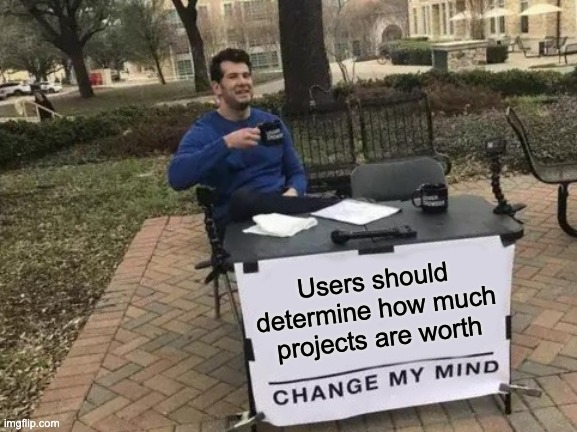

# Y-Foundry DAO — Community Grant Request: Invitation for Input

- **Thread ID:** 7597
- **Author:** YFoundryDAO (`terra187pczkx4rlkxwgw6tk04gkslq0z6q40ycmx0lw`)
- **Created:** 2022-11-08T16:05:17.102Z
- **Last edited:** -
- **Stage:** discussion
- **Views:** 713
- **Reactions:** 0
- **Comments:** 7
- **Source:** https://common.xyz/terra/discussion/7597-y-foundry-dao-community-grant-request-invitation-for-input

---

**Introduction**

The Y-Foundry DAO (YFD) is a community-driven idea accelerator platform that aims to provide the means for community ideators to find developers and funding in a transparent and decentralized way.

However, YFD is designed to fund and incubate more than just strategy vaults. These community-funded ideas can range from starting a new NFT art series, starting a web-store, and even creating whole dApps from scratch.

YFD enables this through its governance and escrow-by-milestone smart contracts, empowering community members with voting rights in order to help decide which ideas should receive funding, ensure that the funds go to the right person, and that deliverables are met. And that is just the tip of the iceberg.

For more information on what YFD has built over the past year, please see our building update on Agora here:[** https://agora.terra.money/discussion/7513-yfoundry-dao-building-update**](https://agora.terra.money/discussion/7513-yfoundry-dao-building-update)

## **Y-Foundry DAO's Collaborative Approach to Building Tools for Public Benefit**

YFD is a community of users, developers, and contributors who are building tools that ultimately result in public benefit. By building open source and equal-access tools for funding projects, developers, and community contributors, YFD democratizes access to blockchain technology, giving more people the ability to learn new skills, build better projects, and create positive change.

Y-Foundry's vision is to create a community that works together on projects that they care about. Through this collaborative approach, Y-Foundry hopes to make it easier for people around the world with different backgrounds and interests—but similar goals—to collaborate on solving problems at scale.

## **The Challenge**

The challenge presented to YFD at the moment is one of resources.

The initial raise for developing the Y-Foundry DAO platform was a total of $1.5M USD in January of 2022. From this amount, $200k was spent on compensating genesis contributors, while $355k was spent on DevOps for Terra 1 vault contracts (DGSF and Hedge+), and a total of $540k was lost in value due to the UST crash of May 2022. 

The remaining $400k runway and the additional ~$120k received from the Terra 2 Emergency allocation has been spent to develop the governance, token, and funding smart contracts for the Terra 2 chain, which will be launched in a few weeks time.
This means that the remaining amount of runway is now trickling towards $0.

As Y-Foundry DAO is and has always been envisioned as a community-driven project, there is now a question for the Terra 2 community in terms of putting in a community funding request.

We want your input about what you think would be best for YFD: What is the right amount of community funding that YFD should request?

## **The Opportunity**

The opportunity for Terra users is to build using a new model of collaborative development using YFD contracts. YFD contracts are designed to work with fYFD points, which is a locked form of the native $YFD token. This token will **NOT** have a public sale, but be distributed by the DAO via equitable means to be decided by the community, in order to populate the governing body of the platform with strongly aligned and skilled contributors.

Uniquely, YFD does not have a core team, as it is designed to be able to run without one. So none of the funding will be used for any type of core team compensation. Instead, it will be used to directly fund community contributors.

All functional elements of the platform are designed to be controlled via on-chain smart contract governance mechanisms with no human admin access. The _Boule _(governing body of token holders) alone decides whether to incentivize, hire, or fire any contributors as it wishes.

**These desired contributors for the DAO can include: **UI/UX designers, 2D, 3D & VFX artists, developers, strategists, community managers, content specialists, project management specialists, data scientists etc.

**As the _Boule_ receives a share of revenue from every successfully funded project,** the goal is to reach self-sustainability, while providing a way for anyone to fund or receive funding for their Web3 project outside of traditional funding structures. We also find that incentivizing the DAO with a revenue share vs a portion of funding increases the incentive for the DAO to select and fund projects with a perceived higher chance of long term success, vs simply approving as many projects as possible.

But as this revenue share depends on the performance of the underlying projects which are yet to be launched, there will be a need for funding to kickstart the DAO treasury and incentivize initial community participation via bounties ([https://app.dework.xyz/y-foundry-dao](https://app.dework.xyz/y-foundry-dao)).

**Please contribute your thoughts & suggestions.**

Please feel free to contribute your thoughts and suggestions below.
If you are interested in contributing to the Y-Foundry DAO, please do join the discord ([**https://discord.gg/yfd**](https://discord.gg/yfd)). We look forward to engaging with you in our community.
We are so excited to see what new projects will be created by the community. Join us in this journey, and together we will write the next chapter of Web3!

Best,
Contributors of YFD

---

## Comments (7)

**Lunatic3 (`terra1s4w2wt6luywup487cjmrvwtdtwn3eaaknz9f3r`)** — 2022-11-09T00:45:23.362Z — 👍 1

Hi,

I dont think it's appropriate to ask "What is the right amount of community funding that YFD should request?" . Shouldnt the amount your asking for be based on what your going to build and deliver and the resources that you need in order to do so? 

After spending 1.07m i'd expect to see something delivered. In my opinion i think you should first ship your MVP , then build a roadmap ,estimate efforts and then create a proposal .

> **YFoundryDAO (`terra187pczkx4rlkxwgw6tk04gkslq0z6q40ycmx0lw`)** — 2023-03-01T10:10:56.518Z
> 
> Hi [@Lunatic3](/terra/account/terra1s4w2wt6luywup487cjmrvwtdtwn3eaaknz9f3r) 
> 
> I don't know if I fully agree that asking "What is the right amount of community funding that YFD should request?" is inappropriate. But hey, difference of opinion is a part of any healthy democracy.
> 
> We see room for collaboration between users and projects where users can have more of a say in determining what should a project be valued at, based on what they can offer, rather than a project saying that "I am worth $XXX, give me money".
> 
> It is in that spirit that we decided to make this "Community Grant Request: Invitation for Input". 
> Think of it as us setting up a table in your local community park like this:
> 
> 
> And there's a very good reason for us to consider this as a better alternative, because the **true value of a project is measured by the utility it gives to the users of a chain. **Would you disagree? (comment below)
> 
> What better way to measure its worth (and determine what is actual product market fit) than asking its users? It also encourages a more prudent approach to funding solutions, and is overall more decentralized. Consider:
> 
> Method A: The team at Project Z says they will produce a front-running solution for users of chain X. They ask for $500,000. Why $500,000? Well... "this is what we say it costs" say the team.
> 
> vs
> 
> Method B: Users of chain X say, we need a front-running solution because MEV bots are making gas and trades expensive.  Let's say there are 10,000 trades a day, and each trade is losing $0.50 on averaged due to MEV. So, this problem is costing users about $5,000 a day for the chain. We can now determine that, over the course of 3 months, this would cost users about $450,000 in MEV costs, not including users that turn to other chains due to the bad experience.
> 
> So, users put up a proposal which offers a bounty of $500,000 (the cost +10% bonus) for anyone to build a solution. There is a bidding process, and finally one developer is awarded the contract with the DAO and begins building the solution. And over time, the DAO knows whether they made a good investment based on whether they saved money or not.
> 
> 
> 
> 
> You see, in both of the above examples, the grant amounts are the same. But if you ask anyone they'd probably prefer Method B. This is to illustrate that even if the resource cost is the same, the reasoning matters. Is it $500,000 because someone said so? or $500,000 based on a value add to the users?
> 
> I mean, feel free to disagree too my man. Tell me more from your perspective.

> > **YFoundryDAO (`terra187pczkx4rlkxwgw6tk04gkslq0z6q40ycmx0lw`)** — 2023-03-01T10:16:28.906Z
> > 
> > Also I hope this wasn't left unclear...
> > 
> > We did NOT get 1M from Terra.
> > From Terra 2, we received the 120k emergency runway allocation but that is all.

**Anonymous (`terra19v62f65v9kdy05c48v6fgnf4yvrqsjvqqyp8n0`)** — 2022-11-11T10:08:57.444Z

Asking for grants is getting hard not just here but everywhere because the majority of "projects" have abused of this funding tool. I think it is not the moment to ask for a grant but to look for a self sustainable method to keep your project running.

You also have received a good quantity of Terra's community money before, so no need for asking for the same over and over again :)

Right know I think we should stop giving grants and talk about how this grants should be given. Deploying code without a goal and without user attraction is a waste of money and dev potential. We, as community, cant give money to everybody without the knowledge that the developed project is helping Terra ecosystem and that cant be measured with a grant proposal.

In the old days, people developed things and if their project was successful they earn money with it, with grants we have changed it to make money first whatever my project is useful or not and that is a huge mistake IMHO. If we stick to the grant system we will end with a community of devs that act as bounty hunters and dont care about what they do as long as they get paid and that is no good.

> **YFoundryDAO (`terra187pczkx4rlkxwgw6tk04gkslq0z6q40ycmx0lw`)** — 2023-03-01T09:49:03.113Z (edited 2023-04-26T07:55:56.692Z)
> 
> Hey [@pablogarcor](/terra/account/terra19v62f65v9kdy05c48v6fgnf4yvrqsjvqqyp8n0),
> 
> First off, thanks for taking the time to read our proposal and leaving your feedback.
> 
> To be honest, I agree with you. 
> 
> And fellow contributors of YFD would too. Community funding is very broken at the moment and easily exploitable by bad actors for personal gain. 
> 
> This is exactly why we wanted to build YFD in the first place — to bring accountability back into the promise of smart contracts and Web3. Why build Web3 if it's just going to have the same problems as Web2?
> 
> In terms of the funds we did receive, I hope our accounting above was enough to indicate where our costs have gone — which is almost entirely towards development. To clarify, we are not developers ourselves. We've worked with a great external team (they are named here: [https://agora.terra.money/discussion/7513-yfoundry-dao-building-update](https://agora.terra.money/discussion/7513-yfoundry-dao-building-update)) who have been diligently turning our ideas into code over the past year. And I'll tell you this: it ain't nearly as cheap as I hoped it would be.
> 
> But hey, here's the outcome. We did it.  The contracts are done and we've passed our audit: [https://github.com/SCV-Security/PublicReports/blob/main/CW/Y-Foundry DAO/Y-Foundry DAO - YFD Contracts - Audit Report v1.0.pdf](https://github.com/SCV-Security/PublicReports/blob/main/CW/Y-Foundry DAO/Y-Foundry DAO - YFD Contracts - Audit Report v1.0.pdf)
> 
> Everything works so far. And we're in the process of plugging things into the ui: [https://dapp-test.yfoundry.io](https://dapp-test.yfoundry.io)
> 
> "with grants we have changed it to make money first whatever my project is useful or not and that is a huge mistake IMHO" Dude I could not agree more. This is why we have milestones in YFD funding initiatives. This is why we have escrow, and cancellable proposals that can claw back funds if someone is not delivering on their promises. This is the accountability we looked for, but couldn't find before.
> 
> So hey, I think we are heading in the same direction. Why not shoot us some questions, let's try and see if we can't clear things up, or set some deliverables and funding milestones that make sense.
> 
> If you prefer DM, just HMU @DrCle4n on Twitter. 
> 
> Best,
> 
> Clean

**Anonymous (`terra17uncwru68z3n0kl543r6rdd5q9jpvwxdxvfe66`)** — 2022-11-17T05:29:01.931Z — 👍 1

Hi Clean, 

Thanks for posting this up. I have been trying to follow the developments of YFD for a few weeks now, and I'm trying to figure out what is the main product that you're trying to build. Perhaps starting your first strategy vault as a pilot vault will shed better light to what YFD is doing. 

I believe that the community pool should be a POL to build up liquidity on your vault, rather than a direct grant. 

I'd propose that the YFD initial builders to:
1. Initiate their first strategy vault, and run it for a fixed duration.
2. With the data, a pitch community fund for POL liquidity to build up the revenue of the vault.

This will not only allow the POL to help protocols bootstrap liquidity, but also reduces the risk to LUNA stakers overall.

> **YFoundryDAO (`terra187pczkx4rlkxwgw6tk04gkslq0z6q40ycmx0lw`)** — 2023-03-01T08:43:05.959Z
> 
> Hi [@Max Callisto](/terra/account/terra17uncwru68z3n0kl543r6rdd5q9jpvwxdxvfe66),
> 
> Thanks for taking the time to read and respond to our proposal. 
> 
> It's been an eventful year, but I'm happy to say that we're getting better at explaining what YFD is.
> 
> The first and arguably most important aspect is vault funding... This is essentially a way to raise the funds for development cost without the need of creating a token or private seed rounds. Users 
> can directly contribute to the development fund of a vault and receive a NFT share of it.
> 
> 
> 
> This also means that any user can propose a new vault that they would like to use, without being a developer themselves. Developers on the other hand, can take on projects directly from the DAO which are funded by users, in order to provide users with a new vault, or feature, or beneficial public good. 
> 
> The funding mechanism itself is a smart contract, and includes milestones, signers, limits, and a designated whitelisted payee. This is better than the current process — which is just simply sending funds directly to a wallet address. 
> 
> Milestone payments introduce much needed accountability. This prevents a developer from simply taking the funds and doing nothing, for example. Or for an inferior product or mismatched product to be delivered. Via smart contract, funders retain the ability to cancel a proposal and therefore recover whatever remaining funds if something goes wrong. This ability is NOT present in current governance mechanisms for community funding or multisigs.
> 
> The signers who verify that deliverables are being met and release additional payments are the people who fund the proposal. In other words, the people who fund it have the final say on whether they accept the product as delivered by the developer. This is not a vote that requires input of the entire DAO, and so voter fatigue is avoided while protecting the funds committed.
> 
> Limits are placed especially on the first payment to be sent, in order to protect YFD users from fraud. Let's say that a proposer and payee colludes to raise funds from the YFD community without any intention of building the product promised. Because the initial payment is limited by smart contract to only be as much as the amount contributed by the proposer, the developer can "cheat" the proposer.  Once it is clear the developer is not delivering beyond the first milestone and the proposer is acting in bad faith, the proposal can be cancelled which returns the rest of the funds to funders. If done before the second milestone, this protects 100% of the user-contributed funds (that are not from the proposer).
> 
> Funds from a proposal can only be sent to its designated payee instead of a manually typed address. This is because, an address can be mistyped or spoofed (e.g. with [copy paste malware](https://medium.com/immunefi/the-malware-that-swaps-your-address-and-drains-your-wallet-552915fba542)). The whitelisting also introduces due diligence which can be performed by the DAO through whatever means necessary to verify legitimacy of the payee.
> 
> 
> 
> That is pretty much the headline summary for what YFD does... which is not quite as short as we'd like it to be. But we're working on it.
> 
> Let's get back to addressing the points you mentioned:
> 
> POL is something that can be considered in theory, but carries a significant risk in the current legal landscape.  Perhaps this is something that can be explored once the project is past its launch stage and can be considered sufficiently decentralized (growing the number and diversity of contributors is key).
> 
> For a strategy vault, we are unfortunately working without Anchor and Mirror protocol which we had committed significantly to pre-Terra crash, in terms of both time and resources. However, we are not without a plan. We have some enhanced ASTRO auto-compounding vaults which are different from the current offerings in the market, in particular due to their ability to benefit partnered projects. The smart contract work for these has been wrapped up, and these will be available when YFD is launched. 
> 
> Hope to answer more questions to come. Thanks again and love to see you around the community Max.
> 
> Best,
> 
> Clean

