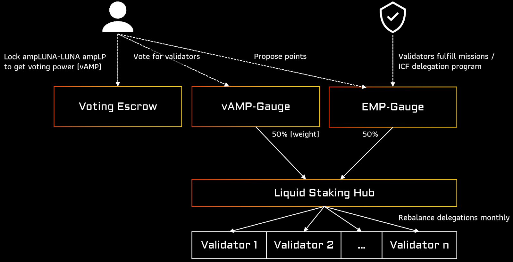
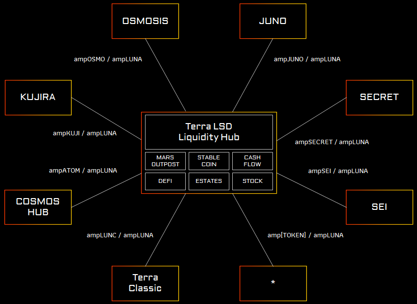
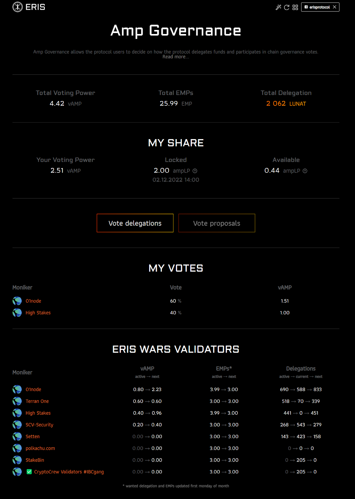
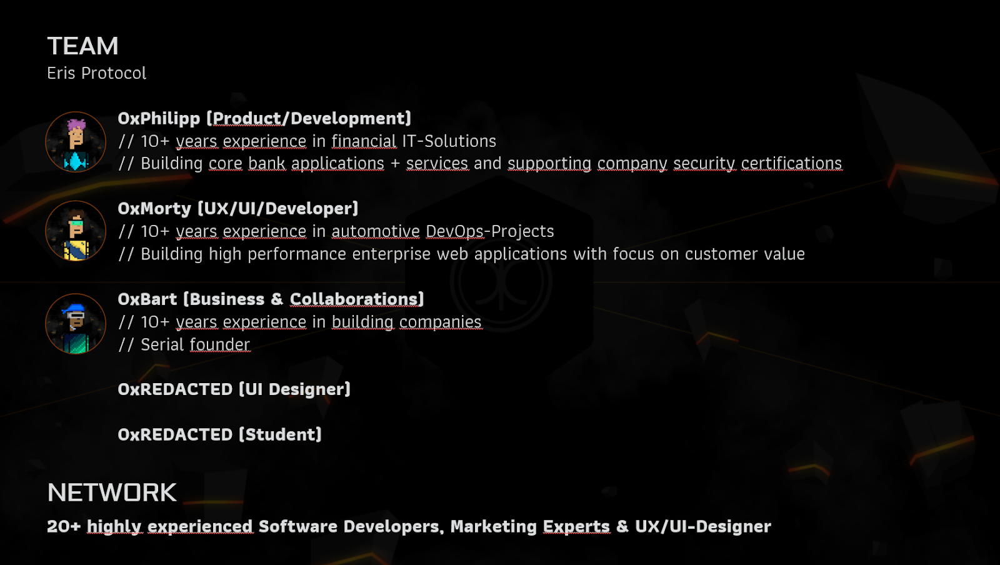
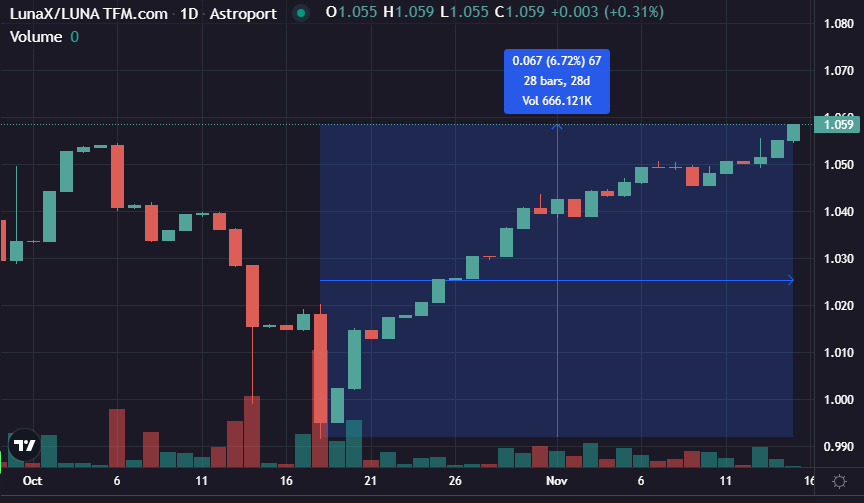
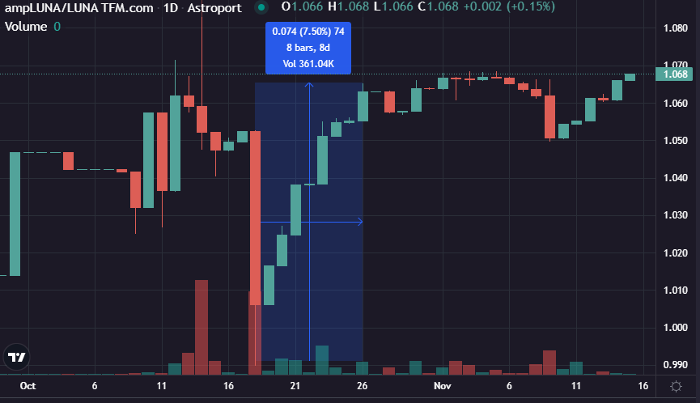
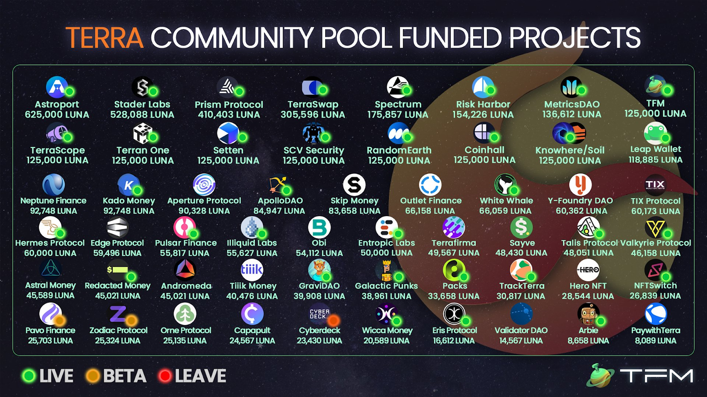

# Eris Protocol Grant Proposal

- **Thread ID:** 7788
- **Author:** Anonymous (`terra1alxk3fmhcl0ga80gl9yj9zp3ezjm4sdh8a9l9c`)
- **Created:** 2022-11-19T10:47:30.471Z
- **Last edited:** -
- **Stage:** discussion
- **Views:** 2490
- **Reactions:** 3
- **Comments:** 11
- **Source:** https://common.xyz/terra/discussion/7788-eris-protocol-grant-proposal

---

## **TLDR**
- In the last 6 months, ERIS has built a TVL (total value locked) over $ 950,000 USD with only just 16,612 emergency LUNA allocation on top of our own personal funds. That’s a factor of 30x, compared to Staders’ 2x (964,000 LUNA TVL from 528k LUNA)

- ERIS’ core mechanism focuses on a stable Liquid Staking Derivative (LSD) economy consisting of multiple mutually complementary products, in which these products share 50% of the reward fees back to its ampLUNA, thus producing an even higher LSD return. 

- ERIS redefines what it means to provide a fair delegation and governance framework and believes that this will make delegations fair and transparent to the community.

- These mechanisms enable the community to have the highest return on their LSD while having a fair and transparent governance for its LSD as Terra scales to its interchain alliance vision.

- ERIS Protocol asks for a community funding of $ 850,000 USD to scale our work for the next 6-12 months, to re-create a vibrant DeFi ecosystem on Terra.

# Introduction

It is time to share our vision and our goal of ERIS Protocol on Terra and the Cosmos. 

To build trust around decentralized finance and ensure it in the long term, it needs security. This is provided by decentralization and strong interconnectivity. ERIS Protocol comes in to enable the provisioning and transfer of Liquid Staking Derivatives across all Cosmos zones. Fueled by the knowledge of the dangers of single points of failure, unlike some other LSDs, **ERIS Protocol deliberately does without its own chain in order to avoid the risk of a total loss of the staked assets in the event of an error, failure or attack of the chain**. Security also requires collaborative action, which is why we will be fully dedicated to the community. As children of the moon, Terra will be our main chain and base of operations. Our so-called "reference zone" of an ERIS Protocol deployment.

Over the last six months we have started building our product portfolio (**Amplifier, Amp Extractor, Amp Compounder, Manual Arb**) for the community. We require a **funding of $ 850,000 USD **to provide the community with a **dedicated professional BizDevOps team**, further products for a **stable LSD economy**, and an **innovative, fair delegation and governance framework**.

# Vision
## Stable LSD economy

For the usage and risks of Liquid Staking Derivatives it is essential to provide a stable LSD economy. LSD’s can have the issue of leading to cascading liquidation, even though the price of the underlying asset has not changed. We provide the tools and products to support a stable economy of LSD’s.

## Fair delegations

When providing coins to a LSD-protocol the depositor gives away his delegation and governance power to the protocol. It leads to possible validator cartels or giving the power to a different governance token. It is time for the LSD protocols to give this power back to the user and enable a fair delegation and governance framework.

For details see Amp Governance.

## Liquidity Hub

Providing a central ecosystem for LSDs allows Terra DeFi to natively integrate any token of the cosmos in its liquid staked form. This allows users and LPs to contribute to the economical security of other chains while also being able to use the locked capital for DeFi applications.

An example of such an integration is to be able to provide a real decentralized stable coin that is backed by all cosmos ecosystems.

# Products

## Amplifier (**Live**)

Amplifier is our Liquid Staking Derivative. It provides the default LSD technology to stake coins, while receiving a receipt token that stays liquid and can be used as collateral, in the alliance module or any other integration or DeFi App.

ERIS Protocol shares 50% of our reward fees of other products with holders of ampLUNA. It is directly integrated into the exchange rate of the token, that means even tokens that are being used on other chains will still participate in the additional rewards.

By improving the APY of our LSD we incentivize cross chain usage of our ampLUNA versus other competitors. On Terra e.g. through the reward fee sharing our ampLUNA APY is higher than LSD protocols even when they are using a 0% fee.

**Utility**
- Auto compounding
- Tax efficient
- Rewards shared from other ERIS Products
- Liquid: Send and Swap
- (Soon) Useable as collateral

**ampLUNA Integrations**
- Risk Harbor protection
- Astroport + Incentivization
- Terra Bridge (ampLUNA transferable to Osmosis, Juno, Kujira)
- FIN on Kujira
- BlackWhale on Kujira
- Pulsar Finance

**Planned Integration Partners**:
- ampLUNA as collateral for Neptune Finance Lending Market
- Loss-less NFT minting with Alchemist Labs
- Combining forces with Spectrum Protocol in Astro Wars
- Pushing for ampLUNA as collateral for USK on Kujira

## Amp Compounder (**Live**)

Amp Compounder allows users to provide liquidity to Astroport pools while farming reward tokens and reinvesting them into the same LP again. 

Due to our fee sharing model, LP’s will also participate in the increased APY while providing liquidity.

**Benefit for LSD stability**
Deep liquidity provides a stable market. By using a stable-swap pool, the exchange rate from ampLuna to Luna can absorb more liquidity without depegging the ampLUNA-LUNA ratio. 

## Manual Arb (**Live**)

Manual arb is a tool to allow users help and take over the 21 days unbonding obligation of other users. They are usually rewarded between 1 - 5 % for swapping LUNA to ampLUNA / LunaX / cLUNA / STEAK / boneLUNA. The principle is also an introduction for our arb repeater that will automate the process and bring professional arbitrage tools to our users.

**Benefit for LSD stability**

When a big sell-off through a whale dumping or liquidations happens, it allows users and long-term holders to simply participate in slow-burn arbitrage. This is a counter movement to the sell-offs to reduce the risk of cascading liquidations.

## Amp Governance (**Testnet**)

This is where our real plan begins.

Amp Governance allows the protocol users to decide on how the protocol delegates funds and participates in chain governance votes. We want to provide a framework for a fair, decentralized delegation and governance structure.

Decentralize the approach on how we delegate protocol funds to validators and help locking liquidity in astroport to provide a stable market for lending and collateral protocols. Delegations will be calculated by a configurable set of on-chain rules. Adding new validators to join the ERIS Protocol Whitelist will still go through our centralized application process to verify hosting, team quality, community and setup monitoring. We want to allow a diversified set of validators without us interfering or controlling delegations. But we do want to incentivize in our opinion good behavior that often happens off-chain and will need some central committee or decision process.

There are different mechanisms for how LSD’s currently select their validators or delegation amount.

**1. Giving power to own token**: Some protocols use their own LSD governance token to decide delegations. This de-facto allows the protocol contributors, advisors and strategic partners often to own more than 50 % of the voting power. For us this means a major risk for all chains involved, as external parties will have delegation and voting power over a different network. The bigger a protocol will grow, the bigger are the risks, as the LSD governance token will take these rights from the user.

**2. Using friendly or own validators**: Other protocols, while communicating decentralization, are selecting friendly validators or even delegate to their own validators. Many of these deals happen behind closed doors and the process is intransparent.

**3. Allow user to decide once**: Others allow users to decide once during the staking process to select the validator (from a curated list). This looks good on paper, but as soon as you add the possibility to trade the LSD, you cannot change that delegation anymore.

This is why we went back to the drawing board on how our governance process should look like.

We decided to implement a 2-gauges principle that can be weighted with configuration.

## vAMP-Gauge - Vote Escrowed ampLUNA-LUNA ampLP

The first gauge is our “Vote Escrowed ampLUNA-LUNA ampLP gauge” or short vAMP-gauge. Instead of using a governance token or only LSD locking mechanism, we allow users and validators to lock in auto-compounding LP liquidity (ampLP).

The user can decide on how long he wants to lock his funds and can choose between any time between 3 weeks minimum lock time and 2 years maximum lock time. When locking liquidity for 3 weeks the user receives ~1.3x voting power (1+(9*3/104)) while when locking his funds for 2 years receives 10x (1+(9*2*52/104)).

The user then can vote on up to 3 validators with his voting power. The same voting power will later be used to vote on Terra governance proposals.

**Benefit for LSD stability**
By incentivizing locking and increasing voting power by lock time, we want to provide a deeper liquidity to our ampLUNA-LUNA pools and make liquidity more predictable due to lock times. 

This also gives back the delegation power of the protocol funds back to the user, as each user can participate and vote on the protocol delegations.

Get ready for ERIS wars!

## EMP - ERIS Merit Points

The second one is our ERIS Merit Points gauge - short EMP-gauge.

EMPs are a way to reward our whitelisted validators that participate and help us or the cosmos community. They will be tracked on-chain and there are 2 different kinds of points. Decaying and fixed. Continued support operations like running relaying will earn fixed points, while one time missions will reward decaying points.

We are in progress of creating an extensive EMP catalog with standard missions and operations to boost the validators EMP power and define how they can increase their delegations. We update the community monthly on the points that we give out.

We have three ways of rewarding EMPs to Validators.

**1. Monthly validator missions**: We want our whitelisted validators participate in our protocol and the community growth and are handing-out a monthly mission board to them. This is also about educational content or user activation for creating a flourishing Terra DeFi ecosystem.

**2. Community Representatives**: We also want the community to be involved in the delegation mechanism. This is why we will be nominating 5 community members, of which each can nominate 3 EMPs per month. We will check conflict of interest on submitted coins and also allow any proposal from community members. We do not want to create overhead for key community members but instead they should be able to vote based on their own preference on what they saw over the past month and what they think should be rewarded.

**3. EMP catalog / ICF delegation program**: We are not planning on reinventing the wheel on how good community validators should behave, but we will take the rules based on the ICF delegation program and apply points to them. If a validator fulfills rules, he will be rewarded by extra delegations. This will be tracked in a visible EMP catalog for reference where we will also add custom Terra-specific community tasks a validator can participate in. For example tasks like running relayers will reward permanent points while providing the service.

**Benefit for LSD stability**
By providing incentives to participate in the Terra chain we want to increase the validators' engagement with the community. Having involved validators’ leads to a healthy system and governance.

**Note**: The name EMP is not yet decided on.

## Delegations

Each first Monday of every month we apply rewarded EMPs and tune both gauges, automatically apply the result to the delegation distribution and redelegate the protocol funds to the top x chosen validators.

There are some safety features available, so validators will only be able to receive up to x % of the total delegations, require a min delegation % to become active and need to be verified and whitelisted.

Initially the weighting will be closely watched and we will start with an even weighting between vAMP and EMP: 0.5 * EMP gauge + 0.5 * vAMP gauge = delegation percentage

Here is a small sneak peak of our app:

Notes: LUNAT is the name we use in the GUI for Testnet Luna. Only the top 5 validators by delegation share are selected on Testnet. On the mainnet we are currently planning with 20.

## Arb Repeater (**Planned**)

Our arb repeater will be an automated slow-burn arbitrage protocol. Users can deposit LUNA and the protocol manages when arbitrage swaps should be executed. We will whitelist liquidation protocols to be able to swap Luna to ampLuna at a fixed rate with a fixed mark up price. This allows them to liquidate assets directly without impacting any oracle markets.

**Benefit for LSD stability**
Again providing a counter protocol to sell-offs and liquidations stabilizes the economy and tries to stop cascading liquidations, as buy pressure is generated.

## Amp Oracle (**Planned**)

Amp Oracle allows other DeFi apps to easily integrate LSD’s from other chains and use them e.g. as collateral.

**Technical description**: Using asynchronous queries and transactions throughout the cosmos ecosystem increases smart contract complexity. As we will be bringing many LSDs to Terra, we will also provide a way for protocols to natively query the exchange_rate synchronously. This allows DeFi on Terra to flourish. We will be using ICQ - Interchain Queries to update the exchange_rate daily for all LSDs we provide.

## Amp Extractor (Live)

Amp Extractor is our yield transformation product. It allows you to extract parts of any LSD yield and use it for other applications. The current implementation only allows donating to a project. The possibilities of this tech are limitless:

- DCAing yield into different assets
- DCAing yield into a portfolio
- Stablecoins backed and funded by the yield underlying assets
- Anchor V2
- Self-repaying loans
- etc.

We have a detailed plan of what we are building in this part as well and would be happy to talk about our vision in a community call, but it would go beyond the scope of the already big proposal. The way it has been built is similiar to how the alliance module plans to distribute LSD rewards with the other stakers.

# Team

In order to achieve sustainable growth of decentralized finance - especially in the Cosmos ecosystem - it is important to focus on topics that demonstrably create high added value for all participants. However, ideas alone are not enough; they must also be built and operated to high quality standards. This requires teams that are passionate and skilled about contributing to the future of decentralized finance. At ERIS Protocol, we have a highly qualified team with relevant experience in the IT environment, specializing in financial systems. Our passion for smart contracts combined with our 10 years of experience from the traditional financial world, let us build applications that will significantly impact the future of decentralized finance.

# Funding

Since our launch 6 months ago, we have tried to build ERIS-Protocol alongside our main activity in the IT consulting industry to show the potential and quality behind our work. For this we have covered all expenses and all opportunity costs ourselves. In order to be able to refinance some of these investments and, most importantly, to be able to dedicate ourselves full-time to growing and stabilizing the Cosmos ecosystem in the long term, we need your financial support.

## Previous fundings

Right now, we have received a total of 16,612 LUNA @ 2.00-2.50 USD (~33,000 USD, 26,000 at current price) for the development and launch of our protocol. While we have used it for paying our team, we have not cashed out a single Luna and instead provide it as liquidity for multiple dexes.
Further we have received 20,000 USD for an audit reimbursement by TFL.

Another audit reimbursement of 30,000 has been requested, but is still in progress.

We are completely bootstrapped and self funded, and have invested a lot of time and money into the Terra ecosystem.

Based on our invested money, time, team size and default rates, we have invested around 50,000 USD per month for the last 6 months to a total of 300,000 USD into the terra ecosystem by building the applications, building collaborations, marketing, community support and creating this vision. 
Result for the 16,612 Emergency Allocation

From the funding we have built the Amplifier on Terra and Terra Classic, built the Amp Extractor with the possibility to donate to the three projects: LUNC DAO, Angel Protocol, Terraspaces, launched our Amp Compounder and prepared the launch of Amp Governance. We have redesigned our whole application and try to support the community and tools in the ecosystem with feedback or PRs.

While many teams focus on also bringing their dApps to other chains, we have a total focus on rebuilding the Terra DeFi, and while we launch smart contracts on other cosmos chains, we do so by also bringing functionality to Terra.

We have made a lot of collaboration with the community and have strengthened our network of collabs and supporters and have gotten the LUNA-ampLUNA incentivized by Astroport. We have started with a community organized Twitter Spaces AMA call to also get the broader Cosmos Ecosystem excited about the possibility of a Terra revival. (Now having died down a little with all the other things going on.)
Even during the bear market, we were able to grow from an unknown project to a project with a total of over 1 M USD TVL and a lot of great Teams we are integrating or planning to integrate with, which is a great growth for us. 

So our initial community funding of 33,000 USD led to a TVL of 1,000,000 (factor 30).

We do think that we already provide a more stable LSD economy on Terra. On 18th october a whale market sold a lot of ampLUNA and LunaX and depegged both LSDs. So here is the comparison.

Even after 28 days, LunaX has not returned back to the peg.

ampLUNA returned back to peg within 8 days.

**Note**: On 15th october the ampLUNA-LUNA pool was incentivized on Astroport, that means data before that time was with low liquidity. The ampLUNA drawdown on 9th november had a low of 1.05 while LunaX went down to 1.046. The exchange rate for ampLUNA and LunaX is almost the same. (Exchange rate is the conversion rate of ampLUNA / LunaX to Luna when waiting 21-24 days)

## Allocation

There are two types of people in the community, some want to see results first before funding a project (PMF) and the other wants to see the idea first before accepting a funding proposal, and if built anyways expect it to be developed for free. We do not think that we can please everyone, so we prefer to show to the community that we provide value to the Terra ecosystem first, and hope to have shown what we can achieve with our focus.

While we are still small, our vision for the DeFi on Terra has grown a lot and we could provide better growth, community, collaborations and development pace, if we were better funded. **We are asking for $ 850,000 USD worth of LUNA, benchmarked at 12:00 PM GMT time on Wednesday, November 30, 2022.**

We are committed to making all our smart contract and tooling code available for the broad community and really participate in OSS, and invite anyone to fork them as long as due diligence, bug reportings, attributions, and security audits for changes are done properly.

We provide real value, a vision and shipping essential parts of a stable LSD economy while competing with other companies / protocols that have been funded by multi million dollar funding rounds or receiving huge “emergency” allocations. We think that Terra will need a strong and community focused LSD provider, and after the community call more than ever.

It is time to put ERIS Protocol on-par with the others regarding funding, to have a real Terra native competitor in the Cosmos space that is active and bringing innovation to Terra. Our products are already top of the line and quickly evolving. We do not need to hide in comparison to other big LSDs. Professional software development and operations is expensive and time consuming and the funding allows us to continue with our focus and allows us to support the Interchain Alliance race as well as possible, building interchain collaborations, integrations, networks providing value to Terra and connected Chains.

Our goal is to continue this ratio of investment to TVL and bring our protocol to a TVL of 25,500,000 over the next 6 - 12 months. We will continue sharing part of our protocol revenue (50%) with ampLuna holders. As of today we have not planned to launch a token in any way.
As we are using much of the liquidity for liquidity provisioning, the runway will depend on the Terra economy and would be between 6-12 months full focus.

We will give monthly status updates about our build progress.

## Comparison

This amount at current market price is a lot less than what our competitors on the same chain received. We have printed this graphic out and hung it on our wall as motivation.

The community agrees that this was just bad spending. Many teams took multiple “bribes” from many different chains and still did not focus on Terra, took the money and ghosted, never launched, or provided minimal versions of their dApps while taking way too long to implement.
It is time for the community to support a protocol and team that has been building non-stop since day 1 in the new Era of the Luna Twin Moons. We have launched as the first LSD on Terra 2 and it is time to reward loyal builders that rebuild the ecosystem, develop new apps, and develop new visions.

## Ecosystem Revival Plan - Developer Mining Program

There is also a lot of discussion about what the project brings value to Terra right now and that developers should propose business deals providing the max return for the community. 

We invested a lot of time and money into the development and rebuilding of the ecosystem. Our goal was and still is to reach 10% of the TVL of Terra and bring Terra back to a $ 40 B USD TVL. Up until recently the funding process was clear by providing a framework for the Developer Mining Program ([https://classic-agora.terra.money/t/terra-ecosystem-revival-plan-2-passed-gov/18498](https://classic-agora.terra.money/t/terra-ecosystem-revival-plan-2-passed-gov/18498)) and for us this was one of the factors why we invested a lot of time, money and emotions into the Terra ecosystem. Not because we want to raid the community “piggy bank”, but because we believed that with the funding we would be able to continue building on Terra in the long term and rebuild it until we are self-sustainable. Due to the current market factors it is still a big unknown how long we will need to sustain and if we can restore the Terra name back to glory. Unknowns are a big risk for any serious development team and company.

Right now we have around 3 % of Terra TVL when we include Risk Harbors $ 9 M USD in the total TVL. Our developer mining allocation based on napkin math and data from DefiLama would be: 3 % * 8 % * 1,000,000,000 LUNA / 4 Years / 4 Quarters = **~ 150,000 LUNA per quarter**. 
Right now we have 2 quarters down and the proposal would be for at least 2-3 quarters. This would make a funding of **600,000 - 750,000 LUNA**, which would allow us to grow and increase our development efforts on Terra and reward our rebuilding efforts.

While we do think this TVL proposal needs to be revised / changed and we support a new one like the Terra Expedition, we do not like a bait and switch approach as this makes planability for us impossible and increases our risks of focusing our investments on Terra. 
The initial proposal is a **Developer Mining Program** and we think this focus will still be needed for Terra DeFi to flourish. Terra still needs to **incentivize **developers to rebuild the DeFi economy and the business deal we are offering is our time and passion rebuilding a great ecosystem. There are many metrics (TVL, Active On-Chain users, Governance participation, number of unique protocols) that need to be improved and only when we have good teams building on Terra (without profit maximizing their “bag”) can it be a success. 

We are committed to investing every last Luna we will receive from the community into the ecosystem.

## Fund usage

As liquid staking lives from the liquidity provided to ecosystems and our goal of providing a central liquidity hub on Terra we usually need to provide $ 50,000 - $ 100,000 USD worth of LP minimum per zone that we connect via IBC. This increases the usage of ampLUNA and LUNA for other DeFi applications and bring in demand and people. Once the liquidity for a chain is deep enough, we will use it to fund our development. 

We will keep a fixed amount of our treasury in USDC to pay for recurring costs like salaries, marketing, infrastructure, taxes and have a planable runway independent of market conditions.

The core team is committed to receiving their salaries in LUNA, ampLUNA, ampLP or arbLP and keeping it at least 3 months for liquidity provisioning on any chain ERIS Protocol operates.

We are committed to only convert LUNA to Stablecoins and vice versa, keeping all liquidity in Terra Tokens or Stable Coins.
## 
## Overview

**Liquidity provisioning**: 
- Terra - 100,000 USD
- Osmo - 100,000 USD
- Juno - 75,000 USD
- Kujira - 75,000 USD
- Other chains are also important as we want to allow the usage of ampLUNA cross chain and increase utility and demand.

**Audits**: 100,000 USD - we still have open quotes for ~60,000 - 80,000 USD for our written contracts and are also planning on building more.

**Marketing**: 50,000 USD - we want to onboard high profile and OG #Lunatics to ERIS Protocol and have gotten a rough quote for creating a full marketing strategy and executing it.

**Relaying infrastructure**: 7,000 - 10,000 USD for 6 months (quote we received was 600 USD per channel per month, 1 channel = 1 connected chain)

**Node infrastructure**: 1,000 - 2,000 USD for 6 months

**Salaries**: Business Developer, Senior Devs (3 * 4,000 / week, our standard business rate is 5,000), Designer (700 / week, part time), Student (300 / week) 
- Total: 13,000 USD / week = ~ 312,000 USD for 6 months

The funds are used to cover the salaries over the last 6 months and for the next 6 - 12 months. As we commit our own salary for liquidity provisioning over 3 months our leeway depends on the market conditions but is expected to be at least 6 months if the community decides to fund us. Our goal is to be fully self-sufficient within 6 - 12 months and be able to give back more to the community over the long run. We also plan to use some of the funds to onboard 1 - 2 developers and community leads to reduce our overtime to acceptable levels.

**We propose to payout 100% after the approval. This is unusual and requires some trust of the community.** Our reasoning is the following: ~ 50% of the funds will be used immediately for liquidity provisioning and we have been investing a lot of time and money over the last six months. Trust goes both ways for us.

We will provide full transparency and proof of reserves by providing a multichain live pulsar portfolio to track our allocated funds. Also if the community is not happy with our milestone progress, we will pay back part of the funds based on not-reached milestones.

We also do not have an issue with being doxxed with selected community members and / or TFL.

## Milestones

- Milestone 1: Launch of Amp Governance Q4 2022 - early Q1 2023 (25%)
- Milestone 2: Launch of Arb Repeater Q1 2023 - early Q2 2023 (15%)
- Milestone 3: Reach 10,000,000 TVL over all products Q2 2023 (10%)

## LP-Option

It is also possible to reduce the funding amount by $ 50,000 USD and instead provide 10,000,000 LUNA to the ampLUNA-LUNA pools on TerraSwap and Astroport (without staking it) for 1 year, providing liquidity and support our development efforts, while the community still has control over the funds and can withdraw the deposit when unhappy with our progress.

This also has the advantage of immediately heating up the ERIS wars as validators have more stake to get involved and fight for delegation shares. The option also benefits the whitelisted validators as they immediately get more delegations, but due to our commitment on making ERIS delegations transparent and onboarding many validators within a couple of months it does not create an unfair validator market.

The community should decide. Let us know below or on the AMA if you want the LP-Option to be used in the proposal.

Napkin math for LP-Option (can also be scaled up or down, e.g. 20,000,000 LUNA for a reduction of $ 100,000 USD)

**TerraSwap**
**Astroport**
5,000,000 LUNA
5,000,000 LUNA
2,500,000 LUNA + 2,341,000 ampLUNA
3,200,000 LUNA + 1,680,000 ampLUNA
2,300,000 * 16% * 5%
1,680,000 * 16% * 5%
= 18,400 LUNA / year = 29,440 USD / year
= 13,440 LUNA / year = 21,500 USD / year

# Why ERIS?

- We are here, building for the last 6 months when the big ones were only taking the money and sleeping or using it for other chains (Stader, Prism, etc.)
- Community focus - Share 50% of rewards with ampLuna holders
- Delegation and governance power given back to the community.
- No conflict of interest - we do not run a validator.
- Providing a factor of investment to TVL of 30! Stader has a factor of less than 2. (Investment 528,000 to 964,253 TVL in LUNA). Prism Protocol a factor of less than 0,005 (Investment 410,403 to 1,975 TVL)
- No dependency on other chains and associated risks (Stride, Quicksilver)
- Governance still in control of LUNA holders, not LSD governance token
- Complete solution for a stable LSD economy
- Providing full transparency and no backroom deals

# Conclusion

We would love to implement our vision on Terra and become the main, community focused Liquid Staking Derivatives with a home base Terra, that pushes the boundaries of what it means to provide professional Liquid Staking as a complete economic solution for a chain or connected sub-zone and interchain alliances.

We bring a set of products all in the goal of providing a **stable LSD economy** and innovation to Terra. For us, providing a stable, trusted market and LSD economy is essential for the future of the chain and we would be delighted to work with you on this vision.

_**“A system is only as effective as your level of commitment to it.”**_

We need your support as this proposal will be the decider if the community wants ERIS Protocol to build and become the preferred staking solution on Terra or if the community will accept the usage of LunaX in the Alliance module.

What we have been building and envisioning over the last months, fits perfectly together with the idea and implementation of the alliance module. We even see parallels between them, like the similarity between TakeRate and our Amp Extractor percentage or working hard on connecting and integrating different chains and communities by bringing ampLUNA to Kujira, Juno and Osmosis and also bringing other amp[TOKEN] back to Terra. It allows the locking and usage of more LUNA across all of Cosmos and Alliance DeFi.

The **$ 850,000 USD grant** will allow us to contribute **more products, collaborations, value and growth for the Terra community**, to **revitalize and rebuild the uniqueness of Terra DeFi**. Our Amp Governance will lead the way for a fair delegation and governance framework for LSDs.

# Voting

Voting “**Yes**” means supporting ERIS Protocol in focusing their development on the Terra chain and the community wants ERIS Protocol to be used in the alliance module.

Voting “**No**” means not supporting ERIS Protocol as the funding amount is too high, proposal not acceptable or you prefer LunaX to be used in the alliance module.

Voting “**Abstain**” means having a personal conflict of interest on voting for or against the proposal.

Voting “**No with veto**” means, ERIS Protocol is not beneficial to the Terra Ecosystem and should stop developing and not follow their vision on Terra.

## Timeline

Posted on Agora **2022-11-19**
AMA with 0xPhilipp on Twitter, hosted by Cephii, moderated by Danku, Rebel, Max **2022-11-24 **
Integrate feedback until **2022-11-27**
Put the proposal on-chain for vote **2022-11-30**

---

## Comments (11)

**Anonymous (`terra1hr7svdp2rga9vf3ry95sx7g5wyspgwmg94qac8`)** — 2022-11-19T15:51:05.533Z — 👍 1

This should be split into 2 proposals.

The first should be a liquidity funding one, where the community puts money into the various LPs.
This should be controlled by people not affiliated with your product, this should be a 12 month 'loan'. See previous LP funding props for guidance, Zon wrote a couple of these in the day.

You could put the funds you already asked for and are just being used to increase your TVL into this one as well if you so choose.

The second should be a 'grant' to fund your devs/get a BD person/whatever.

> **Anonymous (`terra1alxk3fmhcl0ga80gl9yj9zp3ezjm4sdh8a9l9c`)** — 2022-11-22T18:54:53.621Z
> 
> Dear PFC,
> 
> First of all, we would like to take this opportunity to thank you for your dedication and commitment to the Cosmos and Terra communities!
> Even though we got a lot of headwind from you from the beginning and you are directly involved in two of our competitors (STEAK & BackBone Labs) on Terra, we really appreciate your feedback on our proposal!
> 
> To address your points, we reworded the fund summary portion to make it clearer how the funds will be used. This is not a liquidity funding grant and it will be used primarily for payroll and to ensure future benefits in which Terra DeFi can thrive again. It will be used to grow the Terra ecosystem, realize our vision, add more people and funds, and create unique products, ideas, and networks.
> We also introduced a payout plan based on milestones with a 4 out of 5 multi-sig.
> 
> We leave the abstention on this vote due to your conflict of interest and hope for the best for the sake of the entire community!
> 
> It would be nice if in the future we could continue to use our resources to rebuild the community and at this point leave the internal squabbles behind.
> 
> Best regards
> Eris Protocol Team

**Anonymous (`terra19v62f65v9kdy05c48v6fgnf4yvrqsjvqqyp8n0`)** — 2022-11-21T10:15:09.450Z

As eris protocol has no token it cant fit on the approach stated by [@Cristiano](/terra/account/terra1lzhq945tgr7c7e9tk2y9gk7x6p0xxc77ed5gyx) on redacted proposal. Anyway the grant is too huge in my opinion, maybe a good approach is to ask separetely for a grant to every milestone you have specified and ask for more funds if you need it. That way the community can see your work and how good the product fits on the market and maybe on the meantime you will become selft sustainable :)

> **Anonymous (`terra1alxk3fmhcl0ga80gl9yj9zp3ezjm4sdh8a9l9c`)** — 2022-11-21T10:33:14.917Z
> 
> Hi pablogarcor, 
> 
> thank you for participating so actively in the Terra Governance!
> 
> We hear the feedback from the community, and we will be changing the grant payout schedule based on milestones with the usage of a multi-sig. 
> 
> Asking for a grant each milestone creates a lot of overhead for us that we would prefer to focus on development and shipping.
> 
> Best Philipp

**Neptune Finance (`terra1z5h2v3je9fld7ccv9ua0f0f5uw7kjjj074du7c`)** — 2022-11-21T21:50:28.982Z — 👍 2

The Terra community needs this proposal. 

We’re in support of Eris building better LSDs so we can utilise them in our money market. 

From what we’ve seen from the Eris team so far, ampLUNA presents far better technology, development and progress in comparison to the other LSDs currently available in Terra. 

This investment should pay off for the whole Terra ecosystem as the model drives value back to ampLUNA, increasing its staking yield above chain rewards.

Then the Manual Arb and Arb Repeater should bring more stability to ampLUNA, which helps with market confidence and price stability during volatility. This makes these tokens more desirable as collateral in a money market or other protocols.

**Anonymous (`terra17uncwru68z3n0kl543r6rdd5q9jpvwxdxvfe66`)** — 2022-11-23T09:53:23.204Z — 👍 1

Thanks, Phillip, for such an extensive proposal. I love the idea that the funding focuses on the proliferation of ampLUNA to various chains in support of interchain alliance. I've noted that ampLUNA is currently available on Kujira and possibly added as a collateral for the minting of USK stablecoin. 

I am in agreement that the community funds be held in a 4 out of 5 multisig with key community members to judge based on the milestones involved. Since the builders' community fund is managed by selected trusted individuals, you could consider community members such as Cephii or Panterra as well.

**Anonymous (`terra1wlu6yl8cls8y6z64tkujex67thkzjmma99nxc2`)** — 2022-11-25T05:01:22.287Z

Thanks for providing an elaborate and succinct proposal - along with the held AMA. Ryan voiced out a lot of concerns that were of many's!

It is no doubt that Eris is leading the run for Terra Native LSDs at the moment and will be beneficial for other DeFi applications, like Neptune Finance, to bring greater uses for capital efficiency. It's a huge ask, but I am glad the team reviewed community remarks and based the grant on milestone completions for the remaining 50%.  Philipp & co have answered to accountability and proven themselves to be one of the active shippers on the new Terra Network - and while one may argue that liquid staking can be forked in a day - many factors involving security, outreach & stability often do not get enough focus.

Related to Max's comment - On the side, I think the multi-sig would also best include community individuals without COI, e.g., non-validators like Cephii/Karma. 

_>also, this is my sole individual opinion & does not represent others_

> **Anonymous (`terra1alxk3fmhcl0ga80gl9yj9zp3ezjm4sdh8a9l9c`)** — 2022-11-25T18:51:32.502Z
> 
> Hi speicherx,
> 
> thank you for your valuable feedback and looking at it you are totally right that we had too many validators on the multi-sig.
> 
> We have replaced Vini with Somethingelse, so the multi-sig is more balanced with 2 non-validator and 2 validator signees.
> 
> Best
> Philipp

**Anonymous (`terra1heay4nz54pkn20flf2cu0hlayl4ew9teq6rrz3`)** — 2022-11-25T12:52:53.549Z (edited 2022-11-25T12:53:29.081Z)

$850k is a large ask, especially with most of it going to paying the team's salary (am not discounting the work/money you have put in thus far, hats off to that!). 

Since your self-sufficiency depends on your protocol's TVL, I'm wondering if it is better to request for funds from each zone you plan to launch on to incentivize TVL of the respective ampTokens? That might be a quicker route to reach self-sufficiency, as you are directly affecting TVL growth with your funds.

_All opinions are my own._

> **Anonymous (`terra1alxk3fmhcl0ga80gl9yj9zp3ezjm4sdh8a9l9c`)** — 2022-11-26T12:02:07.653Z
> 
> Hi IAN,
> 
> you are right that we will be focusing over the next 6-12 months on also increasing our TVL and that we need some incentives to work in that way, on the other hand most incentives are only a temporary way to bootstrap things and can get out of hand quickly. Our second or even main focus is building small protocol / team focused alliances and integrations to push real DeFi utility on Terra and connected chains, as this leads to sustainable TVL capture through usage.
> 
> We are thinking about some ways to sustainably capture TVL and especially POL, so the incentives can have a lasting positive effect on our stable LSD economy vision aswell.
> 
> For our LSD Liquidity Hub we do plan on contacting other ecosystems to also provide liquidity. Ideally some "combined" deal of them providing liquidity for both their own chain as well as on Terra. This would benefit both systems, as the other chains would get more utility and usage in Terra DeFi aswell as Terra getting liquidity for stability.
> 
> We want to capture TVL in parts of the system that benefit Terra DeFi most and this is right now LUNA-ampLUNA LP / ampLP. And while this benefits the ecosystem and integrations most, we only participate around 36% on the TVL locked in stableswap LP, while a bit more through ampLP due to Astroport incentives.
> 
> We think we can reach a lot with the proposed grant. We have a big vision of many protocols and alliances on Terra, and provide the community with a strong LSD protocol / ecosystem with huge value for Terra.
> 
> We also commit to removing the Amplifier 5% performance fee while being funded in any way by the community.
> 
> Best Philipp

**Anonymous (`terra1alxk3fmhcl0ga80gl9yj9zp3ezjm4sdh8a9l9c`)** — 2022-12-05T16:49:55.082Z (edited 2022-12-05T16:51:36.225Z)

We have received a lot of questions over the last couple of days and here we try to go a little bit more into the details of them.

Here is the FAQ to the ERIS grant proposal:

**What will happen if ERIS runs out of cash after the funding?**

The grant proposal should bring us to the point where we can survive the bear market and prepare for the next bull run. Should we run out of gas in the last miles, we will have brought ERIS to the point where we will also be interesting for external investors by then. We will then be able to bring in additional capital from outside to Terra. 

Maintenance is covered for 3 years. If we have not managed to rebuild Terra together by then, this question will no longer matter.

We will certainly not throw away anything we have built up to that point. But when all else fails:

- Full Open Source everything we built incl. bots
- Use Enterprise for protocol management
- Use Warp for protocol execution
- Maintenance is covered for 3 years.

The funding we request is in this height to make sure we can finish what we promise. So you will get the fully fledged ecosystem we pitched and fully running autonomously.

**Will Eris be self-sustaining beyond this funding?**

This depends heavily on the future of the entire Terra ecosystem. That's why it's important to invest NOW in the right teams and projects that will put their time and passion into rebuilding Terra and innovating applications so that everyone can have a shared future.

- $1 M TVL = TODAY - protocol can cover all automated operating fees. 
- $10 M TVL - we can cover collaboration and integration work, for sustainable growth
- $50 M TVL - we can continue producing products and protocols for Terra around ampLUNA

**Will our proposal create LUNA sell pressure?**

We will not be creating sell-pressure on LUNA, as we have committed to use our salaries at least for 3-6 months for liquidity provisioning on all different connected chains and pay ourselves denominated in LUNA.

We usually need to provide a lot of liquidity based on the utility on the external chain. Usually this is 50-100 k USD worth of ampLUNA. It will allow us to increase the utility for ampLUNA (and therefore LUNA) as well as having high stakes in the overall success of Terra and Alliance strategy. The funds provided for liquidity are still used for salaries.

WAGMI or DED

Either we are all gonna make it, or Terra is ded.

**Will Amp Governance create ASTRO sell pressure?**

For simplicity, our first version of Amp Governance is based on the ampLUNA-LUNA ampLP which auto-compounds ASTRO rewards and makes it the most capital efficient way. If a user wants to hold ASTRO he is still able to buy it on the DEX. The amount of locked ampLUNA-LUNA ampLP does not have an impact on the amount of ASTRO emissions.

Our goal is to provide a way to give back the delegation and governance power of ampLUNA to the user owning the token. That means we are also thinking about a way allowing the user to decide what to use.

Combining different tokens to calculate voting power introduces more complexities, as they contain different amounts of underlying LUNA / ampLUNA and provide different values to the ecosystem. For example LP / ampLP provides more value to the ecosystem than only holding ampLUNA.

Possible weighting could be:
- ampLUNA weight:1
- LP weight: 0.5
- ampLP weight: 0.5 * exchange rate to LP

We are fans of first evaluating Amp Governance and the market fit, before introducing additional complexities. If we see a demand in the market we will also implement ampLUNA and LP to be used in Amp Governance.

**What are the relevance and benefits of ERIS to Terra’s development?**

**Enterprise Protocol**: Decentralization is for us a continuous process that is being started by our Amp Governance. We plan to use Enterprise for the management of Eris Protocol in the medium to long term. There is the possibility to use ampLUNA or even ampLUNA-LUNA LP/ampLP as a governance token for the protocol. 

We currently do not plan to release our own token, but the question arises, so we will also need to evaluate possible models around it, to allow the community to participate and own part of the protocol.

**Warp Protocol**: In the short to medium term we plan to integrate Warp Protocol to run all bot activities for our products and will also provide keepers running the warp protocol. We will need some basic scheduling / repeating job function for that and are in contact with TFL about our needs.

**Alliance Module**: Our protocol fits quite well with the alliance module, as we provide an open, market based, fair delegation framework for validators. We do not support the collusion of validators or backdoor deals, as we are opening up the whitelist, for any validator. We still have to do basic checks on the validators and to have direct contacts to them, if some of our monitoring shows issues to get fast responses.

As we amplify the APY of our ampLUNA LSD, the APY is also the highest among the LSDs on terra, so each chain can participate best by using ampLUNA. This provides an ideal integration for the alliance module.

The Alliance module is LSD agnostic and can even support multiple Terra LSDs at once.

**What governance is planned for the future of the LSD?**

Right now the protocol is running automated, but some decisions need to manually be made and bots are centralized. Our goal is to move to a decentralized form over time. What Enterprise Protocol provides does fit quite well with our own idea of decentralization.

The following is an idea in which direction we want to develop.

Warp Protocol (with scheduling functionality) can run all automated protocol processes like: Harvesting, start unbonding batches and auto compounding. Fees are paid by the protocol.

Enterprise Protocol is used for managing the manual protocol processes. We do prefer having representatives, so that there is no governance fatigue and decisions can be made efficiently.

Small council decisions:
- Validators on- and off-boarding based on guidelines
- Applying EMPs
- Changing / adding automated processes

Full community vote:
- Decide validator guidelines
- Decide on the council
- Vote for delegations
- Vote for Terra governance proposals
- Vote for updating smart contracts

Community
- Propose EMPs
- Propose Validators

**Will ERIS be able to pay back 720,000 USD to the community pool?**

Our idea for ERIS protocol is to provide the best value for the Terra community and ecosystem instead of being focused on maximum profitability. 

We see our fee sharing model with ampLUNA holders as part of giving back to LUNA stakers. If we ever go down the road of launching a token, the community pool will receive a good amount.

Further do we think if we can push the adoption and integrations of ampLUNA throughout the Cosmos ecosystem, we can provide more value to Terra than what is being invested by the community. ERIS needs to provide 0.3 % value of the total ecosystem when calculating with the current $ 210,000,000 USD network value to make good on the investment. We do think that we are able to provide the community with more than that.

**There are already other LSD providers on the market, why support another one?**

[**https://twitter.com/eris_protocol/status/1599135731427217408**](https://twitter.com/eris_protocol/status/1599135731427217408)

**The proposal asks for money for past expenses and salaries for the last 6 months, why?**

ERIS as well as the rebuilding of Terra is a multi-year project. After the crash, ERIS got kickstarted with the emergency allocation of ~ 16,000 LUNA and the funding plan we created was based on the Terra Builder Mining Program. It would have allowed us to continue implementing our products around LSD over the span of 4 years.

We still see the whole project as value provided for Terra and after implementing 33% - 50%, we estimated the whole project. Due to the market based factors we unfortunately can’t work for free. We have invested a lot of time and money into building ERIS. Our focus was always about rebuilding the Terra ecosystem by providing the maximum value for the whole chain instead of maximizing profits for ERIS. And the requested grant is needed to fulfill our vision and providing our help on rebuilding.

**What if the milestones can not be reached in time?**

If we do not make significant progress toward the milestones, the community multi-sig holders can decide to pay the open funding back to the community pool.

