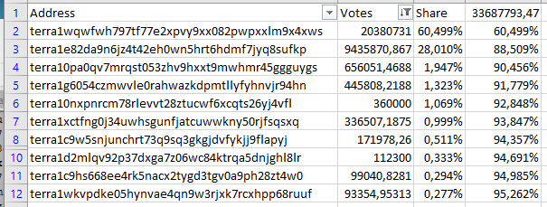

# Terra Community DAO - New Horizon

- **Thread ID:** 7922
- **Author:** Anonymous (`terra1lzhq945tgr7c7e9tk2y9gk7x6p0xxc77ed5gyx`)
- **Created:** 2022-11-30T16:39:17.627Z
- **Last edited:** -
- **Stage:** discussion
- **Views:** 469
- **Reactions:** 0
- **Comments:** 1
- **Source:** https://common.xyz/terra/discussion/7922-terra-community-dao-new-horizon

---

## Summary

The intent of this proposal is not to go on-chain, but to grasp the current sentiment about my idea to restructure the way community funds are handled. If the sentiment is positive towards it, it should signal demand for a Terra Community DAO solution to the builders of Enterprise Protocol, Packs Protocol or others. Current solutions on Terra are not able to support the planned DAO.

## Motivation

> "Show me the incentives and I'll show you the outcome."
(Charles Munger - Berkshire Hathaway)

The current governance system is broken, because the incentives are not designed in such a way that decisions are made in the interest of the community. This is especially costly for the community, when we are talking about decisions regarding the community pool, which is currently worth more than 550 million in USD.

**Current situation: Governance via Validators**

Validators are responsible for verifying transactions on a blockchain. They are incentivized to do this properly, because they get a share of the staking rewards in return and in case they misbehave there are slashing penalties and people will withdraw their stake, which leads to a decrease in revenue. Many validators are active on many PoS chains and they run their operations as a business. The past has shown, that these incentives generally work.

Unfortunately, validators are not incentivized to participate in governance. There is no reward for researching proposals nor a penalty for bad decisions or doing nothing at all. Taking part in the governance of a chain is only a cost factor for them, because it would mean spending a lot of time without direct compensation. Some may argue, that active validators can increase their delegations and thereby their revenue, but validators do not seem to share this idea. A significant amount of validators did not even bother to vote (46 in total) on the quite controversial proposal from Capapult (https://station.terra.money/proposal/2616). And we have no possibility to evaluate how many of the residual validators did vote just to fake governance participation.

Of course, you can always override the vote of your validator, but stakers are not incentivized to participate in governance as well. Many people have a diversified portfolio and stake assets on many chains, while they have a job and a family. Doing research on all proposals is extremely time-consuming, it is not rewarded and their own voting weight is in most cases not a deciding factor. To sum this section up: No one who votes is incentivized to do research and to make good decisions. Therefore we should not expect good decisions from the current alignment of incentives.

**Often used alternative: Committees**

A commonly used alternative is to pay community members or an external agency with VC experience to evaluate proposals and spend funds at their own discretion. These committees tend to be very expensive (https://commonwealth.im/osmosis/discussion/7603-updated-osmosis-grants-program-ogp-renewalhttps://commonwealth.im/osmosis/discussion/7603-updated-osmosis-grants-program-ogp-renewal) and their work is not efficient. They aren't efficient, because unlike real VC's they do not spend their own funds and face no real risk (no incentive to do good work) and we can't really exercise any power of review over them (even less incentives to do good work). We will not exactly know what they are doing all day and will get only vague reports due to confidentiality agreements. 

**Less explored alternative: Investment support**

This is not part of this proposal, but for the sake of completeness, I would like to mention investment aid as a viable tool to incentivize investments in projects on Terra. The community could offer a programm, where it refunds investors a part of their investment into a team, which is developing on Terra. This reduces the risk for investments on Terra and due to the fact, that the majority of funds still comes from an investor/investment team, we can be sure, that they are incentivized to make good investment decision.

**Conclusion**: 

The community pool should stay under the authority of the community. Outsourcing this responsibility to validators or committees is not in our interest due to a misalignment of incentives.

## Proposal

I want to propose the creation of a **Terra Community DAO (TCD).  **The TCD should make all decisions regarding the spending of community funds, because we do have a large number of individuals on our chain who do care about governance and who do care about the future of our chain. This includes Do Kwon and TFL, but also a lot of shrimps like me who do not have much voting weight, but care about this project and want to support it. And we should leverage this engagement and empower it to improve our existing governance system and the quality of funding decisions.

The TCD should be open for everyone who staked $LUNA. And initially everyones voting weight should be equal to his share of staked LUNA (potentially this can be improved and there could be other metrics as well, like number of transactions (do you use the protocols on Terra?), duration of staking (since when are you involved on Terra?) or other metrics. All Luna stakers should be able to participate and there should be no barriers to enter the DAO, it should be as easy as using a dApp on Terra. 

By removing the interference of validators from community spending, **we shift authority from non-involved and non-incentivized individuals back to the Terra community **- to be precise to community members who are active in governance and who do care about governance. This does not automatically ensure good decisions, but it creates the requirements to make them possible in the first place. To ensure the quality of decisions of our community, we could look into the creation of committees. These committee positions could be voluntarily (non-paid) or receive a small compensation, but they will not have any authority over decisions. Their purpose should be to create reports (from a bizdev, legal and technological viewpoint) to allow the community to make better decisions.

Furthermore we need to form consensus about what we want to fund in general with different criteria for profit and non-profit projects. and eventually budgets to avoid spending everything in one year. This would be our spending framework for the TCD.

The roadmap should be:

1) 
**Signal interest** to Enterprise protocol, Packs protocol or interested builders: We want to create a Terra Community DAO and at least the tooling I outlined above

2) 
**Create a framework**, which is binding for the TCD how we do assess proposals and how we spend funds. This is not only important for us, but for the builders as well. They need guidelines and certainty, what they need to do to qualify for funding.

3)
**Create a proposal **to move f.e. 5 million LUNA from the community pool to the TCD according to the budget, which was determined in the framework

4)
Eventually **create subDAO's** to get reports from qualified community individuals without any authority.

## About the team

I do not ask for funds or authority, therefore I think this section doesn't have to have much details. I am an economist and as a community member want to support the efficient use of community funds and make suggestions regarding governance in general.

I am looking forward to your feedback.

---

## Comments (1)

**Anonymous (`terra1alxk3fmhcl0ga80gl9yj9zp3ezjm4sdh8a9l9c`)** — 2022-12-04T13:17:20.083Z

Hi christiano,

I do agree that currently the governance on Terra is not ideal like you said.
But I do not agree with your proposal of creating a sub-dao for it.

**Validators **are highly incentivized for a profitable chain. Their income is directly related to the value of the chain. If the token 10x, so does their income.

**Committees **are highly efficient compared to the normal governance proceedings. Committees are only not best in making the right decision for the chain, as they do not necessarily have a big stake and incentives in the future of the chain. The community still can exercise full power, by changing out the committee via governance vote, requireing the committee to provide some reports or even overruling their decision via normal governance. Committee is a valid choice for a chain governance, but the incentive alignment for the committee needs to be carefully picked and vested in some way. And this will need to be more than just "small compensation", as we do need an actively engaged committee with 50-100 projects there is a lot to do, and they should earn full time income for their work. 

These committees could even be just be tasked to evaluate projects and help them make proposals that will be voted on by regular governance. But they can bring in some kind of organization and minimum requirements for posting a proposal.

**Investment support** in theory allows for a better market based evaluation of projects. But in my opinion leads to a mostly VC owned ecosystem and the community even taking over obligations of VCs, so the incentives will flow to VCs instead of committees (of community members) or projects.

**Your proposal** would remove validators out of the equation, which do have one of the biggest stakes in the chain and move it over to a couple of individuals. Take a look at the user interaction with governance: Data from [https://terra.smartstake.io/gov](https://terra.smartstake.io/gov)

If we take a look at the capapult proposal and remove all validator votes, we have 364 wallets voting. 348 have more than 0 staked LUNA. The top 2 votes already have a combined 88,5 % of voting power. The top 12 over 95%. This would allow for some serious economic security issue on the chain and also to a strong centralization of any sub-dao decision making based on luna staked.

The biggest issues on Terra governance:

**1. Validators have a lot of "dead" voting power. **

There should be done an analysis on that first, how many wallets are not "alive". No transactions or less than 5 transactions.

If this shows that we can still have economic security by removing "dead" capital votes, the normal governance framework could be restored by just "disallowing" the "dead" capital to be voted by validators. So validators voting power would only be active delegates. And we should expect active delegates to support decisions of their validators, or they would redelegate.

This would restore the normal governance procedures like on other chains and give power back to active users.

**2. User participation**

Terra is still a chain with only few users interacting with DeFi, this is why we need to bring back users and also incentivize them to participate in governance.

Best Philipp

