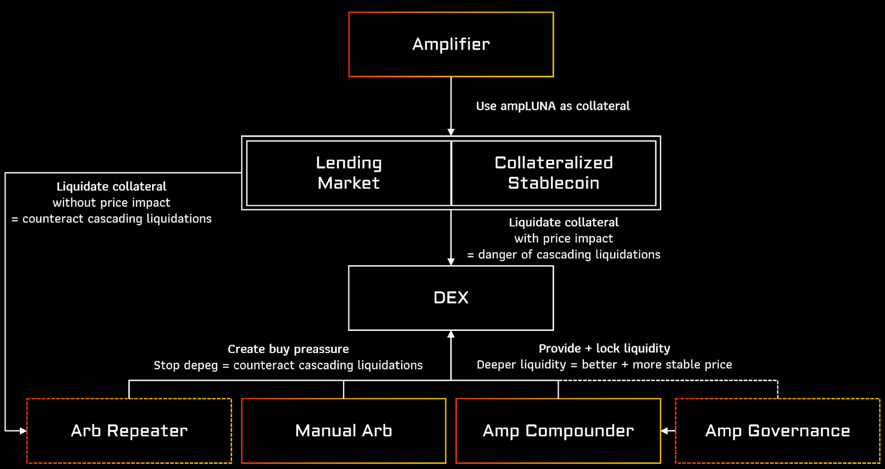

# Revised ERIS Grant Proposal

- **Thread ID:** 8789
- **Author:** Anonymous (`terra1alxk3fmhcl0ga80gl9yj9zp3ezjm4sdh8a9l9c`)
- **Created:** 2023-01-02T13:46:37.141Z
- **Last edited:** -
- **Stage:** discussion
- **Views:** 935
- **Reactions:** 2
- **Comments:** 2
- **Source:** https://common.xyz/terra/discussion/8789-revised-eris-grant-proposal

---

We have taken some time off to recharge our batteries after our closely failed grant proposal and we are back for a second try with a revised proposal.

**Biggest changes**
- Removed back pay component for the work previously provided
- Introduced a 10 % reward fee sharing to the community pool to pay back the grant in the mid to long term.

Our original detailed proposal can be found here, the development scope is unchanged: [https://commonwealth.im/terra/discussion/7788-eris-protocol-grant-proposal](https://commonwealth.im/terra/discussion/7788-eris-protocol-grant-proposal)

# Introduction
ERIS protocol provides Terra with a suite of products around liquid staking and creates a stable economy around yield-generating assets.

Liquid staking derivatives (LSDs) will be at the core of DeFi in the next few years, as it allows an efficient usage of capital while also providing security for the chain. A strong financial on-chain economy is needed to fuel the revival of Terra DeFi. This is where our passion lies and what we want to provide the Terra community with.

Since the Terra crash we have started building our product portfolio (**Amplifier, Amp Extractor, Amp Compounder, Manual Arb**) for the community. We require **a funding of $ 500,000 USD** benchmarked at 12:00 UST time on Tuesday, January 10, 2023 to provide the community with a **dedicated professional DevOps team**, further products for a **stable LSD economy**, an **innovative, fair delegation and governance framework** and provide the infrastructure and configuration for a Terra based **LSD liquidity hub**.

# Vision
## Stable LSD economy
For the usage and risks of liquid staking derivatives it is essential to provide a stable LSD economy. LSD’s can have the issue of leading to cascading liquidation, even though the price of the underlying asset has not changed. We provide the tools and products to support a stable economy of LSD’s.

All the products are described in detail here: [https://commonwealth.im/terra/discussion/7788-eris-protocol-grant-proposal](https://commonwealth.im/terra/discussion/7788-eris-protocol-grant-proposal)

## Fair delegations
When providing coins to a LSD-protocol the depositor gives away his delegation and governance power to the protocol. It leads to possible validator cartels or giving the power to a different governance token. It is time for the LSD protocols to give this power back to the user and enable a fair delegation and governance framework.

For details see Amp Governance.
## LSD Liquidity Hub
Providing a central ecosystem for LSDs allows Terra DeFi to natively integrate any token of the cosmos in its liquid staked form. This allows users and LPs to contribute to the economical security of other chains while also being able to use the locked capital for DeFi applications.

An example of such an integration is to be able to provide a real decentralized stable coin that is backed by all cosmos ecosystems.

# Fund usage

- Audits - $ 100,000 USD
- Marketing - $ 35,000 USD
- Infrastructure - $ 15,000 USD (12 months)
- Salaries - $ 350,000 USD 
- 2 Senior Developers
- 1 Business Developer
- 1 Smart Contract Developer
- 1 Designer 
- 1 Community Manager
- 1 Student
- (Maintenance for 4 years included)
- Total – $ 500,000 USD

A multi sign address will be used as the recipient reflected on the on-chain community pool spend proposal. Signers of the 4 of 5 multi-sig terra18997xdg3mkrw5kl7jddpje687ude4j6y0cz4e3q6kfsl7037lk8qpcvavn:
- 0xPhilipp, Eris Protocol: terra1alxk3fmhcl0ga80gl9yj9zp3ezjm4sdh8a9l9c
- MC, TFL: terra19sft3gk3enekjkw34zgmnrqq2zcvt2t6ueqhac
- Rose, Community: terra1vzxzwsm0rscya65jg9znu9jls9gtqrv7mc9yh9
- Somethingelse, Community: terra1scku27w5rsg4392zcaf2y9gnrh0w62t578ez7p
- RebelDefi, Orbital Command: terra17w74x9vrqq4a338ssh9y9r4m9s3f6zef7wy5ms

# Milestones

- Milestone 0: With passing of the proposal (50%)

Launch of Amplifier, Amp Extractor, Amp Compounder, Manual Arb, Docs, Integrations (Risk Harbor, Astroport + Incentivization, Terra Bridge + any CW20-ICS Transfers, FIN + BlackWhale on Kujira), Additional WIP Collabs (Spectrum, Neptune, Alchemist Labs, USK collateral, SOLID collateral)

- Milestone 1 - Launch of Amp Governance Q1 2023 (25%)

- Milestone 2 - Launch of Arb Repeater Q2 2023 (25%)

# Repayment of grant

> **10% ERIS revenue shared with the community pool**

This includes revenue we are generating on any feather or terra chain we operate on. If we ever introduce a revenue capturing token, the 10 % revenue share can be replaced by a 10 % total supply airdrop. 

Based on pre-crash numbers, we expect that the liquid staking derivative market will recapture a big market share with multiple LSD having close to 1 B$ TVL. A 10% reward fee sharing with a 5% reward fee leads to a return of $ 850,000 USD per year for the community.

As we are providing not only liquid staking we usually calculate with 1 % revenue income in comparison to our TVL over all products. $ 100,000,000 USD TVL leads to $ 1,000,000 USD yearly protocol income, $ 100,000 USD of which for the community pool.

# FAQ
## Why ERIS?
- We are here, building for the last 6 months when the big ones were only taking the money and sleeping or using it for other chains
- Community focus - Share 50% of rewards with ampLuna holders
- Delegation and governance power given back to the community.
- No conflict of interest - we do not run a validator.
- Providing a factor of investment to TVL of 30!
- No dependency on other chains and associated risks 
- Governance still in control of LUNA holders, not LSD governance token
- Complete solution for a stable LSD economy
- Providing full transparency and no backroom deals

## **What will happen if ERIS runs out of cash after the funding?**

The grant proposal brings us to the point where we can survive the bear market and prepare for the next bull run. The funds will allow us to finish the implementation of ERIS protocol and allow it to be managed in a decentralized way.

We will certainly not throw away anything we have built up to that point. But when all else fails:

Full Open Source everything we built incl. bots
Use Enterprise for protocol management
Use Warp for protocol execution
Maintenance is covered for 4 years.

(all included in the funding)

## **Will Eris be self-sustaining beyond this funding?**

This depends heavily on the future of the entire Terra ecosystem. That's why it's important to invest NOW in the right teams and projects that will put their time and passion into rebuilding Terra and innovating applications so that everyone can have a shared future.

$1 M TVL = TODAY - protocol can cover all automated operating fees. 
$10 M TVL - we can cover collaboration and integration work, for sustainable growth
$50 M TVL - we can continue developing products and protocols for Terra around ampLUNA

## **What are the relevance and benefits of ERIS to Terra’s development?**

**Enterprise Protocol**: Decentralization is for us a continuous process that is being started by our Amp Governance. We plan to use Enterprise for the management of Eris Protocol in the medium to long term. There is the possibility to use ampLUNA or even ampLUNA-LUNA LP/ampLP as a governance token for the protocol. 

We currently do not plan to release our own token, but the question arises, so we will also need to evaluate possible models around it, to allow the community to participate and own part of the protocol.

**Warp Protocol**: In the short to medium term we plan to integrate Warp Protocol to run all bot activities for our products and will also provide keepers running the warp protocol. We will need some basic scheduling / repeating job function for that and are in contact with TFL about our needs.

**Alliance Module**: Our protocol fits quite well with the alliance module, as we provide an open, market based, fair delegation framework for validators. We do not support the collusion of validators or backdoor deals, as we are opening up the whitelist, for any validator. We still have to do basic checks on the validators and to have direct contacts to them, if some of our monitoring shows issues to get fast responses.

As we amplify the APY of our ampLUNA LSD, the APY is also the highest among the LSDs on terra, so each chain can participate best by using ampLUNA. This provides an ideal integration for the alliance module.

## **What governance is planned for the future of the LSD?**

Right now the protocol is running automated, but some decisions need to be manually made and bots are centralized. Our goal is to move to a decentralized form over time. What Enterprise Protocol provides does fit quite well with our own idea of decentralization.

## Will ERIS be able to pay back $ 500,000 USD to the community pool?

We will pay back the grant by sharing 10% of the ERIS protocol revenues generated on any feather or Terra chain.

## What if the milestones can not be reached in time?

If we do not make significant progress toward the milestones, the community multi-sig holders can decide to pay the open funding back to the community pool.

## What if SCV can provide volume based audit pricing?

We will still go through the standard approach of getting quotes from multiple audit providers. If we have audit funds left after implementing our vision, we will pay it back to the community.

# Conclusion
We want to continue providing the best value for the Terra Community throughout 2023 and help rebuild the chain to the old size. Developing on Terra is associated with business and market risks. We do not have any validator running to cover some of our future expenses and can only continue working full-time on Terra if we can get funded by the community.

The funding of $ 500,000 USD will allow us to finish our vision of a stable LSD economy on Terra and also keep the focus on maximum value for the community and create the basic DeFi building blocks Terra needs to succeed.

> **Liquid Staking by the community for the community.**

# Voting
Voting “Yes” means supporting ERIS Protocol in focusing their development on the Terra chain and the community wants ERIS Protocol to be used in the alliance module.

Voting “No” means not supporting ERIS Protocol as the funding amount is too high, proposal not acceptable.

Voting “Abstain” means having a personal conflict of interest on voting for or against the proposal.

Voting “No with veto” means, ERIS Protocol is not beneficial to the Terra Ecosystem and should stop developing and not follow their vision on Terra.

# Timeline
Posted on Agora 2023-01-02
Put the proposal on-chain for vote 2023-01-10 
(Shorter time, as the scope of the proposal is the same)

---

## Comments (2)

**Sasori (`terra1q4j4ucmqz74vxew0kszsxqtmvxqgp5fen248p0`)** — 2023-01-03T04:31:58.362Z

Eris Protocol is a team that has shown that it can deliver. While I would like to see continued progress from the team and agree that the products it’s purportedly seeking to deliver is novel and innovative, the one key issue why it will fail as a LSD provider is that it has no viable model to incentivise liquidity for its LSD (which is the centrepiece of their entire strategy). To date, it has been reliant on incentives from Astroport (a single DEX) and we have even seen that being eroded with more LSDs coming into the fray (such as Backbone Labs’ bLUNA) seeking for the same $ASTRO incentives and keeping its liquidity on par with the rest of the LSDs.

The proposal will garner my full support only if Eris is able to elaborate how it is able to incentivise liquidity for its LSD on other chains and ecosystems without a token present.

Please see my detailed response here: https://www.notion.so/terragrantseval/Eris-Protocol-9748ee60ea444d3b8c00b239c8f3cc27

> **Anonymous (`terra1alxk3fmhcl0ga80gl9yj9zp3ezjm4sdh8a9l9c`)** — 2023-01-12T12:35:43.277Z (edited 2023-01-12T12:43:39.986Z)
> 
> Hi Sasori,
> 
> our goal is always a sustainable growth for our LSD and many incentives are short lived or overpaying for liquidity (see Astroport, Osmosis, there is an analysis in the Astroport forum). See the usage of pools versus the cost of bringing in liquidity. Right now deep pool liquidity is not required without utility.
> 
> Our main steps toward liquidity:
> - Get to critical mass, so that validators are incentivized to enter the ERIS wars.
> - Allow users to leverage their own voting power by locking liquidity.
> - Make ampLUNA available to more ecosystems that have DeFi - Cross-chain arbitrage will build up and bring sustainable trading fees.
> -  Utility, utility, utility: More utility = more usage = more trade volume = deeper liquidity, e.g. LUNA-bLUNA in Anchor days wasn't incentivized on TerraSwap and still had ~100% APR only through trading.
> 
> We do have one more alpha that we can't talk openly about it yet.
> 
> Best Philipp

