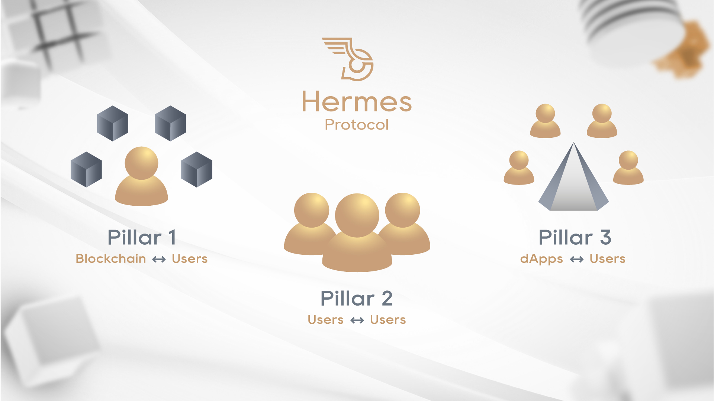
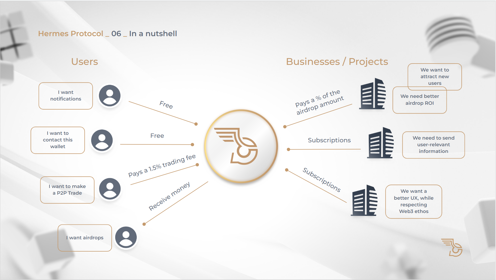

# Hermes Protocol | Community Grant Proposal

- **Thread ID:** 8793
- **Author:** Hermes Protocol (`terra1g6pwngzfj73wnxm7y5gae0thylphugumc2k48z`)
- **Created:** 2023-01-02T17:46:13.927Z
- **Last edited:** -
- **Stage:** discussion
- **Views:** 642
- **Reactions:** 0
- **Comments:** 7
- **Source:** https://common.xyz/terra/discussion/8793-hermes-protocol-community-grant-proposal

---

(for a web version of this post, please click 👉 [here](https://terra-grant.hermesprotocol.io/) 👈)

For a TL;DR version of this grant as an easy-to-digest video, see below 👇

https://youtu.be/aLDcDWeUdt4

# 🚢 Mission

Allow efficient communication between users, projects, and businesses while respecting users’ privacy.

----------

# 🔎 Vision

**We believe that evolving communications in web3 is key for accelerating the adoption we all strive for.**

Hermes Protocol envisions 3 pillars of communication:

- Blockchain to Users
- Users to Users
- dApps to Users

# 📖 Committed to Terra

Since the launch of Terra in July 2022, **Hermes Protocol has consistently supported Terra** even when we started to go to other chains (Near), we continued to invest in Terra partnerships and develop further the app on Terra notifications. Our tweets and videos have always been focused on our building on Terra.

- [Video - Quarterly update in November](https://twitter.com/HermesProtocol/status/1595754446868385792)
- [Skeleton Punks WL giveaway](https://twitter.com/HermesProtocol/status/1601636052543819777)
- [Welcome Hero NFT to Terra 2.0](https://twitter.com/HermesProtocol/status/1598387137745162241)
- [Nov. 15th Weekly Updates](https://twitter.com/HermesProtocol/status/1592616631275900929)
- [Nov. 8th Weekly Updates](https://twitter.com/HermesProtocol/status/1590044839222968320)
- [Video - Setting up an alert for NFT sniping](https://twitter.com/HermesProtocol/status/1584607221484486656)

----------

# 🌔 Contents

1. [**Hermes Protocol Funding**](#🌓-1.-hermes-protocol-funding)

2. [**What Hermes Protocol has built so far**](#🏗️-2.-what-hermes-protocol-has-built-so-far)

3. [**Alignment with the future of Terra**](#🪶-3.-alignment-with-the-future-of-terra)

4. [**Community grant request & usage**](#🤝-4.-community-grant-request--usage)

5. [**Hermes Protocol revenue generation**](#📊-5.-hermes-protocol-revenue-generation)

6. [**Generating ROI for the Community Pool**](#💰-6.-generating-roi-for-the-community-pool)

7. [**FAQs**](#💬-7.-frequently-asked-questions)

----------

# 🌓 1. Hermes Protocol funding

- Hermes Protocol received 60,000 LUNA in the Emergency Builders’ Allocation which was fully vested on 17 October 2022.

- Development to date has cost $195.000 + 65,000 LUNA

----------

# 🏗️ 2. What Hermes Protocol has built so far

## Webapp with Discord integration

**We released the Hermes Protocol web app on Terra and Terra Classic on September 6th** ([tweet](https://twitter.com/HermesProtocol/status/1567181647015215106)).
People can freely subscribe to the following on-chain events which are currently live:

- **Price Alerts**: *(see [alert](https://media.discordapp.net/attachments/986637438267048044/1055529721288474745/image.png) + [conf](https://media.discordapp.net/attachments/992831483603603626/1058454391218249878/image.png) examples)*
  - Terraswap, Astroport, Phoenix Finance
- **Governance Polls**:
  - Terra (gov. module), Astroport (smart contract), Valkyrie
- **Liquidity Pools**
  - Terraswap, Astroport, Phoenix Finance
- **Liquid Staking**
  - Gravedigger - BackboneLabs *(alert example : [boneluna deposit](https://media.discordapp.net/attachments/460043323168522240/1058445249988546591/Liquid_Staking.png))*
- **Wallets** (wallet monitoring)
- **Staking** (whale stakes/unstakes, filter by wallet and/or amount); _(notification setup example: [here](https://drive.google.com/uc?id=1GJI9vqB2RrXA6oaZoUhP9ABT5u0bvLUZ) )_
- **Domain Registrations & Changes**
  - LNS _(notification setup examples: [here](https://drive.google.com/uc?id=1GEtZs5TwQQM_DzS2iyyDuQu6iQRRoIN3); alert examples: [transfer](https://media.discordapp.net/attachments/460043323168522240/1058445248684114081/domain_transfered.png), [renewal](https://media.discordapp.net/attachments/460043323168522240/1058445248986099852/Domain_Renew.png), [changed/updated](https://media.discordapp.net/attachments/460043323168522240/1058445249581694986/Domain_Updated.png) )_
- **Validator Profile Changes** (commission changes, titles, descriptions, etc.)
- **NFTs** ([individual monitoring](https://twitter.com/HermesProtocol/status/1584607221484486656) for sniping, sales, listings, etc.)
  - Knowhere Art, Talis, Random Earth

With thousands of different configurations possible, users are capable of intuitively setup the notifications that fit their needs through our web app or directly in Discord.

___

## Explorer

### Hermes Protocol Explorer was released on 15 December

[Twitter 🧵](https://twitter.com/HermesProtocol/status/1605187152215965698)

From within any Discord server (*which has our bot added to it*), you can query blockchain data whenever you want:

- **Blocks** - specific height, or latest; [see example](https://media.discordapp.net/attachments/992831483603603626/1054378879369871410/image.png) (*a future release will include buttons for the first 5 TXs*)
- **Smart Contracts** - all info + execute query methods; [see example](https://media.discordapp.net/attachments/992831483603603626/1054379624311836782/image.png)
- **NFT info** - all static info (name, description, traits & relative rarity %); [see example](https://media.discordapp.net/attachments/992831483603603626/1054380961476923462/image.png)
(*ranking and dynamic information such as current owner, where it's listed (if listed), asking/bid prices, etc., will come at a later update, together with buttons to buy/bid*)
- **Prices** - will go live as soon as TFM releases the new Price API; [see '21 example](https://media.discordapp.net/attachments/992831483603603626/1054385195249324094/image.png) (*new version will be more appealing visually*)
- **Transactions** - all info except "Message" (*to be added soon, including a 'translate b64 strings' button when base64 values are detected in the TX's 'msg'*); [see early example](https://media.discordapp.net/attachments/992831483603603626/1054385755998400632/image.png)
- **Validator info** - Name, Description, Status, Jailed, Rank, Delegation & Delegator amounts and commission parameters; [see examples](https://media.discordapp.net/attachments/992831483603603626/1054389039454761031/image.png)
- **Wallet info** - Balance & Spendable Balance, Delegations; [see example](https://media.discordapp.net/attachments/992831483603603626/1054390011677642792/image.png)
(*integration with LNS and other name systems and wallet directories are on the roadmap, same as detecting currently owned NFTs (and add buttons to show them on click))*

## Public APIs

### Notification Subscribe API

[Twitter 🧵](https://twitter.com/HermesProtocol/status/1608923007069880320) / [Documentation 📑](https://docs.hermesprotocol.io/public-api/)

On December 20th, we released our Notification Subscribe API, which allows dApp users to subscribe to notifications in a decentralized way. This proof-of-concept implementation, developed in partnership with BackboneLabs' **Gravedigger**, represents an important milestone for Hermes Protocol and demonstrates our commitment to improving the user experience for all web3 users.

We are pleased to announce that we are in discussions with **Terrascope**, **TFM**, and **Terraswap** about integrating this feature into their dApps as well. We believe that this demonstrates the UX priorities of these teams and sets a strong foundation for further adoption of our platform through third-party websites.

### Assets repository

Several projects are already using our Assets repository as a back-end API to access useful information without overloading public LCD endpoints. Here's how it works:

1. The [Assets repository](https://github.com/HermesProtocol-io/assets) is also a [documentation site](https://assets.hermesprotocol.io), which will explain how users can contribute to the repository, thus allowing our platform to support more protocols with minimal effort;
2. Files under the `/static/` folder are publicly accessible with [no bandwidth or rate limits](https://pages.cloudflare.com) and can be used on front-ends as needed;
3. The Assets repository is particularly useful for projects (such as NFTSwitch) that want to display information about all the NFTs in a collection at once, rather than querying them one by one from the chain. It also provides a convenient way to access [all the indexed collections](https://assets.hermesprotocol.io/blockchains/terra/nfts/contracts.json), smart contracts, [tokens](https://assets.hermesprotocol.io/blockchains/terra/tokens/tokens.json), and more. Additionally, the repository includes reliable LCD endpoints with failover options in case the main public endpoint becomes unavailable: [we got you covered](https://assets.hermesprotocol.io/blockchains/blockchains.json)!

## P2P smart contracts

On November 16th, we released our P2P (peer-to-peer) smart contracts on the testnet ([finder link](https://finder.terra.money/testnet/address/terra12mjem4a7f4yvuavw4jyn5h6h750cyqruttkt8daw2sahwkzznnts9elhct)). This was made possible with the help of the Web3 Builders Alliance, whose expertise was invaluable in the development of these contracts.

The P2P smart contracts allow users to trade directly with each other using multiple items, including NFTs and tokens, simultaneously (same trade flow). They also support other interesting use cases, such as bidding or offering something for an unlisted NFT or facilitating over-the-counter deals between venture capital firms, angel investors, and teams with unlisted or low-liquidity tokens.

### Audit

We already asked for two budgets (SVC and Oak) for the Audit of the smart contract, we are waiting for the TFL approval on that budget expenditure.

# 🪶 3. Alignment with the future of Terra

As an **active validator on Terra**, we are committed to supporting the growth of the platform and believe in its vision of a multi-chain future. To this end, we have already partnered with Backbone Labs and become one of the six validators for the BoneLuna LSD. We are also interested in becoming validators for feather chains in the future.

To show our commitment to Terra, we are partnering up with different platforms by integrating our notification solution in exchange for **Luna delegations**.

We have also already tested our smart contract for P2P trades on Juno and are working to have our **contracts available on all feather chains** for further expansion. While we also plan to explore adoption on Cosmos chains, we anticipate that these chains may require some adaptations and adoption may be slower than feather chains.

We have always been an active and supportive member of the Terra community and are committed to continuing to bring significant value to all community members.

___

# 🤝 4. Community grant request & usage

We are requesting a community grant of 200,000 LUNA to be paid into a multi-sig wallet controlled by five trusted members of the community. Upon approval of this proposal, 80,000 LUNA will be transferred upfront to Hermes Protocol to support our ongoing development efforts.

We propose that the remaining 120,000 LUNA be unlocked through objectives every couple of months, with 40,000 LUNA being transferred per each objective delivered. This will allow us to continue building and expanding our platform while also providing a steady source of revenue.

During this period Hermes Protocol will deliver the following new features:

### 1st deliverable

- **P2P trade UI** & related **Docs** - so that 3rd parties (games, marketplaces, etc.) can integrate as well (they'll earn a referral fee for driving traffic);
  - Status: Smart contracts are finished & being audited (pending TFL approval), front-end UI is 2-4 weeks from being finished; we already have agreements with two undisclosed projects who will adopt our smart contracts for their **trades in-game** (for their upcoming projects);

- **Multiple Twitter bots** (& TG alert channels) - As we always build our platform with scalability in mind, we can create hundreds of different automated Twitter accounts for any number of on-chain events, rather than being limited to two or three very specific and independently controlled bots; we commit to launching **at least 20 accounts** for the features we see the highest demand for the duration of this grant;
  - Each of [these accounts](https://twitter.com/i/lists/1608851894813835266) will have a respective Telegram channel *(see examples for [Gov Polls](https://t.me/TerraGovPolls) & [Gov Votes](https://t.me/TerraGovVotes) (validators & whales))*, so people can subscribe to these "general alerts" on both platforms (whichever they prefer or both);
  - White-labeled versions of these Twitter bots will also be possible for projects who wish to have their own without our "Powered by Hermes Protocol" branding (for a price);
  - Status: First 3 bots will go live in January '23, from that point onward it's very easy to populate new ones as we just need to create an account, add credentials and add an entry on our system to create a new event subscription;

### 2nd deliverable

- A working **PoC of off-chain notifications**; - this will enable projects & their dApps to push (to subscribed wallets) either:
  - **Newsletter-type communications**: such as 'Changelogs' (new features) and other important announcements (higher CTR compared to Twitter and @everyone tags);
  - **Personalized communications** based on past or present (real-time) user actions (also referred to as [Transactional](https://postmarkapp.com/blog/what-is-transactional-email-and-how-is-it-used));
  - Status: the subscription API [is done](https://docs.hermesprotocol.io/public-api/), however, we still need to create this new category of off-chain (API triggered) notifications, and a UI for people to see & unsubscribe to existing ones; We also need to create an authenticated endpoint that project teams can use to send the notifications, and ideally, a UI that helps them build it (similar to an email builder); we estimate 2-3 months for this feature (by Q2 '23, at most, it should be finished);

- **Improvements to the Explorer features** as stated above and other general improvements to the bot (implementing different ranking systems for NFTs, so that projects can choose their official algo, for example);
  - Status: most features are already live and well received, however, to bring all current expected features to life, it would probably take us 2-4 more weeks;

- **Custom outgoing webhooks** - rather than being limited to the platforms we release to (Discord, Telegram, Twitter, etc.), any user or business will be able to effectively use no-code automation platforms such as IFTTT, Zapier, Integromat, N8n, and so on to build their own custom integrations. Putting in other words, you can use our platform to trigger your smart lights, send emails (without doxing yourself to us!), or play a sound on a smart speaker when something of interest happens;

### 3rd deliverable

- **Wallet-to-Wallet cross-chain messaging**; (*end-to-end-encryption (using the wallet) will be implemented soon after release, as well as APIs for integrating with 3rd party websites & software (such as games))*
  - Status: Designs are almost complete (check [here](https://www.youtube.com/watch?v=dnXtRDU4tU8) for a very early video we made back in Q2), development has already begun, but will take at least one or two more months to finalize; this will eventually be a [PWA](https://en.wikipedia.org/wiki/Progressive_web_app) so that users can install it to their phones if they wish to do so;

- Radically better **Marketing Strategy**; - we strongly believe our communication solutions can bring positive impact to the ecosystem - users will have a significantly better UX navigating the ecosystem; dApps can communicate with the users without compromising their privacy; but for that we need to build a strong community, better market our solutions, reach more users and accelerate integrations and partnerships, bringing cross-chain pollination into the picture too.
  - Status: read below; we already have an agreement, pending funds;

- More contributions to the **Assets repo** (open-sourcing the indexing/filter, [like we did here](https://github.com/HermesProtocol-io/assets/tree/main/static/blockchains/terra/governance), so that any project can contribute with their smart contracts);
  - Status: also already live, but we want to add a lot more useful things (named wallets, list of **all** projects, and especially: the translation files); estimate for completion: end of January, perhaps mid-Feb.;

Hermes Protocol will continue to close partnerships on Terra and will start to close partnerships on other Feather & Cosmos chains as it expands.

**Expenses are categorized and allocated into:** **Salary (75%).** This includes the engineering & product team to continue shipping new features and improvements, and the operations team that works on the indexer, [docs](https://docs.hermesprotocol.io) & [assets](https://docs.hermesprotocol.io). Includes expenses related to protocol integrations. We are currently a team of 9 (were 16 a couple of months ago...). Our avg. salaries are ~$3.5-4.5k/mo, bringing our burn rate at around $40k/mo (including office expenses, insurance, taxes, etc.).

**Marketing Strategy (~15%) :** We are excited to work with Denis Balitskiy, a marketing expert who has helped numerous successful projects on Terra (Stader, Astroport, etc.) reach their full potential. We believe that collaborating with Denis will help us build a strong and engaged community, and refine our marketing efforts to effectively showcase our product. This percentage of the grant will be used to cover the cost of his services and implement a targeted marketing strategy that will support our long-term growth.

**Infrastructure (10%).** Server Costs for indexers/nodes, SaaS subscriptions, and cloud services.

**Runway**: This grant would provide us with 6 months of runway with Luna @ $1.2. We believe that until mid-2023 we will be able to drive enough revenue to either sustain a smaller core team (until the bull market comes back) or get some external financing.

### Multisig details (**3 out of 5)**

🧑‍💻 **Multisig address: ...**

- **GJ (community)** *terra1ky3ayzkeu9ffcm2h452u3tk3d293gjsnu9gvkj* (address to be confirmed)

- **Jared (TFL)** *terra1gqpvnzggvx4k93s2lrq8fd47pt9jcyf33tdtge*

- **Mark (TFL)** *terra19sft3gk3enekjkw34zgmnrqq2zcvt2t6ueqhac* (to be confirmed)

- **Somethingelse (community)** *terra1scku27w5rsg4392zcaf2y9gnrh0w62t578ez7p*

- **Vini (SCV Security)** *terra18ruqkccl5tp493uhvra0u6jylrzq8t8dv5qs4c* (to be confirmed)

# 📊 5. Hermes Protocol revenue generation

Hermes Protocol is developing a communications platform with a range of free services for users, similar to web2 business models. However, we also offer paid services for projects. Currently, we are gaining traction and are receiving some Luna delegations from supportive platforms. While this is not a long-term revenue generation model, it is a strategy that helps us attract users and increase adoption of our platform and bring the Terra user experience to a new level. In the future, we plan to release additional revenue streams to ensure sustainable growth.

So where and when the revenue will come from?

### P2P trading

One of our key revenue-generating features is the P2P trades feature, which allows users to trade directly with each other using multiple items, including NFTs and tokens. This feature will charge a trading fee of 1.5% of the tokens exchanged in each trade. Trades that include one or more NFTs will also incur an additional cost of 1 Luna per trade. For example, if two users swap three NFTs for four others, each user would pay an additional 0.5 Luna.

- We predict that this feature has the potential to generate around $11,000 per month, based on an estimated 3,000 monthly active users (MAU) with an average trade volume of $250 per month. This is a rough estimate and will depend on actual usage and adoption of the feature.

### Newletters & off-chain notifications

Our newsletters and off-chain notifications feature allow projects to send news and updates to their users on a monthly subscription basis. This feature will be available in the second quarter of 2023.

- We estimate that this feature has the potential to generate around $4,000 per month in revenue, based on an average subscription fee of $50 per business per month if we can attract 75 projects to adopt this service. While this may not seem like a significant amount of money, we plan to expand to more chains and hope that Terra and Phoenix chains will become popular places to build in the coming months, especially after the launch of Phoenix and the multi-chain Station wallet. This could lead to increased adoption of this service and higher levels of revenue.

### Airdrop Notification/Marketing Ad Campaigns

Our airdrop notifications feature, known as "Marketing Ad Campaigns" to businesses, allows platforms to send targeted airdrops to users based on on-chain user data. This feature aims to provide a more effective alternative to traditional advertising by allowing businesses to reach their target audience through claimable airdrops that generate direct notifications to users. Instead of receiving unwanted ads or using ad blockers, users can choose to claim airdrops that are relevant to them. This feature will be available in the third quarter of 2023.

- Based on our estimates, this feature has the potential to generate around $30,000 per month in revenue. We predict that if 25 businesses use our platform to conduct airdrops per year, with an average (annual) value of $130k and a claim rate of 75%, we can generate this level of revenue through a 15% commission on the total value of the airdrops.

### Validator

Our proof-of-stake validator currently has approximately 1.2 million Luna delegated, which generates around $1,000 per month in revenue (excluding hardware costs). With a targeted marketing strategy, we believe that we can increase the number of delegations to our validator to between 3 million and 6 million Luna.

- If we can achieve 5 million Luna delegations and maintain a 5% commission, this would generate approximately $3,500 per month in revenue based on current Luna prices.

This revenue stream has the potential to significantly contribute to our overall sustainability as a project. We are confident that we can attract more delegations to our validator by highlighting the value and utility of our services and demonstrating our commitment to the Terra community.

At Hermes Protocol, we are committed to advancing communications in the Web3 space through the development of innovative solutions. We have made significant progress in building the first pillar of our platform, which enables communication from the blockchain to users, and are now focused on developing the second pillar, which enables communications between users themselves. This includes the implementation of wallet-to-wallet cross-chain chat and P2P trades. We believe that the completion of these two pillars will help drive new activity on Terra and make a positive impact on the ecosystem.

We are also excited to announce that several NFT projects have expressed interest in using our smart contracts for their pilot games, as a way to revitalize their economy. We look forward to continuing to bring value to the Terra community through our ongoing development efforts.

Here's a simple graphic:

# 💰 6. Generating ROI for the Community Pool

To show our appreciation for the community's support and to further align our interests with those of the community, we propose using a portion of our generated revenue to buy back LUNA and return it to the community pool.

Specifically, we propose setting aside 20% of our **total revenue** and 10% of P2P trade fees on Terra, Phoenix, and Cosmos chains for this purpose. This **buyback program** will continue until the amount returned to the community pool reaches **3 times** the original investment made through the grants. We believe this will not only benefit the community but also demonstrate our commitment to the long-term success of the Terra ecosystem.

- Note: The amount spent versus the amount returned will be denominated in $ value. Eg.: if all Luna used from the grant totals ~$250k, at the time that it's transferred from the multi-sig to our team, then we commit to returning the equivalent of ~$750k at the time of each return.

# 💬 7. Frequently Asked Questions

### **Why don’t you raise a seed round?**.
We have been actively seeking a seed round, but have not yet found the right fit for our team and project. Raising capital can be challenging in a bear market, especially when building on a chain with a tainted reputation (hopefully not for long). However, we believe this is not a reflection of the attractiveness or potential of our product, but rather due to other external factors.

- **Token**
While we plan to have a token as part of our platform eventually, we believe that the value of the token will be largely driven by the adoption of our peer-to-peer trading feature and the success of our marketing platform. Both of these features are still in development and require significant adoption and usage to generate value.
Given the current stage of development and the uncertainty around the potential value of our token, we have decided to pursue an equity round (SAFE) rather than a Simple Agreement for Future Tokens (SAFT). This allows us to focus on building and growing our platform, rather than trying to sell an idea that is still in the early stages of development.

- **Overhead and bear market**
Given the current market environment, it has been particularly challenging to secure funding and we have had to devote a significant amount of time and resources to seeking out grants and investments. While we have prepared a pitch deck and are organizing calls with potential investors, it may take some time before we can secure our first investment.

- **Terra’s name**
We are optimistic that as we continue to build relationships with other Cosmos and feather chains, investors will recognize the bright future ahead for our project and be more willing to support us. In the meantime, we believe that seeking community funds is a viable alternative that allows us to continue building and growing our platform while we explore other funding options.

---

### **Is Hermes Protocol self-sustainable ?**

At this time, Hermes Protocol is not self-sustainable. We have always intended for the platform to have three pillars to become profitable, and we are currently in the process of building out the second pillar. We are committed to achieving self-sustainability within the next six months, even if that means reducing our team to a bare minimum to weather the current bear market and continue building.

___

### **Why did you start Hermes Protocol from notifications?**

Our primary goal with Hermes Protocol has always been to bring utility to users, rather than seeking quick and easy profits. We believe that notifications of on-chain events are an essential feature for decentralized finance platforms, but implementing them in a decentralized fashion can be challenging and requires users to trust their privacy to individual projects. By offering free notifications, we aim to provide a useful public good and connect users to the various platforms they are interested in, while also serving as a viable go-to-market strategy.
Unfortunately, the collapse of Terra and the subsequent bear market have disrupted our plans (we had more than enough money to bootstrap everything with our own funds) and made it more difficult for us to fully build out the three pillars of our platform without external funding. However, we are committed to continuing to develop Hermes Protocol and hope to achieve self-sustainability soon. Note: we are not blaming anyone but ourselves for losing that runway, but are just explaining why we started with "free stuff first".

___

### **You already received the Emergency Grant Allocation, why it was not enough, will you ask again in 6 months?**

We were grateful to receive the emergency grant allocation of 60,000 Luna, which we used to bring on-chain event notifications to Terra. We have dedicated all of these funds to the development of our platform and have also stretched our personal finances (used up our "rainy funds") to bring more functionality to Hermes Protocol.
However, we underestimated the time and resources it would take to secure investment while also continuing to build and deliver new features. As a result, we are now requesting a new grant to support the development of additional features. We do not plan to request grants for the same features in the future, and instead, our goal is to become self-sustainable with this new development. When we can do so, we intend to start compensating Terra for the trust and support it has provided to our project.

---

## Comments (7)

**Sasori (`terra1q4j4ucmqz74vxew0kszsxqtmvxqgp5fen248p0`)** — 2023-01-03T04:31:07.809Z — 👍 1

Hermes Protocol is asking for $260,000 from the Terra Community Pool. I will be voting ‘**No**’ on this proposal as the product they are seeking to build has no product market fit, and many of the items they are looking to build already exist for free on Terra

Please see my detailed evaluation here: https://www.notion.so/terragrantseval/Hermes-Protocol-5bdc33cdd05c470c96d2925ec6a1f922

> **Hermes Protocol (`terra1g6pwngzfj73wnxm7y5gae0thylphugumc2k48z`)** — 2023-01-04T15:01:50.899Z
> 
> > Hermes Protocol is asking for $260,000 from the Terra Community Pool. I will be voting ‘No’ on this proposal as the product they are seeking to build has no product market fit, and many of the items they are looking to build already exist for free on Terra
> 
> This sentence seems inconsistent. You claim "No product market fit", however, you argue at the same time that other projects have also solutions like ours.
> So we don't have market fit, but somehow the other projects do?
> Regardless, we are always building with interoperability in mind, so that we can effectively become a platform, rather than a "final destination dApp"; hence what we build is made for others to plug into, so it's not really comparable anyway, but more into that below.
> 
> ---
> 
> #### Now digging into each point of the arguments and challenging the public to evaluate with another point-of-view.
> 
> > Hermes Protocol is a solution that is seeking to solve a problem that does not exist. Usage is low, and there are other notification services that are currently operating for free (see terra_agora, Arbie, Coinhall’s whale alert).
> 
> You mention that the problem we are trying to solve does not exist, but as you mentioned, other projects have already created their own notification solutions. These projects may offer specialized notifications, but they are limited in scope and require users to adapt to multiple different platforms and interfaces to access all the information they need. Our platform offers a more cohesive and comprehensive experience by providing a wide range of notifications and a central interface that is deeply integrated with multiple projects and works throughout the ecosystem. By offering a leading and broader solution, we can also prevent the creation of a fragmented landscape of independently controlled bots and provide a better user experience in the ecosystem as a whole.
> 
> > A block explorer on Discord is also a counterintuitive experience for most people. It is not a natural experience for someone to go into Discord to enter queries and learn more about the blockchain.
>     - Moreover, the responses are clunky and it is difficult to ‘further explore’ into the blockchain based on the information presented.
> 
> Might seem counterintuitive to you since you're most active on Telegram rather than Discord (personal preference, which I can respect, but is biased obviously), but perhaps you'd feel different if this feature was also launched on Telegram and Twitter (as is on our roadmap, but we didn't want to compromise too much on the deliverables).
> Most Terra communities are on Discord, and they love flashing their NFTs and what they do on-chain. Community Moderators throughout the ecosystem also have a constant need to look at TXs (as proof of ownership of a wallet, to enter a whitelist, for ex.), and execute queries, among other tasks. The feedback received so far has been stellar, even if further improvements are due.
> Moreover, this specific feature was developed last month, maybe it doesn't have the best user experience yet, but we wanted to push a working concept out the door and see if there's a demand for it. Regardless, one of the points on our proposal is indeed to improve its UX.
> 
> > The milestones that Hermes Protocol is seeking to deliver are also not valuable to Terra.
>     - P2P Trade UI
>         - We already have (and funded) [nftswitch.xyz](https://nftswitch.xyz/) and [illiquidlabs.io](https://illiquidlabs.io/en/dashboard/). Further, Talis and TFM are also purportedly building the same feature. Do we really need 5 P2P trading platforms even when NFT and CW20 token trading volumes are at an all-time low?
> 
> Our P2P smart contract is not linear (a token for an NFT) as the other ones. Indeed Talis and Knowhere proposed a somewhat similar product some weeks ago, however, our contracts are already done, and our UI is almost finished as well (which is why it's on our first deliverable).
> However, something we don't see in their features is a revenue-sharing model allowing NFT projects (collections, rarity sites, games, marketplaces, etc.) to integrate our smart contract into their platforms. This implies a much quicker "go to market" (as they only have to build the front-end), which means fewer expenses as well. Furthermore, there is no need for audits all the time (less SCV budget expenditure), and they drive profit.
> We already have several projects showing interest in having this kind of business model with us.
> 
> We understand that there are already several linear P2P trading platforms available on Terra, but we believe that our P2P smart contract and trading platform offers a unique value proposition to the entire ecosystem (not just our own platform).
> Moreover, the proposals from Talis and Knowhere, while similar to the naked eye, are fundamentally different. Also, our contracts are already done, and our UI is almost finished as well (which is why it's on our first deliverable)
> Our smart contracts are designed to allow for revenue sharing with NFT projects (collections, rarity sites, games, marketplaces, etc.), making it easier for them to integrate our platform into their own and drive profit while achieving a faster go to market, fewer expenses (no need for audits nor waste a smart contract developer's manhours). We have already received interest from several projects for this business model. While NFT and CW20 token trading volumes may be low at the moment, we believe that our platform has the potential to drive growth and adoption in these areas.
> 
> > Statements such as ‘Hermes Protocol has consistently supported Terra’ is unnecessary given that they have purposefully sought out Emergency Allocation funding on Terra of 60,000 LUNA which binds them to continually build on Terra regardless.
> 
> Thank you for bringing up the Emergency Allocation funding we received. We agree that this funding does bind us (and the other projects) to continue developing on Terra, but some haven't delivered anything, and have left to other ecosystems, while we have done our part (like several others have as well, of course), and we believe this should be clearly stated.
> Your statement puts all (emergency grant) projects under the same bag, however, you can see vast differences in each project's commitment to keep developing on Terra, by looking at their websites, communications, and social media.
> However, we want to stress that our commitment to Terra goes beyond this obligation. We have consistently supported and contributed to the Terra ecosystem, and we believe that our project can bring significant value to the community.
> 
>  > Alignment with the Future of Terra
>     - Hermes Protocol’s first point is that they are an active validator on Terra with partnerships with a LSD provider. This is a moot point as they earn validator commissions (which personally benefit them) and is also not a pass for additional funding.
> 
> While it's true that operating as a validator does generate commissions for us (albeit they have barely covered the break-even (for infrastructure costs)), our primary goal in doing so is to contribute to the security and decentralization of the Terra network. We believe that as active members of the community and as a validator, we are well-suited to help drive the growth and development of Terra. Additionally, our partnerships with LSD providers and our work on the Hermes Protocol project demonstrate our commitment to the long-term success of the Terra ecosystem, while building healthy relationships and collaborations with other builders. While validator commissions may provide marginal financial benefit for us, they are not our primary motivation for participating in the network. Instead, we are focused on building and supporting projects that will help bring long-term success to the entire Terra community.
> 
> > Evaluation of ROI
> The question we should be asking ourselves is have you heard of this product, have you used it yourself, and how much will you be willing to pay to use this product?
> > - How many users or wallets have subscribed to these alerts? Given that we have already funded 60,000 LUNA to Hermes Protocol, what is the return on investment we have seen on this grant? Hermes Protocol needs to release verifiable proof that this is worth our while
> 
> How much an alert is worth is 100% subjective.
> 
> We understand that it is important to consider the value of our product and its potential impact on the Terra community. In regard to the use of our alerts, we believe that real-time notifications can be incredibly valuable for individuals and organizations within the Terra ecosystem. For example, receiving alerts about rare NFTs or liquidity events can help users make informed decisions about their investments. Additionally, alerts about liquidity events or large trades can help users protect their positions and prevent significant losses.
> Back when Anchor Protocol existed (and a similar project will eventually launch on Terra as well), liquidations were a huge problem for a lot of people that were borrowing UST against Luna. By effectively communicating in real-time before these positions reached dangerous levels, people could take action without relying on a bot whose code you have to trust with your seed phrase.
> We also believe that our alerts can be a public good for the Terra community, and we have chosen to offer them for free.
> Since introducing the history feature on our platform on December 2nd, we have sent thousands of alerts to users and public servers, averaging a few dozen alerts per day. While this may not seem like a large number, you have to factor in that most blocks on Terra have zero TXs and a (very low) number of MAUs. It is also important to consider that alerts do not exist when the market is not moving and most of the community is disengaged.
> However, we are open to working with the community to find ways to measure and demonstrate that value.
> 
> > Using 20% of total revenue and 10% of P2P trade fees to buyback LUNA to the community pool to replenish the grant, while an admirable goal, is one that will take Hermes an impossibly long time to accomplish.
>     -   Take for example the 10% P2P trade fees cut that Hermes Protocol takes. They estimate that. Quote from Hermes’ proposal:
>     - At $11,000 per month, Hermes expects to hit $733,000 in trading volume per month - which I’m sure we can agree is an impossible number. Moreover, only 10% of this will be paid back to the community pool. At $1,100 per month (10% of P2P trades), it will take Hermes Protocol 236 months or 20 years to payback the Terra Community Pool.
> 
> While it's true that it may take some time for us to reach our goal of using 20% of total revenue and 10% of P2P trade fees to buy back LUNA for the community pool, it's important to consider the potential scale of our P2P trade platform. As we mentioned, our P2P contracts will be used by multiple projects and platforms across the various ecosystems, which means we will have a larger pool of users and trading volume (not restricted to Terra).
> Look at how much higher volume TFM was able to get on their router after the Station integration, and you can understand how these numbers can start to make sense (once our P2P contracts become the de facto solution for peer-to-peer trading across multiple platforms and ecosystems, similar to how STEAK's contracts are the chosen contracts for building an LSD).
> Additionally, our revenue streams are not solely dependent on P2P trade fees - we have other sources of income as well.
> Finally, it's important to note that our success is not entirely dependent on the market - while a recovery would certainly help by orders of magnitude, we are planning for the long term and are confident in our ability to achieve our goals over a much shorter time than the one you estimated. 
> 
> >"Newletters & off-chain notifications
> Our newsletters and off-chain notifications feature allow projects to send news and updates to their users on a monthly subscription basis. This feature will be available in the second quarter of 2023."
> >
> > Firstly, what does this feature actually do? Why will a team pay $50 in a bear market to send news to their users and how will this actually work? How will newsletters be sent to a project’s users? Through an email blast? Telegram message? How does Hermes intend to crawl this information and handle it in a secure manner?
> 
> Maybe we wrongly assumed that everyone knows what newsletters are, simply because we often see projects having on their websites the "Subscribe to our Newsletter" email form, or even "Know when we launch!".
> If a user uses their wallet to sign-up or signal their support, rather than an email address, not only is that person able to keep themselves anonymous to the dApp, but the dApp can tell by the on-chain activity if they have tried their product post-launch or not (heck, even reward them with a better beta trial if they signed up before they launched, or something).
> Newsletters and off-chain notifications are a way for teams to keep their users informed about updates and important news related to their projects. This feature allows teams to send newsletters and notifications through the channels where the users spend most of their time (of their own choosing), including wallets themselves. This feature can be particularly valuable in a bear market, as it allows teams to keep their users more engaged and informed about the latest developments in their project, compared to tweeting things (and have 0 guarantees that it'll show up on their feed) or expecting users to go on the dApp to see the latest updates (users are more likely to go to the dApp after they know about the update than go to the website often to see if there's an update).
> As far as deliverability, the content is delivered wherever users want: Discord, Telegram, Twitter, or even their wallet if we integrate with a wallet that the user uses. Once our outgoing webhooks are launched, you can even choose to "blink your smart lights when XYZ launches an update" and publishes their Changelog for example (using no-code platforms such as IFTTT/Zapier/Make.com/N8n).
> Our business model here is very similar to Mailchimp. We will not argue the bear market because frankly, it is stupid to talk about a specific time frame that isn't profitable to anyone (_getting some vibes of newspapers arguing the email is useless after the dot-com bubble burst in the early 2000s?_).
>  
>  > Again, these numbers seem to be grasped out of thin air. At 15% commission, Hermes Protocol expects that they will turnaround $200,000 worth of airdrops in a year.
> Firstly, why will a team go to Hermes if there’s a high 15% fee?
> Secondly, instead of theoretics, Coinhall’s Genie is already on the way and we are able to see verifiable work being done [...]
> Coinhall’s Genie is set to launch earlier (in Q4 2022) than Hermes’ projected launch date of Q3 2023 (at no cost to the Terra Community)
> 
> It seems that there is some misunderstanding about our airdrop platform (which isn't included in the grant deliverables, by the way, just that its profits will be used to pay back the community), and how it operates.
> First, we charge a 15% commission on the value of the airdrops that are claimed through our platform, not on the entire campaign budget.
> While it may seem high, it is important to consider the fact that traditional marketing channels, such as Google, Facebook, and Twitter, charge 100% for their services, with little guarantee of (web3) success (meaning, a higher amount of TXs).
> Our platform will allow projects to reach highly targeted audiences (and they specify themselves, similar to Facebook *et al*), including users across borders (dApps) and even across different ecosystems, which is not something that traditional marketing channels can offer. Additionally, we have been transparent about our plans and roadmap for over a year now, and have received very positive feedback from the community and its builders (including Coinhall themselves, when they visited our office in 2022 and discussed our features at length). Genie is a promising product, but it is still in Beta and has a projected launch date of Q4 2022, which has already passed.
> Anyway, it is natural to exist multiple airdrop platforms with different competitive advantages, just as there are multiple marketplaces and DEXs. The community has already funded similar products such as Iliquidly and NFTswitch, and we believe that competition drives innovation and helps to improve the overall user experience.
> We believe it is best for the community if we try and work together, rather than fight publicly and bring bad vibes to the ecosystem, which is why despite everything, we have reached out to Coinhall for a potential collaboration sometime in the future.
>  
> > If the team is confident, then why has it not already done so? It has been more than 6 months since the Genesis of the new chain, and we consistently see Hermes Protocol at the bottom of the validator set.
> Also, as the team rightly pointed out, they “_underestimated the time and resources it would take to secure investment while also continuing to build and deliver new features_”. This lends less confidence to me that their current projections are attainable and gives me even more confidence to say that Hermes Protocol is on the wrong path and is building a product that has no product market fit.
> 
> We agree that our position in the validator set may not be where we want it to be, but this does not necessarily reflect the value or potential of our products. We are confident in the need for and potential success of our offerings, as demonstrated by the fact that we are actively working on and delivering new features (including features included in this grant). We also acknowledge that we underestimated the time and resources required to secure investment while continuing to build and deliver, but we are committed to continuing to work hard and improve in this area.
> 
> As for the question of product market fit, we believe that our offerings address real problems and need in the Terra ecosystem and beyond. While it is true that there are other projects working on somewhat similar solutions, we believe that our unique approach and features set us apart and make us a valuable addition to the ecosystem. We are always open to constructive feedback and will continue to strive to improve and deliver valuable products to our users. Finally, we appreciate your perspective and welcome further discussion on the value and potential of our offerings.

> > **Sasori (`terra1q4j4ucmqz74vxew0kszsxqtmvxqgp5fen248p0`)** — 2023-01-05T08:41:22.065Z — 👍 2
> > 
> > Thanks for the detailed response.
> > 
> > For easier reading, responses may be viewed in-line at the Notion page below:
> > [https://www.notion.so/terragrantseval/Hermes-Protocol-5bdc33cdd05c470c96d2925ec6a1f922](https://www.notion.so/terragrantseval/Hermes-Protocol-5bdc33cdd05c470c96d2925ec6a1f922)
> > 
> > When I say that there is no product market fit, I am referring to the current core product of notifications, as evidenced in the first line on my proposal evaluation (extracted below): Hermes Protocol is a solution that is seeking to solve a problem that does not exist. Usage is low, and there are other notification services that are currently operating for free (see [terra_agora](https://twitter.com/terra_agora), [Arbie](https://twitter.com/ArbieApp),[ Coinhall’s whale alert](https://twitter.com/TerraWhaleAlert)). A block explorer on Discord is also a counterintuitive experience for most people. It is not a natural experience for someone to go into Discord to enter queries and learn more about the blockchain. 
> > 
> > While I acknowledge that the approach you are embarking on is more elegant, once again we must ask ourselves if this is something worth funding. Is this a solution that’s needed? While there’s I do not hold any first party data on hand for analysis, we can make some reasonable ballpark estimates for usership. Take [Arbie](https://twitter.com/ArbieApp) for example. It existed during the bull run and even then, it only has 8.5k followers on Twitter. Assuming an aggressive 50% of these Twitter users converted to using the platform, there are 4k users who used the Arbie product. For a 200k grant, the acquisition cost per user for the Terra community is 50 LUNA per user. This seems far too high. A reasonable number should be >10x smaller than this.
> > 
> > 
> > Contrary to what you believe, I am also an active Discord user. Putting this anecdotal evidence aside, I simply do not believe people are comfortable performing queries on the blockchain on a messaging platform. However, since you are confident of the converse, could you kindly share some usership numbers you see today with the product live?
> > 
> > We already funded [NFTswitch.xyz](http://nftswitch.xyz/) and Illiquid Labs for a similar feature; albeit less fully featured than what you’re describing here. The design space is pretty huge, not sure why we would want to fund a product with 90% feature similarity again. Also, a check on existing platforms with similar features ([Illiquid Labs](https://illiquidlabs.io/en/trade-listings/)) and [NFTSwitch.xyz](http://nftswitch.xyz/) shows that the usership is simply far too low for us to even consider funding a similar product again. There are 0 active listings on NFTSwitch.xyz and 5 active listings on Illiquid Labs. I think this is enough evidence to show that this is not the time to be building such a product. Trading on regular NFT marketplaces is already low right now (see this [Flipside dashboard](https://app.flipsidecrypto.com/dashboard/what-happens-with-terra-2-0-and-their-first-nft-marketplace-9w62Xk)). This will ring even more true for P2P trades.
> > 
> > Regarding newsletters @ $50 per month, a project can simply create for free a Substack, Discord server, Telegram announcements group or Twitter account to keep their audience updated. So why do you think it’s reasonable for them to instead pay Hermes $50 for such a feature?
> > 
> > 
> > Regarding the airdrop platform fees, my argument was frankly more towards the volume of airdrops that you expect to turnaround in a year. $200,000 seems far too high a projection Secondarily, if I were a project owner, I frankly may just opt to do a ‘dumb’ airdrop to users instead of going with Hermes who charges 15%. The efficacy/efficiency delivered to my campaign must justify the campaign cost. I simply cannot fathom why I will think that wastage from ‘dumb’ airdropping is worth me spending 15% of my campaign budget
> > 
> > In conclusion, I do not think that Hermes is on the right path and solving the right problems that is worth the community spending funds for. Many of the features it is wanting to build either already exists, or will expectedly have low adoption. I sincerely wish Hermes the best, but I hope it will decide to tackle another problem worthwhile for us to fund instead.

**Anonymous (`terra17uncwru68z3n0kl543r6rdd5q9jpvwxdxvfe66`)** — 2023-01-04T15:01:15.798Z — 👍 1

Hi Hermes, this is currently a second proposal from the team. Unfortunately, I do not see how the future products will generate sufficient revenue to sustain the team. 

Firstly, P2P trading is currently served by NFTswitch and there isn’t sufficient demand for such services to begin with. Also, the % that you’ll be getting from P2P may not be sufficient to cover the cost of development.

Second, airdrop campaign can be managed with Coinhall’s Genie program which was currently on beta phase. The amount requested by Coinhall is significantly much lower than this. Protocols will use a free solution like Coinhall before paying for a service. 

As for the newsletter notification, you’ve predicted a revenue based on 75, but I fail to see sufficient protocols launched on Terra to justify this. Have this product been validated so far? 

Unfortunately, this is a “no” on my end.

**Hermes Protocol (`terra1g6pwngzfj73wnxm7y5gae0thylphugumc2k48z`)** — 2023-01-04T16:13:18.987Z

Multisig has been created on **Enterprise Protocol**:
- [terra1vpr0yc7w4z3jxne3np9ka9qfrjzavnzm5r85kltmrcraxr90jzgqqv6ms5](https://beta.enterprise.money/dao/terra1vpr0yc7w4z3jxne3np9ka9qfrjzavnzm5r85kltmrcraxr90jzgqqv6ms5)

**Anonymous (`terra1wlu6yl8cls8y6z64tkujex67thkzjmma99nxc2`)** — 2023-01-05T08:40:46.997Z (edited 2023-01-05T08:54:57.350Z)

Hey, Hermes team & folks - just to clear up some potential misconceptions wrt to Coinhall.

- _Additionally, we have been transparent about our plans and roadmap for over a year now, and have received very positive feedback from the community and its builders (including Coinhall themselves, when they visited our office in 2022 and discussed our features at length)._

I stopped (only me!) by their office to visit when I was at NEARcon Lisbon last year.  I am overall encouraging of active builders and enjoyed hearing the Hermes team out. However, opinions are not definitive - and are certainly not representative of the entire team.

- ''...which is why despite everything, we have reached out to Coinhall for a potential collaboration sometime in the future.''

Yup this is true. Chinoman reached out to me but would like* to reiterate that these are only barebone discussions and nothing has been set in stone but we are always happy to explore different opportunities.

Cheers!

**Lunatic3 (`terra1s4w2wt6luywup487cjmrvwtdtwn3eaaknz9f3r`)** — 2023-01-05T21:09:54.317Z

Hi Hermes/Chinoman! 

I've been following you guys for a while and it's good to see your still building on Terra! 

Regarding this grant request.. 

While i appreciate that work momentum one has put in to Hermes protocol and supporting the discord servers on Terra . I dont think the spend here justifies what has been delivered and the value it brings to the Terra community.

I have tried using Hermes protocol when it initially launched , and it just didnt work. After looking at it again more recently it seems the functionality has improved , but the functionality offered is pretty bare and not something i find very useful .

While i use price alerts , i prefer other tools that offer other alerting methods (TG, email, browser/mobile push alerts) . Nothing against discord , it's just not where i want to get my price alerts. 

Regarding the monetization of Hermes to become more self sustaining , i agree with the other comments here. 

- It's extremely unlikely a project would want to pay another company to manage their project updates or newsletters. 
- Charging 15% for projects to use a targeted airdrop feature is unrealistic. For that cost the project could dump 15% of their supply and bring on a full time dev to figure out their airdrop distribution. 
- The monthly TX volume for NFTs on Terra is between 60- 100k Luna per month. With a 1.5% fee and the best case scenario this equates to 1500 Luna per month. And this assumes that Hermes P2P NFT marketplace handles 100% of the NFT volume on Terra . I think your estimated revenue projections are highly misinformed . 
- And regarding the explorer feature from discord commands , i really dont think discord is a good tool for this . It's clunky and i could not give you 1 reason why i'd want to use this over a browser based explorer. 

And lastly it seems that Momentum is asking for a grant to cover their entire burn rate for 5 months. But we know that momentum does not dedicate 100% of their resources to Terra as they have various professional and managed services offerings. With the last grant of 60k Luna roughly valued at 120k I expected to see a bit more progress on Hermes . While the product is clean and has a nice UI , we already have DEX price alerts on Terra , and the only differentiating factor from Hermes and other solutions is that it now supports NFT monitoring. 

For the reasons mentioned above I cannot support this proposal. Best of luck.

