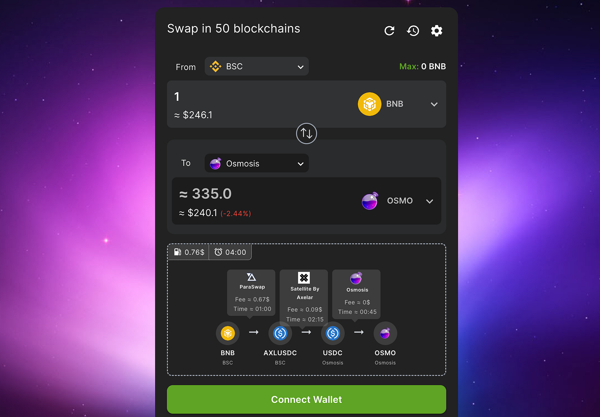
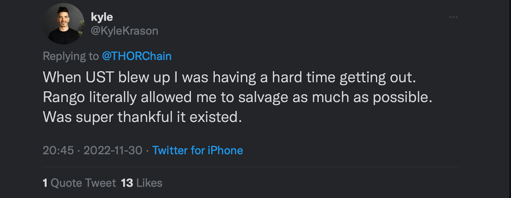
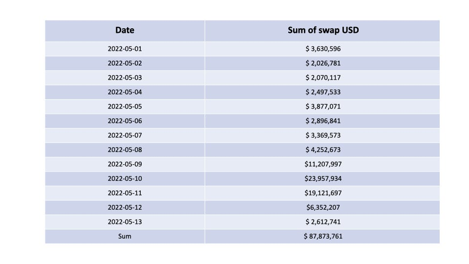

# Rango Grant and Emergency Allocation proposal

- **Thread ID:** 8815
- **Author:** Anonymous (`terra1t2cgttk66ktz4xmuekdrz4sd6nm84f3pfuc3s4`)
- **Created:** 2023-01-04T06:59:41.505Z
- **Last edited:** -
- **Stage:** discussion
- **Views:** 452
- **Reactions:** 0
- **Comments:** 2
- **Source:** https://common.xyz/terra/discussion/8815-rango-grant-and-emergency-allocation-proposal

---

## 🚢 Mission:

Rango is the **first cross-chain DEX/Bridge aggregator** built for the dynamic crypto industry as it supports different blockchains including EVM-based, Cosmos-based, Solana, UTXO and it will also encompass Near, ADA, and many other famous blockchains in the future. Its mission is to provide a seamless cross-chain swap experience for all crypto users and become the leading aggregator platform for all DEXs and bridges. It finds the fastest, cheapest, and most secure route for the user across 40+ blockchains!
Rango integrates all DEXs, bridges, and DEX aggregators around the DeFi world to offer the best experience for users in the multi-chain ecosystem. It performs complex and multi-step swaps to provide the ultimate user experience through its easy-to-use interface.

**Sample of our smart routing system:**

## 🌕 Rango × Terra blockchain:

Before Terra’s collapse, Rango had always supported Terra by integrating all the best DEXs that could be found on the market (such as Astroport, Loop, TerraSwap), as well as Terra Bridge, which allowed Terra to be interoperable with other blockchains, both EVM and non-EVM, before Terra collapsed. Within a short period of time Rango had become one of the most popular platforms for swapping and bridging between Terra and other blockchains for trading and swapping.
During the crisis in May, when a lot of load was on terra dApps, many people in terra ecosystem used Rango to move around money.

You can see the data as follows:
                                                               We have hit ~$87 million dollars 13 days.

Take a look at some of our partnership:

[https://twitter.com/RangoExchange/status/1487767419439534084?t=ImR2p0_KK02xXVLQ3NxM9w&s=19](https://twitter.com/RangoExchange/status/1487767419439534084?t=ImR2p0_KK02xXVLQ3NxM9w&s=19)

And you can check many more in our Twitter handle:

[https://twitter.com/rangoexchange?s=21&t=wzujeEgad6I6I-Db7KMJAQ](https://twitter.com/rangoexchange?s=21&t=wzujeEgad6I6I-Db7KMJAQ)

## ⏭️ What is the next?

- We want to bring this interoperability into Terra 2.0, supporting Alliance, Feather, and supporting Cross-chain Station.

- Furthermore, we want to play a key role in providing APIs and SDKs for other Terra projects, enabling them to easily connect to and onboard users from other chains.

## 🛣️ Roadmap & milestones

_**While the Emergency Builders’ Allocation was underway we did not submit a request for this allocation at first because we thought we could handle it without outside funding. However, we realized that in order to support Terra 2.0 and build the community around it, we would need some funds.**_
In addition to integration of Terra 2.0, this grant will enable us to support Alliance & Feather, and Cross-chain Station over time.‌ 
To devote developers and marketing resources to the creation of a community around our upcoming integration, we are in need of the following grants: 
Our detailed plan for integrating and supporting Terra 2.0:

**Salary breakdown:**
** **
**Dev Team:**

7 Senior Devs, 1 UX/UI Designers, 2 Tech Lead, 1 Dev Ops, 1 QA
**Cost per month: $60,000**

**Marketing & Communications:**

Marketing Team, Support, Business Development: 
**$7,500 per month**

Other costs(E.g: Server cost): 
**$4,000 per month**

## Integrating Terra 2.0:

**⏰ Time for integration: 2 month**
**💰 Grant: 150,000 LUNA**

## Supporting Alliance & Feather:
**⏰ Time for integration: 3 months**
**💰 Grant: 150,000 LUNA**

## Supporting Cross-chain Station + Marketing:
**⏰ Time for integration: 2 month**
**💰 Grant: 100,000 LUNA**

##

---

## Comments (2)

**Sasori (`terra1q4j4ucmqz74vxew0kszsxqtmvxqgp5fen248p0`)** — 2023-01-04T07:49:19.908Z

Hey Rango team, 

First off, I really like your product and think that there's massive value in having Terra supported. 

However, this proposal frankly makes very little sense for us.

Firstly, no other Cosmos chain has paid for ‘integration costs’. 

We have also not paid Rango in the past for integrations, so why are we starting now? 

Finally, the team also does not elaborate what exactly what the integration costs meant for. What does supporting Alliance & Feather mean?

I've shared my full thoughts here: [https://www.notion.so/terragrantseval/Rango-Exchange-ef6053d84fe14774b2703f4a9c80b467](https://www.notion.so/terragrantseval/Rango-Exchange-ef6053d84fe14774b2703f4a9c80b467)

**Anonymous (`terra1005ukvnajnddezzcfceslmwnywkqjep2cxkz5c`)** — 2023-01-04T09:07:38.069Z

Pricing should be uniform - i think it makes little sense for Rango to ask for an integration grant from the Terra community if it has not done so evenly for the many chains it currently supports.

Also keep in mind that for cosmos chains the marginal integration cost should be low - IBC / bank module code should be similar for all chains. 

Best of luck, but will be a "No" vote from me.

