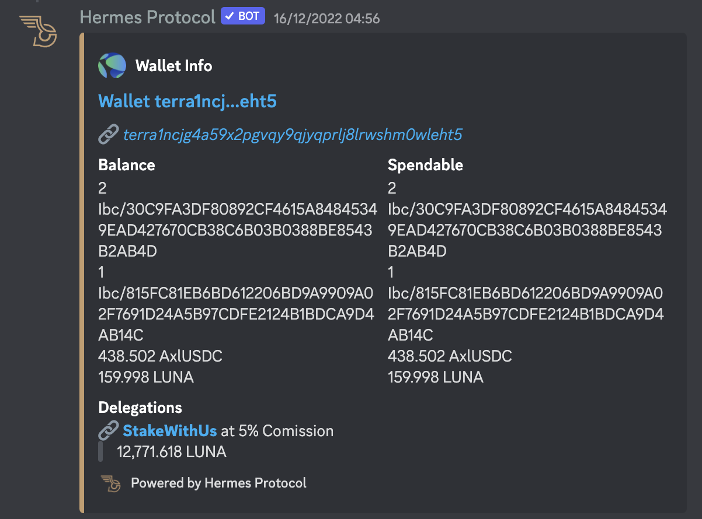
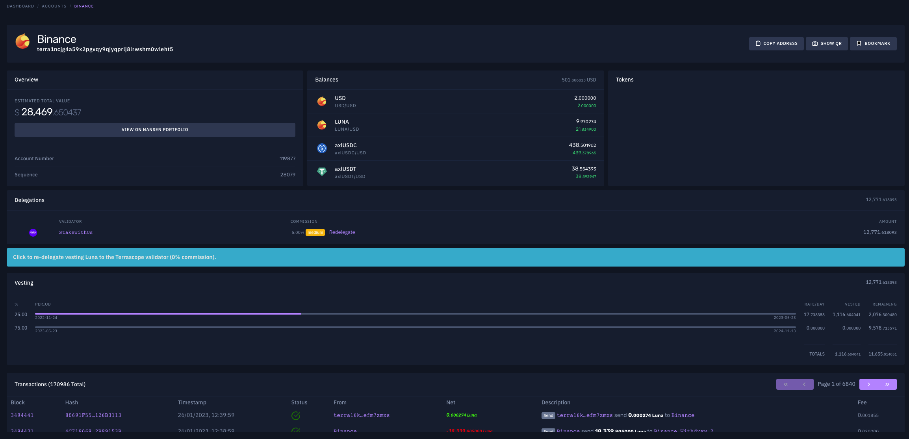

# Hermes Protocol | Revised Community Grant Proposal

- **Thread ID:** 9583
- **Author:** Hermes Protocol (`terra1g6pwngzfj73wnxm7y5gae0thylphugumc2k48z`)
- **Created:** 2023-01-24T19:24:16.713Z
- **Last edited:** -
- **Stage:** discussion
- **Views:** 612
- **Reactions:** 0
- **Comments:** 7
- **Source:** https://common.xyz/terra/discussion/9583-hermes-protocol-revised-community-grant-proposal

---

## https://v2.terra-grant.hermesprotocol.io/
(for a web version of this post, please click the link above)

For a TL;DR version of this grant as an easy-to-digest video, see below 👇

https://youtu.be/aLDcDWeUdt4

### Important Notes regarding the previous proposal (and the video above)

The video is now slightly outdated, as it was made considering the [original proposal](https://agora.terra.money/discussion/8793-hermes-protocol-community-grant-proposal) (v1).

**Main changes**:
- **Grant type**: from "payback" (loan) to "public goods" (development expense);
  - **Fees**: Due to the grant type change, fees will be completely waived on Terra **indefinitely**; +info on [Chapter 6](#💖-6.-community-pool-for-public-goods).
- **Grant amount**: 200k Luna ➡️ 80k Luna
- **Deliverables**: 
  - **P2P UI** no longer included (only the contract audit) although it'll be finished anyway (just not included as a grant item);
  - **Twitter bots** no longer included (initial release already done);
  - **Marketing Strategy** no longer included (we'll find another way to fund it).

# 🚢 Mission

Allow efficient communication between users, projects, and businesses while respecting users’ privacy.

----------

# 🔎 Vision

**We believe that evolving communications in web3 is key for accelerating the adoption we all strive for.**

Hermes Protocol envisions 3 pillars of communication:

- Blockchain to Users
- Users to Users
- dApps to Users

# 📖 Committed to Terra

Since the launch of Terra in July 2022, **Hermes Protocol has consistently supported Terra** even when we started to go to other chains (Near), we continued to invest in Terra partnerships and develop further the app on Terra notifications. Our tweets and videos have always been focused on our building on Terra.

- [Video - Quarterly update in November](https://twitter.com/HermesProtocol/status/1595754446868385792)
- [Skeleton Punks WL giveaway](https://twitter.com/HermesProtocol/status/1601636052543819777)
- [Welcome Hero NFT to Terra 2.0](https://twitter.com/HermesProtocol/status/1598387137745162241)
- [Nov. 15th Weekly Updates](https://twitter.com/HermesProtocol/status/1592616631275900929)
- [Nov. 8th Weekly Updates](https://twitter.com/HermesProtocol/status/1590044839222968320)
- [Video - Setting up an alert for NFT sniping](https://twitter.com/HermesProtocol/status/1584607221484486656)

----------

# 🌔 Contents

1. [**Hermes Protocol Funding**](#🌓-1.-hermes-protocol-funding)

2. [**What Hermes Protocol has built so far**](#🏗️-2.-what-hermes-protocol-has-built-so-far)

3. [**Alignment with the future of Terra**](#🪶-3.-alignment-with-the-future-of-terra)

4. [**Community grant request & usage**](#🤝-4.-community-grant-request--usage)

5. [**Hermes Protocol revenue generation**](#📊-5.-hermes-protocol-revenue-generation)

6. [**Community Pool for public goods**](#💖-6.-community-pool-for-public-goods)

7. [**FAQs**](#💬-7.-frequently-asked-questions)

----------

# 🌓 1. Hermes Protocol funding

- Hermes Protocol received 60,000 LUNA in the Emergency Builders’ Allocation which was fully vested on 17 October 2022.

- Development to date has cost $195.000 + 65,000 LUNA

----------

# 🏗️ 2. What Hermes Protocol has built so far

## Webapp with Discord integration

**We released the Hermes Protocol web app on Terra and Terra Classic on September 6th** ([tweet](https://twitter.com/HermesProtocol/status/1567181647015215106)).
People can freely subscribe to the following on-chain events which are currently live:

- **Price Alerts**: *(see [alert](https://media.discordapp.net/attachments/986637438267048044/1055529721288474745/image.png) + [conf](https://media.discordapp.net/attachments/992831483603603626/1058454391218249878/image.png) examples)*
  - Terraswap, Astroport, Phoenix Finance
- **Governance Polls**:
  - Terra (gov. module), Astroport (smart contract), Valkyrie
- **Liquidity Pools**
  - Terraswap, Astroport, Phoenix Finance
- **Liquid Staking**
  - Gravedigger - BackboneLabs *(alert example : [boneluna deposit](https://media.discordapp.net/attachments/460043323168522240/1058445249988546591/Liquid_Staking.png))*
- **Wallets** (wallet monitoring)
- **Staking** (whale stakes/unstakes, filter by wallet and/or amount); _(notification setup example: [here](https://drive.google.com/uc?id=1GJI9vqB2RrXA6oaZoUhP9ABT5u0bvLUZ) )_
- **Domain Registrations & Changes**
  - LNS _(notification setup examples: [here](https://drive.google.com/uc?id=1GEtZs5TwQQM_DzS2iyyDuQu6iQRRoIN3); alert examples: [transfer](https://media.discordapp.net/attachments/460043323168522240/1058445248684114081/domain_transfered.png), [renewal](https://media.discordapp.net/attachments/460043323168522240/1058445248986099852/Domain_Renew.png), [changed/updated](https://media.discordapp.net/attachments/460043323168522240/1058445249581694986/Domain_Updated.png) )_
- **Validator Profile Changes** (commission changes, titles, descriptions, etc.)
- **NFTs** ([individual monitoring](https://twitter.com/HermesProtocol/status/1584607221484486656) for sniping, sales, listings, etc.)
  - Knowhere Art, Talis, Random Earth

With thousands of different configurations possible, users can intuitively set up the notifications that fit their needs through our web app or directly in Discord.

___

## Explorer

### Hermes Protocol Explorer was released on 15 December

[Twitter 🧵](https://twitter.com/HermesProtocol/status/1605187152215965698)

From within any Discord server (*which has our bot added to it*), you can query blockchain data whenever you want:

- **Blocks** - specific height, or latest; [see example](https://media.discordapp.net/attachments/992831483603603626/1054378879369871410/image.png) (*a future release will include buttons for the first 5 TXs*)
- **Smart Contracts** - all info + execute query methods; [see example](https://media.discordapp.net/attachments/992831483603603626/1054379624311836782/image.png)
- **NFT info** - all static info (name, description, traits & relative rarity %); [see example](https://media.discordapp.net/attachments/992831483603603626/1054380961476923462/image.png)
(*ranking and dynamic information such as current owner, where it's listed (if listed), asking/bid prices, etc., will come at a later update, together with buttons to buy/bid*)
- **Prices** - will go live as soon as TFM releases the new Price API; [see '21 example](https://media.discordapp.net/attachments/992831483603603626/1054385195249324094/image.png) (*new version will be more appealing visually*)
- **Transactions** - all info except "Message" (*to be added soon, including a 'translate b64 strings' button when base64 values are detected in the TX's 'msg'*); [see early example](https://media.discordapp.net/attachments/992831483603603626/1054385755998400632/image.png)
- **Validator info** - Name, Description, Status, Jailed, Rank, Delegation & Delegator amounts and commission parameters; [see examples](https://media.discordapp.net/attachments/992831483603603626/1054389039454761031/image.png)
- **Wallet info** - Balance & Spendable Balance, Delegations; [see example](https://media.discordapp.net/attachments/992831483603603626/1054390011677642792/image.png)
(*integration with LNS and other name systems and wallet directories are on the roadmap, same as detecting currently owned NFTs (and add buttons to show them on click))*

## Public APIs

### Notification Subscribe API

[Twitter 🧵](https://twitter.com/HermesProtocol/status/1608923007069880320) / [Documentation 📑](https://docs.hermesprotocol.io/public-api/)

On December 20th, we released our Notification Subscribe API, which allows dApp users to subscribe to notifications in a decentralized way. This proof-of-concept implementation, developed in partnership with BackboneLabs' **Gravedigger**, represents an important milestone for Hermes Protocol and demonstrates our commitment to improving the user experience for all web3 users.

We are pleased to announce that we are in discussions with **Terrascope**, **TFM**, and **Terraswap** about integrating this feature into their dApps as well. We believe that this demonstrates the UX priorities of these teams and sets a strong foundation for further adoption of our platform through third-party websites.

### Assets repository

Several projects are already using our Assets repository as a back-end API to access useful information without overloading public LCD endpoints. Here's how it works:

1. The [Assets repository](https://github.com/HermesProtocol-io/assets) is also a [documentation site](https://assets.hermesprotocol.io), which will explain how users can contribute to the repository, thus allowing our platform to support more protocols with minimal effort;
2. Files under the `/static/` folder are publicly accessible with [no bandwidth or rate limits](https://pages.cloudflare.com) and can be used on front-ends as needed;
3. The Assets repository is particularly useful for projects (such as NFTSwitch) that want to display information about all the NFTs in a collection at once, rather than querying them one by one from the chain. It also provides a convenient way to access [all the indexed collections](https://assets.hermesprotocol.io/blockchains/terra/nfts/contracts.json), smart contracts, [tokens](https://assets.hermesprotocol.io/blockchains/terra/tokens/tokens.json), and more. Additionally, the repository includes reliable LCD endpoints with failover options in case the main public endpoint becomes unavailable: [we got you covered](https://assets.hermesprotocol.io/blockchains/blockchains.json)!
4. A future update which is part of this grant proposal, will include "blockchain translation" files, so that anyone can easily understand how NFT trades are done, regardless of the marketplace, how tokens are swapped, and so on. It will increase the Developer Experience for devs that build on the same chains as us by a big margin.

## P2P smart contracts

On November 16th, we released our P2P (peer-to-peer) smart contracts on the testnet ([finder link](https://finder.terra.money/testnet/address/terra12mjem4a7f4yvuavw4jyn5h6h750cyqruttkt8daw2sahwkzznnts9elhct)). This was made possible with the help of the Web3 Builders Alliance, whose expertise was invaluable in the development of these contracts.

The P2P smart contracts allow users to trade directly with each other using multiple items, including NFTs and tokens, simultaneously (same trade flow). They also support other interesting use cases, such as bidding or offering something for an unlisted NFT or facilitating over-the-counter deals between venture capital firms, angel investors, and teams with unlisted or low-liquidity tokens.

The UI is ~60% done, and should be completed by end of February '23.
Documentation so that other projects (games, marketplaces, etc.) can use our smart contracts as well will go live shortly before.
Note: we already have agreements with two undisclosed projects who will adopt our smart contracts for their **trades in-game** (for their upcoming projects);

### Audit

We already asked for two budgets (SVC and Oak) for the Audit of the smart contract, and as soon as we get the upfront payment we will commence the audit.

## Multiple Twitter bots (& TG alert channels)

As we always build our platform with scalability in mind, we can create hundreds of different automated Twitter accounts for any number of on-chain events, rather than being limited to two or three very specific and independently controlled bots.
As a proof-of-concept, we have already launched [these accounts](https://twitter.com/i/lists/1608851894813835266/members) *(actively growing in number)* on Twitter and Telegram.
We are already in active conversations with multiple projects and dApps to build these accounts for them as well at no charge (unless they want a whitelabeled solution).

Each of these Twitter accounts has a respective Telegram channel *(see examples for [Gov Polls](https://t.me/TerraGovPolls) & [Gov Votes](https://t.me/TerraGovVotes) (validators & whales))*, so people can subscribe to these "general alerts" on both platforms (whichever they prefer or both);

NFT Projects or dApps who wish to have their own automated Twitter account(s) can reach out to us via [our Discord](https://discord.gg/RkZvDsWaGk) or [Telegram](https://t.me/HermesProtocolCommunity).

# 🪶 3. Alignment with the future of Terra

As an **active validator on Terra**, we are committed to supporting the growth of the platform and believe in its vision of a multi-chain future. To this end, we have already partnered with Backbone Labs and become one of the six validators for the BoneLuna LSD. We are also interested in becoming validators for feather chains in the future.

To show our commitment to Terra, we are partnering up with different platforms by integrating our notification solution in exchange for **Luna delegations**.

We have also already tested our smart contract for P2P trades on Juno and are working to have our **contracts available on all feather chains** for further expansion. While we also plan to explore adoption on Cosmos chains, we anticipate that these chains may require some adaptations and adoption may be slower than feather chains.

We have always been an active and supportive member of the Terra community and are committed to continuing to bring significant value to all community members.

___

# 🤝 4. Community grant request & usage

We are requesting a community grant of 80,000 LUNA (~$160k) to be paid into a multi-sig wallet controlled by five trusted members of the community. Upon approval of this proposal, 25,000 LUNA will be transferred upfront to Hermes Protocol to pay for the audit included in the first deliverable and other ongoing expenses.

We propose that the remaining 55,000 LUNA be unlocked through objectives every couple of months, with 27,500 LUNA being transferred per each objective delivered. This will allow us to continue building and expanding our platform while also providing a steady source of revenue.

During this period Hermes Protocol will deliver the following new features:

### 1st deliverable (27.5k Luna) - Q1-Q2 '23

- Audit for the P2P smart contract so that other dApps can save money while trusting our provided solution; this cost is covered by part of the Luna paid upfront upon grant approval on-chain;

- A working **PoC of off-chain notifications**; - this will enable projects & their dApps to push (to subscribed wallets) either:
  - **Newsletter-type communications**: such as 'Changelogs' (new features) and other important announcements (higher CTR compared to Twitter and @everyone tags);
	  - As a niche use-case, new dApps can create landing pages with the typical call-to-actions that say "*Know when we go live!*", and instead of collecting email addresses, they collect wallet signatures (addresses + signatures), which allows safe, private and non-doxxed collection of user interest;
  - **Personalized communications** based on past or present (real-time) user actions (also referred to as [Transactional](https://postmarkapp.com/blog/what-is-transactional-email-and-how-is-it-used));
  - **Status**: the subscription API [is done](https://docs.hermesprotocol.io/public-api/), however, we still need to create this new category of off-chain (API triggered) notifications, and a UI for people to see & unsubscribe to existing ones; We also need to create an authenticated endpoint that project teams can use to send the notifications, and ideally, a UI that helps them build it (similar to an email builder); we estimate 2-3 months for this feature (by Q2 '23, at most, it should be finished);

- **Improvements to the Explorer features** as stated above and other general improvements to the bot (implementing different ranking systems for NFTs, so that projects can choose their official algorithm, for example);
  - **Status**: most features are already live and well received, however, to bring all current expected features to life, it would probably take us 2-4 more weeks;

- **Custom outgoing webhooks** - rather than being limited to the platforms we release to (Discord, Telegram, Twitter, etc.), any user or business will be able to effectively use no-code automation platforms such as IFTTT, Zapier, Integromat, N8n, and so on to build their own custom integrations. Putting it in other words, you can use our platform to trigger your smart lights, send emails (without doxing yourself to us!), or play a sound on a smart speaker when something of interest happens;
  - Note: this effectively allows any wallet provider such as Obi, Station, XDEFI, Leap, etc. to incorporate our notification system within their own system very easily, without even requiring our intervention; or dApps to create their own bot solutions without having to create all the blockchain interpretation aspects of it.

### 2nd deliverable (27.5k Luna) - Q2 '23

- **Wallet-to-Wallet cross-chain messaging**; (*end-to-end-encryption (using the wallet) will be implemented soon after release, as well as APIs for integrating with 3rd party websites & software (such as games))*
  - **Status**: Designs are almost complete (check [here](https://www.youtube.com/watch?v=dnXtRDU4tU8) for a very early video we made back in Q2 '22), but will take at least two or three more more months to finalize; this will eventually be a [PWA](https://en.wikipedia.org/wiki/Progressive_web_app) so that users can install it to their phones if they wish to do so;
  - Disclosure: so that the deliverables are easier to quantify, we will consider this task to be done (for the sake of releasing the funds) when the UI and its basic features are released and working (even without encryption at first).

- More contributions to the **Assets repo** (open-sourcing the indexing/filter, [like we did here](https://github.com/HermesProtocol-io/assets/tree/main/static/blockchains/terra/governance), so that any project can contribute with their smart contracts);
  - **Status**: also already live, but we want to add a lot more useful things (named wallets, list of **all** projects, and especially: the translation files); estimate for completion: January-February '23;

Hermes Protocol will continue to close partnerships on Terra and will start to close partnerships on other Feather & Cosmos chains as it expands.

### Expenses are categorized and allocated into:

#### **Salaries (~65%)**
This includes the engineering & product teams to continue shipping new features and improvements, and the operations team that works on the indexer, [docs](https://docs.hermesprotocol.io) & [assets](https://docs.hermesprotocol.io). Includes expenses related to protocol integrations.
We have recently downscaled our team to just 5 people in February, and have cut on other costs such as the Lisbon office. Our avg. expense per person ~$5k/mo, which makes our burn rate at around $25k/mo (including work insurance and taxes).
This brings the cost of 6 months of runway to $150k, not ~$100k (65% of $160k). However, Hermes Protocol already has, very little, recurring revenue from its validator which helps subsidize this cost.
Momentum One (the company building Hermes Protocol) also has some recurring revenue from clients and is able to cover the remaining costs of Hermes Protocol's development.

#### Audit (~15%)
Early budget estimates that were given: ~$15-20k.
However, the contract has since become more complex, and we'll likely have to cover bug fixes that surface from the audit, hence the ~15% ( ~$24k ) total.

#### Infrastructure (~20%)
Server Costs for indexers/nodes, SaaS subscriptions, and cloud services for one year. Current costs are lower, but we expect to have to scale this, specially if the chat pops off and we have more dApps integrating our open API.

**Runway**: This grant would provide us with 6 months of runway with Luna @ $2. We believe that until mid-2023 we will be able to drive enough revenue to either sustain our team until the bull market comes back (and then we can go back to reinvesting our own profits to keep building).

### Multisig details (**3 out of 5)**

🧑‍💻 **Multisig address: [terra1vpr0yc7w4z3jxne3np9ka9qfrjzavnzm5r85kltmrcraxr90jzgqqv6ms5](https://enterprise.money/dao/terra1vpr0yc7w4z3jxne3np9ka9qfrjzavnzm5r85kltmrcraxr90jzgqqv6ms5)**

- **GJ (community)** *terra1ky3ayzkeu9ffcm2h452u3tk3d293gjsnu9gvkj*

- **Jared (TFL)** *terra1gqpvnzggvx4k93s2lrq8fd47pt9jcyf33tdtge*

- **Mark (TFL)** *terra19sft3gk3enekjkw34zgmnrqq2zcvt2t6ueqhac*

- **Somethingelse (community)** *terra1scku27w5rsg4392zcaf2y9gnrh0w62t578ez7p*

- **Vini (SCV Security)** *terra18ruqkccl5tp493uhvra0u6jylrzq8t8dv5qs4c*

# 📊 5. Hermes Protocol revenue generation

Hermes Protocol is developing a communications platform with a range of free services for users, similar to web2 business models. However, we also offer paid services for projects. Currently, we are gaining traction and are receiving some Luna delegations from supportive platforms. While this is not a long-term revenue generation model, it is a strategy that helps us attract users and increase adoption of our platform and bring the Terra user experience to a new level. In the future, we plan to release additional revenue streams to ensure sustainable growth.

So where and when the revenue will come from?

### P2P trading (free on Terra)

One of our key revenue-generating features is the P2P trades feature, which allows users to trade directly with each other using multiple items, including NFTs and tokens. This feature will charge a trading fee of 1.5% of the tokens exchanged in each trade. Trades that include one or more NFTs will also incur an additional cost of 1 Luna per trade. For example, if two users swap three NFTs for four others, each user would pay an additional 0.5 Luna.

- We predict that this feature has the potential to generate around $11,000 per month, based on an estimated 3,000 monthly active users (MAU) with an average trade volume of $250 per month. This is a rough estimate and will depend on actual usage and adoption of the feature.
- **Important Note**: as we will waive all fees on Terra if this grant passes, these simulations are only relevant for revenue coming from other chains that Hermes Protocol will adopt in the future. In order to keep the contract interesting for dApps, we will keep the platform referral fee, which will allow Terra projects to use their own front-ends to drive revenue for themselves, and Hermes Protocol will not charge anything (unless our own front-end is used); **TL;DR**: a small fee will always be included, however the fee will go 100% to a partner when not using the Hermes Protocol front-end;

### Newletters & off-chain notifications (free on Terra)

Our newsletters and off-chain notifications feature allow projects to send news and updates to their users on a monthly subscription basis. This feature will be available in the second quarter of 2023.

- We estimate that this feature has the potential to generate around $4,000 per month in revenue, based on an average subscription fee of $50 per business per month if we can attract 75 projects to adopt this service. While this may not seem like a significant amount of money, we plan to expand to more chains and hope that Terra and Phoenix chains will become popular places to build in the coming months, especially after the launch of Phoenix and the multi-chain Station wallet. This could lead to increased adoption of this service and higher levels of revenue.

### Airdrop Notification/Marketing Ad Campaigns

Our airdrop notifications feature, known as "Marketing Ad Campaigns" to businesses, allows platforms to send targeted airdrops to users based on on-chain user data. This feature aims to provide a more effective alternative to traditional advertising by allowing businesses to reach their target audience through claimable airdrops that generate direct notifications to users. Instead of receiving unwanted ads or using ad blockers, users can choose to claim airdrops that are relevant to them. This feature will be available in the third quarter of 2023.

- Based on our estimates, this feature has the potential to generate around $30,000 per month in revenue. We predict that if 25 businesses use our platform to conduct airdrops per year, with an average (annual) value of $130k and a claim rate of 75%, we can generate this level of revenue through a 15% commission on the total value of the airdrops.

### Validator

Our proof-of-stake validator currently has approximately 1.2 million Luna delegated, which generates around $1,000 per month in revenue (excluding hardware costs). With a targeted marketing strategy, we believe that we can increase the number of delegations to our validator to between 3 million and 6 million Luna.

- If we can achieve 5 million Luna delegations and maintain a 5% commission, this would generate approximately $3,500 per month in revenue based on current Luna prices.

This revenue stream has the potential to significantly contribute to our overall sustainability as a project. We are confident that we can attract more delegations to our validator by highlighting the value and utility of our services and demonstrating our commitment to the Terra community.

At Hermes Protocol, we are committed to advancing communications in the Web3 space through the development of innovative solutions. We have made significant progress in building the first pillar of our platform, which enables communication from the blockchain to users, and are now focused on developing the second pillar, which enables communications between users themselves. This includes the implementation of wallet-to-wallet cross-chain chat and P2P trades. We believe that the completion of these two pillars will help drive new activity on Terra and make a positive impact on the ecosystem.

We are also excited to announce that several NFT projects have expressed interest in using our smart contracts for their pilot games, as a way to revitalize their economy. We look forward to continuing to bring value to the Terra community through our ongoing development efforts.

Here's a simple graphic:

# 💖 6. Community Pool for public goods

On our previous proposal, we figured that having a buyback system would be interesting for a community pool funded project, so that the pool can replenish over time.
Unfortunately, we received some backlash since revenue generation during the bear market is complicated and the future is uncertain.

Having this consideration, we have decided to remove the buyback program (effectively making the grant a "development bounty", rather than a financial loan), and in exchange we will **waive ALL FEES** for the developments covered by this grant indefinitely (on Terra).
This effectively means that the P2P contract, the off-chain notifications, wallet-to-wallet messaging, additional Explorer features and the Custom outgoing Webhooks (which effectively allows anyone to build their own bots without programming a single line of code) will have **no fees forever** on Terra.

# 💬 7. Frequently Asked Questions

### **Why don’t you raise a seed round?**.
We have been actively seeking a seed round, but have not yet found the right fit for our team and project. Raising capital can be challenging in a bear market, especially when building on a chain with a tainted reputation (hopefully not for long). However, we believe this is not a reflection of the attractiveness or potential of our product, but rather due to other external factors.

- **Token**
While we plan to have a token as part of our platform eventually, we believe that the value of the token will be largely driven by the adoption of our peer-to-peer trading feature and the success of our marketing platform. Both of these features are still in development and require significant adoption and usage to generate value.
Given the current stage of development and the uncertainty around the potential value of our token, we have decided to pursue an equity round (SAFE) rather than a Simple Agreement for Future Tokens (SAFT). This allows us to focus on building and growing our platform, rather than trying to sell an idea that is still in the early stages of development.

- **Overhead and bear market**
Given the current market environment, it has been particularly challenging to secure funding and we have had to devote a significant amount of time and resources to seeking out grants and investments. While we have prepared a pitch deck and are organizing calls with potential investors, it may take some time before we can secure our first investment.

- **Terra’s name**
We are optimistic that as we continue to build relationships with other Cosmos and feather chains, investors will recognize the bright future ahead for our project and be more willing to support us. In the meantime, we believe that seeking community funds is a viable alternative that allows us to continue building and growing our platform while we explore other funding options.

---

### **Is Hermes Protocol self-sustainable ?**

At this time, Hermes Protocol is not self-sustainable. We have always intended for the platform to have three pillars to become profitable, and we are currently in the process of building out the second pillar. We are committed to achieving self-sustainability within the next six months.

___

### **Why did you start Hermes Protocol from notifications?**

Our primary goal with Hermes Protocol has always been to bring utility to users, rather than seeking quick and easy profits. We believe that notifications of on-chain events are an essential feature for decentralized finance platforms, but implementing them in a decentralized fashion can be challenging and requires users to trust their privacy to individual projects. By offering free notifications, we aim to provide a useful public good and connect users to the various platforms they are interested in, while also serving as a viable go-to-market strategy.
Unfortunately, the collapse of Terra and the subsequent bear market have disrupted our plans (we had more than enough money to bootstrap everything with our own funds) and made it more difficult for us to fully build out the three pillars of our platform without external funding. However, we are committed to continuing to develop Hermes Protocol and hope to achieve self-sustainability soon. Note: we are not blaming anyone but ourselves for losing that runway, but are just explaining why we started with "free stuff first".

___

### **You already received the Emergency Grant Allocation, why it was not enough, will you ask again in 6 months?**

We were grateful to receive the emergency grant allocation of 60,000 Luna, which we used to bring on-chain event notifications to Terra. We have dedicated all of these funds to the development of our platform and have also stretched our personal finances (used up our "rainy funds") to bring more functionality to Hermes Protocol.
However, we underestimated the time and resources it would take to secure investment while also continuing to build and deliver new features. As a result, we are now requesting a new grant to support the development of additional features. We do not plan to request grants for the same features in the future, and instead, our goal is to become self-sustainable with this new development. When we can do so, we intend to start compensating Terra for the trust and support it has provided to our project.

---

## Comments (7)

**Sasori (`terra1q4j4ucmqz74vxew0kszsxqtmvxqgp5fen248p0`)** — 2023-01-25T10:10:10.474Z — 👍 1

Hey Hermes team,

Not sure why this is published as a brand new proposal instead of revising the original one here: https://agora.terra.money/discussion/8793-hermes-protocol-community-grant-proposal
Pasting the link above so that community members can track the discussion previously.

**In summary, I will be voting 'No' as there is no product-market-fit, and many of the deliverables already exist on Terra and I do not think it is worth community pool funds to fund the development for this.**

Of the deliverables listed,
- Discord Explorer Feature: Unintuitive experience 
- Newsletter type communications: With Substack, why do we need this?
- P2P Trading - we already funded [NFTSwitch.xyz](https://dapp.nftswitch.xyz/) and [Illiquidlabs.io](https://illiquidlabs.io/en/trade-listings/) for this. We do not need a third option especially given low NFT volumes today.

Revenue projections are also highly aggressive:
- P2P Trading: Firstly, it's free on Terra, which is your primary community base, frankly don't see how you can attract 3000 users to use this.
- Newsletter notifications: Again, a free alternative is available (Substack). 
- Airdrop Notification: Coinhall's Genie already offers this. Why should we fund development of a similar tool?

For those interested, my full analysis and response may be found here:
https://terragrantseval.notion.site/Hermes-Protocol-5bdc33cdd05c470c96d2925ec6a1f922

> **Hermes Protocol (`terra1g6pwngzfj73wnxm7y5gae0thylphugumc2k48z`)** — 2023-01-25T19:36:21.549Z
> 
> Thank you for your time.
> 
> Commonwealth (the Agora software) is very buggy and doesn't allow us to edit the original post.
> This is why we had to make a new thread.
> 
> Now, as for your points raised:
> - "Unintuitive experience": we've had significant adoption (hundreds of people using the different commands available). People won't go to Discord specifically to query the blockchain, but if they are already having conversations there, they can use it either as curiosity, or to show someone something publicly. Regardless, we are proposing to further improve this experience exactly, not build it from scratch.
> - "Substack": that platform requires users to use their own emails (which they either dox or have to create privacy addresses for that purpose). With our solution, the only thing the dapp knows is the wallet addresses, which are public anyway as they know which wallets interact with their smart contracts and front-ends regardless. It is also not a solution for Transactional communications (see Wikipedia link embedded in the prop for +info on what that means).
> - "Already funded other P2P projects": we are not asking to fund this feature, only its audit ($15-20k), since TFL doesn't sponsor audits anymore (which it previously was doing).
> - "Revenue projections": I don't see what is the point of picking up this subject anymore. We won't be doing the "buyback" anymore, so the economic viability and our projections aren't relevant to your analysis anymore.
> - "Genie": you are again picking on our Revenue generation part, which is unrelated to the grant deliverables. This grant will not be used to finance this feature, it is simply part of our roadmap. Regardless, Genie is an entirely different platform, it is not meant to notify people of airdrops they might have to claim.
> 
> 
> While we appreciate what you want to do (provide analysis so other people can base their opinions on it), your comments are very heavily focused on the previous proposal (the revenue generation, the P2P, etc.) and not this one, which is a public good for the entire Terra community to benefit from at 0 costs.

> > **Sasori (`terra1q4j4ucmqz74vxew0kszsxqtmvxqgp5fen248p0`)** — 2023-01-26T04:51:14.147Z (edited 2023-01-26T04:55:03.768Z)
> > 
> > I don't understand any of ur counterpoints.
> > 
> > If u have no source of revenue, and the only funds that will be used to fund the developments I have outlined are from the community pool, does it matter whether you frame these components (e.g. P2P trading, marketing ad campaigns) as part of development or revenue projections? 
> > 
> > At the end of the day, wouldn't the community pool funds go to your team to fund everything listed in the proposal?
> > 
> > You claim that there are hundreds of users for your Discord block explorer. Can u point me to a server or channel where I am able to see this? 
> > 
> > I'll elaborate what I mean by unintuitive experience:
> > 
> > _Screenshot of Discord block explorer by Hermes Protocol_
> > 
> > 
> > _Screenshot of same query on Terrasco.pe_
> > 
> > In your block explorer, how am I able to dive into the wallet and see more? Say I want to view the transactions of the wallet and click into the transaction hashes to see what happened, how does this happen? Do I have to type even more lines to the bot just to have these basic information show up? Why will I not just use a web block explorer, have all these information presented to me, then dive deeper into what I please since it's already in front of me?
> > 
> > **Once again, we do not need more of the same products and we certainly do not need an unintuitive block explorer on Discord. To quote your words: _'_**_which is a public good for the entire Terra community to benefit from at 0 costs.' _I disagree. It is not 0 costs. Everything listed here is a cost to us since u are asking for a community pool grant to fund ur team.

> > **Sasori (`terra1q4j4ucmqz74vxew0kszsxqtmvxqgp5fen248p0`)** — 2023-01-29T15:57:58.524Z
> > 
> > I see the team has gone ahead to post this proposal on-chain despite not having addressed some pressing points in my latest post. 
> > 
> > I will be genuinely very concerned if this proposal passes.

> > **Hermes Protocol (`terra1g6pwngzfj73wnxm7y5gae0thylphugumc2k48z`)** — 2023-02-03T15:03:34.898Z
> > 
> > Dear Sasori,
> > 
> > Thank you for your feedback. We apologize for not replying to your message earlier. The reason was that the software behind the Agora forum, Commonwealth, doesn't allow deeply nested comments and, in our perspective, your message seemed not relevant. However, it was wrong of us to make such assumptions and we have since noticed that some validators took your statement seriously regarding the buzzword "no product-market fit".
> > 
> > Allow us to clarify how inaccurate your statement was and how limited your knowledge is on the subject.
> > 
> > 1. **What is the market for Hermes Protocol?**
> >   - The market for Hermes Protocol is web3 projects.
> > 2. **Why do projects seek to use Hermes Protocol?**
> >   - Projects seek to use Hermes Protocol to increase their monthly active users (MAUs) and other key metrics that keep their investors happy and ensure the sustainability of the project in the long run.
> > 3. **How do we know that projects are willing to pay to use Hermes Protocol?**
> >   - Before the creation of Hermes Protocol, our development team received over 100k in revenue for bot development, with notifications being the most requested feature.
> >   - Some of the projects and companies that have approached us in the past for a solution include Apollo Dao, Delphi Digital (Astroport + Mars), GraviDAO, and Hero NFT. There are also others whom we have signed non-disclosure agreements (NDAs) with.
> > 
> > We have validated the continued interest in the current market through the following:
> > 
> > - Radix recently gave us a grant to integrate with their chain;
> > - Andromeda views us as a key component of their structure, as evidenced in our recent Twitter AMA;
> > - Pulsar Finance has publicly stated its intention to integrate with Hermes Protocol;
> > - Three wallet providers, one on Radix and two on the Near blockchain, are integrating with us, and there's one more unannounced integration on Terra;
> > - XDEFI gave us a grant for the same purpose before Terra's collapse;
> > - Other projects have also approached us for our solutions;
> > - Over 100 Discord servers (representing various projects and dapps) currently use our bot.
> > 
> > This is just a brief overview of Hermes Protocol's **strong** product-market fit.
> > 
> > Regarding our proposal, we are currently in the go-to-market phase, so we do not yet have revenue. We have always maintained that Hermes Protocol is a public good and has a sustainable business model in the long run. Our product will always be free for users as they are not our clients.
> > 
> > If your primary argument for voting against the proposal was based on the assumption of "no market fit", we hope that the evidence provided here will prompt you to reconsider and change your vote.
> > 
> > We understand that not everyone may see the value in setting up notifications on a platform, but consider the fact that your dentist or favorite store pays providers to remind you of appointments or promotions. In the web3 world, users are anonymous and they still want to remain that way while receiving notifications from their favorite dapps. Hermes Protocol serves this purpose for both users and projects.
> > 
> > In this proposal, we have outlined 5 deliverables. Four of them aid us in our go-to-market efforts, while the fifth is a useful feature for users: a Discord explorer that helps avoid clicking on fraudulent links. While the user experience may not be optimal and some functionalities may be missing, as you pointed out, that is exactly why we have included it in the grant. We do not profit from this feature, and our goal is to promote safety within communities.
> > 
> > Hermes Protocol wants to connect everything and everyone. The development team of Hermes Protocol are bot experts, we are keen to make the communities safer and improve the User eXperience in Web3 as well.
> > 
> > It's a long speech we know! We like to communicate😉!

> **Sasori (`terra1q4j4ucmqz74vxew0kszsxqtmvxqgp5fen248p0`)** — 2023-02-06T07:04:41.860Z
> 
> Despite stating how you 'like to communicate', it seems like the team is only interested in hearing opinions that are aligned with ur own. This is not communication. This is denial.
> 
> 'Not having product-market-fit' is not a buzzword - it is the sentiment that's shared by many folks regarding ur product and the proposal.
> 
> Given that the community has now voted against this proposal, if Hermes is interested to continue developing on Terra and wants to seek a grant to do so, it would be great if the team was more receptive as to what they should work on next. 
> 
> However, if the team believes so much in the strong product-market-fit in the products it's trying to build, then I am sure it will work out in the end. 
> 
> All the best.

**Hermes Protocol (`terra1g6pwngzfj73wnxm7y5gae0thylphugumc2k48z`)** — 2023-01-26T16:07:10.038Z

As an added bonus that hasn't been disclaimed on our grant proposal, we will also develop and open-source an integration with Crew3, so that anyone can create web3 quests for their communities to do, which earns them XP and leveling, further incentivizing on-chain activity.

Several projects already use this platform to gamify their web3 communities, but so far they've been having to verify all claimed quests by hand manually which is prone to human mistakes and other issues.

