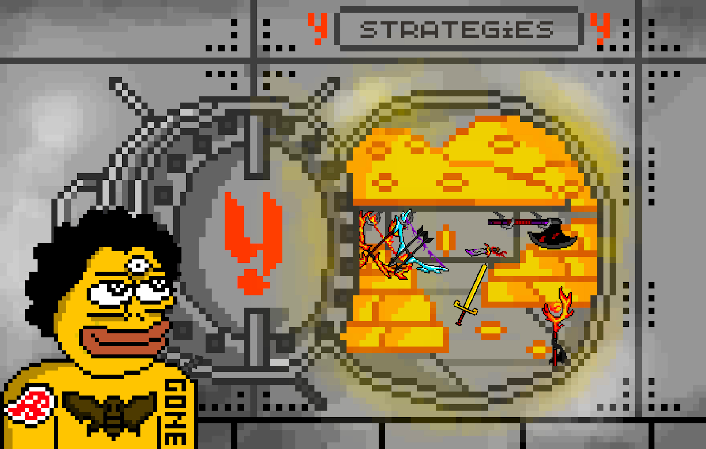
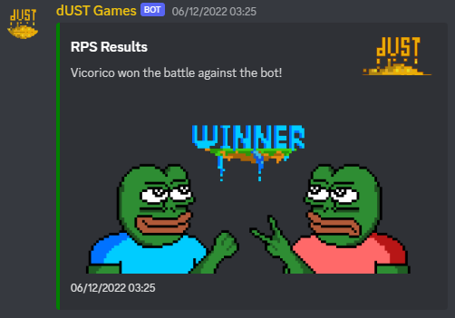
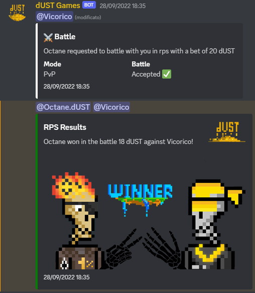
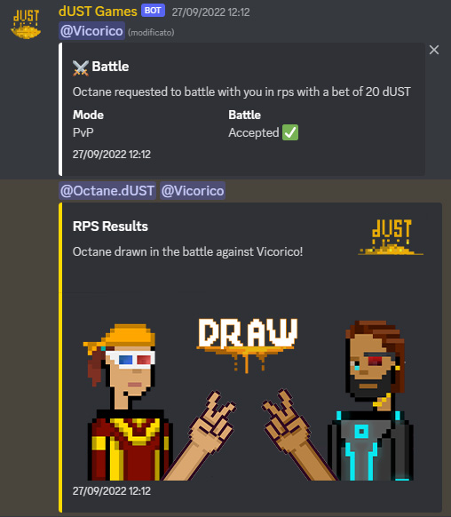
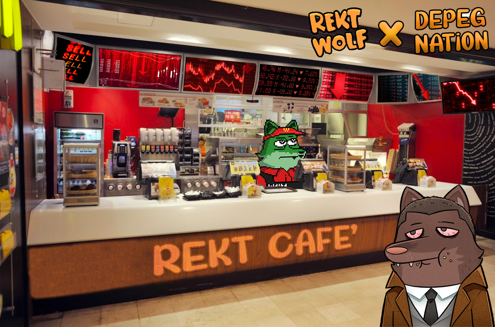

# dUST Games Grant Proposal

- **Thread ID:** 9702
- **Author:** dUST Games/Depeg Nation (`terra19e3hluapyw2dszpy8v62xhy7ges8pft2c0msqc`)
- **Created:** 2023-01-27T09:47:17.233Z
- **Last edited:** -
- **Stage:** discussion
- **Views:** 1056
- **Reactions:** 3
- **Comments:** 20
- **Source:** https://common.xyz/terra/discussion/9702-dust-games-grant-proposal

---

# **dUST Games Grant Proposal**

dUST Games/ Depeg Nation is the first NFT project created on Terra 2.0. This project is the first of its kind and it aims to create a unique and engaging gaming experience for users on Discord. The platform utilizes NFTs as a means to govern the distribution of fees obtained through casual gaming. This is done by distributing the revenue generated from these games to holders of the NFTs, which helps to tighten the communities and create more engagement within them. 

We were advised by multiple Terra Community members to put out this proposal that will provide the necessary runway for the project to develop and grow, and it will allow the team to continue to improve and innovate the platform.

**Table of contents:**

1. **Mission**
2. **Why gaming on Discord?**
3. **Vision**
4. **Accomplishments to date**
5. **Current status  **
6. **Roadmap**
7. **Grant ask & Future plans**
8. **Embarking more users to Terra**
9. **FAQs**
10. **Our Love for Terra**
11. **Socials**

# Mission

## Building the epicenter of Cosmos Casual Gaming on Terra 2.0 with dUST Games.

# Why gaming on Discord? 

Discord allows users to join servers and participate in voice and text chats. Many servers have dedicated channels for gaming, where users can play together, share tips, strategies, and compete against each other. Casual gaming on Discord is a great way to connect with other players and have fun while doing so, developing an engaging way to enjoy their favorite games with friends. 

Gaming Discord bots play a vital role in increasing engagement on servers. These bots can help to create a more dynamic and engaging experience for users, encouraging them to participate more actively in the server, thus building a sense of community. Another benefit of Gaming Discord bots is that they can provide a variety of interactive features that users can enjoy. For example, a trivia bot can ask questions on a variety of topics, and users can compete against each other to see who knows the most. This can be a fun way for users to engage with each other and learn new things. 

# Vision

We believe that gaming will play a big part in onboarding new users to the Web3 space.

Looking at the benefits of Discord games, we are aiming to add a stake to these activities in the form of dUST our native token. Adding stakes to games on Discord can make them more exciting and competitive. It can also provide a sense of accomplishment for players when they win a game where there is something on the line. Additionally, stakes can also add a financial incentive for players, making the game more engaging and motivating for them to play. This can also help to build a sense of community within a Discord server, as players will be more inclined to play games and interact with each other when there is something at stake. Overall, adding stakes to games on Discord can enhance the gaming experience for players and make the server a more dynamic and engaging place.

Some users might be tired to play the same old PvE games with no competition. One really important aspect of dUST Games is that, besides the thrilling PvE experiences, it also offers the excitement of PVP (players vs players) games. Users test their skill against other players in intense, strategic battles and see who comes out on top. This can help players engage and have fun together, while providing a powerful tool to project to distribute prizes such as WL,NFTs and to engage with their community in a completely new way.

# Accomplishments to date

- Created and minted out the first collection on Terra 2.0 - Depeg Nation (5K LUNA)
- Supported various other projects mint / remint (Redacted Money, Skeleton Punks, Tradooors)
- Was part of multiple Twitter Spaces to support the growth of Terra 2.0
- Minted aprox. 50% of the Tales of dUST collection (aprox. 7K LUNA) with a total of approx 13K LUNA left; the difference was airdropped)
- Partnered up with YFoundry DAO and created a Vault
- Released the Infrastructure for the dUST Games bot and the first games on Discord to be tested by holders, to get the necessary feedback
- Organized a Rock Paper Scissors tournament with 64 unique players
- Launched a Gamified IDO where users open CHESTs to get a part of the revenue distribution
- Released the first Staking platform for NFTs at[ stake.depeg.io](http://stake.depeg.io) 
- dUST Games / Depeg Nation is formed of OG Terra members, has a strong and tight community
- Easy to understand concept

# Current status

_Why is the survival of dUST Games getting tougher everyday?_

At the moment, the dUST Games/Depeg Nation project is at a point where it has a clear vision, mission, and product development plan, but it lacks the funding to succeed. The grant plays a vital role in ensuring that individuals and the organization can continue to thrive in the face of financial challenges.

The NFT market is pretty weak, especially on Terra, and it will take some time to recover. Since that was our main source of funding, we are really struggling at the moment to deliver our products.
With the announcement that Knowhere.art will stop working on Terra ([https://twitter.com/knowhere_art/status/1615287860805894145?s=20&t=4aCDL10Km3AskTZWbULhkA](https://twitter.com/knowhere_art/status/1615287860805894145?s=20&t=4aCDL10Km3AskTZWbULhkA)) as they are closing the marketplace on 15th February, our main source of project funding will disappear and therefore the project will not be able to continue and deliver further developments. The only option that we were given was to build our own page to continue minting, which would not be cost effective.

If we will be able to reach the full minting goal here ([https://knowhere.art/launchpad/collection/terra1kad44vp08yqcz9ec366krj89yvsvs6nmauvhqu6sl93jjw5ugw2qd3xdnw](https://knowhere.art/launchpad/collection/terra1kad44vp08yqcz9ec366krj89yvsvs6nmauvhqu6sl93jjw5ugw2qd3xdnw)) and the governance proposal passes, we will return half of the funds to the community pool, but to continue the development and  survive, the grant is crucial. We do appreciate all your support in this journey. 

# Roadmap

**2023 Q1: **
- Release of the new wallets infrastructure for Discord (similar to Tip.cc, as a reference)
- Release of the Squid Game on the dUST bot
- Add onchain randomness to the Games
- Release of the Matchmaking system

**2023 Q2: **
- Start true Cosmos Expansion
- Founders/DAOs bot customization
- Gamified Staking system for Revenue Distribution
- New Games release
- Build a dashboard showcasing analytics about the games, users and servers, using the bot

# Grant ask & Future Plans

We are asking for a **23,000 LUNA** grant to help us achieve our vision and mission. The grant will be used as follows:

_**35% - Restructuring of the dUST Games to make it more user friendly. **_

So far, all the users had to register their wallet and send assets to that wallet to play the games. This ended up being a great way to give ownership to the assets, but had one downside:, the enormous gas fees players had to pay each time they were in a game. 
Moving forward, our way of restructuring is this: creating a wallet with a MEMO, where players send the funds and a database gets updated every time someone does so. Beyond the fact that this eliminates the problem of gas fees paid by the user, it also creates a more effective way to scale up. When users from multiple Cosmos chains want to play together, the gas fee costs will be eliminated and they will not have to engage in expensive IBC transactions. 

_**25% - Creating a matchmaking system that goes over the barriers of the same server**_

So far, the users were only able to play with other users from the same server. In the peak bear market, it was difficult to find someone available at the same time. With the new matchmaking system, we aim to create a much deeper connection between the players and a shorter waiting time for each of the games to happen. Simultaneously, it creates a cross-marketing action, the bot aiming to showcase what Cosmos chain each player is from. 

_**10% - Allowing project founders to customize the bot **_

Allowing DAOs or founders to customize the bot will create an immersive experience and it will be a way for players to engage in their own community by creating tournaments, ways of giving Whitelist spots or other rewards to the winner. 

_**20% - Creation of multiple games **_

As soon as the proper foundation is built, more games can be added to the bot. At the moment the bot supports some classic games such as PvP and PvE Rock Paper Scissors, Tic Tac Toe and Coinflip. These games are 1vs1 or player vs robot. 

The next game we are planning to release is an iteration of the popular Discord game Royal Rumble, the first game in which more than two players can join. It’s a winner-takes-it-all type of game, where players make choices and the last player standing wins.

_**10% - Customer support & Business development **_

Since the vision is to scale up and have the dUST Games across many servers, we expect that there will be users who will need support and it is a feature we are looking to invest in. Even if we expect the user base to grow organically, some partnerships with larger, notorious projects will increase the reach and awareness of the product.

When the above steps are completed, any funds that are left from the grant will be locked as Liquidity in the dUST/LUNA pool.

# Embarking more users to Terra

We are leveraging Discord and Casual Gaming to bring more users to the Terra ecosystem. It is incredibly easy to add the bot to any Discord server with a two click method and there’s not any need for extra implementation.

Everyone can play the games, but in order to earn fees from the revenue sharing system, one must be on the Terra chain to stake the needed NFTs. All revenue shares are being paid in dUST, which is a Terra CW20 native token. Fees are currently at 10% but the DAO can vote on increasing/reducing them whenever. 

# FAQs

_How are we going to provide true randomness?_
We are going to use [https://entropiclabs.io/](https://entropiclabs.io/) beacon VRF capabilities to provide true randomness.
We are using it to provide fair games for anyone which can be traceable on chain.

_How do we onboard new users?_
While players can still place a stake, which adds an extra level of excitement and motivation, they are also allowed to play for free, meaning that they can try out the game without having to add any funds. Since it’s so easy to add the games to any server and the servers don’t have to be crypto related, more players can join from anywhere, thus reaching a new market easily. We expect that these players will eventually be intrigued by the stakes feature and start wanting to know more about the bot, thus attracting and creating awareness within new communities.

_What is the scalability plan?_ 
As soon as the foundation is ready, we are looking to reach out to different communities and add the bot on the bigger Cosmos servers. The moment we do that, more users will have access to games. The more games will appear, the more users will be willing to try and engage with the bot. This will create more volume, thus more fees generated to the stakers. 

_Integrations of Feather.JS?_
Our vision to overtake the Cosmos ecosystem is strengthened by Station going multichain and the migration from Terra.JS to Feather.JS. We are aligned with the mission and vision of the Terra ecosystem and are willing to play our part in making it happen. 

_How are users generating revenue?_
Each individual game has a specific fee decided by the Nation DAO. That fee goes into a fee wallet   ( terra1lshyk79gya7tcfu9waxphmykx38ejdyylh2k2e ) and gets distributed to the stakers.
 
 
# Our love for Terra

Our deep love for Terra certainly exists. We were the first NFT project that appeared and minted out after the Depeg. At the same time, we released the bots right after the mint, to test them out and give the community a feeling of inclusion during the hard times of the attacks that were happening mid and end of last year.

Currently, we want to survive and then thrive, by continuing to build our beloved product that we believe will onboard many new users to Terra. After sharing good and bad luck on Terra Classic, we would love to be part of the future of Terra 2.0, since we believe in it from the beginning and we still see the immense potential to decentralize the financial industry and provide financial freedom to people all over the world.

We would be pleased to answer any questions and receive constructive feedback! Thank you for putting in the time to read our proposal! 

# Socials

Twitter:[ https://twitter.com/DepegN](https://twitter.com/DepegN)
Discord:[ https://discord.gg/W6tFazArCj](https://discord.gg/W6tFazArCj)
NFTs & DAO website: [https://www.depeg.io/](https://www.depeg.io/)
Staking:[ https://stake.depeg.io/](https://stake.depeg.io/)
Whitepaper: [https://whitepaper.depeg.io/](https://whitepaper.depeg.io/)

---

## Comments (20)

**AnonMe (`terra1sm6qtfynkj5rwt22s4aftyx5j7mt2sxk2zusln`)** — 2023-01-27T10:00:40.802Z — 👍 5

What a wonderful proposal, you definitely got my vote!

**Twinmoons (`terra17dh4xurzter8qhsxh90nj4j44s9ratvqwtq8up`)** — 2023-01-27T10:09:40.379Z — 👍 6

This project we need to save

> **darragh.ust (`terra1tu0lx26n8vjkpfjrjdyktnvt3wqfdtup65lyj5`)** — 2023-01-28T16:30:40.090Z
> 
> agreed

**wojci3ch (`terra1rcm0tauqjerh6cv67j9lkd2ck3psztmcax3yg9`)** — 2023-01-27T10:33:06.759Z — 👍 5

These games created by the dust team are absolutely amazing! I had the pleasure of playing Rock Paper Scissors and many others. The team organized a tournament in which of course I lost while the way people were involved was amazing. This project deserves credit, it has my sincere support from the beginning!

**TheMoondalorian (`terra1ggf9ru2kzm0f5vytx8hlnkmdefuh20rc3v00yq`)** — 2023-01-27T10:58:59.491Z — 👍 5

This is a project with innovative and creative ideas. It is definitely worth to save through this bear and will add value to this ecosystem for the next bullmarket!

**poesmeow (`terra15apmuz6glqlvtt5sgc987p2gej3n7s44mupuyl`)** — 2023-01-27T11:58:56.864Z — 👍 3

This project is my favorite! It's simple, fun and innovative. It creates a bridge between new potential users and Terra and it adds real value.

**Yramrag (`terra1pwm92g03xsgu20p5cl20ny7u778zfwdsyp3d0z`)** — 2023-01-27T12:03:49.745Z — 👍 5

I have been following the project since the early days and through the crash the team has stayed positive with a focus on building utility for dUST for the own supporters but also the wider crypto world. True community spirit. Battling the aftermath of the crash and following bear market and to hopefully come out with potential at the other end can provide great opportunity for all.

In my view fight should be rewarded.

**lunarluy (`terra1mdp338cf6d34zcz7n6xqt9g8xpwj00f7l3jvea`)** — 2023-01-27T12:08:03.982Z — 👍 5

Depeg Nation is for sure one of the most promising project out there on terra,I want to express my admiration for the hard work,passion and dedication that the team has put into this project.
I have been struck by the innovative and forward thinking approach of this project.
Depeg Nation is a testament to the creativity and I am confident that they will achieve great success if they receive this grant.

**ecclesia168 (`terra1eqaq2kuntl3jh4xd5sjxcf9ncpuk2plml0dgsg`)** — 2023-01-27T12:43:55.223Z — 👍 5

Will always support a team player. Doing their best to help the ecosystem and the community. Making it fun. Will definitely have my support.

**Kyle Woken (`terra13rzuyuysxsk7hafh3ueu6v7l2lcz0hxg4scdgs`)** — 2023-01-27T12:56:06.882Z — 👍 5

This proposal presents an opportunity to lend support to a solid, long standing team and community that has always shown the resolve and belief in the NFT space on Terra V2.
Their continued development and plans to move forward have met with many obstacles to date, but yet, they have not given up. 

They are now calling for some assistance.

The community is small just now, but in time, there will be new members to the Terra NFT space and there are only a few of the OG projects to look to in the NFT space. Depeg Nation has so much unrealised value and this proposal allows for its full potential to be explored.

I hope others also offer their support and also get behind the Depeg Nation team.

**Wafu50 (`terra1kdha4c95mnzrrvkp82jx286c9dml88sgf36ah9`)** — 2023-01-27T18:51:28.181Z — 👍 3

I’m biased because I hold a few NFTs. But, this project is run by a dedicated team who, put their efforts into making the project work through long periods without personal remuneration. They will never let the project die, but instead have the potential to turn this new concept into a win/win for themselves and Luna. It does however, need better marketing IMO. 

This project is not just about NFT minting, or a coin, or staking, or gaming. It is a whole mini ecosystem based on fun and has good potential. I’ll be voting yes. But this needs your vote too. They will attract customers to the chain, use Luna for mint of NFT collections, LP for dUST/Luna and game play is simple and fun. This project brings lots of benefits to the Luna community and Discord

P.S. No other project currently deploys the rabid rabbit from Monty Python’s Holy Grail in its weapon arsenal. Best do as they ask. Or else😉

Thank you.

**JollyRogerX (`terra17x6u9krpf506t8rzsqyph4c5em0ptderdpcjaq`)** — 2023-01-28T02:48:32.984Z — 👍 2

The first NFT project on Terra 2.
This team has always believed in rebuilding Terra and they have worked so hard for it. Helping them means helping the Terra community.

**darragh.ust (`terra1tu0lx26n8vjkpfjrjdyktnvt3wqfdtup65lyj5`)** — 2023-01-28T16:29:58.303Z — 👍 1

Seems like a pretty reasonable proposal. I'm in

**Tuhalf (`terra1nfjj4wk5kf9lujvx0faz3dedan8fk7yzy06ttq`)** — 2023-01-29T10:10:24.233Z

Tales of dUST was meant to be a gamified ICO for the dUST token and the project behind the dUST token. It's been 4 months and you couldn't sell even half of the NFT's. You didn't disclouse the closing date of the mint. Since the begining you are telling us it's closing soon, hurry up. Why should we provide 23k of Luna from community money when your ICO didn't suceed. If community would think this project is going to suceed, ICO would be sold out. ~$50k is a lot of money to ask and you should provide more details on where exactly you will spend this money. How many developers will you hire, how much is needed to keep the server running etc. I think voting yes on this proposal won't benefit the ecosystem.

> **dUST Games/Depeg Nation (`terra19e3hluapyw2dszpy8v62xhy7ges8pft2c0msqc`)** — 2023-01-29T11:41:12.788Z — 👍 1
> 
> Hi [@Tuhalf](/terra/account/terra1nfjj4wk5kf9lujvx0faz3dedan8fk7yzy06ttq) and thank you for your response! We are always open to critics, as long as they are constructive. We’ll take your points step by step.
> 
> Firstly, the Tales of dUST was not just a gamified ICO, its supply consisted of half WEAPONs and half CHESTs. Only the CHESTs were part of the gamified ICO, which is still live at [stake.depeg.io](https://stake.depeg.io/). Since the beginning we mentioned that the release of the token was meant to follow the staking system to preserve the Liquidity Pool and avoid a massive dump of the token, it being a linear vesting of 100 days from the moment you stake your chest.
> 
> Secondly “ It's been 4 months and you couldn't sell even half of the NFT “, tackling this, we indeed did reach over 50% of the minted supply. Kindly remind you that on the first day of mint on Knowhere we saw an issue with the Candy Machine and had to stop the mint to make it all right. After we changed it,  the mint counter started from 0 but all holders were made whole.
> 
> The difference between this and other proposals is that we are focusing on a totally different industry which is gaming and are building infrastructure for Discord Users to be onboarded to Terra in no time.  In order to benefit the ecosystem new people need to join it and this is our way of reaching this goal since we believe that gaming plays an important part in adoption. 
> 
> Regarding the developers that we will hire, we already got quotes about the creation and development of the new game system and it will cost about that amount, server hosting costs are minimal, that’s why we didn’t even add them to the proposal. 
> 
> Hope we gave a clear answer to most of your questions, if you would like to add anything please do. We are here to respond to any input/suggestions!
> 
> Just take a minute and think how this will be a game changer: millions of people are engaging each day on Discord and a lot of projects would try anything to grow their communities.
> Now take as an example the popular game Rumble Royale, it's added on thousands of servers and it's often used to give away free stuff such as WL, NFTs, and so on because it's fun, engaging, and simple. We aim to become at least that big, and the fact that we are enabling PVP games across servers will open new experiences that will connect even more people which will make them more excited and engaged than before. The free-to-play mode will be the mean that will let us spread the bot across a large number of servers and we are sure that a percentage of those people will be excited about the staking system and they will start to learn about it, how to play with the token, how to use the blockchain and so on.
> In this way, we are not just aiming at the "web3" users that are already familiar with cryptocurrencies, but we can potentially onboard "web2" people, whom, we will teach how to use the new technology and show them some of the advantages behind it.

**Its only me (`terra1pnr4wvn54t68jyh7vsxvu2njnhmexslf67j82x`)** — 2023-01-29T11:44:00.323Z — 👍 2

I support this proposal. Unfortunately, Knowhere.art decided not to keep going, forcing a closing date of the mint early for this project and throwing timelines out. The original business plan that would have seen self-funding did not predict many issues impacting the whole Crypto space, including Luna. That said, I believe that the Liquid labs project launching for NFTs on Luna will be a game-changer and long term will increase liquidity and spending in the Terra/Cosmos NFT space. 

I can't underscore enough the value that NFT projects bring to a blockchain. The Artwork and potential utility will attract investors and fans from outside of the ecosystem, perhaps even outside of Crypto and these benefits are clear. A brand I am very familiar with, National Geographic, decided to launch its genesis NFT collection on Polygon. National Geographic has promoted this to many millions of subscribers and followers, driving many new users to the Polygon ecosystem and into Crypto, via NFTs. The PR value this has to Polygon is also huge and will attract other companies and brands to build and launch, driving even more users. 

I hope Terra can support the NFT projects and ecosystem, the rewards of doing so are clear.

**Sasori (`terra1q4j4ucmqz74vxew0kszsxqtmvxqgp5fen248p0`)** — 2023-01-29T17:25:39.185Z

The team should setup a multisig made up of trusted community members where vesting of funds is tied to the milestones listed above. 

Failure to deliver any of the milestones within a defined period (e.g. 1 year) should warrant a return of remaining funds to the community pool.

> **dUST Games/Depeg Nation (`terra19e3hluapyw2dszpy8v62xhy7ges8pft2c0msqc`)** — 2023-01-30T13:18:38.759Z — 👍 1
> 
> Hi [@Sasori](/terra/account/terra1q4j4ucmqz74vxew0kszsxqtmvxqgp5fen248p0) and thank you for your input!
> 
> We are planning to create a multi-sig wallet and set up the DAO using [Enterprise.money](https://enterprise.money/) so all our community will play a part in how and when we are spending the funds. 
> 
> Regarding the timeline, we are looking at a max period of 6 months to deliver, so we can do what you proposed AKA returning the remaining funds to the Community Pool if we don’t deliver on our milestones within this timeframe. We have a clear plan and want to start building the product right after we receive the funding.
> 
> Also, I believe that it’s important mentioning the fact that Vicorico and Octane who are the two core members of the project, are both well-known in the space and trusted on multiple chains. Vicorico is also DOXXED. We are looking to help the ecosystem by leveraging casual gaming and would really appreciate being offered the opportunity to turn our vision into reality. 
> 
> Let us know if this works, and again, thank you for sharing your thoughts!

> > **dUST Games/Depeg Nation (`terra19e3hluapyw2dszpy8v62xhy7ges8pft2c0msqc`)** — 2023-01-30T13:23:39.186Z — 👍 1
> > 
> > We are having a space discussing the proposal [https://twitter.com/i/spaces/1MYxNgOeZBbKw?s=20](https://twitter.com/i/spaces/1MYxNgOeZBbKw?s=20) so tune in if you want to ask any questions or come up with any suggestions!

**dUST Games/Depeg Nation (`terra19e3hluapyw2dszpy8v62xhy7ges8pft2c0msqc`)** — 2023-02-01T18:12:15.370Z — 👍 1

Dear Terra Community,
A 5 of 7 multi-sig was created as a recipient for this grant: 

terra1g725aqx9nxfans20e4kek8utp2yyuduh8xu05s3vuam8jlyxyn7sc9zfru

All 7 participants are known and trusted community members:

Vicorico (Core Team Member)
Octane (Core Team Member)
Max Callisto (Community Member)
MC (TFL)
Mayank (Community Member)
CJ (Community Member)
Aegir (Orbital Command)

