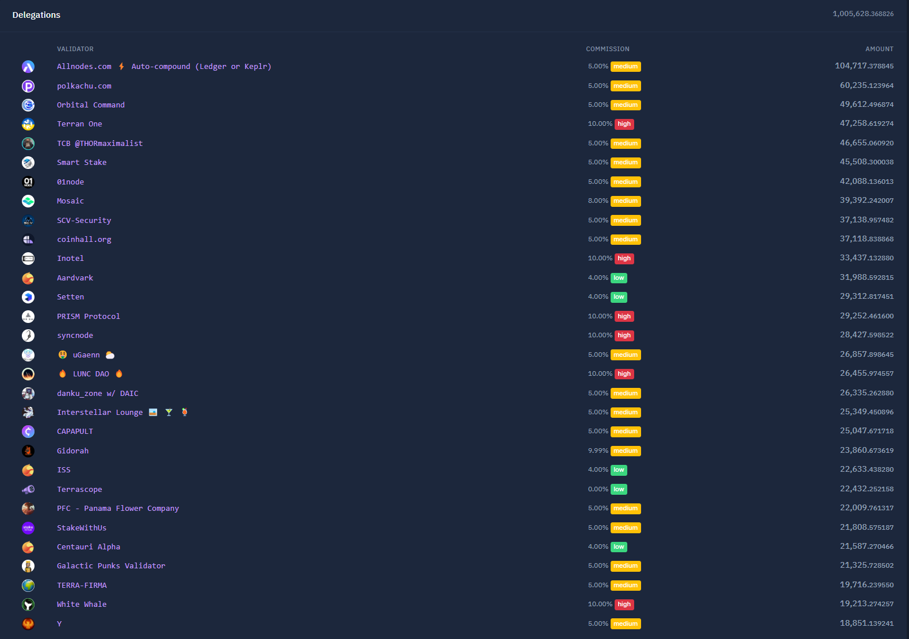

# A new decentralized stablecoin for Terra and the Cosmos

- **Thread ID:** 10386
- **Author:** Anonymous (`terra15rx7anfy3rj2sn5znpq42j5rfl8m8rhk40f997`)
- **Created:** 2023-03-13T15:16:56.467Z
- **Last edited:** -
- **Stage:** discussion
- **Views:** 1880
- **Reactions:** 1
- **Comments:** 23
- **Source:** https://common.xyz/terra/discussion/10386-a-new-decentralized-stablecoin-for-terra-and-the-cosmos

---

**Summary**

If you haven’t heard, LUNA has regained the ability to be directly converted into a stablecoin. Using the new [Capapult protocol](https://www.capapult.finance/), liquid staked tokens of LUNA can be used to collateralize the stablecoin $SOLID.

Due to the recent USDC depeg and increasing regulatory concerns about fiat-backed stables in the US, the need for a truly decentralized stablecoin has never been more obvious. I say, we as the Terra community seize this opportunity by promoting SOLID throughout the Cosmos. All we need to do is dog-food it, and then hopefully it will begin growing organically.

At the very least, we can make SOLID the default stablecoin for Terra DeFi, giving Terra DeFi the unique value proposition of not relying on a centralized stablecoin.

**The plan**

In order to promote SOLID throughout the Cosmos, the Terra community should partner with Astroport. Here's the deal.

The Terra community should offer to provide a sufficient amount of LUNA and SOLID to completely fill a LUNA-SOLID pool, so that it replaces the LUNA-USDC pool. With a LUNA-SOLID pool sufficiently filled with protocol-owned-liquidity from the Terra community, Astroport would be relieved of the responsibility of incentivizing the LUNA-USDC pool, which would save a considerable amount of ASTRO incentives. In exchange, Astroport would have to agree to incentivize a SOLID-axlUSDC pool on Astroport Terra, as well as one on Astroport Injective, Astroport Sei, and Astroport Neutron (assuming Astroport deploys on those chains).

So the Terra community would provide all the liquidity for the LUNA-SOLID pool, and in exchange Astroport would incentivize SOLID-axlUSDC pools on Terra, Injective, Sei, and Neutron.

The LUNA-SOLID pool would serve as a good example of SOLID’s usecase, and the SOLID-axlUSDC pools across the Cosmos would give all Cosmos DeFi participants convenient access to SOLID.

Then we let it grow organically.

**Phased approach**

Before involving the Astroport community, the Terra community should work independently to establish a proof of concept, to make sure the system works right. To wit:

A multisig of prominent community members is created, and 1.15M LUNA is released from the community pool to that address. Of that 1.2M LUNA, 1M is liquid staked and used to mint SOLID at a collateralization ratio of 1,000%. Assuming a LUNA price of $1.25, that results in 125,000 SOLID.

Then, using the remaining 150,000 LUNA, that 125,000 SOLID is paired with the proper amount of LUNA in an Astroport LUNA-SOLID constant product pool, giving the pool $250,000 in liquidity depth.

With this proof of concept in place, we should observe for 3 weeks to make sure everything works properly. If everything checks out, we can release additional funds from the community pool to scale up the LUNA-SOLID pool, and we can begin to negotiate with the Astroport community.

**Details**

When minting SOLID on Capapult against liquid staked LUNA, I suggest we use a collateral ratio of 1,000. This would maintain safety and ensure confidence.

For the initial proof of concept, I suggest we utilize both LunaX and ampLUNA as collateral. Once stLUNA becomes available, I suggest we use that, too. By diversifying the kinds of LUNA liquid staked tokens used, we reduce risk.

After the proof of concept phase, to sufficiently fill the LUNA-SOLID pool I suggest we bring it to a depth of $6M. This would require 3M SOLID. At a CR of 1,000 and a LUNA price of $1.25, 24M LUNA worth of liquid staked LUNA collateral would be required to mint 3M SOLID. An additional 2.4M LUNA would be needed for the LUNA side of the pool.

Regarding Capapult, a fee of 0.5% is required to mint SOLID. After that fee is paid, Catapult doesn’t charge interest.

**Multisig**

Due to the unprecedented amount of LUNA required, a robust multisig would be needed. I suggest a 6 / 10 multisig, composed of prominent individuals with diverse positions. My recommended roster:

One well-known, trusted individual from each of the following projects / organizations:

Eris, Stader, Stride, Capapult, Astroport, Obi, Notional, Flipside.

As well as two individuals from TFL.

**Risks**

The community’s collateral position on Capapult could be liquidated. This risk is mitigated by using a CR of 1,000. Moreover, the community pool currently has over 300M LUNA; if necessary, more LUNA could be released to increase the position’s CR.

Multisig signers could go rogue or get hacked. Risk is mitigated by having a large multisig with individuals from many organizations.

One of the liquid staking providers used could go rogue or get hacked. Risk is mitigated by using multiple providers: Eris, Stader, and Stride, all of which have been audited. Moreover, Stader and Stride are large, professional organizations with VCs, lawyers, and doxed contributors. (However, Eris contributors are anonymous, and Eris has not received VC funding. Using Eris may or may not be an acceptable risk.)

Capapult could go rogue or be hacked. Risk is mitigated by Capapult being based on the Anchor codebase, and having received a fresh audit in January. Capapult is run by a [2/3 multisig](https://terrasco.pe/mainnet/address/terra18mnmjp6jwg3q06r7nmhq2spcn5kdfpp3g7lhvgynucsmv4xqhllsdytcat), which is not ideal. However, I believe they plan to transition to token voting, using the CAPA token. And there is a plan for [sufficient CAPA token distribution](https://medium.com/@capapult/capa-a-governance-token-for-the-new-capapult-protocol-4338ae0f5575).

Astroport could be hacked. This risk is mitigated by the many [audits Astroport has undergone](https://github.com/astroport-fi/astroport-audits), and Astroport’s reliable track record. Astroport going rogue is not a risk, because Astroport contracts are controlled by the Astroport DAO (Astral Assembly), and the ASTRO token supply is sufficiently distributed.

**About the SOLID Peg**

SOLID is a unique CDP stablecoin, in that it has no interest payments, only a 0.5% mint fee. For this reason, SOLID will probably trade in a range between $1.00 and $0.95. It will be prevented from falling too low by a mechanism that increases the [mint fee the more it deviates from peg to the downside](https://medium.com/@capapult/introducing-the-latest-changes-of-capapult-protocol-e288c5e26cc4).

So SOLID won’t hold its peg as well as a fiat-backed stable, and it may not even hold its peg as well as a CDP-backed stable with interest payments. But unlike a fiat-backed stable it won’t be banned, and unlike a CDP-backed stable with interest it is more scalable. In my view, these are very good trade-offs.

**Final thoughts**

Do we still care about decentralized money?

If so, this is our chance to put our beliefs into action. We have spent the last nine months funding various Terra projects, and now it’s time to put them all together. Imagine Astroport, Eris, Stader, Capapult, (and eventually Stride) working together to promote SOLID across the Cosmos.

In the coming months, all Cosmos DeFi chains will be searching for a decentralized stablecoin to meet their trading needs. With its suite of apps, its community pool, and most importantly its daring community of risk-taking innovators - Terra is the best positioned blockchain to provide that stablecoin.

So now, let's discuss!

_Disclaimer: I am employed by Stride Labs, and have a large stake in the Astral Assembly. I am not affiliated with Capapult; I hold less than $1,000 worth of CAPA._

---

## Comments (23)

**Anonymous (`terra1v5dqd8fdck68tlqveulqwctdctrcl59ydyrem2`)** — 2023-03-13T15:50:27.661Z

It's about time we push some decentralized stables. The decentralized stable space is changing fast but with LSDs as collateral I think they can grow faster as before thus supporting this on Terra makes sense to me! I get SOLID is the preferred choice on Terra but alongside SOLID, I think USK is also a very good option within the whole Cosmos ecosystem. I suggest supporting both pools of these tokens. They both have LUNA as collateral option anyway

**Anonymous (`terra1alxk3fmhcl0ga80gl9yj9zp3ezjm4sdh8a9l9c`)** — 2023-03-13T17:30:51.933Z (edited 2023-03-14T06:25:15.820Z)

I generally support this proposal.

Please remove the wrong note, regarding ERIS, as both can be applied to Capapult. I am however doxxed to multiple parties in the Terra ecosystem (TFL, security auditors, and multiple partners and validators.). Our amplifier and related contracts are fully audited by both SCV and OAK security and the contracts are only changeable by a Terra builders multi-sig, which includes TFL.

We believe in a decentralized stablecoin, owned and backed by diverse ecosystems. Whilst we appreciate a stride contributor bringing this idea to the table stride itself has some risks:

1. LunaX and ampLUNA have a 0% fee while stLUNA extracts 10% of the staking rewards.
2. Delegations and governance are not necessarily aligned with the Terra community.
3. Stride is not decentralized. They closely resemble a chain of proof of authority, that means they have hand picked validators and partners and this group holds more than 50% of the stride token allocation.
4. Having a VC forces the company to go for maximum profit instead of maximum value.
5. External chain risk: If stride zone goes down, the staked LUNA can't be retrieved.
6. The majority of strides’ LUNA delegations is with AllNodes, which had a controversy over the last month. There has been no public decision on the validator set on terra, so it was picked by unknown people and we do not know who has control over it.

The community should evaluate if stLUNA is included or not.

While I do understand, that Stader has been dormant over the last year, mostly focusing on ecosystems outside of the Cosmos, our data shows that they have a very consistent staking performance:
[https://twitter.com/eris_protocol/status/1630611142992183302?s=20](https://twitter.com/eris_protocol/status/1630611142992183302?s=20)
and opened up their delegations, while also having a 0% staking fee.
[https://twitter.com/stader_terra/status/1600146994038611968](https://twitter.com/stader_terra/status/1600146994038611968)

An additional benefit of the proposal is that it will give the Terra community more governance power by using ERIS Amp Governance. That means each user holding ampLUNA can lock their tokens, to decide which validator receives a delegation and how the protocol votes on governance proposals. The community members that are most aligned with the ecosystem have control over the direction of it. There is no external party extracting value or building a validator cartel.

For the stability of Capapult it would make sense to provide liquidity in SOLID-ampLUNA and SOLID-LunaX to allow for a streamlined liquidation process and increasing trading revenue for Astroport.

**Rebel Defi (`terra17w74x9vrqq4a338ssh9y9r4m9s3f6zef7wy5ms`)** — 2023-03-13T23:14:32.056Z (edited 2023-03-13T23:15:41.030Z) — 👍 2

John Galt writes:

> A multisig of prominent community members is created, and 1.15M LUNA is released from the community pool to that address. Of that 1.2M LUNA, 1M is liquid staked and used to mint SOLID...

Is there a typo of amounts? 1.15M goes to multi-sig, then it turns into 1.2M? Or have I mis-read?

Overall support the general idea.

**Questions:**

Why bLUNA, cLUNA excluded from prop? I think if we're using Community Funds for a "Community prop", we need to be wary of being partisan.

Why multi-sig signers from Eris, Stader, Stride, Capapult and Astroport? Seems like potential for COI.

Rationale for Obi, Notional and Flipside?

Considering the amount of LUNA that could end up being administered by this group, I would like to see a positive case made for each organisation/individual included.

> **Anonymous (`terra15rx7anfy3rj2sn5znpq42j5rfl8m8rhk40f997`)** — 2023-03-14T18:18:24.044Z
> 
> Small typo! Fixed it (:
> 
> Regarding the multisig, I think it's best to have a large multisig with diverse individuals from many different teams / projects. I think it's best to get people who work in crypto, because they have their jobs and reputations to protect.

> > **Rebel Defi (`terra17w74x9vrqq4a338ssh9y9r4m9s3f6zef7wy5ms`)** — 2023-03-15T05:30:25.483Z
> > 
> > Jobs and reputation to protect is strong argument. Didn't really address COI concern though. You think that's not important?

> **BackBone Labs (`terra1gw8mesks5uw2gukjfv9xftf5xh0xn8empydw2t`)** — 2023-03-14T23:29:15.773Z — 👍 2
> 
> I'd step up to be a multi-sig signer. 
> 
> Just saying.

**4719 (`terra13qjxhnw98lm36rxc9yjakkmulhpv7zctdc5zlz`)** — 2023-03-14T08:47:22.497Z — 👍 2

I am in support of this in general but I would divide the second phase into two phases of 12mill LUNA each & see if $SOLID gets traction before deploying the 2nd 12mill LUNA. 
I would also include all LSDs as this is coming from the community pool & we wouldn’t want to divide the community by giving preference to certain LSDs as opposed to others. I think cLUNA & bLUNA need to be included.

**Anonymous (`terra1alxk3fmhcl0ga80gl9yj9zp3ezjm4sdh8a9l9c`)** — 2023-03-14T10:46:49.671Z (edited 2023-03-15T11:56:22.323Z)

Rethinking the usage of liquid staking protocols based on the comments. In my opinion it will be easiest to define a framework that an LSD/DEX/Stablecoin needs to fulfill to be used for this prop.

**For LSDs**
- **max 10% LSD fees**: The community should mostly support LSDs with a low commission, so value is not extracted. We should also weight the deposited amount by the fee. Based on the fee I propose these factors: 10% -> 1x, 5% -> 2x, 0% -> 3x the amount. Linearly in between. 
- **Open validator whitelist (at least 15-20 validators whitelisted)**: We should only include LSDs that have an open validator whitelist. Otherwise the main beneficiaries are the validators that are part of small validator sets. If as a community to provide a big stake to only 5 validators independent of their involvement, we deincentivize other validators being involved and doing a good job for the Terra community.
- **Audit**: For the safety of the funds an audit of the involved contracts is mandatory.
- **Contracts controlled by governance or community/builder multi-sig**: Changes to the contracts should only be possible through governance or a multi-sig.
- **Live for 3 months**: Protocols should have a history on terra and show they are committed to the ecosystem, building or providing a stable protocol.
- **Open sourced contracts**

**For DEX**
- Low fees (0.3% or lower)
- Audit
- Contracts controlled by governance or community/builder multi-sig
- Live for 3 months
- Open sourced contracts

**For Stablecoin**
- Low fees (0.5% or lower)
- Audit
- Contracts controlled by governance or community/builder multi-sig
- Live for 3 months: Should be skipped in case of Capapult
- Open sourced contracts

When new DEXes, LSDs or stablecoins are launched, the framework will be reevaluated on the launching protocol if they will receive part of the liquidity / deposit and the multi-sig will need to rebalance based on the definition.

If any protocol falls out of the requirements, they will loose all community funds and be blacklisted for 3 months before being able to be included again.

> **BackBone Labs (`terra1gw8mesks5uw2gukjfv9xftf5xh0xn8empydw2t`)** — 2023-03-14T23:34:49.685Z (edited 2023-03-15T00:26:41.228Z) — 👍 2
> 
> Say these criteria happen to cut bLUNA out and we have served the Luna community. Our product has a 10% fee and 100% gets redistributed back to the LUNA community in various ways, should we be cut off for that?
> 
> 
> The GraveDigger on LUNA is a community good. BBL makes nothing in producing bLUNA.

> > **Anonymous (`terra1alxk3fmhcl0ga80gl9yj9zp3ezjm4sdh8a9l9c`)** — 2023-03-15T07:44:53.015Z — 👍 1
> > 
> > If the community wants to use 10% as a limit, it could also be okay, I just went ahead and used the same commission requirements as TFL for their auto-stake feature. I updated the comment above.
> > 
> > Audits are still a hard requirement for me.
> > 
> > And an open whitelist is required, as otherwise the main beneficiary are the few validators, so at least 15-20 validators whitelist should be required.

**Anonymous (`terra1a3068uwt4k3tpztnsz5mczulneggys98jwyrkh`)** — 2023-03-14T11:41:24.073Z (edited 2023-03-14T11:52:54.506Z)

I also like the idea of the proposal with Capapult and SOLID.

I think the timing is absolutely right.

Especially because in the whole Cosmos Ecosystem mainly axlUSDC is used and after the incident in the last days I really see a problem because there are hardly good alternatives.

I also believe that Terra could really make up market share by providing a decentralized stablecoin for the whole Cosmos ecosystem forced by a community incentive.

Astroport is the biggest DEX on Terra, with the expansion to more Chains in Cosmos they could promote SOLID strongly beyond Terra.

Maybe in a second step we can talk about expanding the props to other DEXes as soon as the DEXes reach a certain size.

I am also a fan of allowing all LSDs from the community.

> **BackBone Labs (`terra1gw8mesks5uw2gukjfv9xftf5xh0xn8empydw2t`)** — 2023-03-14T22:38:26.333Z — 👍 2
> 
> White Whale would make a better partner in this prop considering they are a DEX with its own L1 who is preparing for the Alliance module.
> Its time to support those projects which actually give back.

**Anonymous (`terra1hr7svdp2rga9vf3ry95sx7g5wyspgwmg94qac8`)** — 2023-03-14T14:48:42.112Z — 👍 1

I don't believe this proposal will be a net positive for SOLID, or the LUNA community in general.

The first thing to remember about any stable-coins is that it needs usage, and demand to get growth.

This proposal does not address this.

The proposal will fund LUNA-based protocols to promote SOLID over the cosmos, but they are all on the same beach-head, Astroport is a bit further along, but really just a few steps ahead, and frankly are not being used that much outside of LUNA bag holders (yet).

What is needed is other projects that are already successful on other chains to adopt SOLID (osmo, kuji, injective, comdex, mars, whale, etc etc), and encouraging other chains to adopt SOLID for their fees.

This proposal does the exact opposite, and will tie up the community pools liquidity inside of itself. (ie the only people getting benefit are our existing users, and $ASTRO holders, who frankly already use these things anyway)

A better approach would be to approach the existing established Dexes/CLOBs/loan things out there, and use our funds to add SOLID to their systems. This way their users will see $SOLID, and hopefully start using it, giving SOLID more capability to compete against the other decentralized stable coins being launched on the cosmos chains.

But before we use LUNA community funds to promote SOLID, I believe we should just have a generic vote on if we (the LUNA holders) actually have the promote a stable-coin in anything right now.

**Anonymous (`terra15rx7anfy3rj2sn5znpq42j5rfl8m8rhk40f997`)** — 2023-03-14T18:14:39.882Z

To address feedback I've received here and other places:

Part of the appeal of this plan is that it costs nothing. The Terra community funds a huge SOLID-LUNA pool on Astroport, and in exchange Astroport provides incentives for SOLID-USDC pools throughout the Cosmos.

Astroport is ideal, because only Astroport will have deployments on Terra, Injective, Sei, and Neutron. Also, Astroport has a historic relationship with Terra, and it is objectively a safe and high-quality DEX.

It's true that this plan doesn't explicitly promote the integration of SOLID with DeFi protocols. But it does show the example of LUNA trading with SOLID, and it provides convenient access to SOLID throughout the Cosmos. Hopefully that will be enough to encourage other DEXes to start adopting SOLID in their trading pairs.

Regarding liquid staking providers, I think that safety is paramount. The plan calls for millions of LUNA from the community pool to be entrusted to liquid staking providers. They should have to meet a high standard of safety.

While I do work for Stride, I think I can still speak objectively on this topic. Considering safety, I think only Stader, Stride, and Eris should be considered. They are the only ones with the resources to ensure the security of their protocols and the reputations to provide confidence.

That said, I personally have my doubts about Eris, because I don't feel comfortable liquid staking such a huge amount of LUNA with a protocol run by anonymous contributors and secured by a multisig. But I'm just one voice in the community, and I'm happy to involve Eris in this plan if the community wants it - which appears to be the case.

But to Philip's point, the Capapult team is anonymous, too, which is unfortunate. In general, it's unfortunate that Eris, Capapult, and Stader are all secured by multisigs. It could be that the Terra app ecosystem is not yet sufficiently decentralized for this plan to safely be attempted.

Nevertheless, for the sake of experimentation and community-building, I would still like to pursue this plan. At the very least, I think we should deploy the proof of concept, which only requires 1.3M LUNA.

**Anonymous (`terra1hjdrzs6g4u8c23sz8rsxsshkuncpr28sy5g6rw`)** — 2023-03-14T21:26:05.440Z — 👍 3

How will bLuna and cLuna be part of this? I see those missing. Do not really understand why. Is there a reason?

**Anonymous (`terra1e3tzzc6hu4l6a73lkm2430ssumyjvw677f6j46`)** — 2023-03-14T21:41:33.607Z — 👍 3

I don't think it's a good idea to involve Stride in this conversation. Stride has already jeopardized the stability of the LSD community in Terra, which is one of our main narratives in the coming months with Alliance. Stride has proven to be an organization willing to crush competition at all costs, and this feigned alliance with Terra is merely a means to an end, which will be to promote the adoption of stLuna. If stLuna becomes a main lsdLuna on Terra, we will lose a significant amount of autonomy and fees, funneled directly into the pockets and electorate of a separate chain, Stride. We do not need them. We have many other lsdLuna providers that have proven to be active, thoughtful, and integrated in the Terra community, with lsd assets that are designed better and with more appealing qualities than stLuna.

To name a few: 

Eris's ampLuna and Backbone Labs bLuna. Eris has a rocksolid foundation that funnels all fees to ampLuna holders via their suite of tools available for luna community members including autocompounding vaults, manual arb assistance, and validator gov voting. Ampluna is the go to for highest apr lsd luna.

Backbone Labs has, hands down, the most sustainable liquidity depth structure out of any of the lsdLunas, by delegating 70% of the lsd fees to the anchor liquidity pool for bluna-luna. On top of that, Backbone has a solid nft community of lunatics where they are bringing defi to nfts via staking- allowing any member to be a part of this revenue generation machine. 

Not to mention both bluna and ampluna are fully audited and with teams dedicated to the success of Luna. 

As someone who cares deeply about the future of this chain, I would like to support others who feel similarly. And its obvious which projects share that vision with me - Eris and BackBone Labs.

**BackBone Labs (`terra1gw8mesks5uw2gukjfv9xftf5xh0xn8empydw2t`)** — 2023-03-14T21:44:11.070Z (edited 2023-03-14T22:22:27.521Z) — 👍 5

I am sure this is going to ruffle feathers, but I am tired of staying silent. 

I don't know about everyone else, but I am tired of people pretending that STRIDE and Astroport are on terra's side. They are not and this was made clear a few weeks ago when STRIDE bullied the pot and Astroport ejected in favor of injective. Stader has basically done the bare minimum and they were awarded over 500k LUNA in the emergency builder grant, so in my opinion, they are not worthy either. 

None of these groups above should be asking the community for money.  They are not terra community. 

That said the prop is good, but the players are wrong. I propose that we make this exact prop but with projects who are actually committed to terra. 

Capapult
White Whale instead of Astroport 
Eris instead of STRIDE 
BackBone Labs instead of Stader

Seems like a no-brainer to me. 

Flags Out!
🏴‍☠️🫡

**Anonymous (`terra1ph6q7z3ltyzn2jtxl4e8808qgcw6vrglkcgq9h`)** — 2023-03-14T22:41:46.186Z — 👍 3

I believe the idea has merit - but would actively campaign against it if $bluna is not considered for inclusion. My inclination would also be to exclude LunaX - who are not actively involved in the Terra community, and who have shown absolutely no interest for engagement or growth in the ecosystem. This proposal is one about Terra first and foremost. To use John's words; "make SOLID the default stablecoin for Terra DeFi". What are Stader and Stride doing specifically for Terra? Not much to my knowledge. Eris and Backbonelabs are clearly the front-runners from a "Terra-first" perspective.

It makes no sense to exclude $bluna, the liquid staking derivative, which until Stride's vampire attack through Astroport, was the LSD with the MOST liquidity in Terra. As many are aware, $bluna sends 100% of its fees back to Terra community members (and this is not an EXCLUSIVE membership - ANYONE can own Skeleton punks). Where does the 10% from stLuna go? Certainly not back into community hands! 

I think it is also ironic that John prefaces the acceptability of Stride and Stader because they are "professional organizations with VCs, lawyers, and doxed contributors". Personally, that is a reason NOT to include them in this proposal. It was large, "professional organizations with VCs, lawyers and doxxed contributors" who brought about Terra's downfall in the first place. Short memory John?

If there was ANY concern about security either on the Eris or Backbone labs side for ampLuna or bLuna; I would suspect the community would happily accept a grant proposal to have these contracts professionally audited if they have not been already (although I believe BOTH have). This would be a small price to pay, to ensure that the two liquid staking derivatives that BEST REPRESENT Terra's ethos and community-first spirit, are included in the proposal. Having said that, I believe the fear John is trying to use to exclude bluna and ampluna is unfounded - given that WhiteWhaleDefi have happily integrated both onto their feather chain and will continue to promote them through the Cosmos.

> **BackBone Labs (`terra1gw8mesks5uw2gukjfv9xftf5xh0xn8empydw2t`)** — 2023-03-14T22:42:48.941Z — 👍 2
> 
> Couldn't agree more if I tried.

**kingfisher (`terra1f0ku303nqqh8rvefded58c2ggpy0ev396mr0cn`)** — 2023-03-15T01:18:24.151Z — 👍 1

I absolutely agree that there is an opportunity and I am fully behind SOLID.

It is disappointing that you are asking for community support while shilling a few of your favored project providers and your employer. The providers you mentioned all benefit you and those mentioned and not very community focused.

Community support & funds should support a group of Alliance & Terra projects and builders.

I propose that the COMMUNITY votes on DEXs, LSDs, multi-sig signers, et al. 

Timing is perfect. We should move quickly to take advantage of this opportunity.

**Anonymous (`terra1a3068uwt4k3tpztnsz5mczulneggys98jwyrkh`)** — 2023-03-15T08:55:25.874Z — 👍 1

I really like the constructive discussion here, keep up the good work guys!

What I take from this:

Everyone thinks the idea is very good in principle.

The timing is perfect and we should implement it quickly.

Any "terra-first" projects, LSDs, multi-signers etc should be prioritized, which may need to be voted.

**Nikolas (`terra1r7etzukk3e5qqwexml2dy2ryadne755yuugfxr`)** — 2023-03-22T12:18:59.077Z

No With Veto.
Do Kwon said that 2.0 will be without any “stables”.

**Michel Pabst (`terra10z97wv8v6ucgvhfvekctn062re7aunv4a08duu`)** — 2023-09-08T20:06:23.173Z

I think this topic could be revisited.

