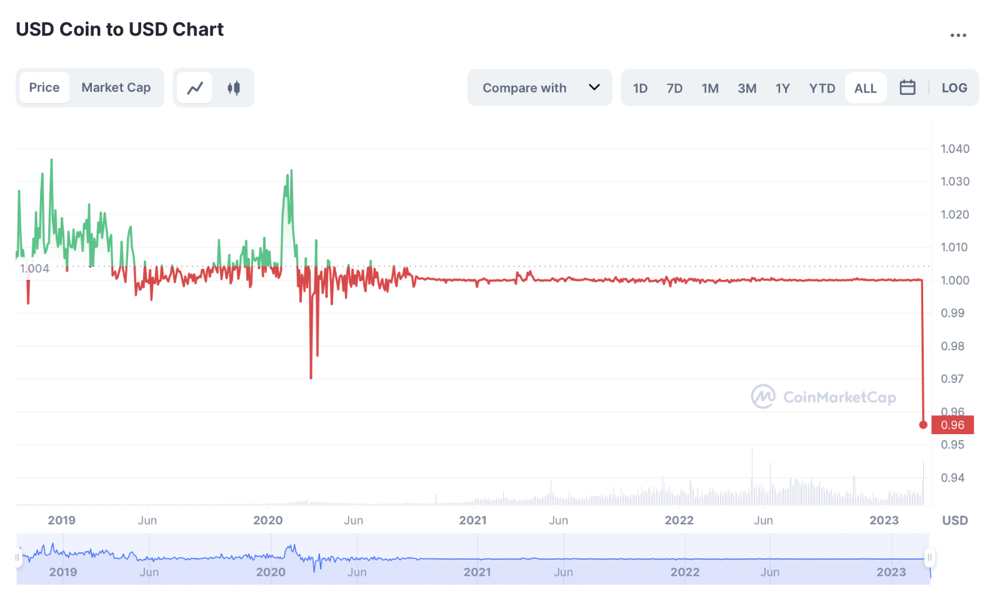
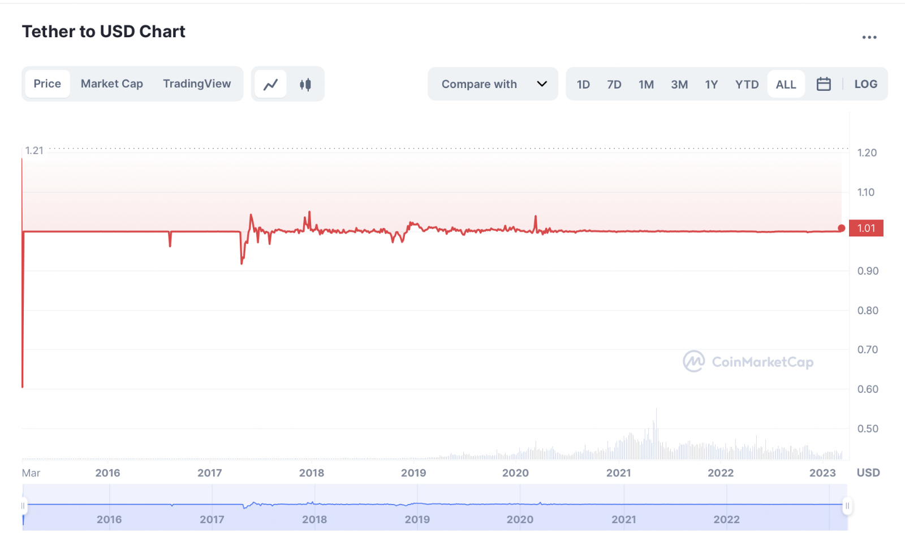
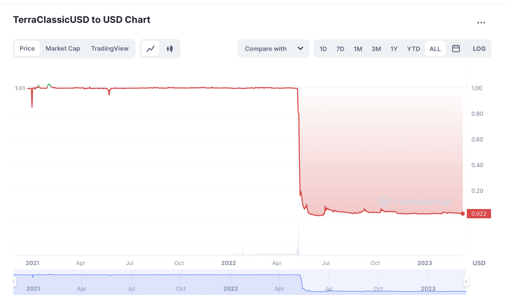
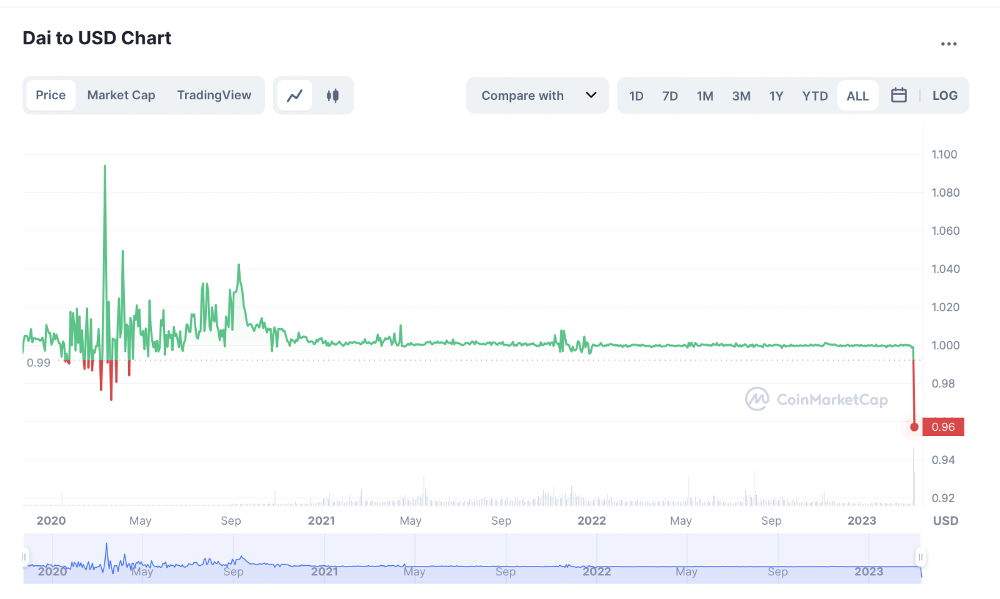

# Perpetual Bitcoin backed Stablecoin (USBI)

- **Thread ID:** 10393
- **Author:** Anonymous (`terra10dac3dxq8dqqltnd3rfp2r8uhpy27xyax8a708`)
- **Created:** 2023-03-14T11:32:02.741Z
- **Last edited:** -
- **Stage:** discussion
- **Views:** 213
- **Reactions:** 0
- **Comments:** 0
- **Source:** https://common.xyz/terra/discussion/10393-perpetual-bitcoin-backed-stablecoin-usbi

---

Hello everyone, 

since my start 2016 I've seen a lot of project but in my point of view the most important step to create the "real" crypto world, is the remove the Fiat to Crypto in Stablecoins! 

The last days, weeks and month we saw the best examples "USDC, DAI and several others"! 

Since September 2022 we worked on the USBI concept and finally I can present you the next Perpetual Bitcoin backed Stablecoin! Within last two weeks the Bitmex CEO published similar ideas but connected to the centralized world, which pushed me to finish the concept and to publish it! 

It would be amazing to get your feedback and who knows, maybe we can build something unique together! 

Our total available team includes 14 developer, 2 designer and 1 content writer. 

If the concept is accepted by the Terra Community and we can work together, we will publish the proposal. 

Cheers TGG

-----

**Abstract **
USBI aims to create a completely decentralised Stablecoin, which is backed by Bitcoin or Ethereum. This is to be achieved by replacing all middle-men or centralised platforms with smart contracts. This is not only because of the distrust in traditional finance institutions but also to avoid the correlation to any non crypto backed assets. Considering the number of people who are using stablecoins and and the number of people who are lacking access to the banking infrastructure, we need a fully decentralised system which requires a decentralised crypto backed stablecoin! This is of course backed by a strong belief in the decentralised world and Bitcoin! 

**Introduction **
With USBI you avoid any type of centralised third parties in the stablecoin issuing process between you and your collateral / funds. Most cryptocurrencies, including Bitcoin, have a strong speculative demand, which contributes to wild fluctuations in price. Bitcoin’s extreme price volatility is a major roadblock towards its adoption as a medium of exchange or store of value. Intuitively, nobody wants to pay with a currency that has the potential to double in value in a few days, or wants to be paid in a currency if its value can significantly decline before the transaction is settled. 

At the core of how the USBI Protocol solves these issues is the idea that a cryptocurrency backed by Bitcoin and protected by total loss coverage due to decentralised perpetual trades would maintain a stable price. Retaining all the censorship resistance of Bitcoin, and making it viable for use in everyday transactions. However, price-stability is not sufficient for the wide adoption of a currency, it is important the users understand how it works and why they should consider it to use. 

We have seen in the past a lot of stablecoins which depegged from the proposed value due to technical issues, not enough collateral or due to the wrong collateral (fiat) or even fraud! 

**Problem Statement **
Stablecoins are used as stores of value or as trading, payment currency with less volatility. 

	We encountered the following problems with other stablecoins: 
	- Backed partially with fiat money 
- USBI backed with Bitcoin 

	- Backed partially with Stablecoins which are backed with Fiat money 
-  USBI backed with Bitcoin 

	- Backed with too volatile or less liquidity crypto currencies 
- USBI backed with Bitcoin 

	- Relying on demand and supply (burning and minting) 
- USBI can be issued if enough trading liquidity is available 

**2.1) USDT, BUSD or USDC **
The total market cap from USDC, USDT and BUSD is around $120 billion (12th of March 2023) backed by mostly fiat which is stored in banks. The majority of the crypto market is connected to the fiat world and always relies on the traditional system. As we have seen with the recent crash of [silicon valley bank](https://www.wsj.com/articles/crypto-investors-cash-out-2-billion-in-usd-coin-after-bank-collapse-1338a80f), if the stablecoin is backed by Fiat which you store in the bank and something happens to the bank you lose your peg because you lose the collateral. In the whole process BUSD and USDT are the ones with the best peg until today. 

**2.2) UST **
At a high level, TerraUSD (UST) is a decentralised algorithmic stablecoin that aims to maintain the value of 1 UST=$1 through a “mint/burn” mechanism. Maintaining dollar-peg stability means algorithmically regulating supply and demand of the coin – a computer program balances the price. To go back to some economics 101: When demand exceeds supply, the price goes up (in this case, UST>$1). When the opposite occurs, the price goes down. So, the task at hand is to regulate the supply so that the price of the stablecoin remains at $1. This is done through a two-coin system. As discussed, UST is the stablecoin. Terra’s native cryptocurrency, luna, backs UST. Minting $1 of UST requires burning $1 worth of luna, and vice versa. Say the demand for UST is too high. The price will go above $1, perhaps to $1.01. To bring the value back down, $1 of luna can be exchanged for $1 of USD. This “mints” $1 of UST, increasing the supply and ultimately lowering the price. At the same time, it “burns” $1 of luna. When the demand is too low, users can “mint” luna to reduce the supply of UST and increase its value back to $1. With market volatility and an overall downward trend, the balancing act for this particular stablecoin failed. The reflexivity of the system meant that when demand for UST falls, sell pressure on luna increases. This can and did result in a downward spiral that saw the [price for both plunge to near zero](https://www.bloomberg.com/graphics/2022-crypto-luna-terra-stablecoin-explainer/). 

2.3) DAI
DAI as “decentralised” Stablecoin which is pegged by various crypto currencies including stablecoins, also depegged within the USDC crisis and issued an emergency proposal because of the [3.1 billion $ USDC exposure ](https://cointelegraph.com/news/maker-dao-files-emergency-proposal-addressing-3-1b-usdc-exposure)which depegged DAI. 

**3) The Solution **
The Solution is the decentralised perpetual Bitcoin backed stablecoin!  
 

**3.1) How does it work? **
Example: User X comes to USBI with $20,000 in BTC to create USBI the stablecoin and at this moment we open via smart contract one short position with leverage 1 size 10,000$ short and 10,000 $ (0.5BTC = BTC price 20,000$) we keep in BTC. With leverage 1 we do not have any liquidation point. 

Exit higher price*: 
You borrow USBI at BTC price 20,000 $ and you bring 100% from the borrowed USBI back at a bitcoin price of 30,000 $, you get back 0.5 BTC which is now worth 15,000 $ + 5,000 $ in BTC at the current price. 

Exit lower price*: 
You borrow USBI at BTC price 20,000 $ and you bring 100% from the borrowed USBI back at a bitcoin price of 10,000 $, you get back 0.5 BTC worth now 5,000 $ + 15,000 $ in BTC at the current price.

Every user has its own position so the execution happens separately.

115% collateral required 

	* The USBI fee, the trading fee and the maintenance fee need to be deducted.

**3.2) How do we get enough liquidity?**
The USBI Users pay per annum 4% maintenance fee and 3% from the fees are getting distributed to the liquidity providers. The exchange does not have funding rates for leverage trades due to the partner collaboration but 0.1% trading fee.

Our protocol is shorting 100% and never takes a long position which means for external traders who want to go long on the partner perpetual dex, the liquidity is much higher which animates additional to the 0 funding rates new traders and more liquidity. 

**3.3) How do we protect USBI stablecoin holders from the position liquidation? **
With leverage 1 we have no liquidation point. 

**3.4) Is there always enough liquidity available to borrow USBI? **
The user has two options to borrow, one is borrow with market price borrow, where you get (depending on your amount) a bit less USBI due to the slippage or the option to do limit borrow where you get the USBI when the orders are filled. 

If you select market mint, the system will show you the expected price change and you can select the max slippage.

**4) Fees**

**4.1) Maintenance Fee **
You as a user can select how long you want to borrow USBI and based on your terms you pay the maintenance fee which is up to 4% per year. The amount will be deducted from your deposit. If the user does not renew the borrowing process before the borrow contract expires the position will be closed and the amount is used to buy back USBI from the market and burn it to avoid uncollateralized issued USBI. 

  3 month = 1% 
  6 month = 2%
  9 month = 3% 
12 month = 4%

**4.2) Trading Fee **
If you borrow and return the borrowed USBI you pay 0.1% trading fee on your total amount.

**4.3) Funding Rate **
Due to the partnership with a new kind of perpetual exchange or own build perpetual exchange, we do not pay any funding rates but the exchange receives 75% from the maintenance fees and the Trading fee to pay the liquidity providers and cover the costs.

---

## Comments (0)

_No comments._
