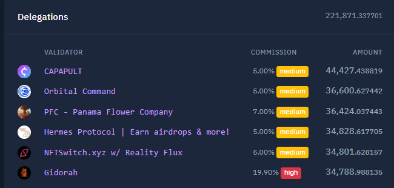

# Backbone Labs - Audit & LP proposals

- **Thread ID:** 10945
- **Author:** Anonymous (`terra1hr7svdp2rga9vf3ry95sx7g5wyspgwmg94qac8`)
- **Created:** 2023-04-03T23:22:17.826Z
- **Last edited:** -
- **Stage:** discussion
- **Views:** 68
- **Reactions:** 2
- **Comments:** 11
- **Source:** https://common.xyz/terra/discussion/10945-backbone-labs-audit-lp-proposals

---

# Backbone Labs

Backbone Labs is a group of blockchain enthusiasts and developers who are dedicated to building community-driven decentralized finance (DeFi) tools and non-fungible token (NFT) utility and innovation. The group was born out of the Terra crash, an event that occurred in the early days of the blockchain space.

Through this experience, the team at Backbone Labs has learned how to navigate the challenges and opportunities of the decentralized web, also known as web3. We have developed a deep understanding of the technologies and protocols that drive this ecosystem, and are committed to use this knowledge to empower others on their own journey in web3.

The Backbone Labs team is focused on building tools and solutions that are accessible and easy to use for people of all skill levels. We believe that by making the technology more approachable, we can help more people discover the benefits of decentralized systems and the potential of NFTs.

Our goal is to create a vibrant and engaged community of users who can benefit from the innovative solutions we are developing. We believe that by working closely with our users, we can better understand their needs and build solutions that truly meet their requirements.

# Gravedigger
Gravedigger forms one of the pillars of the Backbone ecosystem, allowing people to liquid stake their tokens and earn yield in several ways, through 'boneLuna', on the terra blockchain, and also other chains through the alliance system.

## boneLuna / Liquid Staking
boneLuna is gravediggers liquid staking token. Liquid staking mitigates some of the risk of staking, by diversifying the validators that people use, as well as providing a fast way to enter & exit their Luna without having to wait a few weeks by using a LP pool.

The fees generated get rolled back into the ecosystem,  30% going back to the NFT collection, and the remaining 70% being used as incentives in their LP pools, encouraging people to make the token more liquid.

You don't need to hold a NFT to participate in gravedigger, you can still get great yeild and rewards in our LP pool.

# The Asks
We are focusing on making backbone amazing for everyone involved, and are looking to the community to help us with two things.
* Auditing our code 
* Funding a liquidity pool

## Auditing

We believe in good security hygine, and as such, we believe we should re-audit our codebase on a regular basis, to ensure our systems still up to date with the latest good security practices, and the people using our systems are in good hands.

In order to do so we are asking the Terra community for ~35k USD of Luna to fund this. The funds will go directly to the audit provider. 
We have selected SCV to lead this audit. SCV has conducted previous audits on this codebase, and are quite familiar with liquid staking, and have audited our contracts before.

## Funding our liquidity pool

For a liquid staking token to truly work, it has to be easy for people to enter and exit from
without experiencing too much slippage.  For this to occur, the liquidity pool should be big enough to handle a regular user's needs. 
In order to do this we are asking the Terra community for ~$2-500k USD of Luna to add to our liquidity pool on white whale's dex. The money will be managed by a multi sig of indepent people / directly from the community fund itself, with any rewards getting rolled back into the LP. This pool is not being 'spent' per-se, but remains in the community, and can be un-wound with another governance prop. We are looking for input in the size of the pool. The fees generated from these funds would be returned to the community pool

---

## Comments (11)

**Anonymous (`terra1alxk3fmhcl0ga80gl9yj9zp3ezjm4sdh8a9l9c`)** — 2023-04-04T09:11:23.483Z (edited 2023-04-04T09:12:15.184Z) — 👍 1

Hi PFC,

this should be split into 2 proposals. One for the audit and one for the LP.

I fully support funding the audit for BackBone Labs!

1. Is the audit only for Liquid Staking or also other contracts?
2. Have you enquired multiple quotes from different security firms?

I do also support the community pool funding liquidity for community projects. There are however some caveats I would like to see addressed:

1. Validator set: The LP from the community should help the growth of the ecosystem and not fund specific validators. The validator set should be increased to at least 10 or better 15 validators
2. On what criteria are validators chosen and what are the allowed commission ranges?

3. I understand there are not the best feeling regarding Astroport on Terra, but I would still like to see all DEXes included. 25% Terraswap, 25% Astroport, 50% WhiteWhale and after Dexter launches (+3 months delay) move 25% from WhiteWhale to Dexter.
4. Right now there are two major NFT projects on Terra, SkeletonPunks and GalaticPunks. The liquidity will generate income for SP holders, so the GP validator should be whitelisted, to participate and we show to support both NFT projects.
5. All contracts need to be migrated to a Terra builders multi-sig.

I would like to see a generalized liquidity provision proposal. ERIS will also request community provided liquidity, and I would also like to see John Galts proposal be implemented by using boneLuna and ampLuna.

> **Anonymous (`terra1hr7svdp2rga9vf3ry95sx7g5wyspgwmg94qac8`)** — 2023-04-04T12:30:05.134Z (edited 2023-04-04T12:30:25.525Z) — 👍 2
> 
> This will go up as 2 separate proposals to governance, but we decided to make a single thread as most questions will probably be inter-related.
> 
> 1. The audit quote is for the liquid-staking and the fee/vaults stuff.  
> 2. I'll let others comment on this, but it is usually based on contributions made.
> 3. Our thinking is one LP with a high TVL to minimize slippage. TFM (the default in station) selects the best, and what is best for the LP providers. 
> 4. That's a BD decision, I'll let others discuss
> 5. Yes, contract migration from a multi-sig is a good idea.

> **Anonymous (`terra1ph6q7z3ltyzn2jtxl4e8808qgcw6vrglkcgq9h`)** — 2023-04-06T00:11:34.298Z — 👍 1
> 
> Agree with Philip's assertion about generating multiple quotes; that would be prudent. 
> Disagree with his view about the DEX's - unless he can provide something more substantive than "I would like to see". I WOULDN'T like to see Astroport included. Is that a good enough justification? Astroport has made several business decisions in its self interest, which it is entitled to do. Why Backbone Labs should not be allowed to do likewise confuses me. At worst, the proposal is voted down - it doesn't necessarily need to be changed for "fairness" factors. This applies to the comment about the Galactic Punks validator as well. I'm not entirely sure why including the GP validator is a make or break. They are entitled to create their own governance proposals and discussions as well, and I don't believe the Skeleton Punk team would be surprised (or disappointed) if their proposals did not seek to benefit the Skeleton Punk project. I agree with Philip's comment about John Galt's proposal factoring in the inclusion of $bluna and White Whale.

**TheMoondalorian (`terra1ggf9ru2kzm0f5vytx8hlnkmdefuh20rc3v00yq`)** — 2023-04-04T09:52:40.531Z — 👍 4

I fully support this. Backbone labs worked so hard for this ecosystem for free and does a crucial part to revive the whole ecosystem. So let's support those efforts.🔥☠️🔥

**PolluxMan (`terra14dhzxgzynx6lgjw23f4g6j4m3e2z6rgqwg99wz`)** — 2023-04-04T18:18:04.845Z — 👍 2

Fully support the team behind Backbone Labs and their unwavering support to the NFT community with Skeleton Punks. They are re-building DeFI in Terra and giving back - this is a great endeavour and they should be supported.

Considering the comments about splitting this into two proposal, I think that's a good idea. As well as perhaps having different quotes from suppliers (although if they used the suggested supplier successfully in the past then there might be no reason to change).

Backbone is one of the few teams in Terra that are building multiple projects and this should only bring more visibility to the ecosystem as a whole, therefore I do think it's a good investment to fund the team.

**ecclesia168 (`terra1eqaq2kuntl3jh4xd5sjxcf9ncpuk2plml0dgsg`)** — 2023-04-05T00:31:11.670Z — 👍 2

The NFT scene in Luna is still in its infancy. Blue Chip projects like SP and GP are needed to forge through this difficult time. SP has not asked for any funding from Terra Community and has revived their community despite the bear market. I do not have the knowledge or wisdom as other devs but would just like to ask for consideration in their proposal and hope that it will be accepted. Thank you.

**GameOver (`terra1enj5sly30kmn0uxhhaylaavfwmfp68xc3sr7vq`)** — 2023-04-05T23:30:50.802Z — 👍 2

BackBone Labs and Skeleton Punks have been building nonstop since the Depeg. While many others left Luna entirely, they have stuck to the course, and their vision for the Terra eco has only become more clear and stronger. I fully support this proposal. The team has my trust, completely. An AUDIT will help secure their systems, and funding their liquidity pool will help the entire Luna community, BOTH of which are great things for Terra

**Anonymous (`terra1hjdrzs6g4u8c23sz8rsxsshkuncpr28sy5g6rw`)** — 2023-04-06T06:05:07.403Z

Fully support. Aligned with [@Philipp | Eris Protocol](/profile/id/96095)  comments.

**xero1 (`terra1aj0fjeffrlx5jheqltq6f5q0l6rdk3tcs7gela`)** — 2023-04-07T02:08:26.786Z — 👍 1

We’ve witnessed Backbone Labs take an NFT collection from rugged to number 1 on Terra after funding was denied. Voting “no” delayed their progress but they went ahead and achieved the miracle regardless. 

- **Proven capabilities!** This is a no brainer.  

Funding would have supercharged their plans and we’d be way in front of where we are today. We have some highly skilled, determined and passionate Terra OGs seeking support, we know they are capable as this has been proven. Their strategic partnership with White Whale has already made history with bLuna being the first LSD staked on a non-native chain to support that chain.  

**Why is this good for Terra?  **

White Whale are unifying the cosmos evolving strategies with interchain liquidity that will attract users, not only from cosmos, also polkadot parachains, avalanche and any other IBC chain that supports cosmwasm smart contracts.

Terra will either be a shining beacon in the cosmos supporting this evolution or just some chain that keeps approving funding for outside investors seeking returns or teams that over promise and underdeliver.

In conclusion, witnessing what this team has achieved, despite everything that was thrown at them (Founder rugged, Terra attack, social attack, funding denied, astroport pulling incentives).

Nothing gets in the way of their vision and for that I have massive respect!

Investing in proven capabilities here. Simple, let’s fast track the success this time!

> **BackBone Labs (`terra1gw8mesks5uw2gukjfv9xftf5xh0xn8empydw2t`)** — 2023-04-09T13:53:54.528Z
> 
> 🏴‍☠️🫡

**Sasori (`terra1q4j4ucmqz74vxew0kszsxqtmvxqgp5fen248p0`)** — 2023-04-11T09:14:59.583Z (edited 2023-04-11T09:15:43.718Z)

**Audit**
- Why does the codebase require a re-audit? Has there been any changes to the code? 
- Even if a new audit is required, shouldn't the team engage a separate auditor to at least ensure that there has been another pair of seasoned eyes have had a look at the code? Getting the same folks to do the same work again and expecting a different result seems highly inefficient.

**Liquidity Pool**
What utility does bLUNA have? The introduction to this proposal states that the team is 'building community-driven decentralized finance (DeFi) tools and non-fungible token (NFT) utility and innovation'. 

Before we explore committing more funds to the team, can the team elaborate what has been built and what's on the roadmap?

A quick inspection at what has been delivered so far:
1. BoneLUNA (bLUNA) is a fork of $STEAK by Larry
2. Nothing else has been launched

Moreover, this claims to be a community-driven, but all I see is a generous proportion of fee generation going to Skeleton Punk holders, which is a collection of 5.06k NFTs. Even assuming 100% unique ownership, we are at most seeing 5.06k wallets benefitting from this proposal, not the entire $LUNA community. 

Regarding the validator selection for boneLUNA, the selection process isn't transparent at all, and the set is concentrated to a select group of 6 validators, of whom:
- 1 is the proposer's
- 2 is the core teams' validators

What you are proposing frankly is taking funds from the community pool (All of $LUNA stakeholders) to benefit a small subset of users (Skeleton Punk holders) and insider group of validators. 
When you say 'community', do you mean the Skeleton Punk community?

A number of the folks expressing support in the comments section are also either Skeleton Punk bagholders, or part of the core team. This conflict of interest should be declared to make the conversation here more transparent. 

Finally, as a recipient of the Emergency Grant Allocation, when do you intend to ship Validator DAO before working on something new?

Thank you.

