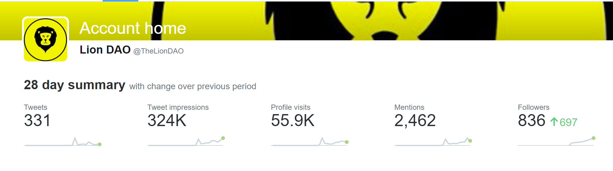
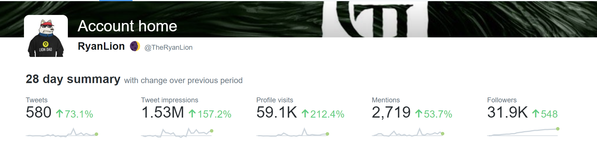
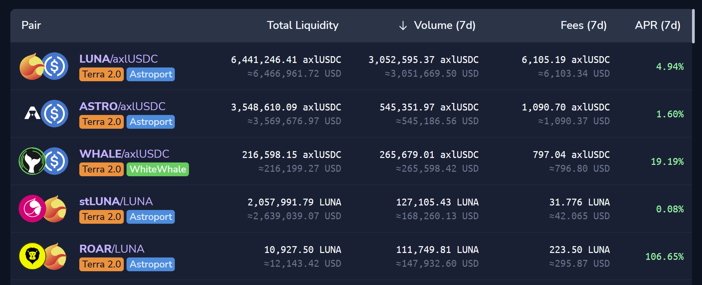

# Lion DAO Treasury Grant

- **Thread ID:** 11084
- **Author:** Lion DAO (`terra1nrt0tcqc3kazztzfhyd2pf9q59p49ywu9g36w8`)
- **Created:** 2023-04-10T17:08:53.037Z
- **Last edited:** -
- **Stage:** discussion
- **Views:** 100
- **Reactions:** 2
- **Comments:** 8
- **Source:** https://common.xyz/terra/discussion/11084-lion-dao-treasury-grant

---

## Summary

The Lion DAO was created to test, demonstrate & promote Enterprise.money - the automated, no-code DAO creation tool recently launched on Terra by TFL. Alongside this, we aim to showcase the various tools & protocols that Terra has to offer through partnerships & integrations. Finally, we want to support the Terra Builders' strategy of showcasing the power of Cosmos & IBC.

This proposal requests 50,000 LUNA to be transferred to the Lion DAO treasury in order for the DAO to be able to demonstrate & implement various DeFi strategies using LUNA both on-chain & interchain across the Cosmos.

## Motivation

The creation of the Lion DAO has already captured the imagination of many sidelined ex-LUNAtics and re-activated them again both on-chain & across social channels, bringing positivity & activity to the Terra Blockchain & Terra Community.

In order to continue the mission of Lion DAO of stress testing Enterprise.money, to promote & demonstrate the various on-chain protocols & tooling, as well as the interchain utility of LUNA we require the DAO to have LUNA within the DAO treasury that can deployed into various DeFi strategies.

Since the inception of Lion DAO 11 days ago, the official Twitter account has gathered ~325K impressions & ~55K profile visits:

The founder RyanLion has seen impressions jump 157% to ~1.5m impressions over the last 28 days since documenting the creation and progress of the DAO:

There are over 1,500 Terra wallets that currently hold the Lion DAO governance token ROAR on Terra & ROAR is being provided as staking rewards to 14K wallets on Kujria (due to token trading on Kujira).

Over the past 7 days there has been ~$150K in trade volume on the ROAR/LUNA pair making it the 5th most traded token on the Terra blockchain, despite constant warnings not to trade it due to low liquidity & experimental nature:

There have been integrations & collaborations with a number of protocols - tooling providers & NFT projects on Terra, as well as cross-network collaborations. Collaborations to date include:

Enterprise DAO
TFM
Coinhall
Terrascope
Terra Station Wallet
Astroport
Eris Protocol
Capapult (TBC)
Terra Poker (TBC)
Redacted Money
Pulsar Finance
Skeleton Punks
Backbone Labs
Galactic Punks
Kujira
Fuzion (dApp on Kujira)
Chihuahua Chain
Stargaze Zone
White Whale
+ others

We have an opportunity here to continue to promote and bring attention to the Terra blockchain by granting a LUNA allocation to the Lion DAO treasury that can be used to demonstrate both the power of Enterprise.money & the utility of LUNA both on-chain and beyond.

This can also serve as an example to builders that if they come and build on Terra & generate some activity there’s a path to community pool funding where needed.

## Proposal

We propose that the Community pool allocate 50K LUNA to the Lion DAO treasury in order to demonstrate the utility of LUNA both on-chain and interchain through its deployment into different DeFi strategies.

Examples of strategies that could be deployed:

- Using LUNA to mint various liquid staking derivatives through Eris, Backbone Labs, Stader & Stride Zone
- Using LUNA LSDs as collateral to mint SOLID on Capapult
- Using LUNA as collateral for borrowing on Cavern Protocol
- Using LUNA or LUNA LSDs as collateral for borrowing on Carbon Network's Demex Exchange
- Using LUNA to mint USK on Kujira
- Using LUNA LSDs to stake on other blockchains that are implementing alliance module
- Using LUNA to mint CMST on Harbor Protocol on Comdex chain
- Using LUNA & LUNA LSDs to provide liquidity on Astroport

Generally all strategies that could or would be deployed would be for the benefit of demonstrating the utility of LUNA on Terra & across other Cosmos chains.

What we would not do with any LUNA tokens allocated to the DAO treasury:

- Sell LUNA
- Use LUNA to provide liquidity for the DAO's governance token
- Pay any salaries or incentives to DAO members
- Implement any high risk strategies that were likely to dilute the LUNA owned by the DAO or result in liquidation of the LUNA held by the DAO
- All strategies will be deployed with the aim of creating additional yield for the DAO treasury
- 

Given that the LUNA would be sent to the Lion DAO treasury, the only way to utilise it would be through DAO governance proposals approved by the Lion DAO governance contract on our Enterprise.money DAO page.

With regards to the above, there are some risk factors as the DAO governance token becomes more distributed that DAO members may vote for strategies or utilisation of the treasury funds that are against these principles & for that reason we are restricting the size of this community pool request to an amount that would not have a significant effect on the LUNA token price should these risk factors materialise.

## About the team

The Lion DAO was created by RyanLion (@TheRyanLion on Twitter) a well known Terra community member who has been active in the community since January 2021.

Ryan was formerly operations lead at Prism Protocol, a leading dApp on Terra Classic prior to the UST depeg in May 2022.

Ryan has documented his journey of the creation of the Lion DAO on Twitter in an effort to be fully transparent about how the DAO has grown & is operated.

Currently there is no wider DAO management team, anyone else involved in promotion or coordination of the DAO is doing so in an unofficial & volunteer capacity. If the DAO continues to grow, any formal team &/or compensation will be decided by the DAO governance process.

## Next Steps:

We are open to discussion on the forum over the next 48 hours and will make proposal amendments if they are deemed to be reasonable by the Lion DAO before moving to an on-chain governance proposal.

We are limiting the amount of time allocated to this discussion to 48 hours to capitalise on the current momentum & engagement that Lion DAO currently has.

---

## Comments (8)

**4719 (`terra13qjxhnw98lm36rxc9yjakkmulhpv7zctdc5zlz`)** — 2023-04-10T18:00:00.182Z — 👍 1

This is a small marketing spend for what LION DAO has achieved in promoting Enterprise protocol & terra.money. I believe it has gained a lot of attention & this spend can go a long way in further showcasing the power of enterprise protocol, the reliability of terra.money & the great developments happening on the chain by TFL & the many other great builders. 
The LUNA spend ultimately benefits the active users on the chain so gidorah validator will support this proposal.

**Rocket Man (`terra169hpn0fr2tf5un4rknndttncveshqkkq3yp6x8`)** — 2023-04-10T18:31:51.302Z — 👍 1

+1 for this proposal. I've been very impressed with TheRyanLion's efforts with the Lion DAO. It's showcasing the utility and efficiency of the Enterprise.money protocol for quickly and effectively forming DAOs in the Terra ecosystem. 50,000 LUNA could go a long way towards growing this DAO and showcasing it to others as a way for fast-tracking their DAO needs.

**Rufus (`terra1xdmdyh7uyhdrqczuh7nckd7sv5tpveggpv7jpp`)** — 2023-04-10T19:08:11.043Z — 👍 1

Been very impressed with Lion Dao and Ryan's creative efforts and energy. As a showcase alone for enterprise dao 50k Luna is not a big commit. I support the proposal

**Beatmode (`terra14yrfk4pdtn8p768dylqdhyrmh4udfwgel8skgf`)** — 2023-04-10T19:29:11.621Z — 👍 1

Love it! The Lion DOA also helped stress test coinhall usage demand. +1 for the proposal.

**Anonymous (`terra1ph6q7z3ltyzn2jtxl4e8808qgcw6vrglkcgq9h`)** — 2023-04-11T03:52:35.133Z

I've been impressed with the momentum and interest this exercise has generated; well done Ryan. The biggest issue with the proposal in my view is the misnomer about "DAO governance". It is not a community controlled or owned DAO. As I understand it, the DAO is effectively controlled by Ryan. This means any vote created, is controlled by him. If all of the tokens in his current control were put into the Treasury or some other mult-sig controlled wallet (with perhaps other signatures coming from the protocols/projects that have teamed up with Lion DAO - i.e. Skeleton Punks, TFM etc) - then the idea has greater merit.

**ChrisTheElec (`terra188jwlyq30fml4n75cme238e7z6px393rh8245s`)** — 2023-04-11T10:48:19.824Z

100% support this proposal. What Ryan & LionDao have achieved in such a short time and the re-energising of the LUNAtic community has been great. Love you see it and be a part of it

**Anonymous (`terra1hr7svdp2rga9vf3ry95sx7g5wyspgwmg94qac8`)** — 2023-04-12T16:12:18.133Z

why 50k and not 5k ?

or even $500 for that matter?.

> **Lion DAO (`terra1nrt0tcqc3kazztzfhyd2pf9q59p49ywu9g36w8`)** — 2023-04-12T21:29:50.368Z
> 
> Hi PFC - Thanks for your question, I think it's a good one and a pertinent one.
> 
> The purpose of the grant is to allow the DAO to demonstrate and promote various DeFi strategies & utility of LUNA both on chain & cross-chain.
> 
> I think there are a few main reasons why we request a non-trivial amount:
> 
> 1. We want to implement multiple strategies simultaneously - as described in my prop, we want to demonstrate as many different LUNA utilities as possible, so we will split the grant across many different strategies.
> 2. Attention - by moving non-trivial amounts of LUNA into various strategies & tracking performance we can generate outside interest in how these strategies are performing vs. if we are moving $50 into a strategy. By gathering outside attention we bring increased focus on the DeFi possibilities on Terra & the utility of LUNA on & cross-chain.
> 3. Maintaining DAO engagement. Ultimately the goal is to show what can be achieved through the power of the Enterprise.money DAO tooling. Providing a non-trivial grant to the treasury will provoke significant effort by DAO members to come up with strategies & to write governance proposals on how the treasury should be implemented. We have already seen significant efforts being made by DAO members in an autonomous capacity through governance, peripheral projects & community efforts. Implementing treasury strategies takes the DAO management to the next level. My anticipation is that with a non-trivial treasury to manage we will see a lot of coordinated effort in our social channels to work on DeFi strategies & governance, whereas a trivial amount would probably lead to Ryan being the main/sole driving force, trying to implement low EV strategies with low overall DAO engagement.

