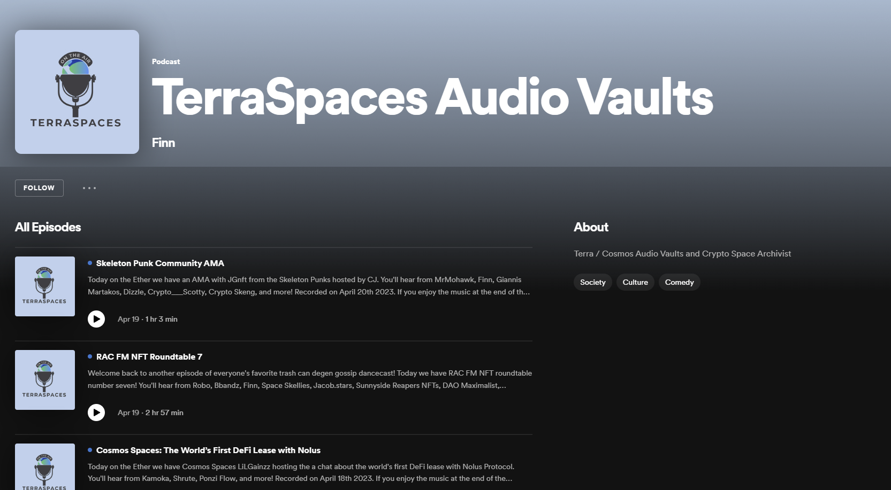

# Community Funding for TerraSpaces

- **Thread ID:** 11194
- **Author:** Finn (`terra12k7xxnvyy305pgtuez7mtnpkwupgru59tjaree`)
- **Created:** 2023-04-19T17:25:48.620Z
- **Last edited:** -
- **Stage:** discussion
- **Views:** 40
- **Reactions:** 3
- **Comments:** 17
- **Source:** https://common.xyz/terra/discussion/11194-community-funding-for-terraspaces

---

_Proposal Summary_

[TerraSpaces.org](https://terraspaces.org/) is a platform that archives, and makes freely accessible, crypto-focused discussions covering hundreds of DeFi and NFT protocols, projects, and ecosystems. We initially started as an effort to archive Terra Twitter spaces that were being missed, but over the past year have evolved into a multichain, chain agnostic, searchable repository, along with an editing, archiving, and audio show podcast production studio.

We are requesting $80,000 USD in funding from the Terra community pool for a one-year service contract to cover the costs associated with maintaining and improving the TerraSpaces.org platform.

The funding will be used to cover salaries, server, and maintenance costs, along with anything else TerraSpaces needs to continue to grow and evolve.

The current funding request represents a $5,000 increase from the initial funding received on November 21, 2021. This increase is based on the 7.43% rise in the Consumer Price Index (CPI) since that time.

_Project Description_

TerraSpaces is akin to a fly on the wall that records, edits, and archives conversations and discussions taking place in the crypto space. We believe these spaces and conversations are crucial to documenting the history of our industry, and we are committed to creating a historical record of our technological renaissance starting with funding from Do back in November 2021.

While we have been successful in archiving over three thousand audio files from various crypto-related spaces, we would like to pivot towards producing more Terra-focused content in the next year, including spaces and shows for the Terra community, while focusing a little less on mass archival.

We currently produce several shows for various community members in the Cosmos: "RAC FM" which is a daily dose of everything web3 in the Cosmos, and "Bare Bones of Web3" which is a weekly dose of market news, analysis, and alpha. In addition to these shows, we would like to create more Terra-focused content that covers important topics and issues in the Terra ecosystem including DAOs, governance, and project updates / weekly wrap ups.

We believe that this approach will help us better serve the Terra community and our wider audience, while still archiving all Terra-related spaces and any other spaces the Lunatics want to see on our feed.

_Budget_

We are requesting $80,000 USD split into two $40,000 USD payments every 6 months in order to cover costs associated with maintaining and improving the TerraSpaces.org platform. The funding will be following services:

- Developer salaries
- Server and maintenance

_Voting Options_

Yes: I agree to fund TerraSpaces.org with $80,000 USD for a one-year service contract.

No: I do not support this proposal

_Conclusion_

We believe that TerraSpaces.org is an essential resource for anyone who wants to learn about the Terra ecosystem, and crypto in general. We are committed to expanding the Terra Lunatic community, improving our platform, and producing high-quality content that can better educate and inform our audience about the Terra ecosystem as well as other blockchain projects and innovations within the cosmos, and beyond.

With your support, we can continue to create a historical record of our industry and ensure that our renaissance is not forgotten. We thank you for your time and consideration, and look forward to your feedback.

---

## Comments (17)

**Anonymous (`terra1rr2g4z2ch4cqwl8s70yj94a5l2vakg0v34lxzy`)** — 2023-04-19T18:04:14.849Z — 👍 2

We support this proposal. We listen to many Cosmos/Terra podcasts but cannot keep up with them all. TerraSpaces offer a great archive for us to keep track. 

I do think that this product can be improved though. With the recent advance in AI, there might be an opportunity to offer searchable transcript for these podcasts. 

That said, we will support the proposal as is even if we hope for future product improvement.

> **Finn (`terra12k7xxnvyy305pgtuez7mtnpkwupgru59tjaree`)** — 2023-04-19T18:25:39.242Z — 👍 1
> 
> sers 🤝
> 
> Funny you say that, one of the star interns from intern capital is actually working on something that will let you ask a question to a text box and it'll spit you out an answer based on the data / transcripts. We're definitely thinking in those terms and down that path.
> 
> I just want to make sure TerraSpaces is something the community still wants and is willing to fund.
> 
> Thank you for the support!

> **taoi (`terra1tyqg45t76edexrj6jhpml6mqpptpe709r5gu9m`)** — 2023-04-20T20:44:54.788Z — 👍 2
> 
> Hello,
> 
> 	The random intern working with finn to add AI capabilities to terra spaces. 
> 
> 	The initial plan is to self-host whisper to transcribe the audio, and use GPT models from Open AI for embedding and text completion queries. Whisper is open sourced and I am happy with its performance, but the same can not be said for the GPT models. The ease of use of the Open AI API has made this a good starting point, however, I am searching for an open source LLMs. My intent is to structure this within docker containers so that the back end of this can run on the Akash Network. 
> 
> 	Progress so far:
> 	We are close to rolling out a "beta" of this. It will have the 50 latest episodes embedded and ready to be referenced by GPT-3.
> 	Database of raw transcripts is being established. Read access will be open to all.
> 
> 	Limiting factors:
> 	I would like to state that I am not a developer by profession. I do not have a programming background. 
> 
> 		Cost:
> 		GPT-3 API charges per request. though at first glance it appears cheap (few cents per question) this can add up rather quickly. For now I am putting a limit on this of $5 per month.
> 		Currently the compute is hosted on Oracle always free tier. This will be migrated to Akash and the will also have recurring costs. Whisper is the biggest consumer.
> 
> 		Time and Skills:
> 		As stated I am not a dev and all the coding and debugging has been GPT-4 reliant.
> 		I am full-time employed and this is a hobby level time commitment on the best of days. 
> 		
> 	Broader outlook:
> 	Once the framework is set, It will be easy to expand to other data sources easily. A simple example of my mind is embedding white papers.
> 
> 	You may follow my progress via this [repository](https://github.com/taoi11/terra_spaces). More documentation to be added as I find time. I intend for this code to be available to all.

**BackBone Labs (`terra1gw8mesks5uw2gukjfv9xftf5xh0xn8empydw2t`)** — 2023-04-19T18:04:35.778Z — 👍 1

I am 100% in support of this. 

Terra Spaces has been a cornerstone of the LUNA community for as long as I can remember and after the crash, it served as the glue to hold us all together while rebuilding    

Terra Spaces has never had to ask for funding before and that is because they are a project, that up until now has been personally funded by Do Kwon.   Do understood the value of documenting the financial journey we are on and it is important that the LUNA community step in to keep it going. 

IMHO Finn is the heart of the IBC. 

🏴‍☠️🫡

> **Finn (`terra12k7xxnvyy305pgtuez7mtnpkwupgru59tjaree`)** — 2023-04-19T18:26:18.884Z — 👍 1
> 
> i appreciate you and everything you guys are building as well! Thank you for the support. 🤝

**Anonymous (`terra1heay4nz54pkn20flf2cu0hlayl4ew9teq6rrz3`)** — 2023-04-19T19:47:21.647Z — 👍 1

Hey Finn,

Big fan of your work ethic and relentlessness in recording Cosmos content over the years.

Besides LionDAO, there's pretty much nothing happening on Terra other than ~$14M TVL farming on Astroport. So IMO, any grant has to be viewed from the POV that this will positively affect onchain activity and user growth, just like the last one from LionDAO.

Thus, could you share listener metrics for Terra-related content over the last couple of months? It would be interesting to see them in contrast to the activity (or non-activity) on Terra as well as to have some sort of yardstick to measure the effectiveness of the grant (should it pass), moving forward.

Also, would like a bit more clarity around:
- Existing grants or funds obtained from outside of Terra for the same period
- Developer salaries - _how many devs?_
- Server and Maintenance - _breakdown of costs_

IMO, as you have requested the grant to be broken down into two payments, a review of the effectiveness of the first 6 months should be carried out before another vote to renew the service contract for another 6 months.

_Opinions are my own and do not reflect that of any group or organization I represent. _

> **Finn (`terra12k7xxnvyy305pgtuez7mtnpkwupgru59tjaree`)** — 2023-04-19T20:28:51.121Z — 👍 3
> 
> Sure no worries. I didn't really start this to make content designed to garner a lot of views. This was started as an archive of the spaces people were missing. I don't focus on stats but i understand people would like to see that there's listeners and all that. Here's a screenshot from the Spotify stats, as well as from the web server itself. My apologies, I don't really know how to embed images, so hopefully these links work. If not let me know and I will make a tweet or something about the stats.
> 
> [Spotify Stats](https://terraspaces.org/Numbas/spotify-stats-4-19-23.jpg)
> 
> [Raw Site Stats](https://terraspaces.org/Numbas/sites.jpg)
> 
> [Raw Usage](https://terraspaces.org/Numbas/usage.png)
> 
> Hopefully people understand creating an archive of audio is pretty different than creating digestible content for clicks and views. That being said, I would like to get away a little bit from the mass archival now that we have a good foundation of over 3,000 spaces, and get back to creating more actual digestible show productions.
> 
> I've not received any other grants since they locked up our sweet sweet Do Kwon. He was funding this project, and had things not gone the way they had, would have continued funding it. But since what happened has happened, here we are.
> 
> I get donations here and there from helpful community members like Dove from Kujira and Sistla from OmniFlix, Jake from Juno, as well as from Ruwan and Shane from Stargaze, but it's not enough to cover my bills / feed my family. It's just a little something to say thank you for archiving all the cosmos stuff.
> 
> As far as the funds go, that's the minimum I need to pay my bills and keep TerraSpaces going. 1 Dev = me. I run my own server and do all my own stunts.
> 
> The break down is basically to continue what Do had setup. I was getting paid every 6 months, so I figured that would be fine for the proposal. I'm happy to take it in one lump sum if that's easier. I just need to know that I'm covered year to year if the community would like me to continue this work. Please let me know if you have any other questions, and thank you for your feedback!

**Satoshi Nakamoto (`terra1mdtes94sv3mtdqwj7zwxunmntc6u7778kus033`)** — 2023-04-20T01:49:03.086Z — 👍 2

Keep up the good work- though in my opinion the UI needs a lot of improvement.
maybe hiring a designer is a good idea.

> **Finn (`terra12k7xxnvyy305pgtuez7mtnpkwupgru59tjaree`)** — 2023-04-20T04:05:13.191Z
> 
> I agree. Thank you for the feedback. I appreciate the support. 🤝

**Jorg (`terra1zf6xze03rv3gvhvmktypvn3xgusy8rnkesnqg6`)** — 2023-04-20T20:44:06.111Z — 👍 2

Big fan. I vote yes. You should host more shows too.

**Neptune Finance (`terra1z5h2v3je9fld7ccv9ua0f0f5uw7kjjj074du7c`)** — 2023-04-21T21:25:06.826Z — 👍 1

It has been helpful to keep up with other projects through the TerraSpaces site and it serves as a great archive for our own content. We support this proposal.

> **Finn (`terra12k7xxnvyy305pgtuez7mtnpkwupgru59tjaree`)** — 2023-04-21T23:45:34.904Z
> 
> thank you, i absolutely appreciate the support!

**Rebel Defi (`terra17w74x9vrqq4a338ssh9y9r4m9s3f6zef7wy5ms`)** — 2023-04-23T09:02:18.488Z — 👍 2

> Long time listener, first time caller.

Terra has been defined by its community. Finn plays a leading role in community building. He puts in the hours to provide not only Terra but the entire Cosmos with first class audio recording/editing.

As we are in a phase of expansion and want to spread the message of Alliance, the relationships Finn has nurtured for the last year could be extremely useful.

Whether we decide to fund Terraspaces will say a lot about our Community. It's a **yes** from me ser.

What I think might be cool is for people to really engage with this vote. Don't leave it up to your validators. Can we see if we can get the most number of wallets to vote in a governance proposal?

**Anonymous (`terra1qgflsn03yq4x9cjk0dsdlzfmw9dhr7teuf6tlc`)** — 2023-04-23T16:29:28.058Z — 👍 1

I wholeheartedly support TerraSpaces.org's proposal for funding. The platform's archiving and freely accessible crypto-focused discussions have been an essential resource for me, and I'm sure many others, in getting up to speed with what's happening in the Terra ecosystem. 

Furthermore, TerraSpaces.org's platform has not only helped me but has also proven to be an indispensable tool for anyone who wants to learn about the Terra ecosystem, and crypto in general. The vast array of discussions and protocols covered on the platform provides invaluable insights for beginners and experts alike.

**Setten (`terra14t5f07qtjzngc4w0l68wyujytqfrdeq7mctcep`)** — 2023-04-25T09:05:52.316Z — 👍 1

Hello Finn,

We really value your contribution and are keen to support your proposal.
Before we proceed, we'd like to get a better understanding of the operating costs involved. We've noticed that TerraSpaces hosts audio on a service called Blubrry, and their PRO plan, which comes with some great features, is priced at $100 per month.

It seems that costs could potentially rise if there are multiple shows ($10/month for each additional show) or if there's significant bandwidth usage (an extra 1 cent/GB beyond 1TB). However, it looks like most spaces typically are part of a single "show" (with some exceptions like "RAC FM") and might primarily be streamed on platforms that don't count towards your bandwidth quota, like Spotify (though we'd need more data to confirm this).

Could you please provide us with a detailed breakdown of the infrastructure costs associated with running TerraSpaces? We'd really appreciate your help with this.

Thank you!

> **Finn (`terra12k7xxnvyy305pgtuez7mtnpkwupgru59tjaree`)** — 2023-04-25T12:25:41.651Z — 👍 1
> 
> I run a dedicated server. I do not use any paid blubrry services. What you're probably seeing is their plugin which is what powers the RSS feed.
> 
> The server has been 160 a month for the last 15 years or so I've had it. Domain names around 33 dollars for 2 years.
> 
> Hopefully that helps. The majority of the funding here is so that I can get by continuing to survive doing this work. It's a long grind with zero days off. I left a job to come do this work and I need a certain amount coming in to live.
> 
> Please reach out if you have any other questions. As one of your stakers and a member of the lunatic community, I  appreciate the support.

> > **Setten (`terra14t5f07qtjzngc4w0l68wyujytqfrdeq7mctcep`)** — 2023-04-25T15:29:58.966Z — 👍 1
> > 
> > Thanks Finn for clarifying, we will support this proposal!

