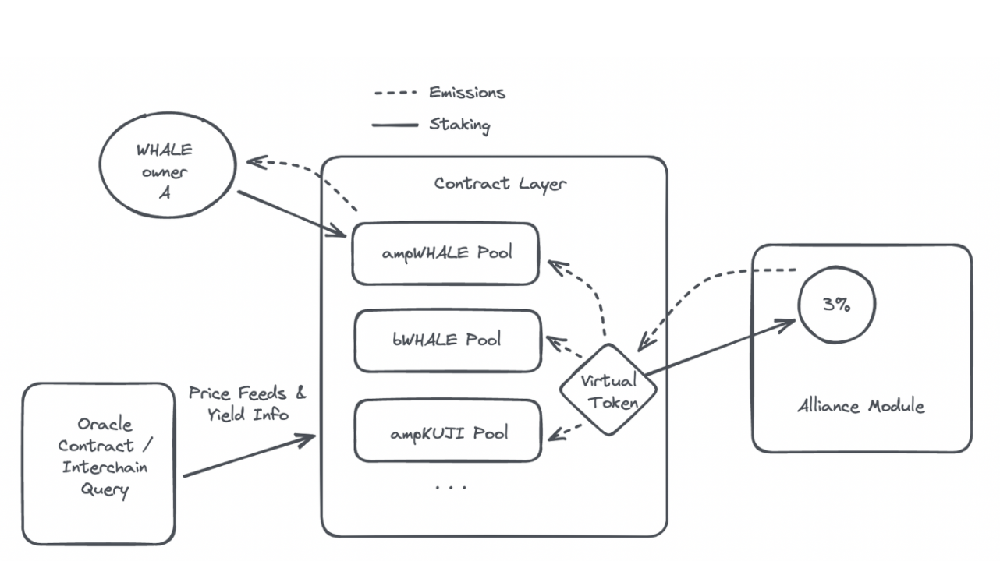
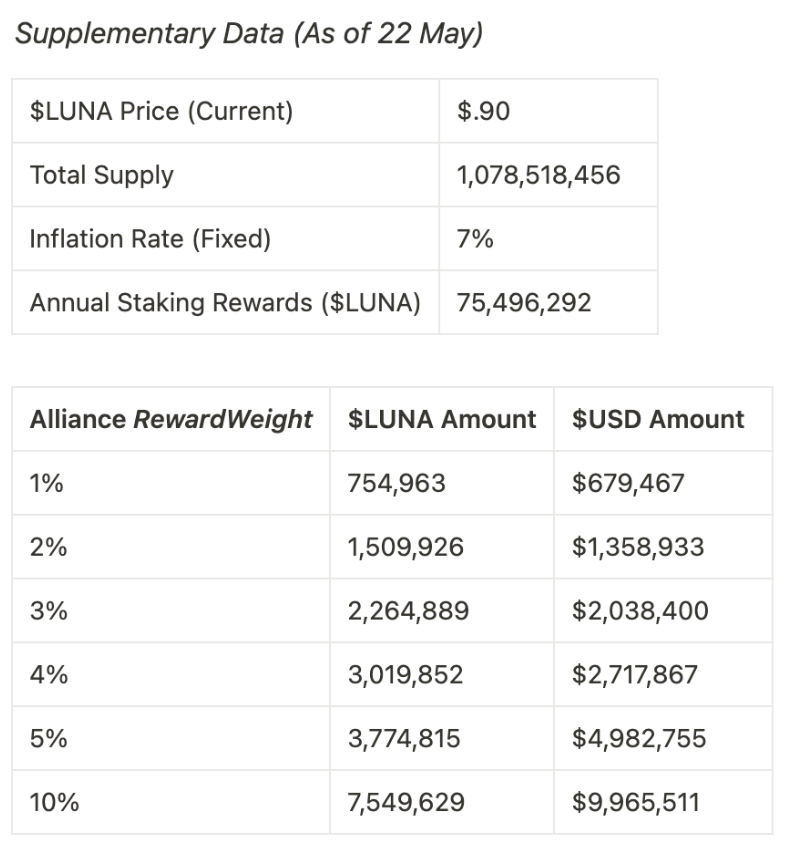

# Alliance Signaling Proposal

- **Thread ID:** 11500
- **Author:** Anonymous (`terra1ld4yf48eqex65vdrt3kta23cvrx865zyfkgkka`)
- **Created:** 2023-05-25T09:31:01.585Z
- **Last edited:** 2023-05-26T10:40:13.731Z
- **Stage:** discussion
- **Views:** 266
- **Reactions:** 1
- **Comments:** 6
- **Source:** https://common.xyz/terra/discussion/11500-alliance-signaling-proposal

---

_Disclaimer: I am an employee of Terraform Labs_

**Motivation**

The aim of this proposal is to:

- Incentivize the adoption of the Alliance module and the formation of mutually beneficial economic alliances between LUNA and other Cosmos ecosystems
- Cross-pollinate users and liquidity between Terra and allied chains

**Summary**

To achieve the above objectives, we propose allocating a combined **3% of LUNA staking rewards to the first ten Cosmos chains** that:

- Integrate the Alliance module
- Add at least one LUNA Liquid Staking Derivative (LSD) as an Alliance asset with a positive yield (i.e., the total $ value provided via the RewardWeight exceeds the total $ value of LUNA LSDs acquired via the TakeRate)

On Terra, we propose whitelisting LSDs representing each of these chains’ native tokens as Alliance assets. The portion of the combined 3% RewardWeight each LSD will be allocated will be dynamically calculated using Warp Protocol, based on the yield the allied chain offers to LUNA LSD Alliance stakers. The higher the APR, the higher the RewardWeight the allied chain’s LSDs will be allocated on Terra. Multiple LSDs can be added as Alliance assets for each allied chain, and the rewards distributed to each LSD for a given chain will be uniformly distributed.

Upon this proposal's passing, TFL will develop a smart contract protocol that:

- Mints a virtual staking token that can be added as a Terra Alliance asset (in a future governance proposal) and awarded a 3% RewardWeight. This token will represent the total amount of LUNA staking rewards that can be distributed to all LSDs for each of the first ten chains that meet the above requirements
- Pulls in LUNA LSD yield data from allied chains via an oracle contract or Interchain Query (ICQ) to dynamically determine the portion of the total RewardWeight to be allocated to each chain
- Allows users to stake and claim LUNA staking rewards using foreign LSDs (e.g., ampWHALE, bWHALE, etc.)

**Implementation**

Here’s an example of how this system would work, assuming a RewardWeight of 3% set aside for the first ten chains to meet the above requirements and a WHALE LSD staker:

**(Image 1 posted in comment below, as file size was too big)**

Contract initialization

1. TFL to create a smart contract that mints a virtual token (VT)
2. Terra governance to pass a proposal that whitelists VT as an Alliance asset with a RewardWeight of 3% and TakeRate of 0%. 

To prevent a scenario where early stakers receive outsized rewards, the RewardWeight given to VT could slowly increase from 0.3% to its final target of 3% over six months. This would make APRs appear more attractive over an extended period as more chains integrate the Alliance module and whitelist a LUNA LSD as an Alliance asset.

User experience

1. Users stake their native tokens with their preferred LSD provider on an allied chain and IBC them to Terra using the ‘Send’ function on Station
2. Users stake their LSDs via the ‘Stake’ page on Station, which will interact with this new protocol on the backend
3. LUNA rewards are streamed to users every block, which they can collect directly from Station

When new Alliances are formed

1. Terra governance votes in Alliance assets to be eligible for emissions. Multiple assets can be added from an allied chain in a single proposal
2. The oracle / ICQ contract pulls in the current RewardWeight that the allied chain is providing to LUNA LSD stakers
3. Using Warp Protocol, emission proportions for each allied chain (and their associated LSDs) are automatically recalculated and distributed to Alliance stakers based on data from the oracle / ICQ contract

When chains stop rewarding LUNA Alliance stakers

1. The oracle / ICQ contract notifies the protocol that yields have stopped
2. The protocol recalculates emissions and redirects LUNA emissions away from the chain's assets, disabling the alliance

What happens when a validator gets jailed, slashed, or tombstoned

1. A validator that’s been jailed is penalized via temporary removal (for a period of 1 week) from the pool of validators that can have virtual Alliance assets staked to them 
2. Virtual tokens that have been slashed do not impact foreign LSD tokens in the protocol, meaning that users who stake LSDs do not lose funds. Although, as has always been the case, validators (and their corresponding native LUNA delegators) who are slashed lose a small amount of LUNA as punishment for double signing, extended downtime, or missed consensus votes
3. If a validator is tombstoned, they are permanently removed from the pool of validators that can have virtual Alliance assets staked to them 

**Community Discussion**

The above proposal details are, of course, all open to discussion. Still, one parameter in particular that we need to settle on is the total RewardWeight that Terra will allocate towards LSDs for chains that meet the above requirements. Upon initial assessment, it is our opinion that 3% will be reasonable and adequate.

To guide community discussion, and assuming LUNA is trading at ~$.90, the following is the amount of staking rewards we could look to allocate: 

**(Image 2 posted in comment below, as file size was too big)**

**—**

This signaling proposal aims to gauge community sentiment toward the ideas mentioned above. If passed, TFL will initiate protocol development and lay out a future proposal to incorporate VT as an Alliance asset.

---

## Comments (6)

**Anonymous (`terra1ld4yf48eqex65vdrt3kta23cvrx865zyfkgkka`)** — 2023-05-25T09:31:28.512Z

**Anonymous (`terra1ld4yf48eqex65vdrt3kta23cvrx865zyfkgkka`)** — 2023-05-25T09:31:46.608Z

**Rebel Defi (`terra17w74x9vrqq4a338ssh9y9r4m9s3f6zef7wy5ms`)** — 2023-05-25T11:27:34.536Z

> Upon this proposal's passing, TFL will develop a smart contract protocol

Assuming this proposal passes, what is the anticipated timeline for smart contract development, testing, implementation?

> **Anonymous (`terra16qtc3vuc8fum7rsx0k3ps3vfyj9ru3vwrwztfz`)** — 2023-05-26T03:27:26.249Z
> 
> Hey, this is Javier from TFL. Our estimated timeline for the completion of protocol development and testing is approximately one month. Please note that this timeline does not account for the time required for the audit.

**4719 (`terra13qjxhnw98lm36rxc9yjakkmulhpv7zctdc5zlz`)** — 2023-05-25T14:09:36.649Z

I like the warp integration and solves a major question I had about mutual alliances where setting a lasting mutually beneficial take rate & reward weight is challenging given the volatility of the allied assets. 
One question: if the distribution is dynamic according to yield data will the initial criteria of having a positive yield for LUNA LSD be sustainable in the long term ?

> **Anonymous (`terra16qtc3vuc8fum7rsx0k3ps3vfyj9ru3vwrwztfz`)** — 2023-05-26T03:30:58.225Z
> 
> The purpose of this proposal is to encourage the adoption of the Alliance module. In terms of ensuring the longevity of alliances, our roadmap includes additional plans to offer value that will incentivize chains to maintain their alliance with Terra over the long term. That will be proposed in a separate initiative in the future.

