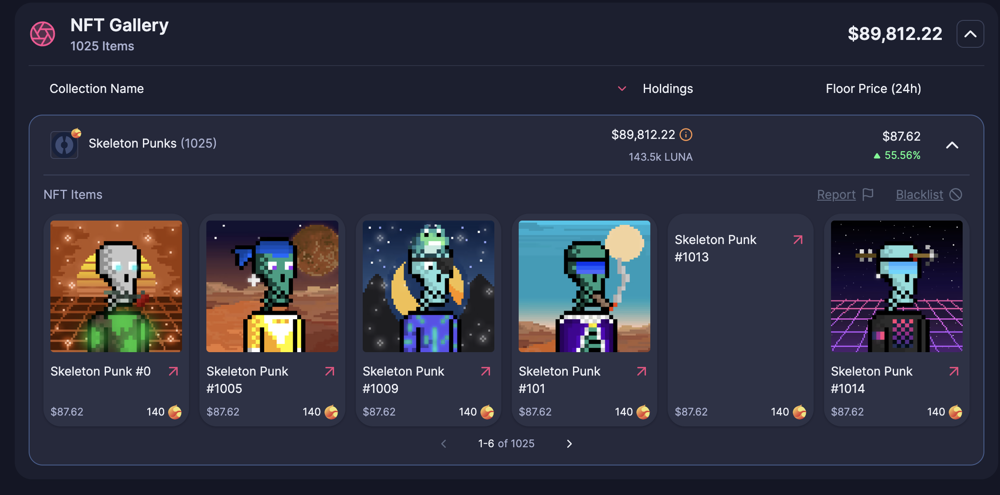
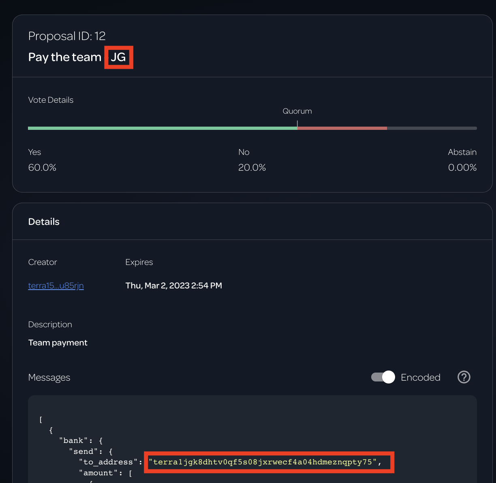
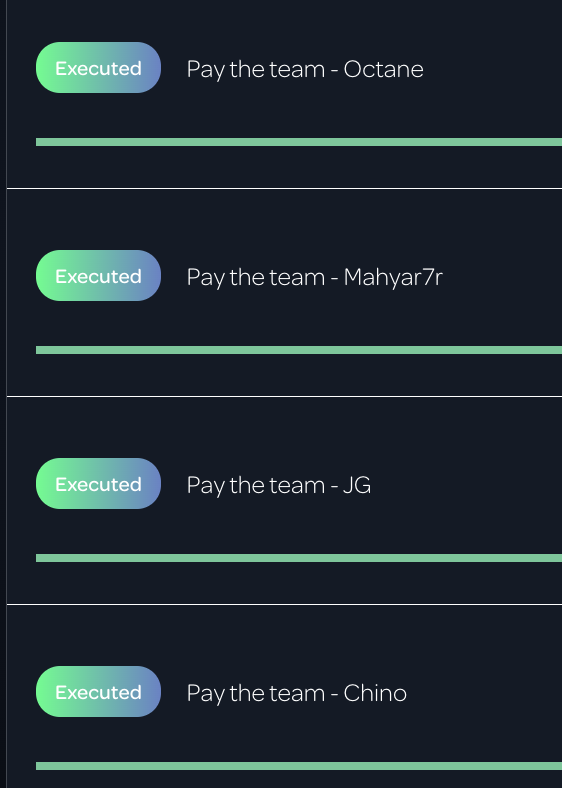

# "Revitalizing Terra: A Backbone Labs and Eris Protocol Collaboration"  (Not a Grant)

- **Thread ID:** 11807
- **Author:** BackBone Labs (`terra1gw8mesks5uw2gukjfv9xftf5xh0xn8empydw2t`)
- **Created:** 2023-06-21T04:14:06.478Z
- **Last edited:** 2023-07-03T13:22:50.453Z
- **Stage:** discussion
- **Views:** 169
- **Reactions:** 2
- **Comments:** 53
- **Source:** https://common.xyz/terra/discussion/11807-revitalizing-terra-a-backbone-labs-and-eris-protocol-collaboration-not

---

**Introduction and Proposal**

We, the combined forces of Backbone Labs and Eris Protocol, submit this proposal to request the participation of the Terra community pool in our dual incentive systems, namely the Gravedigger, Eris Protocol, and the WhiteWhale DEX. The proposal seeks not a grant, but approval for an injection of 10 million $LUNA tokens, divided equally between the Backbone Labs and Eris Protocol, to stimulate a vibrant Terra ecosystem, increase the utility of $LUNA tokens, and provide ROI to the Terra community pool fund.

**The Birth and Growth of Backbone Labs and Eris Protocol **

The story of Backbone Labs and Eris Protocol embodies resilience and commitment to the Terra community. Born out of the aftermath of Terra's crash, both entities stood by the community when the ecosystem needed it most. The mission was clear: revitalize the ecosystem, support its recovery, and spearhead innovations that would stimulate growth and solidify the community's faith and involvement in the Terra blockchain.

As a pioneer in the web3 space, Backbone Labs focused on delivering NFT-used decentralized finance solutions to overcome limitations in multichain collaboration and interoperability. On the other hand, Eris Protocol emerged as a key player in liquid staking derivatives and yield optimization strategies, becoming a cornerstone in the Terra ecosystem recovery.

**Proposal and its Benefits**

We propose a 10 million $LUNA injection into the Gravedigger, WhiteWhale DEX, Astroport DEX, and Eris Protocol. The LUNA will be equally used for the liquidity of both LSTs.

The LUNA will be used as follow:
- 2.50 M LUNA deployed into Gravedigger
- 2.50 M LUNA deployed into bLUNA-LUNA LP on WhiteWhale
- 2.50 M LUNA deployed into ERIS Amplifier. 20% of the ampLUNA will provide additional security on Amp Governance.
- 1.25 M LUNA deployed into ampLUNA-LUNA LP on Astroport
- 1.25 M LUNA deployed into ampLUNA-LUNA LP on WhiteWhale

Benefits of this proposal include:

- **Boosted Economic Activity:** Increased liquidity will stimulate the $LUNA ecosystem.
- **Reduced Slippage:** A larger liquidity pool will reduce slippage, enhancing user experience and attracting more users to the ecosystem.
- **Increased LSD Usage:** Users will experience minimal slippage, improving the desirability and accessibility of financial services in the Terra DeFi space.
- **Enhanced Financial Democratization: **Both Backbone Labs and Eris Protocol stand for financial democratization. This collaboration will further decentralize financial services in line with the Terra ecosystem's core values.
- **Cosmos Integrations**: Many money markets require deep LST liquidity for assets to be listed. Deeper liquidity further increases the reach and integrations of LUNA LSTs in the cosmos.

**Multi-sig Details**

A multi-sig wallet will be established, ensuring a broad spectrum of oversight and transparency and fostering trust within the community. Key representatives from diverse areas within our community and respective organizations will manage the wallet.

Members managing the multi-sig wallet include:

Mark (TFL) - 
Philipp (Eris Protocol)  - 
JGnft (BackBone Labs) -
PFC (BackBone Labs) - 
Rebel DeFi (Community) - 
RyanLion (Community) - 
Maslin Edwin (Community) - 

Multisig Wallet -  Will post wallet information shortly. 

**In the spirit of ensuring continual community involvement and protection of communal resources, it's intended that the funds will be transferred back to the community pool upon the materialization of the Alliance system for liquidity pools.**

We strongly believe in the possibilities that the Alliance module will bring to the Terra chain, and both teams are actively working on making this vision a reality. There is still work to be done, and we expect it to take 4-6 months to complete. This liquidity provisioning request is targeted as a kickstart that will be faded out in favor of Alliance-based liquidity incentivization to provide the Terra community with one of the best LST experiences across the whole Cosmos today.

**Conclusion**

Through this proposal, Backbone Labs and Eris Protocol envision a more robust and dynamic Terra ecosystem, with the Terra community pool's participation in the Gravedigger Protocol, Eris Protocol, and the WhiteWhale DEX. We believe this will foster a cycle of growth and prosperity for all 'Lunatics' and position Terra at the forefront of the DeFi space.

We express our deep gratitude for the Terra community's continuous support and trust. We welcome your feedback and invite open discussions about this proposal. With your approval, we can take further steps toward our shared vision of a truly decentralized financial ecosystem.

- Multi-sig and wallet information will be updated shortly.

---

## Comments (53)

**Anonymous (`terra1x5juwsn2rsf4l42mvkd97c2nf709q4tzvmj6tv`)** — 2023-06-21T09:41:58.476Z (edited 2023-06-21T09:42:45.143Z) — 👍 2

For me, these teams/members have constantly proven their loyalty to the growth of the $LUNA ecosystem. They have championed terra products like enterprise and warp, with the lion dao being the prime candidate to take the reigns, when feather drops. Back bone labs have provided homes for three critical NFT projects in skeleton punks, Galactic punks and pixel lions. Eris protocol have provided a front end for Alliance, allowing $LUNA holders to stake their $LUNA LSDs and earn $WHALE and $SWTH. 10 million $LUNA injected into their key strategic positions and offerings can only serve to help promote the terra ecosystem. I'm a firm yes

**Sen Com (`terra1jlcqudqhzemqtq7uga53q07cukzju6ddtsrz7v`)** — 2023-06-21T12:08:12.478Z — 👍 2

Dear Terra Community,

I enthusiastically support the proposal presented by Backbone Labs and Eris Protocol. Alongside the benefits outlined in the proposal, I want to emphasize additional considerations signifying why this proposal is an indispensable opportunity for the Terra ecosystem.
1. **A Stepping Stone for Innovation**: Injecting liquidity into the ecosystem is tantamount to planting seeds for innovation. The proposed capital infusion can lure gifted developers and visionaries, potentially spawning groundbreaking advancements within the Terra blockchain. This is not merely a financial move but an investment in the creative minds that will mold the ecosystem's future.
2. **Network Effect & Brand Recognition**: The accelerated network effect that this proposal can trigger is invaluable. As liquidity attracts users and reduced slippage enhances experiences, each new user contributes to a virtuous cycle that brings in even more participants. This positive feedback loop is quintessential for exponential growth. Moreover, as Terra's prominence rises, its brand will become a hallmark of excellence in the DeFi space again.
3. **Defensive Strategic Positioning**: In our relentless and cutthroat world, stagnation is regression. We are securing Terra's standing in the blockchain space by adopting a proactive growth strategy through this proposal. Consider this as an avenue for growth and a bulwark that ensures Terra's continued leadership amidst rapidly evolving adversaries.
4. **Ecosystem Synergy**: The proposal's direct beneficiaries are the Backbone Labs, Eris Protocol, Astroport, and WhiteWhale, but the ripple effects throughout the Terra ecosystem could be monumental. Increased economic activity could spur the adoption and development of other dApps. This cascading effect establishes a synergistic environment where every cog in the wheel is fortified.
5. **Cross-Chain Market Expansion**: Deeper liquidity in the liquid staking pools allows for utilizing tokens across many markets in different chains, such as lending markets. Many cross-chain markets require minimum liquidity to participate. This is particularly significant as it amplifies the economic activity surrounding the LUNA token, augmenting its value and cementing its position within the broader blockchain ecosystem.
6. **Crypto-economic Stability**: The diversified allocation of LUNA tokens across protocols and liquidity pools is a strategic move towards higher crypto-economic stability within Terra. The proposal mitigates the risk of sharp price fluctuations and potential manipulations by spreading the allocation, thereby fostering a more secure and stable ecosystem.
7. **Enhancing Scalability**: With increased liquidity, the Terra ecosystem will be better positioned to handle more volume, thereby improving scalability. This is crucial for Terra's long-term growth and sustainability, as it needs to be equipped to handle the demands of an ever-growing user base without compromising on speed or security.

In closing, this proposal is a call to action. It's a multi-faceted investment in innovation, brand dominance, strategic defense, ecosystem synergy, cross-chain expansion, crypto-economic stability, and scalability.
I urge all community members not to let this defining moment pass. Let us unanimously vote in favor of this proposal and usher in a new era of growth for the Terra ecosystem.

With Best Regards,

Sen Com

**MB aejir (`terra10ql0yxam88pg0a02946pzv36a3w699shl9r3mc`)** — 2023-06-21T16:54:19.322Z — 👍 3

Thanks for this proposal. Both teams have been some of the most committed to Terra since its beginning. Respect.

Suggestions

The simplest approach imo would be just a pure liquidity proposal with a 50% split between each of the LST providers, who would in turn allocate 50% to each of Astroport and White Whale DEXs

-It is not clear how 2.5M LUNA to Gravedigger and 2.5M to Eris Amplifier would 'stimulates a vibrant Terra economy' any more than just providing deeper liquidity to the DEXs instead, which seems to make more sense

-When using Community Pool funds I recommend a proposal that does not seem to favour one DEX over another hence why Liquidity should be split 50:50 Astroport and White Whale

-The liquidity provision should not be open ended. There should be a date by which the funds are to be returned to Community Pool, unless a future prop extends provision beyond the initial period. There should also be a trigger related to the relevant Alliance implementation you mention that also mandates the return of funds

-The Multi-sig should be amended - Currently 4 of the 7 members are team or contributors to either BBL, ERIS or WW. I recommend a max of 1 from each of BBL and Eris. The other 5 could be MC, 4719, Rebel, Ryan, and Somethingelse if they are available

Hope this is helpful and appreciate the work here.

ps. Wouldn't this be a good opportunity to get Dexter launched too?

> **BackBone Labs (`terra1gw8mesks5uw2gukjfv9xftf5xh0xn8empydw2t`)** — 2023-06-21T17:19:06.964Z (edited 2023-06-21T17:21:46.533Z) — 👍 1
> 
> Totally acceptable. 
> 
> This liquidity is not meant to be open-ended. It is only supposed to be utilized only until Alliance can be implemented. 
> 
> Which we figure to be a 4 - 6 month process.

> **4719 (`terra13qjxhnw98lm36rxc9yjakkmulhpv7zctdc5zlz`)** — 2023-06-21T18:26:56.804Z — 👍 2
> 
> Great initiative by both [@BackBone Labs](/profile/id/97077) & [@Philipp | Eris Protocol](/profile/id/96094). I support the proposal with the suggestions made by [@MB aejir](/profile/id/110864). Would love to see dexter as one of the dexs in here, hope they can make it happen in time.

> **BackBone Labs (`terra1gw8mesks5uw2gukjfv9xftf5xh0xn8empydw2t`)** — 2023-06-22T17:38:21.050Z — 👍 1
> 
> We have just implemented many of the above suggestions.

**Anonymous (`terra15rx7anfy3rj2sn5znpq42j5rfl8m8rhk40f997`)** — 2023-06-21T17:21:53.377Z

Happy to see this proposal! It's great to see the Terra community pulling together to continue the revitalization of the Terra ecosystem.

In order to offer more options to the Terra community, it would be good to see Stride's stLUNA included in this program. stLUNA offers a different security profile than other LUNA LSTs, with decentralized governance, multiple audits, rate-limiting, and soon interchain security. Stride Labs, the main development company that contributes to the Stride blockchain, has substantial resources, which ensures robust security standards for the Stride liquid staking protocol.

While ampLUNA and bLUNA may indeed be the more community-focused LUNA LSTs, Stride's stLUNA places an emphasis on security and decentralization. And the more options available, the better Terra DeFi will be.

I propose this proposal be amended to include Stride's stLUNA. Specifically, that it be updated to include this clause:

> 5M LUNA deployed into the stLUNA-LUNA pool on Astroport.

With this clause added, the proposal would provide more options for Terra users. There would be equal onchain liquidity for stLUNA, ampLUNA, and bLUNA, allowing users a fair choice about which to use.

For anyone who may not be aware, I'm a contributor to Stride.

> **BackBone Labs (`terra1gw8mesks5uw2gukjfv9xftf5xh0xn8empydw2t`)** — 2023-06-21T17:44:05.659Z (edited 2023-06-21T18:18:16.089Z)
> 
> Why would Stride be included?
> 
> Stride does not build anything on Terra and has a community pool of its own to tap into.

> **Sen Com (`terra1jlcqudqhzemqtq7uga53q07cukzju6ddtsrz7v`)** — 2023-06-21T18:44:16.779Z — 👍 3
> 
> Dear John,
> 
> Thank you for your feedback and suggestion. Engagement is invaluable, and I appreciate the opportunity to delve deeper into the points you raised.
> 
> 1. You stated, "And the more options available, the better Terra DeFi will be." While diversity has merits, each additional option must have a unique and significant value proposition. Please, John, elaborate on the value that Stride would bring to the Terra ecosystem that Eris Protocol and Backbone Labs don't already offer.
> 2. On decentralized governance, how does the governance model of Stride compare to the models within Eris Protocol and Backbone Labs? Both teams have built robust and unique systems to handle decentralized governance.
> 3. Regarding multiple audits, both Eris Protocol and Backbone Labs have undergone extensive auditing processes. Please share details on how the audits for Stride are substantially different or more rigorous.
> 4. Concerning security, it's essential to recognize that Eris Protocol and Backbone Labs, native to Terra, inherently align with Terra's risk profile. Incorporating Stride would entail embracing the risk associated with an additional blockchain and various experimental technologies. How does Stride plan to mitigate these additional risks?
> 5. Bringing in an external entity like Stride, which operates on its own blockchain, would divert tokens and TVL away from Terra. Further, it's essential to consider that introducing an external player would inadvertently weaken the position of Terra's native teams.
> 
> 
> In conclusion, adding Stride's stLUNA introduces several drawbacks, including additional risk, diversion of TVL, and a weakening effect on Terra's native teams. These are significant considerations. John, how does Stride justify these drawbacks, especially considering that the primary elements such as governance, audits, and security are already robustly handled by Eris Protocol and Backbone Labs?
> 
> Our commitment is to ensure that Terra thrives through careful and considerate growth strategies. Your insights are valued, and I look forward to understanding more about the distinct value that Stride believes it can bring to the Terra ecosystem.
> 
> Warm regards,
> 
> 
> Sen Com

> > **Anonymous (`terra15rx7anfy3rj2sn5znpq42j5rfl8m8rhk40f997`)** — 2023-06-21T20:28:14.778Z — 👍 1
> > 
> > Thanks for these thoughtful questions! Happy to respond.
> > 
> > 1. The unique value that Stride brings to Terra is a decentralized LST. Last I checked, ampLUNA and bLUNA are controlled by a multisig and a single admin key, respectively. This means that those two LUNA LSTs are completely controlled by a single person or a small group of people, like a centralized entity. Stride's stLUNA, on the other hand, is controlled by Stride governance. No single person or small group of people controls stLUNA. The only way that the Stride liquid staking protocol can be changed is through Stride blockchain's decentralized governance.
> > 
> > This isn't to say that stLUNA is _better_ than ampLUNA or bLUNA - just different. Some people prefer maximally decentralized LSTs, and others prefer community LSTs. What's important is that Terra governance doesn't favor one LST over another, so that Terra users get to choose what kind of LST they want to use.
> > 
> > Another advantage of Stride is its positioning at the center of the Cosmos. Stride is the biggest LST provider in the Cosmos, and the [second biggest Cosmos chain](https://www.mapofzones.com/home?columnKey=ibcVolume&period=30d) in terms of IBC volume. And since Stride has a large presence on Terra, this is very good for the Terra community. Since many Cosmonauts are already familiar with and trust Stride, Stride's stLUNA can help people rediscover Terra.
> > 
> > 2. The key question is: who is able to change the code of a liquid staking provider? Because whoever can change the code can potentially harm users. While ampLUNA and bLUNA may have some innovative governance features, I believe the code for both of them can be changed in private by a single person or a small group of people. But with Stride, code changes (upgrades) must be posted publicly for everyone to review, and Stride's decentralized and open governance must approve the changes. So strictly speaking, I believe Stride is more decentralized than the other two. But again - that doesn't mean better. Just different.
> > 
> > 3. Stride has undergone three separate security audits, by the security firms: Oak, Certik, and Informal Systems. Link [here](https://github.com/Stride-Labs/audits). Additionally, Stride receives continuous auditing from Informal Systems. All these audits were paid for by Stride Labs, and Stride Labs has the financial resources to maintain the Stride codebase and to pay for ongoing auditing.
> > 
> > In addition, given Stride's crucial position in the Cosmos ecosystem, several well-respected firms have taken it upon themselves to independently review Stride's codebase. These firms include Notional, Jump, and others.

> > > **Anonymous (`terra15rx7anfy3rj2sn5znpq42j5rfl8m8rhk40f997`)** — 2023-06-21T20:31:29.731Z — 👍 1
> > > 
> > > 3. Stride has undergone three separate security audits, by the security firms: Oak, Certik, and Informal Systems. Additionally, Stride receives continuous auditing from Informal Systems. All these audits were paid for by Stride Labs, and Stride Labs has the financial resources to maintain the Stride codebase and to pay for ongoing auditing.
> > > 
> > > In addition, given Stride's crucial position in the Cosmos ecosystem, several well-respected firms have taken it upon themselves to independently review Stride's codebase. These firms include Notional, Jump, and others.

> > > > **Anonymous (`terra15rx7anfy3rj2sn5znpq42j5rfl8m8rhk40f997`)** — 2023-06-21T20:41:37.110Z — 👍 1
> > > > 
> > > > 4. This is true. Stride is a separate blockchain than Terra. But that hasn't deterred other blockchains from providing protocol owned liquidity to Stride LST pools. Cosmos Hub, Evmos, and Juno. The reason is: Stride is generally considered a highly secure blockchain. The Stride chain has decentralized governance, multiple audits, chain minimalism like Cosmos Hub, IBC rate limiting, and will soon have interchain security.

> > > > > **Anonymous (`terra15rx7anfy3rj2sn5znpq42j5rfl8m8rhk40f997`)** — 2023-06-21T21:04:14.233Z — 👍 1
> > > > > 
> > > > > 5. Providing 5M LUNA to the stLUNA-LUNA pool would not divert TVL from Terra. It would result in exactly 5M LUNA TVL on the Terra blockchain, just like the ampLUNA and bLUNA parts of the proposal.
> > > > > 
> > > > > I don't understand why you think Stride is an "external player" and not "native" to Terra. Eris, BackBone, and Stride all serve multiple Cosmos chains - so in that they're exactly the same. They all built a liquid staking protocol, deployed it on Terra, and generate transaction fees for the Terra chain. All of Stride's stLUNA liquidity is hosted on the Terra chain, and I think that's the case for ampLUNA and bLUNA, too. And something that sets Stride apart from the other two is that is incentivizes stLUNA liquidity on Terra.
> > > > > 
> > > > > So the way I see it, Stride is a native Terra protocol. It's an integral part of the Terra ecosystem. What's more, stLUNA is supported as collateral on Demex, and is a stakable token on Carbon.
> > > > > 
> > > > > If you have any more questions, please ask! Happy to answer (:

> > > > > > **Anonymous (`terra1x5juwsn2rsf4l42mvkd97c2nf709q4tzvmj6tv`)** — 2023-06-21T23:56:13.546Z
> > > > > > 
> > > > > > Hi John,
> > > > > > 
> > > > > > I enjoyed reading your reply. However, I have concerns with STRD decision to join the AEZ. With the launch of enterprise DAO and soon feather, I think AEZ is at odds with what we are trying to build here. I want to foster community teams on terra, so that they are better equipped to maybe consider starting a feather chain of their own, as we progress. I think a STRD proposal should be separate from this proposal and at this time, we should not be relinquishing Terra TVL.
> > > > > > 
> > > > > > Regards

> > > > > > **Sen Com (`terra1jlcqudqhzemqtq7uga53q07cukzju6ddtsrz7v`)** — 2023-06-22T15:24:09.320Z
> > > > > > 
> > > > > > Dear John,
> > > > > > 
> > > > > > Thank you once again for your response. I appreciate your willingness to engage in this dialogue. However, the conversation demands a more in-depth examination of your points.
> > > > > > 
> > > > > > First, the mention of decentralization through Stride's governance is an attractive pitch, but how decentralized is it in practice? Stride boasts a Nakamoto coefficient of merely 7/100. Just eight wallets, out of which seven are part of the genesis file, control more than 50% of the staked supply. In other words, Stride's governance is at the mercy of the team and its backers. When you compare this to a multi-sig of independent Terra teams, is Stride truly more decentralized?
> > > > > > 
> > > > > > Moving on, security audits are undoubtedly an essential aspect of any crypto project. That Stride has undergone audits similar to Backbone Labs, and Eris Protocol is commendable. However, you conveniently omitted that using Stride would entail a different and more aggressive risk profile than Backbone Labs and Eris Protocol.
> > > > > > 
> > > > > > Furthermore, it's disheartening that you sidestepped the conversation around the weakening effect on Terra's native teams, John. Backbone Labs and Eris Protocol are not just liquid-staking protocols. Backbone Labs is the cornerstone of Terra's NFT ecosystem, with contributions like a P2P NFT trading platform, an NFT marketplace, and the leading NFT collection. Eris Protocol is a behemoth providing a suite of DeFi products encompassing arbitrage, automation, and yield strategies. Both teams' liquid-staking tokens are widely used inside and outside Terra. Is Stride similarly interwoven in Terra's ecosystem and community?
> > > > > > 
> > > > > > Your claim that other blockchains haven't been deterred from providing liquidity to Stride's LST pools is a classic example of an argumentum ad populum – essentially saying it must be good because others are doing it. This is not a valid argument. The core issue is whether incorporating stLUNA aligns with Terra's goals and how it would benefit the Terra ecosystem and community. 
> > > > > > 
> > > > > > While Stride has security audits, it still is riskier due to its position on a separate blockchain with experimental technologies. Stride is nowhere near as integrated or contributive to Terra as Eris Protocol or Backbone Labs, and your argument for decentralization lacks substance when scrutinized. Furthermore, the theoretical value proposition of Stride remains elusive, and you still need to address the detrimental effects on Terra's flagship teams. In summary, you have yet to present a compelling case for why you believe the Terra community should include Stride in this proposal.
> > > > > > 
> > > > > > Terra deserves decisions rooted in thorough analysis and concrete benefits. I hope this spurs a more honest and transparent conversation.
> > > > > > 
> > > > > > 
> > > > > > Warm regards,
> > > > > > 
> > > > > > Sen Com

> > > > > > > **Anonymous (`terra15rx7anfy3rj2sn5znpq42j5rfl8m8rhk40f997`)** — 2023-06-22T19:07:12.397Z — 👍 1
> > > > > > > 
> > > > > > > Yes, Stride is more decentralized than Eris and Backbone.
> > > > > > > 
> > > > > > > Stride is a Cosmos appchain, and thus it uses Tendermint consensus, which is decentralized, open, and transparent governance system. All Stride upgrades are posted publicly, and anyone can review them. Scores of separate world-class validator companies run Stride validators, and thereby control Stride governance. Dozens of different entities and individuals stake STRD. At this point, about 15% of the total STRD supply has been distributed freely to Cosmonauts, via airdrops and liquidity incentives. In total, 50% of the STRD supply is allocated to be distributed to Cosmonauts.
> > > > > > > 
> > > > > > > This is categorically different from Eris and Backbone, which are smart contracts without governance tokens. Centralization isn't a bad thing, and indeed before the Terra crash I believe Anchor protocol used a centralized oracle. But the fact is, Eris and Backbone do not have decentralized governance systems to control access to their code, and are thus centralized. 
> > > > > > > 
> > > > > > > Terra users deserves options. They deserve the choice between using a decentralized LUNA LST or using a community-focused LUNA LST. In my view, Terra governance should not pick LUNA LST winners. Rather, Terra governance should treat all LUNA LSTs the same, and let users decide.
> > > > > > > 
> > > > > > > By the way - how long have you been a Terra community member? This is the only forum post you've ever commented on, and I don't recognize your name. Please remind me who you are. I apologize that I don't seem to remember.

> > > > > > > > **Anonymous (`terra1x5juwsn2rsf4l42mvkd97c2nf709q4tzvmj6tv`)** — 2023-06-24T13:23:34.481Z — 👍 1
> > > > > > > > 
> > > > > > > > Hi John
> > > > > > > > 
> > > > > > > > Again, as this is a joint proposal from Eris protocol and back bone labs and they have little affiliation with STRD, I think the entirety of this prop falls outside the purview of a STRD commitment. A positive outcome from this vote though and this would give STRD grounds to potentially ask for something similar. I look forward to seeing your prop up soon
> > > > > > > > 
> > > > > > > > Regards

> > > > > > > > **Anonymous (`terra1x5juwsn2rsf4l42mvkd97c2nf709q4tzvmj6tv`)** — 2023-06-24T14:13:28.822Z — 👍 1
> > > > > > > > 
> > > > > > > > Here's a great idea John,
> > > > > > > > 
> > > > > > > > Why don't we get $STRD to incentivise the bLUNA-LUNA and ampLUNA-LUNA pools on white whale with $STRD, in exchange for the stLUNA-LUNA incentives on $ASTRO. That is what migaloo zone is doing right now on white whale, with $WHALE. Let's get some $STRD in $LUNA holders hands

> > **Anonymous (`terra193k9f389sx58hxrx0jw05y44r7zlxq4lsu6n7s`)** — 2023-06-22T00:35:09.596Z (edited 2023-06-22T00:45:25.135Z) — 👍 2
> > 
> > Yes, you're a contributor to Stride. 
> > 
> > You're also the guy who drove hard to disincentivise LSDs on Astroport, seemingly because it had the potential to undermine the community LSDs, opening the way for Stride's stLuna to capture the liquidity due to having the capacity to bribe with token incentives. 
> > 
> > Now that was a ruthlessly effective business move but what it was not was a strategy to support Terran initiatives to grow through the Cosmos via Alliance and other tools coming through that are pushing Luna out as a multichain system and exemplar of what the Cosmos is about. What are you doing with Alliance? What are your plans for Warp? Are you looking at TFL's tool development for implementation in ways that facilitate the expansion of Luna's reach? 
> > 
> > I don't see it. In fact, thinking about it now, I'm not really seeing any evidence that Stride is doing anything to embrace and push out Terra's plans for Luna apart from having created an LSD. Now I'm not against stLuna, that would be going against community members building their position using it. However that's not enough as far as I'm concerned, either to overcome the recent destructive legacy you have regarding your competitors and it certainly doesn't justify giving you a free ride on the back of what BBL/Eris are trying to do here. 
> > 
> > So, whilst my vote is small in the scheme of things, it's emphatically no to including stLuna in this proposal. Stride needs to go away and do some work on creating their own initiative to push Alliance and other tools forward that will drive Luna's growth. Then come back and put your own proposal up.

> **Rebel Defi (`terra17w74x9vrqq4a338ssh9y9r4m9s3f6zef7wy5ms`)** — 2023-06-21T19:23:03.427Z — 👍 6
> 
> Good to see you join the conversation. I'm a fan of building consensus and inclusion. I could quite happily support an equal allocation for stLUNA/LUNA liquidity. But for that I'd be looking for something more than simply _more options_. What would Stride be able to bring to the table?
> 
> I mean, it would be another 5M LUNA worth of liquidity in the system. As you say, Stride has great security standards. But what value add is there? What doors would you be able to open? How about Stride forming an economic Alliance with Terra? That could build some bridges.

> > **Anonymous (`terra15rx7anfy3rj2sn5znpq42j5rfl8m8rhk40f997`)** — 2023-06-23T14:13:51.543Z — 👍 1
> > 
> > Sorry for the late response. Lots of comments in here! xD
> > 
> > As I've pointed out elsewhere, Stride currently offers the most decentralized LUNA LST on Terra. This is pretty significant in and of itself. Terra's motto is: a decentralized economy needs decentralized money. And I think a good chuck of the Terra community still believes in maximal decentralization.
> > 
> > Also, Stride is the only LST provider on Terra with access to significant external funding and with a large group of contributors. Stride is definitely here for the long run, regardless of market conditions.
> > 
> > And lastly, because of Stride is such a well known and trusted blockchain, Cosmonauts can rediscover Terra through Stride's stLUNA.
> > 
> > Stride's stLUNA is significantly differentiated from other Terra LSTs, and in my opinion Terra governance should include it equally in any protocol owned liquidity proposal.

> > > **BackBone Labs (`terra1gw8mesks5uw2gukjfv9xftf5xh0xn8empydw2t`)** — 2023-06-23T15:14:13.322Z — 👍 1
> > > 
> > > Unless STRIDE is going to implement Alliance or Enterprise there is no reason to include them in this prop.  Every project that is included is championing Terra technology and the Alliance module. STRIDE does none of these things and in fact, they have joined the ICS model. 
> > > 
> > > This is a Terra prop for projects building on TERRA, championing Terra.

> **4719 (`terra13qjxhnw98lm36rxc9yjakkmulhpv7zctdc5zlz`)** — 2023-06-23T08:27:36.137Z — 👍 2
> 
> I am inline with [@Rebel Defi](/profile/id/45431) that the terra community should strive to be inclusive. I think stride should put out a separate proposal on agora for $stLUNA where we can discuss a mutually beneficial way forward for both terra & stride.

**MonsieurLeo (`terra1rl8wnsyt89kywhlrawu27yye8v6tv6wvfzgcep`)** — 2023-06-21T19:45:54.467Z (edited 2023-06-21T19:54:35.914Z) — 👍 2

Sorry, but I am against giving anything to astroport. In my opinion Astroport has left terra for a long time. After they cancelled ampLUNA and bLUNA LPs incentives, they clearly showed that they don't want to focus on terra anymore but on Stride and Injective. It may be harsh, but it is my opinion.
But of course Eris and Backbone Labs are top teams that have been working for the Terra ecosystem and have always delivered and they still do. It's nice to see Eris and Backbone Labs doing something together. So I support the proposal.

**Beatmode (`terra14yrfk4pdtn8p768dylqdhyrmh4udfwgel8skgf`)** — 2023-06-22T00:13:05.191Z — 👍 3

John,

Thank you for your considered input on the potential inclusion of stLUNA in the proposed program. While the unique security profile and resources offered by Stride Labs are certainly valuable, it's crucial for us to evaluate the broader context of our community dynamics.

Most notably, the level of engagement and commitment displayed by Stride and stLUNA within the Terra community appears significantly less than that of entities like Eris and Backbone Labs. These organizations have consistently exhibited their dedication to our shared goals by actively listening to, engaging with, and providing tools for our community. In contrast, Stride's approach has been notably distinct, with their separate development path and community pool suggesting a divergence from Terra's core values and goals.

Moreover, it's worth highlighting the remarkable work that Backbone Labs has done for our community. Despite not having any external funding for months, they have been committed to building and contributing to the Terra ecosystem. This dedication is a testament to their belief in our shared vision and their willingness to invest their own resources for the collective good. Just imagine the advancements we could see if they were to receive funding.

In light of this, while stLUNA could potentially enhance the robustness of the Terra ecosystem with its technical capabilities, the lack of visible engagement from Stride and their separate development path are significant considerations that cannot be overlooked.

Moving forward, I hope to see Stride show greater commitment to the Terra community, not only in terms of their technical contributions but also through a more direct and active relationship with our community. This holistic approach is what truly strengthens and enriches the Terra ecosystem.

Thank you for your understanding and your continued dedication to Terra.

> **Anonymous (`terra15rx7anfy3rj2sn5znpq42j5rfl8m8rhk40f997`)** — 2023-06-22T19:17:44.261Z — 👍 1
> 
> Thanks for your interest in Stride. Let me build on some of your points.
> 
> Stride contributors consider themselves to be Terra builders, and Stride is indeed part of the Terra ecosystem. All of Stride's stLUNA TVL is hosted on Terra, and all transactions to liquid stake LUNA with Stride generate transaction fees for Terra. So Stride is a native Terra app, just like Eris and Backbone.
> 
> Stride deployed a high quality, highly decentralized LST of LUNA on Terra. In doing so, Stride drew attention to the Terra ecosystem and reminded Cosmonauts that Terra is still great. Stride contributed lots of external liquidity incentives to its LUNA LST, and remains only one of two LST providers on Terra to _ever_ contribute external liquidity incentives to its LST pool.  What's more, Stride did business development to get stLUNA approved as collateral on Nitron and get stLUNA approved as a stakable token on the Carbon blockchain.
> 
> And keep in mind, Stride is 100% externally funded. Stride did all this for Terra without ever receiving a single LUNA token from the community pool.
> 
> To sum up, stLUNA currently has the deepest Astroport Terra liquidity of all LUNA LSTs. This is because Stride cares about Terra, and Terra users like using Stride's stLUNA.

**Anonymous (`terra193k9f389sx58hxrx0jw05y44r7zlxq4lsu6n7s`)** — 2023-06-22T00:45:55.133Z — 👍 2

As far as this proposal is concerned, it's a yes from me and that enhanced if it embraces the sensible suggestions made by MB Aejir above. My modification to those would be that any trigger for early repayment should be on the basis of a rolling average of desired activity, rather than an instant, and I would favour a slightly longer term eg up to 12 months for the liquidity loan.

**xero1 (`terra1aj0fjeffrlx5jheqltq6f5q0l6rdk3tcs7gela`)** — 2023-06-22T09:31:33.969Z — 👍 3

Fellow Terra Community Members,

AN INVESTMENT WITH YIELD? AND PRINCIPLE IS RETURNED?

Couldn't help but notice, it's not highlighted, however, this team is not asking for a grant, it's a temporary allocation to provide liquidity and support our ecosystem.  I've been close to Terra throughout the bear and I think we're all well aware the teams behind these projects are 100% dedicated with proven capabilities and continue to deliver.

I encourage you to read Sen Coms feedback below, brilliant!  A detailed description of the benefits this prop will bring for Terra that answers it all.

Backbone Labs and Eris Protocol partnering is massive for Terra, we need to get behind this!

**Anonymous (`terra1cqc26lnatzxvu0z5nd4yx8m4ecllkm7jlj6nna`)** — 2023-06-22T20:47:51.099Z

_Disclaimer, I'm part of Capapult_

While I believe this proposal can help the Terra ecosystem, I think there are alternative strategies that could be more beneficial. 
Allow me to present my alternative suggestions:

Diversify Liquidity Across 2 Pools: Instead of concentrating liquidity in a single pool, I propose distributing it across two pools with different assets. By doing so, we can create opportunities for arbitrage and generate higher trading volumes. This approach enhances the overall liquidity ecosystem, attracts a wider range of traders and investors and generate fees for Eris, Backbone and the DEX.

Consolidate Liquidity on a Single DEX: I recommend focusing all liquidity provision efforts on a single DEX, avoiding splitting too much the liquidity, ask Astroport and WhiteWhale to offer a certain amount of their tokens to be used as incentives for the pool and pick the best offer.

Utilize Rewards Responsibly: As the community benefits from the rewards earned through liquidity provision, I suggest using half of the rewards to purchase and burn Luna and burn the other half. 

Additionally, I would like to suggest considering SOLID as the additional asset for the liquidity provision strategy and WARP to manage the debt position without any risk. In this way the multi signature can leverage ampLuna and bLuna using them to mint SOLID, thereby avoiding the need to sell Luna on the open Market.

So I propose to create 4 pools and split the liquidity between them:
SOLID - ampLuna
SOLID - bLuna
Luna - bLuna
Luna - ampLuna

Using SOLID to pair those assets open the way to multiple farming and arbitrage strategies:
Mint and sell SOLID if bLuna - Solid pool is unbalanced and 1 SOLID > 1 USD
Mint and sell ampLuna if ampLuna - Solid pool is unbalanced and 1 ampLuna > LUNA * exchange_rate.
Buy and burn SOLID if bluna - SOLID pool is unbalanced and 1 USD > 1 SOLID 
Buy and burn ampLuna if LUNA * exchange_rate > 1 ampLuna.

> **Anonymous (`terra1alxk3fmhcl0ga80gl9yj9zp3ezjm4sdh8a9l9c`)** — 2023-06-22T21:33:41.885Z (edited 2023-06-22T21:35:04.901Z) — 👍 3
> 
> Hi Daniel,
> 
> I agree that having SOLID-ampLUNA and SOLID-bLUNA pools are very important for the growth of SOLID in the Terra Ecosystem, which I completely support. However I see this as a secondary proposal, when we have the tech available to safely execute such strategy. I would love to see a revival of John Galts decentralized stablecoin proposal lead by Capapult, that targets building up liquidity in SOLID-USDC, SOLID-LUNA, SOLID-ampLUNA and SOLID-bLUNA ([https://commonwealth.im/terra/discussion/10386-a-new-decentralized-stablecoin-for-terra-and-the-cosmos](https://commonwealth.im/terra/discussion/10386-a-new-decentralized-stablecoin-for-terra-and-the-cosmos))
> 
> **Consolidation of Liquidity**: Both Astroport and WhiteWhale have provided big merits to the Terra ecosystem and similar to how we want to support multiple different LSTs, multiple DEXes should be supported. Both have their own strengths and visions and it would be too short sighted to leave one of the great teams in the dust.
> 
> **Utilization of Rewards**: In my opinion this proposal does not need to generate revenue in form of LUNA for the community pool, so I would be down to just burn all staking and trading rewards if the community supports that. 20M LUNA used as liquidity, after 6-9 months, 20M LUNA are returned + ~1 M LUNA being burnt.
> 
> **Diversification of Liquidity**: SOLID is one of the assets that make the most sense for such a strategy, as you can create it without requiring to sell LUNA to provide liquidity. However the timeline to create such pools and strategies need to be well developed and secured enough.
> 
> I have already made the commitment to your team, that ERIS Devs will work on vaults providing such a functionality in a safe way with conservative LTV. But this takes time, involves more risks and can be implemented independently from this liquidity prop, so a separate proposal makes more sense to me.
> 
> **We have a lot planned and this is only the beginning of the Terra Revitalization!**
> 
> _Disclaimer: I hold a good amount of $CAPA._

> **4719 (`terra13qjxhnw98lm36rxc9yjakkmulhpv7zctdc5zlz`)** — 2023-06-23T08:34:41.492Z — 👍 3
> 
> I think this merits a separate proposal. The ideas here are SOLID.

**Anonymous (`terra1e3tzzc6hu4l6a73lkm2430ssumyjvw677f6j46`)** — 2023-06-22T22:09:58.094Z — 👍 4

First of all thank you to everyone contributing in this discussion. I am glad to see a variety of people and views being shared. 

I am in support of this prop, following a few of the recommendations from other posters such that a) that there should be a definitive end date to the liquidity injection, and b) that the multi sig signers should change to be less centralized among the protocol contributors. 

My comments: 

The proposal authors are from bbl and Eris, why can’t we let them decide which dex to put the luna they are requesting?

Astroport team is not involved in the writing of this proposal; they cut incentives to lsdLuna pairs to align with their teams goals of reducing the Astro emissions. I have nothing against it- that’s their mission and it’s their right to pursue it. 

Similarly, stride is not involved in writing this proposal; they cut incentives to the stluna pair on astroport by 90+% as an indication of their disinterest in this lsd asset and this ecosystem. If they want to make their own prop asking for Luna from the community fund to fund their pair, I invite them to do so and we can discuss it's merits. 

Adding to the previous points, I do not see the benefit of adding either additional dex’s or additional lsdLunas to the proposal other than those that are already listed because this would further reduce the depth of the proposed pools and reduce the efficacy of the proposal- which is to create depth in the $bluna and $ampLuna pools. 

I’m looking forward to continued discussion of revitalizing of the Luna blockchain and continuing to attract and reward passionate developers who are dedicated to making Terra a diverse and flourishing ecosystem.

**Heisemberg (`terra13lq28yy2hzmxn3m4t5qgs0mjvgyx9vwmp66zdn`)** — 2023-06-26T12:29:46.557Z (edited 2023-06-26T12:30:26.656Z) — 👍 1

I agree with this proposal, both Eris and Backbone are present and help the ecosystem with real proposals and facts on the ground, I support this proposal.
For Stride I think it's only fair to have a separate proposition.

**Sasori (`terra1q4j4ucmqz74vxew0kszsxqtmvxqgp5fen248p0`)** — 2023-06-26T17:20:06.630Z

## Summary of my view
- There is a reason why LUNA (and its LSTs) adoption is low right now. We should be tackling those reasons instead of artificially propping up liquidity. The high amount of 20M LUNA was also not substantiated and seems arbitrarily defined.
- This proposal speaks of decentralisation and democratisation, but has the opposite effect. Staking on both LST providers further centralises power to their validator set. In boneLUNA’s case, it’s even worse with only 6 validators on the set.
- Furthermore, both of these providers stand to gain as fees are charged on the staking yield of LUNA staked, Backbone Labs’ more so at 10% of fees as compared to Eris Protocol’s of 5%.
- Other risks of exposing this native LUNA to smart contract risks on both the LST contracts and DEX contracts were not highlighted. Other risks, specifically on the admin rights to Backbone Labs’ contracts being controlled by a small multisig fully comprising of the team were also not highlighted.

For my reasons above, I believe that the proposal is not fully thought out and needs further details before more consideration can be had. 20M LUNA should not be provided from the community pool for this cause.

> **Sasori (`terra1q4j4ucmqz74vxew0kszsxqtmvxqgp5fen248p0`)** — 2023-06-26T17:24:10.939Z
> 
> **Reasoning for increased LUNA LST liquidity is not clear**
> - Of the 5 reasons stated for this proposal (quoted above),
> - **Boosted Economy Activity** is highly vague
> - **Reduced Slippage** and **Increased LSD Usage** are exactly the same - reduced slippage.
> - I also do not see how reduced slippage will bring on more users. We have a deep enough liquidity pool for LUNA-axlUSDC today, but by that thread, we do not see many users on Terra today
> - **Enhanced Financial** **Democratization** is a nice statement, but again, does not show how there will be more decentralisation. If anything, there is more centralisation of stake with Backbone Labs’ validator set of only 6 validators.
> - **Cosmos Integrations** is limited. Demex’s Nitron on Carbon already has 2 LUNA LSTs listed as collateral - and usage is low. What is the plan for increasing adoption of LUNA LSTs even when liquidity is improved? Why will it attract more users?
> 
> 
> **Why is 20M LUNA needed?**
> - There is no substantiation provided nor reasoning provided for this number. At LUNA’s current price of $0.67, this amounts to $13.4 million dollars which is more than twice that of Terra’s TVL today.
> - ampLUNA’s supply today is 714k and bLUNA is 234k
> - With 5M LUNA going directly to boneLUNA and ampLUNA, this is **11x** more than what ampLUNA and a whopping **42x** more than bLUNA’s circulating supply today.

> > **Sasori (`terra1q4j4ucmqz74vxew0kszsxqtmvxqgp5fen248p0`)** — 2023-06-26T17:27:26.394Z
> > 
> > Downsides of this proposal are not elaborated or highlighted anywhere
> > **Fees charged by both LST providers will be borne by the LUNA community**
> > Specifically for Backbone Labs, the generally shared concerns are:
> > - The current model benefits a very small group of people.
> > - boneLUNA charges a 10% fee. 150k LUNA will be netted as a result of this proposal.
> > - Fees accrued go directly to Skeleton Punk holders.
> > - A very small set of 6 validators stand to benefit from delegations through this, highly distorting voting power and validator rewards for this set.
> > 
> > 
> > **Security risks**
> > - Admin rights are controlled by multisig made up of team members. This means that the bLUNA contract may potentially be upgraded by the team at any time.
> > - Taking LUNA out of the community pool and staking them through LST contracts and providing them as LP on DEXes exposes the LUNA to smart contract risks on these LST and DEX contracts.
> > 
> > 
> > **Utility**
> > Nitron, a money market on Carbon already lists 2 LUNA LSTs as collateral available for borrowing. However, utility is already low right now. Why will increased liquidity improve usage?
> > 
> > **Execution Issues**
> > There is no mention of how the LUNA LSTs will be acquired.
> > - Will it be acquired through existing liquidity (i.e. swapping LUNA for LSTs), or by minting directly through the contract?

> > > **Sasori (`terra1q4j4ucmqz74vxew0kszsxqtmvxqgp5fen248p0`)** — 2023-06-26T17:28:49.568Z
> > > 
> > > **How it may be improved**
> > > In general,
> > > - Substantiate how the 20M LUNA number is derived. Right now, this number is looks highly arbitrary with no explanation as to why so much LUNA is needed.
> > > - Elaborate on the use case for increased LSD liquidity. How exactly will this benefit the Terra ecosystem and LUNA stakers? A broad statement that ‘A larger liquidity pool will reduce slippage, enhancing user experience and attracting more users to the ecosystem.’ is not a plan in itself. More liquidity does not mean more utility.

> > > > **Sasori (`terra1q4j4ucmqz74vxew0kszsxqtmvxqgp5fen248p0`)** — 2023-06-26T17:29:11.487Z
> > > > 
> > > > For both LST providers
> > > > - Broaden up the validator set. 6 validators for boneLUNA and 11 validators for ampLUNA is far too few, considering there are 130 validators in the active set.
> > > > - Consider routing fees back to Terra stakers, especially since with this injection, the majority of the staked LUNA in your contracts will come from the community pool.
> > > > - More clarity on stake distribution. There is also no documentation available as to how validators may enter the set, or how you intend to distribute the stake.

> > > > > **Sasori (`terra1q4j4ucmqz74vxew0kszsxqtmvxqgp5fen248p0`)** — 2023-06-26T17:29:38.049Z
> > > > > 
> > > > > For Backbone Labs
> > > > > - Reduce its fees in line with general market rates (5 percent)
> > > > > - Democratise its fee sharing practices instead of narrowing it to only a select group (Skeleton Punk holders)
> > > > > - Widen its validator set. 10M LUNA concentrated to 6 validators will mean that each of these validators stand to receive 1.6M LUNA and will artificially distort the voting power for these validators.

> > > > > > **Sasori (`terra1q4j4ucmqz74vxew0kszsxqtmvxqgp5fen248p0`)** — 2023-06-26T17:30:09.090Z
> > > > > > 
> > > > > > Full view in prose here: [https://www.notion.so/terragrantseval/Backbone-Labs-and-Eris-Protocol-Collaboration-5b1ea6f0d90a4393bb9674a8b54081d1](https://www.notion.so/terragrantseval/Backbone-Labs-and-Eris-Protocol-Collaboration-5b1ea6f0d90a4393bb9674a8b54081d1)

> **BackBone Labs (`terra1gw8mesks5uw2gukjfv9xftf5xh0xn8empydw2t`)** — 2023-06-27T16:47:47.861Z — 👍 1
> 
> Hello Sasori,
> 
> Thank you for your concerns about fees and security risks associated with LST providers. Let me clarify some points you have stated in error and address your worries.
> 
> Backbone Labs, the provider of boneLUNA, distributes 100% of all $bLUNA fees to the community. The project will earn nothing from this or any LP provided. This means the fees don't just benefit a small group of people. Instead, 70% of the fees go to Liquidity Providers (LPs), ensuring a wider distribution among participants. The remaining 30% is allocated to Skeleton Punk Stakers, benefiting the LUNA community. Our entire LST model is fusing DeFi products with NFT communities. Every bASSET we produce will have a partnering NFT community. 
> 
> Continued below.

> > **BackBone Labs (`terra1gw8mesks5uw2gukjfv9xftf5xh0xn8empydw2t`)** — 2023-06-27T16:48:13.643Z — 👍 1
> > 
> > Backbone Labs plans to expand its validator set from six to ten once the proposed changes are implemented to address the issue of voting power and validator rewards. This expansion helps prevent a small set of validators from disproportionately influencing rewards and voting power.
> > 
> > Regarding security risks, the administration rights of the bLUNA contract are controlled by a multi-signature wallet held by trusted individuals all of whom have proven their dedication to Terra time and time again.
> > 
> > JGnft (Founder) [https://twitter.com/JGnft_is_me](https://twitter.com/JGnft_is_me)
> > PFC (GraveDigger dev) [https://twitter.com/PFC_Validator](https://twitter.com/PFC_Validator)
> > Thomas (Necropolis DEV) [https://twitter.com/tvle83](https://twitter.com/tvle83)
> > 
> > Continued below.

> > > **BackBone Labs (`terra1gw8mesks5uw2gukjfv9xftf5xh0xn8empydw2t`)** — 2023-06-27T16:48:34.140Z — 👍 1
> > > 
> > > Regarding smart contract risks, it's important to note that Backbone Labs and all participating parties have undergone thorough audits to ensure the security and reliability of their contracts. While it is true that all smart contracts carry inherent risks, Backbone Labs, Eris, WhiteWhale, and Astroport are the most utilized products in Terra and all have taken proactive measures to minimize these risks by subjecting their protocols to rigorous scrutiny. However, it's important to remember that participating in any financial system always involves a degree of risk, and individuals should make informed decisions based on their own risk tolerance.
> > > 
> > > Backbone Labs, Eris, WhiteWhale, and Atroport are all deserving of community trust and participation. All teams have relentlessly fought through this bear market and a strong showing of community support would be highly appreciated. 
> > > 
> > > TY

> > > > **Anonymous (`terra1sa5ah0pl5ukm96n2xxznvt7fx989hfqhxq9ye6`)** — 2023-06-28T09:41:16.781Z
> > > > 
> > > > hello backbone labs team
> > > > 
> > > > replying to what you said point by point:
> > > > 
> > > > - your team says that 100% of fees go to community but why does JGnft own 10% of SP supply in this wallet? **terra1jgk8dhtv0qf5s08jxrwecf4a04hdmeznqpty75**
> > > > 
> > > > 
> > > > - the multisig is made up of all team members. it does not make sense for you to claim that you are trustworthy. incentive alignment here is poor when it's a simple 2 of 3 multisig like (i.e. 2 members of the team can just choose to upgrade the contracts) and it happens that thomas and you are both full time on this project.
> > > > 
> > > > 
> > > > - Can you share the audit reports?

> > > > > **BackBone Labs (`terra1gw8mesks5uw2gukjfv9xftf5xh0xn8empydw2t`)** — 2023-06-29T06:06:43.996Z — 👍 1
> > > > > 
> > > > > Hello Berry,
> > > > > 
> > > > > I am more than happy to clear up these points of concern. 
> > > > > 
> > > > > Here are the audits for the contacts that we currently employ
> > > > > 
> > > > > LST bLUNA 
> > > > > [https://github.com/SCV-Security/PublicReports/blob/3a9585db232865cc0fee349f07ee1bf7b99a6afc/CW/PFC/PFC%20-%20Steak%20%26%20Fee%20Split%20-%20Audit%20Report%20v1.0.pdf](https://github.com/SCV-Security/PublicReports/blob/3a9585db232865cc0fee349f07ee1bf7b99a6afc/CW/PFC/PFC%20-%20Steak%20%26%20Fee%20Split%20-%20Audit%20Report%20v1.0.pdf)
> > > > > 
> > > > > Fee splitter 
> > > > > [https://github.com/SCV-Security/PublicReports/blob/3a9585db232865cc0fee349f07ee1bf7b99a6afc/CW/BackBone%20Labs/BackBone%20Labs%20-%20Fee%20Split%20-%20Audit%20Report%20v1.0.pdf](https://github.com/SCV-Security/PublicReports/blob/3a9585db232865cc0fee349f07ee1bf7b99a6afc/CW/BackBone%20Labs/BackBone%20Labs%20-%20Fee%20Split%20-%20Audit%20Report%20v1.0.pdf)
> > > > > 
> > > > > The wallet terra1jgk8dhtv0qf5s08jxrwecf4a04hdmeznqpty75 is the Skeleton Punk Treasury. This is for our project runway and for partnerships and collaborations. The SP team members earn 1 Skeleton Punk every 60 days. 
> > > > > 
> > > > > At present, the core team owns less than 3.5% of the collection. 
> > > > > 
> > > > > Continued below...

> > > > > > **BackBone Labs (`terra1gw8mesks5uw2gukjfv9xftf5xh0xn8empydw2t`)** — 2023-06-29T06:23:06.276Z — 👍 1
> > > > > > 
> > > > > > Here is our story in a nutshell...  You can decide if we are trustworthy.
> > > > > > 
> > > > > > The Skeleton Punks, a wildly successful terra NFT project, was brutally betrayed by its founder, who shamelessly robbed the community. But this isn't just a sob story. No, this is a tale of unity, determination, and justice prevail. The community rallied together, tirelessly tracking down the scoundrel, collecting indisputable on-chain evidence, and exposing his despicable actions. Armed with the undeniable proof stored on the blockchain, we stormed the NFT markets, demanding justice and reclaiming what was rightfully ours.
> > > > > > 
> > > > > > And guess what? We not only survived this gut-wrenching betrayal but thrived in the face of adversity. We even secured a hefty line of credit, a cool 350k, just to make sure we had the resources to keep going. But then, disaster struck. The crash hit, leaving us battered and bruised. Boolin, the last remaining founder of the Skeleton Punks handed over the project wallet, Twitter account, and discord to JGnft, who turned to the community for help and these men answered the call. 
> > > > > > 
> > > > > > Octane
> > > > > > Mahyar
> > > > > > BettercallCino
> > > > > > 
> > > > > > Together, we birthed Backbone Labs GraveDigger, a groundbreaking endeavor we proudly refer to as "NFTfi." And let me tell you, PFC Validator has played a pivotal role in making this incredible fusion of Defi product management and NFT communities possible. The Skeleton Punks became trailblazers, harnessing this innovative utility, and soaring to become the top-selling collection on Terra. We didn't miss a beat; we kept delivering, never losing our stride.
> > > > > > 
> > > > > > But the challenges didn't stop there. When Knowhere closed its NFT marketplace, we rose to the occasion once again. We assembled The Necropolis, a marketplace specifically for the LUNA community. And here's the kicker: we accomplished all of this with limited funding. The Terra community graciously supported us by funding our LST audit a mere few months ago, and we will forever be indebted to them for their unwavering belief in us.
> > > > > > 
> > > > > > We have been unwavering champions of Terra, proudly advocating for TFL tech wherever we go. BackBone Labs has achieved monumental feats with meager resources, but now we stand at a critical crossroads. We need the support and assistance of the community to get LUNA back on track. We are on the cusp of greatness, and with the community rallying behind us, victory is within our grasp. We are so close, and we implore you, the community, to stand by us as we forge ahead. Together, we will triumph and conquer all obstacles in our path.

> **Anonymous (`terra1evtktqwv5gqkt0l2edh2pak0m2u9kxkdtke97p`)** — 2023-06-28T06:59:00.249Z (edited 2023-06-28T07:16:09.360Z) — 👍 2
> 
> Hi Sasori
> 
> You raise some valid points. 
> 
> But on this: " There is a reason why LUNA (and its LSTs) adoption is low right now. We should be tackling those reasons..."
> 
> Are you able to share what you think the reasons are and outline any ways that might help tackle them if you have any?
> 
> You are right that this is an important topic to discuss so lets discuss. 
> 
> MB

**Anonymous (`terra1sa5ah0pl5ukm96n2xxznvt7fx989hfqhxq9ye6`)** — 2023-06-30T06:09:13.230Z

sorry I donot understand why you repeatedly claim the team owns less than 3% of the SP supply when this wallet has so many Skeleton Punks.

the team multisig also clearly shows that this wallet is JGnft's: [https://safe.apollo.farm/phoenix-1/terra1n4j52tz9807fs4us9eakstxcnl05aawqqjfgljk5pfm66e5mdjqqvsx2nv/proposals/12](https://safe.apollo.farm/phoenix-1/terra1n4j52tz9807fs4us9eakstxcnl05aawqqjfgljk5pfm66e5mdjqqvsx2nv/proposals/12)

> **BackBone Labs (`terra1gw8mesks5uw2gukjfv9xftf5xh0xn8empydw2t`)** — 2023-06-30T21:45:26.606Z (edited 2023-06-30T21:54:09.142Z)
> 
> I have already answered you on this, but you missed my reply. 
> 
> The wallet terra1jgk8dhtv0qf5s08jxrwecf4a04hdmeznqpty75 is the Skeleton Punk Treasury. This is for our project runway and for partnerships and collaborations.
> 
> Since terra1jgk8dhtv0qf5s08jxrwecf4a04hdmeznqpty75 is a team wallet that is where we send funds for distribution. it is easier than 6 multi-sig transactions.  
> 
> "Pay the team JG" is saying JG when the money goes to the team ledger pay the team.  Not pay JG.  
> 
> Currently, the core team owns less than 3.5% of the collection.

> > **Anonymous (`terra1sa5ah0pl5ukm96n2xxznvt7fx989hfqhxq9ye6`)** — 2023-07-04T02:55:34.213Z
> > 
> > this is hard to believe since every member (with a different unique recipient terra1 address) is also named in other props on this multisig.
> > 
> > 
> > as i have mentioned, the terra1jgk8dhtv0qf5s08jxrwecf4a04hdmeznqpty75 wallet owns >10% of supply, why do you keep claiming it's 3.5%? what's going on here?

> > > **BackBone Labs (`terra1gw8mesks5uw2gukjfv9xftf5xh0xn8empydw2t`)** — 2023-07-04T04:17:17.978Z (edited 2023-07-04T04:17:41.334Z)
> > > 
> > > I am not sure how many times I can say this. 
> > > 
> > > terra1jgk8dhtv0qf5s08jxrwecf4a04hdmeznqpty75 is a project wallet. None of them are staked and that is because the project won't stake and take rewards from the community or the system. Skeleton Punk team members are paid in SPs. This is the project runway. 
> > > 
> > > If I privately owned them they would have been staked.

**xero1 (`terra1aj0fjeffrlx5jheqltq6f5q0l6rdk3tcs7gela`)** — 2023-07-04T08:28:05.656Z — 👍 1

Have to say, it's really disappointing to see the lack of support for this prop. The teams behind this have kept Terra alive.  Random Earth struggling, knowwhere's gone, Talis? .. they delivered an NFT marketplace.  They delivered a launchpad that sold out its first collection.  

Who in history has taken a rugged NFT collection following the attack on Terra while everyone else ran like rats, they stuck by pulled it together and brought that collection back to become number 1.  

They're not asking for a grant here, it's just an allocation of liquidity and the outcome is a win win for everyone.  

My opinion, Terra should be rallying to support period.

> **BackBone Labs (`terra1gw8mesks5uw2gukjfv9xftf5xh0xn8empydw2t`)** — 2023-07-05T02:05:20.145Z
> 
> Thank you!!

