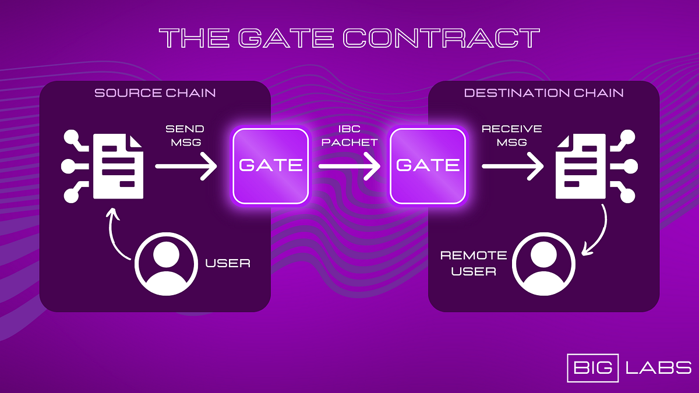
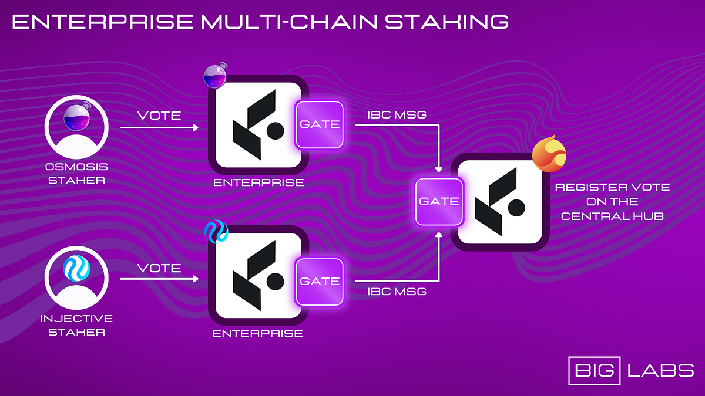
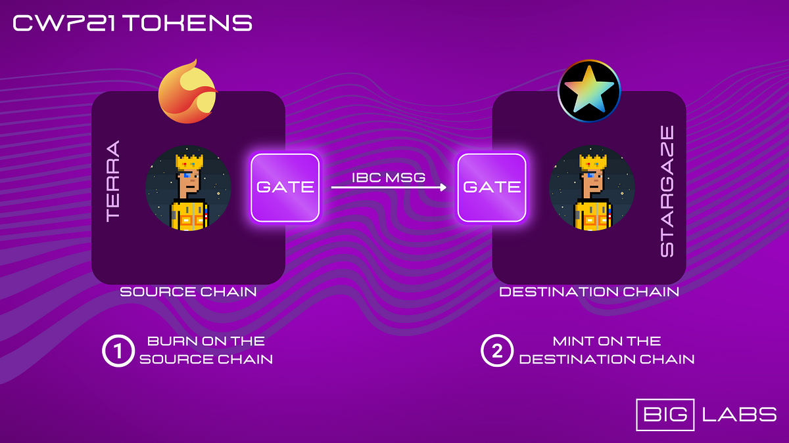

# The Gate Contract

- **Thread ID:** 12091
- **Author:** Big Labs (`terra1ss7lcn3kzusxu3kazgqgh0adjc2h93z20yt6ku`)
- **Created:** 2023-07-09T13:02:53.087Z
- **Last edited:** 2023-07-23T19:24:14.433Z
- **Stage:** discussion
- **Views:** 112
- **Reactions:** 0
- **Comments:** 5
- **Source:** https://common.xyz/terra/discussion/12091-the-gate-contract

---

**BIG LABS: **

We are a software house specializing in the blockchain industry, comprised of a skilled and talented team. Our team consists of:
- **5 Senior Smart Contract Developers**, with extensive experience in smart contract development.
- **4 Junior Developers**, young and passionate talents in blockchain technology.
- **1 Full Stack Senior Developer**, possessing comprehensive skills in front-end and back-end development.

So far, we have focused our work on the development and management of software for the Terra ecosystem. We have had the privilege of collaborating with prominent projects such as **Capapult Finance**, **SCV**, and we are currently working closely with the **Galactic Punks**.

We firmly believe that the success of a blockchain relies primarily on developers who dedicate their time and expertise to drive innovation, security, and user-friendly experiences. Our goal is to contribute to the growth not only of the **Terra blockchain** but also the entire **Cosmos ecosystem**, leveraging our experience and skills.
We are thrilled to introduce our latest product: the **Gate** **Contract**. This revolutionary tool will enable protocols and developers to seamlessly interact across different chains, providing significant benefits to end-users.

**THE GATE CONTRACT**

Imagine being able to freely move your favorite NFT across different chains, utilize an interconnected lending and borrowing protocol seamlessly between two different chains, or leverage a protocol like Enterprise to stake your DAO tokens/NFTs on a different chain while still being able to vote on governance proposals. These are just a few examples of what will be possible thanks to the **Gate Contract**.
Currently, deploying a protocol on a different chain simply involves instantiating the same code on a new chain. However, despite the brand, user interface, and code remaining unchanged, the new instance is **unable to interact with its counterpart** on the main chain, resulting in **isolated instances** for each deployment.
> _The **Gate Contract** is specifically designed to **facilitate IBC Messages between Smart Contracts** on different chains._
> 
> 

Once deployed, it can handle all the communications between the chain and every other supported chain. This means that **only one Gate instance per chain is needed.**
By sending an **ExecuteMsg** to the Gate Contract, contracts on supported chains can forward IBC Packets to other chains and execute specific messages on those chains. **The Gate Contract handles the intricacies of IBC internally**, allowing developers to simply set up entry points in their contracts to communicate with the Gate. It also allows for sending **native tokens** along with messages on other chains.

Furthermore, the Gate Contract **rewards relayers** who execute the transactions on the other chain with **Luna**, making the process profitable and giving utility to Luna. It can send **multiple messages** in the same IBC Packet from multiple contracts to multiple remote contracts, also it allows contracts to perform **Inter-Chain Queries**.
Importantly, **the Gate is free to use** and does not charge any fees to its users. **Security is maintained within the contract itself**, as each smart contract can filter incoming messages, permitting only registered and trusted contracts to send inter-chain messages using the Gate.
> _It is crucial to note that the Gate is **exclusively designed to interact with smart contracts** and not directly with users._
> 
> 

**EXAMPLE USE CASE N°1: ENTERPRISE**

As explained earlier, in the current state, launching an existing protocol on another chain results in two isolated protocols that cannot interact optimally with each other. This limitation is particularly problematic for protocols like **Enterprise**, an innovative protocol on Terra created with the aim of easily managing DAOs.
If **Enterprise** were to launch its protocol on other chains like Osmosis or Injective, it would results in having separate and distinct DAOs from those existing within their protocol on Terra. This is because when tokens are transferred to Terra using ICS, they are recognized as **IBC Tokens** on Terra, limiting staking and voting capabilities to the native chain where the DAO was originally created.
> _By leveraging the Gate Contract, Enterprise can easily switch the Cw20 code used to our Inter-Chain Cw20 Version, enabling the transfer of Cw20 tokens across different chains._
> 

The transfer of Cw20 tokens involves **burning** the tokens on the originating chain and **minting** them on the destination chain. This process is automatically handled by the Gate, which **does not act as a custody contract** and does not hold users’ tokens.

Through this approach, **Enterprise** avoids the need to handle IBC Tokens directly. Additionally, if someone wants to transfer a token from Neutron to Injective, they **no longer need to route the transaction through Terra**. Instead, the Gate handles the direct forwarding of the message to the correct chain.
In conclusion, for **Enterprise**, utilizing the Gate would mean being able to implement the capability of **Multi-Chain Staking and Voting for DAOs**,** **allowing users to stake their tokens/NFTs on any of the supported chains and vote on governance proposals.

**EXAMPLE USE CASE N°2: CAPAPULT**

For a lending and borrowing protocol like **Capapult**, choosing to implement the Gate would bring significant benefits and opportunities for new features.
**Capapult** could, for example, launch its protocol on Injective as well, and a Terra user would be able to:

- Deposit their collateral on Terra
- Mint SOLID directly on Injective, with the fees paid in LUNA

This is just an example of how the Gate can radically accelerate the interconnection between different Cosmos chains, enabling users to enjoy an **increasingly effortless and enhanced user experience**.

**EXAMPLE USE CASE N°3: GALACTIC PUNKS**

For an NFT collection like **Galactic Punks**, choosing to utilize our **new Cw721 standard** would undoubtedly open up a world of new possibilities, allowing the community to break free from being tied to a particular chain and explore new horizons within the Cosmos ecosystem by **moving their NFTs from one supported chain to another**.
This would enable communities from different chains to finally begin **interacting with each other**, breaking down the barriers that have existed between Cosmos chains, particularly in relation to NFTs.
Furthermore, the ability to move one’s NFTs to other supported chains allows for **accessing the liquidity of those chains**, resulting in significant liquidity benefits and the opportunity to reach a larger number of users.

**GATE CONTRACT FUNDING PROPOSAL**

First and foremost, we want to emphasize that the Gate Contract will be completely **free** and **open source**. Big Labs will not profit from the Gate Contract itself or the work done thus far, as our motivation has solely been to make a meaningful contribution to the community.
We strongly believe that a double audit is absolutely necessary to ensure the highest level of security and reliability for the Gate Contract, as it could potentially be a single point of failure for the protocols utilizing it. To address this concern, we have chosen to engage the services of two highly specialized and renowned companies, **SCV** and **Oak Security**.

- _The estimated cost for the double audit amounts to approximately $70,000_

But we are still waiting for official quotes.

Furthermore, we are requesting funds to cover the expenses for one year of work for one of our **Senior Smart Contract Developers**. This developer will be responsible for implementing our solution directly into the code of various protocols and continuing the development of the Gate Contract.

As mentioned earlier, our team consists of 5 Senior Smart Contract Developers, and we want to emphasize that the requested compensation is intended to ensure the commitment and availability of this developer for an entire year of development. Despite it being less profitable for us, our focus remains on supporting the growth and achievement of new milestones for the Terra and Cosmos ecosystem, and we are confident that our decision will be appreciated by the community.

- _We are requesting $150,000 for a Full-Time Senior Smart Contract Developer for one year of work_

Lastly, we recognize the need for effective **project management** to establish connections with both Terra protocols and other chains.

The **Project Manager**’s role will involve interacting with **protocols on Terra**, presenting them with the potential use cases of the gate contract, and encouraging its implementation. They will also engage with **protocols outside of Terra**, persuading them to adopt the gate contract and launch on Terra to benefit from free support.

- _We are requesting $150,000 for a Full-Time Project Manager_

For a total of _**$370,000**_ in Luna at the moment of the proposal.

For **Terra protocols**, we will provide assistance at no cost to them in implementing our solution within their contracts to connect to other Alliance chains. Therefore, the protocols on Terra are definitely at an advantage as they will receive free support and be assisted by us in the order they come in.

**Protocols outside the Terra ecosystem**, on the other hand, will need to implement the Gate internally on their own, without our support, unless they decide to launch the protocol on Terra as well. In that case, they will also receive free assistance from us.

More information in our [Github ](https://github.com/BIG-Labs/gate-contract-core)repository.

---

## Comments (5)

**codeNoodle (`terra1hmrmqf2aszlnzdgz2crxr3d9vw6t6k68dxmjw2`)** — 2023-07-19T04:24:25.136Z — 👍 1

Although I don't think this feature is necessarily satisfying a current "need," I do think that it could make for a fun tool for projects to build on top of. I appreciated the above examples, and it seems there could be at least a few use cases not far off. Maybe they do something really cool that draws attention to Terra, maybe they don't, but I like the premise of fostering experimental ideas. For the most part the costs seem reasonable considering that on-chain support is included. One thing I do wonder is why the Project Manager role includes what could be two separate jobs? One seems more of a support role assisting apps on Terra, and the other is a sales role to market the capabilities of the tool to entice builders to use it. Of course, I am not saying there isn't someone capable of doing both roles out there, but is there someone in mind already? How would they handle the split of the two roles? The sales side of this seems to be pretty important, as upkeep will become burdensome without adoption once we hit the 1 year mark. I understand this is already up for vote, but better late than not at all I suppose.

Disclaimer: I am not a dev nor a financial expert of any form, and my ideas are my own. ✌🌕

> **Big Labs (`terra1ss7lcn3kzusxu3kazgqgh0adjc2h93z20yt6ku`)** — 2023-07-23T10:18:41.449Z
> 
> Thanks!

**NoGrift (`terra1kekm2wdz8urwzrcxu8wvssz8vtljqu0p5fecpa`)** — 2023-07-21T06:59:58.040Z

It's a No for me.

Why a bunch of validators vote Abstain? Too scared to vote No? Abstain just enables the prop to pass.

So you built something that 
1. Nobody asked for 
2. Has several existing standards in Cosmos ecosystem already, that are being worked on for a long time (ICS721 for instance)

And now you are asking money to 'help' projects implement it. 
It really sounds unnecessary at this point and why should community pay 1-year upfront for this?

It sounds like you want some free audit and aggressive marketing for the Gate at the expense of Terra Community Fund.

What if there is no adoption or interest from Cosmos projects? Apart from political agreement to implement it from some Terra Protocols. Are you gonna pay it back then?

SCV voting Yes is weird, they are being paid by this prop.
Capapult is basically Big Labs, so voting Yes on own prop again, same as with Capapult original prop, nice.

It is good to take initiative and build new stuff, that should be encouraged. 
But this prop looks like a prettified grift attempt to me. 
Get some adoption first or get protocols that need 'help' implementing it create their own individual props to be funded for it from the Community Pool.

If it was only about audit - it would look better. But also not clear why community should fund two audits. Why not go with five or seven, it is not your money you are spending, right.

> **NoGrift (`terra1kekm2wdz8urwzrcxu8wvssz8vtljqu0p5fecpa`)** — 2023-07-21T14:50:48.149Z
> 
> 150k for a dev to help implement it? It is clearly not a full-time job but a sometimes kind of job. Whenever and IF protocols decide they want it. Let's be honest, help implementing it will take a few days per protocol tops. So how such amount is justified if it is not a grift attempt?
> 150k for 'project manager' to aggressively shill your product to everybody? Community needs to pay for that? Why?

> > **Big Labs (`terra1ss7lcn3kzusxu3kazgqgh0adjc2h93z20yt6ku`)** — 2023-07-23T10:18:13.952Z
> > 
> > Hey, thanks for your feedback, so:
> > 
> > 1. As explained in the proposal the Gate is much more than ICS721.
> > 2. The ask is to implement code directly inside protocols, not a part time job for sure.
> > 3. Capapult and BIG Labs are two separate entities, BIG Labs is a software house that doesn't own any protocols.
> > 4. We have already reached GP, Capapult and Backbone labs that would like to receive our help, so they'll be the initial adoption.
> > 5. Double audit for things like that are really important, because they'll be used from different protocols and a vulnerability could be really dangerous.

