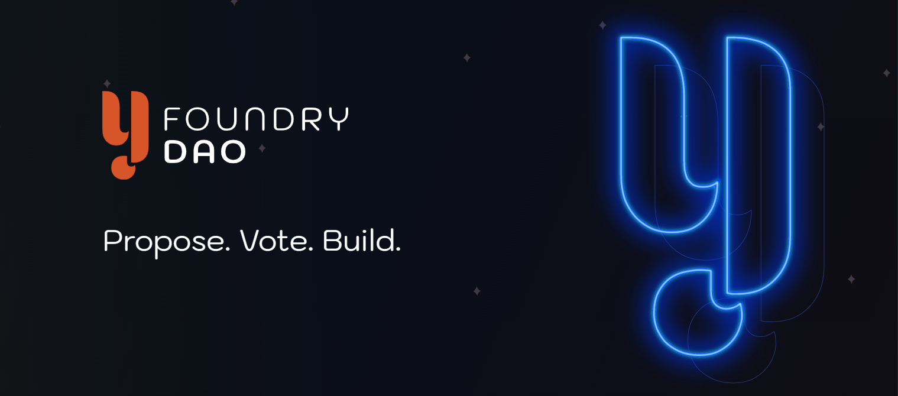

# Y-Foundry DAO Proposal: $LUNA Integration into Y-Foundry Governance

- **Thread ID:** 12187
- **Author:** Anonymous (`terra1ul5eyygj60cw0zr8qrnt9650z84falm2gn4c5w`)
- **Created:** 2023-07-15T17:38:48.858Z
- **Last edited:** 2023-08-08T07:00:29.025Z
- **Stage:** voting
- **Views:** 134
- **Reactions:** 0
- **Comments:** 3
- **Source:** https://common.xyz/terra/discussion/12187-y-foundry-dao-proposal-luna-integration-into-y-foundry-governance

---

Summary
# Summary
Y-Foundry revolutionizes project funding and asset escrow through a trust-less, automated smart contract platform operated by the Y-Foundry community.

This proposal presents the incorporation of an **expanded governance framework** which would include **$LUNA as a recognized Y-Foundry governance asset.**

The intention behind the expanded governance framework is to create synergistic relationships between the Y-Foundry platform and Terra Luna ecosystem by bonding the Governance of the Y-Foundry platform on Terra to the native governance token $LUNA. 

The additional of LUNA as a governance token into Y-Foundry's smart contracts would provide additional utility for LUNA holders by granting governance and funding influence in the Y-Foundry platform. 

The benefit to Y-Foundry DAO would be a reduction in the barrier of entry for Terra's Y-Foundry DAO providing for the potential of an increase interest and membership in the platform.

**Community Pool funds requested: 54,269 LUNA**

—

# **2.0 Motivation: The LUNA Token Integration**

## 2.1 **Objective**
To integrate the LUNA token within the Y-Foundry smart contracts and UI to allow $LUNA to be staked for Y-Foundry governance permissions and for participation of funding proposals on the platform. 
## 
## 2.2 **Scope**
This integration will allow LUNA holders to leverage their LUNA (and optionally LUNA derivatives (bLUNA, ampLUNA –and– even LUNA paired LP tokens) for access to Y-Foundry DAO governance and funding permissions for development of community-proposed projects. LUNA holders will also be able to lock LUNA to gain fYFD (governance) influence on the Terra Y-Foundry platform alongside the YFD-Terra governance token. 

The fYFD power of a depositor determines their amount of allowed funding on a single proposal as well as proportional influence in overall DAO governance.

—

# **3.0 Value Proposition and Impact Assessment**

## 3.1 **Global Reach and Inclusion**
The integration of LUNA into Y-Foundry has the potential to expand crowdfunding's geographical reach. By leveraging Terra's inherently global nature, we anticipate fostering a worldwide user base, thus facilitating a more globally inclusive environment for community-driven projects and innovation.

## 3.2 **Market Growth Potential**
The top 5 crowdfunding platforms raised a total of $17.2 billion last year. The global crowdfunding market is forecasted to reach $300 billion by 2025. The inclusion of LUNA in Y-Foundry could contribute significantly to this growth, potentially driving substantial economic benefits and user base growth for the Terra ecosystem.

## 3.3 **Enhanced Token Utility**
Integrating LUNA will increase its utility by allowing token holders to fund projects and participate actively in the Y-Foundry DAO's governance. This could lead to increased transactions involving LUNA and value generation for LUNA holders.

## 3.4 **Cross-Community Synergies**
This integration is anticipated to stimulate an influx of projects and users into the Terra ecosystem through Y-Foundry, driving innovation and fostering collaborations. At the same time, Y-Foundry stands to benefit from the dynamic LUNA community, broadening its pool of creators and contributors.

## 3.5 **Alignment of Community Incentives**
The proposal includes the potential to build a reserve of LUNA tokens in the Y-Foundry DAO treasury. This will allow the YFD community to participate in Terra's community governance and decisions, aligning incentives between the two ecosystems.

—

# **4.0 Terra Blockchain and Crowdfunding: A Perfect Synergy**

## 4.1 **Ideal Infrastructure**
The features of Terra, such as low fees, quick transactions, scalability, security, and interoperability, make it well-suited for crowdfunding initiatives. Moreover, it can support a variety of stablecoins, smart contracts, and rewards that are useful in crowdfunding and subscription-style payment applications.

## 4.2 **Cross-Application Utility**
The integration of LUNA into Y-Foundry could help streamline crowdfunding and subscription payments, enabling platforms to accept local currency donations, automate subscription charges, and facilitate global support for diverse projects.

—

# **5.0 Cohesion with Existing Terra Protocols**

## 5.1 **Alignment with Enterprise**
Enterprise is a comprehensive tool for organizing, creating, and maintaining Decentralized Autonomous Organizations (DAOs) on Terra. By integrating LUNA with Y-Foundry, we can leverage Enterprise's streamlined DAO management to promote transparency and efficiency in crowdfunding project governance allowing for cross-DAO collaborations of funding and on and off-chain initiatives.

## 5.2 **Integration with Warp Protocol**
As a decentralized event handler, Warp Protocol can automate tasks, create custom workflows, and support the development of decentralized applications. The synergy of Warp and Y-Foundry could enhance crowdfunding experiences through automations and customizations, making project execution more efficient.

—

# **6.0 Methodology**

## 6.1 **Token Whitelisting**
The first stage will involve refactoring the governance system to allow the whitelisting of multiple CW20 and Native tokens including the LUNA token as to allow the deposit into the smart contracts.

## 6.2 **Locked LUNA Funding and Governance Mechanism**
Next, development of mechanisms that allow depositors to receive fYFD in exchange for locked $LUNA, ampLuna, bLuna, stLuna and other varieties as approved by Y-Foundry DAO governance.  fYFD is used to provide funding guidelines for projects and governance voting power on the platform.

## 6.3 **Token Pool Monitoring**
Introduction a monitoring system that will regularly assess the amount of LUNA locked, ensuring a transparent operation.

## 6.4 ** Yield Harvesting ** (experimental/optional)
Prototyping a system that allows for deposits of native $LUNA to be staked and yield harvested. 
—

# **7.0 Timeline and Milestones**

## 7.1 **Development Stage**
## **Q3 2023**
We expect the development and testing of these features to take approximately until late Q3 2023. 
The milestones are outlined above in the **6.0 Methodology** section.

Deliverables include refactoring and modifying existing smart contracts to grant governance and funding permissions to LUNA. 
Testing the refactoring of the code and governance token abstraction layer.

Additionally, revisions to the UI/UX, along with comprehensive testing of the new governance tokens, will take place on the Terra testnet and will be open to the community to participate in testing.

If time allows, additional time will be invested exploring and executing potential integration points with Vlad and the Enterprise codebase.

## 7.2 **Deployment and Promotion Stage**

Following a successful test phase, we anticipate a further month for deployment and promotion of these features within the Y-Foundry community and the wider LUNA ecosystem.

—

# **8.0 Budget**

## 8.1 **Development Costs**
## 
The primary cost will be related to development and testing of the features, estimated at:

27,777 LUNA - 2.5 months Smart Contract Refactoring + Testing ($17,500 USD at $0.63 per 1 LUNA)
13,492 LUNA - 2 Month UI/UX Development ($8,500 USD)
—------------
**42,269 LUNA** for Development Related Expenses

## 8.2 **Deployment and Promotion Costs**
The costs associated with deployment and promotion are estimated at: 

**12,000** LUNA 
3 Month Dedicated On-boarding support for 3 months

**Responsibilities:**
- Primary - Work with community members and projects to support getting proposals submitted, developing and promoting plans)
- Business development and partnerships support
- Platform troubleshooting and testing support
- General communication and marketing support

**Grand total - 54,269 LUNA**
—
# 
# **9.0 Closing**

This proposal presents an exciting opportunity for Y-Foundry to enhance its platform, grow its user base, offer increased utility to the LUNA community, and align incentives with Terra. 

The integration of LUNA into Y-Foundry would mutually benefit both communities, and we sincerely hope for your favorable consideration and support.

---

## Comments (3)

**Sasori (`terra1q4j4ucmqz74vxew0kszsxqtmvxqgp5fen248p0`)** — 2023-07-17T02:33:48.610Z — 👍 2

hello [@Ray Raspberry](/profile/id/119011) ,

Thank u for putting this together. Can u elaborate why the Terra Community needs to pay another sum just to have $LUNA supported when we have already paid 60k as part of the emergency builder allocation?
[https://terraeco.notion.site/Terra-Emergency-Builder-s-Allocation-6b92e167b2b441ca96409d2a9ff7f4d2](https://terraeco.notion.site/Terra-Emergency-Builder-s-Allocation-6b92e167b2b441ca96409d2a9ff7f4d2)

thank u

> **Anonymous (`terra1ul5eyygj60cw0zr8qrnt9650z84falm2gn4c5w`)** — 2023-07-17T12:04:16.879Z — 👍 1
> 
> Hey [@Sasori](/profile/id/65656) 
> 
> Thanks for the question.  The clearest answer is the builder funds ran out a long time ago and we hadn't thought to develop the contracts with support for alternative governance tokens in that time.  I'm not aware of any protocols in the Cosmos that support protocol governance using native chain governance tokens in addition to their own.  
> 
> After thinking about and discussing amongst the Y-Foundry contributors we felt like sharing protocol governance with $LUNA holders offers a much more equitable offer of shared governance than a token swap or revenue sharing.  So, bottom line, what is being proposed here does not exist in Y-Foundry protocol in its current form.
> 
> The contracts as they are, audited and functionally complete, do not include functionality to support $LUNA or other tokens beyond Y-Foundry's token for membership or governance.  Additionally, the User Interface doesn't display or expect multiple token options for staking and governance either.
> 
> The motivation is addressed in the original post and that is to expand the market for Y-Foundry and bring additional utility directly to $LUNA.
> 
> Regardless of what happens with this proposal, Y-Foundry is still shipping to Terra.  Currently the wallet and contract adaptors are being rewritten to support more than Station Wallet.  We're not adding additional major features at this time so the shared governance and the potential for Enterprise integration outlined in this proposal will most likely not be developed or included for a Terra release without additional support from the Terra community.
> 
> I hope that answers your questions.  Let me know if you have more.

**Anonymous (`terra1alxk3fmhcl0ga80gl9yj9zp3ezjm4sdh8a9l9c`)** — 2023-07-17T11:06:39.683Z (edited 2023-07-17T11:09:23.457Z) — 👍 1

I am in support of this proposal. This seems like a very sane ask for a commited community member / team that has been continuously active in the Terra ecosystem since the depeg (and before).

A couple of things I would like to see:

- Instead of 3 months dedicated on-boarding support, it would be better to have something like a special support for the first 10 or 20 projects using the platform.

- I would like to see some more info on how Enterprise will be connected to Y-foundry, -> why not host a shared TwitterSpace between Ray and Vlad?

- The grant should include a preliminary audit estimate, if the audit costs less than expected, return of the over estimation of audit funds. Or will there be a second grant request for the audit?

- I would like to see this put into a multi-sig that will be paid out after the successful launch.

Terra doesn't have a launchpad and Y-foundry sounds like it could fit very nicely in bootstrapping milestone based fundings for projects in combination with Enterprise. 

Not sure about the yield harvesting aspect however, as I would prefer that it would be built around ERIS products like the Amp Extractor, that can be used to harvest yield from any our yield optimized products. It is easily possible to take yield from ampLUNA, ampLP, arbLUNA and even from other chains LSTs like ampWHALE, arbWHALE and any amp[TOKEN]. Which reduces complexity, cost and redundant work done by Y-Foundry and ERIS team.

_Disclaimer: I am in regular contact with Ray and value his personal input and detail in which he uncovers bad actors on Terra and Cosmos._

