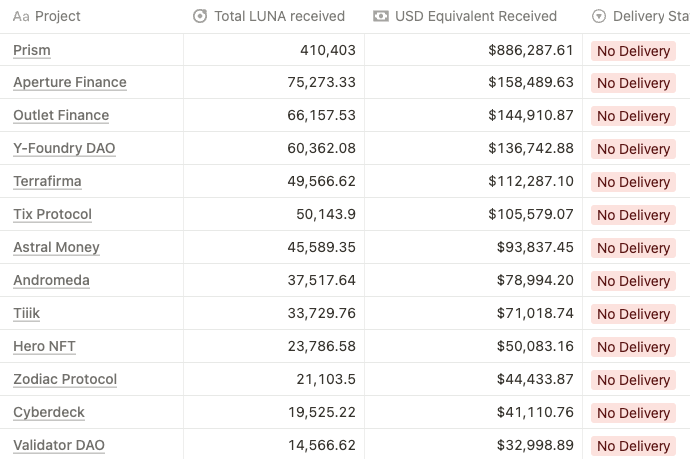

# Emergency Builder's Allocation Non Delivery

- **Thread ID:** 12349
- **Author:** Sasori (`terra1q4j4ucmqz74vxew0kszsxqtmvxqgp5fen248p0`)
- **Created:** 2023-07-26T06:20:51.989Z
- **Last edited:** -
- **Stage:** discussion
- **Views:** 118
- **Reactions:** 4
- **Comments:** 2
- **Source:** https://common.xyz/terra/discussion/12349-emergency-builder-s-allocation-non-delivery

---

## Summary
To date, ~$3M LUNA has been given to teams on the Emergency Builder's Allocation who have either exited the ecosystem or have not delivered any thing at all: [https://terragrantseval.notion.site/Emergency-Allocation-Jul-2023-Status-0e5c11e688ce4b4d87f8268b4be35c5a?pvs=4](https://terragrantseval.notion.site/Emergency-Allocation-Jul-2023-Status-0e5c11e688ce4b4d87f8268b4be35c5a?pvs=4)

As laid out in governance, if there has been no delivery after 1 year, these teams should return the funds. These should not be in-kind given how the token price has performed, but the realized cash value for these teams based on when the LUNA exited their wallets. 

When are we going to hold the teams who have not delivered accountable?

---

## Comments (2)

**Anonymous (`terra1alxk3fmhcl0ga80gl9yj9zp3ezjm4sdh8a9l9c`)** — 2023-07-26T08:46:01.539Z (edited 2023-09-28T02:29:45.465Z) — 👍 2

Hi Sasori,

I like your proactiveness and I support to try to clawback funds. 

I think the referenced data is not ideal so I went through the project list and here are my conclusions and actions I would take:
[https://docs.google.com/spreadsheets/d/1W3BsTQ1OZkSnqP-deoRr7LUlf1CsDLwqnHJvIhZ2UW4/edit?usp=sharing](https://docs.google.com/spreadsheets/d/1W3BsTQ1OZkSnqP-deoRr7LUlf1CsDLwqnHJvIhZ2UW4/edit?usp=sharing)

Clawback:
- Risk Harbor
- Aperture Finance
- Outlet Finance
- Tix Protocol
- Edge Protocol
- Tiiik
- Hero NFT
- Pavo Finance
- Cyberdeck
- Wicca Money

Discuss:
- Stader Labs
- Setten
- Terran ONE
- Knowhere / Soil Protocol
- Packs
- Zodiac Protocol

Received Feedback for discussion:
- Terrafirma
- Astral Money

Extend Deadline, as they are still building / active on Terra
- Neptune Finance
- Y-Foundry DAO
- Obi
- Andromeda

For all projects that feel I misrepresented them, please contact me or write a comment in the sheet, so I can update.

**HashiiMot0  (`terra18vj4suur9k5yt6shdewuz6d2s52px7e3ced843`)** — 2023-09-28T02:29:40.193Z

Would love to see this luna go to projects that actually want to build and bring liquidity and users

