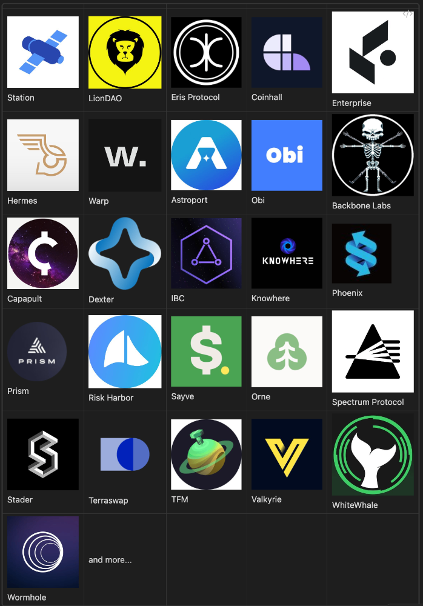
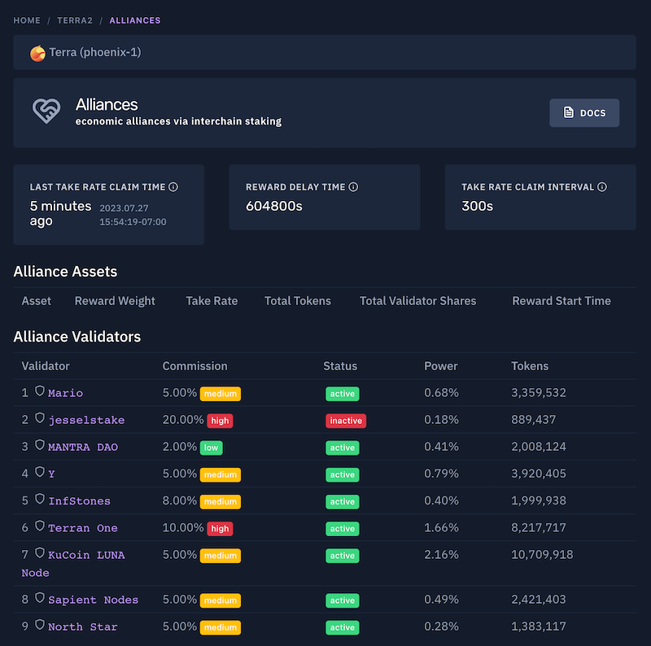
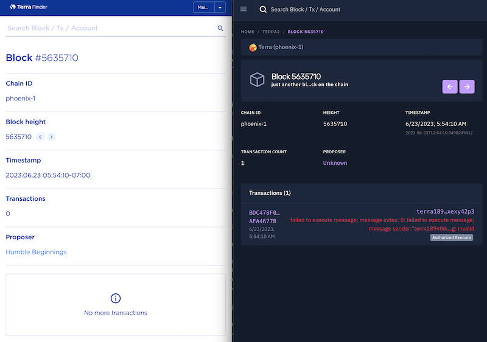
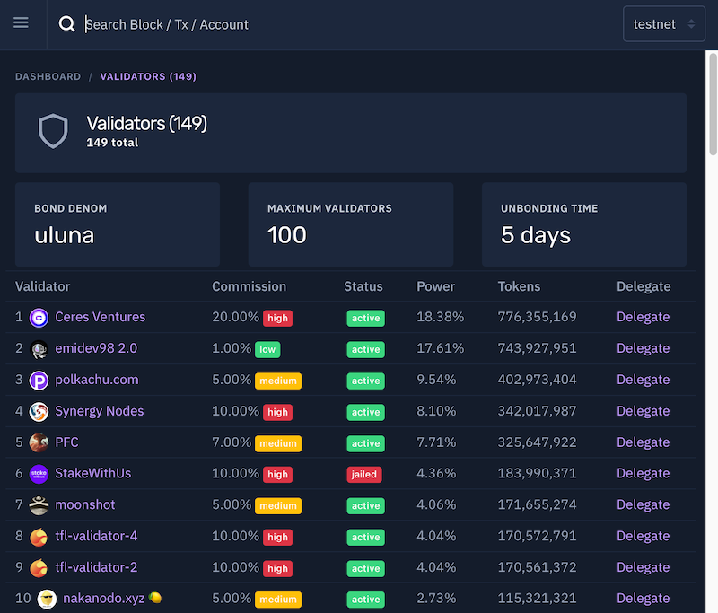
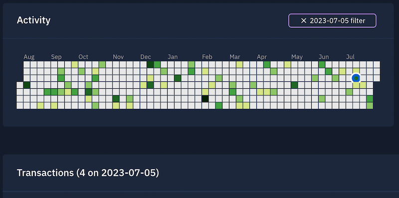
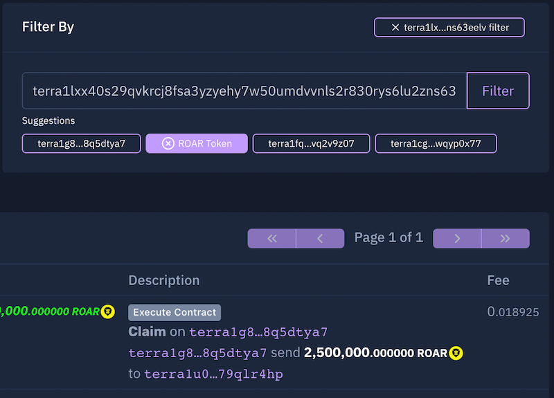
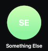

# Chainscope - Funding The Next Generation Lens for Terra

- **Thread ID:** 12494
- **Author:** Chainscope (`terra1060yhv9qt6raxc0tf8ugxyueprs6pgzf6rff6h`)
- **Created:** 2023-08-03T04:55:49.951Z
- **Last edited:** 2023-08-06T03:16:13.860Z
- **Stage:** discussion
- **Views:** 242
- **Reactions:** 0
- **Comments:** 3
- **Source:** https://common.xyz/terra/discussion/12494-chainscope-funding-the-next-generation-lens-for-terra

---

# What is Chainscope?

 

> "...we have the best developer tooling, the best wallet, *the best explorer*." - [Chris Amani](https://twitter.com/fleece_cannon), TFL CEO ([Source: YouTube](https://youtu.be/1YgswS4bFnQ?t=1890))

As Terra's go-to explorer, Chainscope (a.k.a. Terrascope) serves an essential infrastructure role, similar to a default wallet or core code maintenance.

This proposal funds support for Terra on Chainscope for one year, with the aim to maintain and accelerate Terra's competitive advantage in the explorer space.

# Why Chainscope?

 

> "all of you want (chainscope) back, and that's indicative of their outsized value add in the ecosystem. and that value needs to be correctly incentivised" - Do Kwon, TFL Founder

Every chain needs an explorer. Chainscope serves as a public good, adding value to the entire chain via clarity, transparency, and ease-of-use. It acts as a force multiplier for Terra to 1) onboard new users, 2) increase retention, and 3) accelerate the developer experience.

We've been working on it for years, most recently at a loss. This proposal funds security and growth for Terra on Chainscope, which benefits everyone on Terra.

# Track Record

 

> Chainscope improved end-user experience so well that Do Kwon decided to deprecate Terra's own home-grown Finder in favor of redirecting users to it. - [William Chen](https://twitter.com/stablechen), Cosmology, Terran.ONE, ex TFL dev relations

Past performance is the best indicator of future success. Chainscope has demonstrated

* competitiveness (e.g., users and TFL favor Chainscope),
* cost-effectiveness (compare with [mintscan integration for 2m USD](https://twitter.com/Jared_TFL/status/1616479517438251009))
* consistency (e.g., monthly updates, if not more frequent, going back years, while [Finder has seen minimal updates](https://github.com/terra-money/finder)), and
* reliability (e.g., compare [a block with missing txs on Finder](https://finder.terra.money/mainnet/blocks/5635710) with [Chainscope](https://chainsco.pe/terra2/blocks/5635710)).

 

# Accomplishments

 

> “Chainscope has been the reference explorer since TerraV2 inception, and kept enhancing their product to become an in-depth analytics suite on cosmos. One of the few projects for which the Luna emergency allocation was not wasted.” - [Seb](https://twitter.com/SebNondzee), Emergency Allocation Committee Review

Below are select accomplishments exemplifying our track record:

* Last year, TFL deprecated in-house Finder in favor of Chainscope. Performed upon popular request (h/t [Midas]()) and at zero cost to TFL and the community.
* Re-launched on Terra 2 within one month of initial disbursement from emergency allocation.
* Continuous service from relaunch through present (cf. [many other recipients, yet to ship or since shut down](https://agora.terra.money/discussion/12349-emergency-builders-allocation-non-delivery)).
* 100% reporting reliability during emergency builder allocation term. 0 late reports. 0 disbursement denials. 
* Feature updates, bug fixes, and improvements every month over the past 18 months, extending even after the builder allocation was exhausted.
* Launched `pisco-1` testnet support at the request of TFL, with zero cost to TFL and the community (post builder allocation).
* Integration with ecosystem projects, including Terra Station, Warp, Enterprise, Coinhall, TFM, and almost every ecosystem dapp via decoding and cross-linking.

 

# Feature Comparison

 

> Chainscope changed the whole game on Terra. Before they appeared in the picture, finding transactions and making sense of the finder was a pain in the ass. Once they came along, exploring the chain became something anyone could do. They democratized things. - Midas, [@TheMoonMidas](https://twitter.com/themoonmidas)

 

> Chainscope has unparalleled features when it comes to block explorers. From looking up IBC details, smart contract-development, and ease of use. Chainscope is my go-to explorer. - [PFC](https://twitter.com/pfc_validator?s=21), Validator and Kujira Senator

 

| | **Terra Finder / Station** | **Chainscope** |
| -------- | -------- | -------- |
| Account Module List | ❌ | ✅ |
| Account Tx Heatmap | ❌ | ✅ |
| Alliance Module Overview | ❌ | ✅ |
| Asset List Page | ✅ | ✅ |
| Asset Detail Pages | ✅ | ✅ |
| Block Pages | ✅ | ✅ |
| Bookmarks | ❌ | ✅ |
| Contracts | ❌ | ✅ |
| Contract Binaries | ❌ | ✅ |
| Contract State Decoder | ❌ | ✅ |
| Community Pool Overview | ✅ | ✅ |
| Proposals | ✅ | ✅ |
| Project List (3rd Party) | ❌ | ✅ |
| IBC Channels | ❌ | ✅ |
| IBC Connections | ❌ | ✅ |
| IBC Tokens | ❌ | ✅ |
| Interchain Accounts | ❌ | ✅ |
| Txs | ✅ | ✅ |
| Tx Filtering | ❌ | ✅ |
| Tx Log Summaries | ❌ | ✅ |
| Tx Net Amounts | ❌ | ✅ |
| Validators | ✅ | ✅ |
| Validator Delegator List | ❌ | ✅ |

 

# Ecosystem Integrations

  
# Recent Improvements (post-builder allocation)

This section highlights features added to Chainscope and delivered during 2023, at zero cost to the community or TFL.

## Highlight 1: Alliance Dashboard

We're the only explorer to display an overview for Alliance, a core part of Terra's strategy going forward.

## Highlight 2: Data Integrity and Tx Indexing Reliability

Reliable off-chain indexing is difficult. Chainscope recently spent a weekend ensuring data integrity for transactions. Below is an example of the result. Block 5635710 has transaction data on Chainscope that is missing on Finder.

## Highlight 3: pisco-1 Testnet Support

## Highlight 4: Interactive Account Activity Analytics

The account heatmap provides a quick overview of activity and a direct interface to filter txs by date.

## Highlight 5: Advanced Txs Filtering with Suggestions

Filter account transactions based on interactions with another account or contract.

# Vision / Roadmap 

 

> The principal challenge to blockchain right now is not creating apps but activating users. Better UX will decrease activation energy and increase retention. - [Zaki Manian](https://twitter.com/zmanian/status/1683753313638944769?s=46)

Chainscope can be 10x better, making the blockchain easier than a bank statement. Blockchains that "[hide the wires](https://www.youtube.com/live/1Qb42-Vz0qg?feature=share&t=43)" will rise to the top. This proposal supports stepping Chainscope and Terra towards that mission, including

* redefining the "explorer" experience as a "search" portal for web3,
* enhanced labels and decodings for core dapps (e.g., warp and enterprise)
* extending the site as an in-depth analytics suite,
* raising the UX bar via rapid iteration based on community feedback,
* research and development (e.g., to explore further support of Alliance module and Feather appchains)

 

# Deliverables

 

* Front-end explorer site service for `phoenix-1` mainnet deployed at https://chainsco.pe/terra2 or similar (deliverable immediately)
* Front-end explorer site service for `pisco-1` testnet deployed at https://testnet.chainsco.pe/terra2 or similar (deliverable immediately)
* Custom API services (e.g., GraphQL) to support the above front-ends (deliverable immediately).
* Multiple collection services and real-time indexing of data off-chain, in support of the above (deliverable immediately).
* Ongoing support, bug fixes, and site improvements.

 

# Alternatives?

 

> "Mintscan is so generic. Chainscope makes dev 10x easier." - [Mike Richards](https://twitter.com/MikeR_AM), A10 Capital Founder and Astral Money Co-Founder  

What if this doesn't pass? What are the other options?
  
* Mintscan reportedly requested 2m USD for integration, over 5.5x this ask ([Source](https://twitter.com/Jared_TFL/status/1616479517438251009))
* TFL's Finder, worse by TFL's admission (even before crash, when they were much better capitalized), not currently developed
  
Any other option would be lower quality, more expensive, and questionable delivery time (if ever). In contrast, Chainscope contributes value to Terra immediately with a compelling product, *today*.

# How Much?

 

We are requesting 20k USD / month for mainnet and 10k USD / month for testnet (30k / month total) for a one-year service period (360k USD total) to support `phoenix-1` and `pisco-1` on Chainscope. 

The on-chain proposal amount in Luna will be calculated from a timely price from CoinGecko (e.g., $0.568817 at the time of this writing).

25% of this (5k / month for mainnet and 2.5k / month for testnet) will be budgeted for real-time data indexing. For comparison, [the MetricsDAO grant allocated 10k USD / month for data warehousing costs for mainnet](https://agora.terra.money/discussion/6320-final-proposal-metricsdao-onchain-data-curation-grant) (2x this cost).

We would love to support the Terra ecosystem. Lack of funding, however, makes it impractical. Are you with us?

# What does TFL think?

| | | 
| -------- | -------- |
| | "all of you want (chainscope) back, and that's indicative of their outsized value add in the ecosystem. and that value needs to be correctly incentivised" - Do Kwon |
|| "...we have the best developer tooling, the best wallet, *the best explorer*." - [Chris Amani](https://twitter.com/fleece_cannon), TFL CEO ([Source: YouTube](https://youtu.be/1YgswS4bFnQ?t=1890))|
| | "For all my on-chain needs as a DeFi user and developer, Chainscope is the unrivaled go-to platform since Day 1. For reliable chain data and dev tooling, I can't name a single on-chain resource i've used more." - Mike Merz, [@ApolloDAO](https://twitter.com/ApolloDAO) Co-Founder and [Terraform Labs](@terra_money) Engineering Lead |
|| "The most comprehensive block explorer I've ever used. Makes blockchain development an absolute pleasure." - Vlad, Apps Team Lead at TFL |
||"Chainscope offers both retail users and developers a superior block explorer solution on Cosmos. We’ve been partnering closely with Chainscope to direct users to Chainscope as the block explorer of choice for the protocols we’ve built." - [MC, TFL Head of Ecosystem](https://twitter.com/mc_ust)| 

 

# What about ex-TFL?

| | | 
| -------- | -------- |
|| Chainscope improved end-user experience so well that Do Kwon decided to deprecate Terra's own home-grown Finder in favor of redirecting users to it. - [William Chen](https://twitter.com/stablechen), Cosmology, Terran.ONE, ex TFL dev relations |
|| "Chainscope is what an explorer should be, showing every detail of what really matters." - [Jesse](https://twitter.com/jesse____c), Founder [Newmetric](https://twitter.com/newmetricxyz) and ex TFL infra lead | 
||“The Chainscope team understands what users want out of an explorer. They’ve built tools and features that have become invaluable to myself and many other industry leaders across the space. The real, human-interpretable data is just the cherry on-top.” - [JQuantAnalytics](https://twitter.com/JQuantAnalytics)|

 

# What does the community think?

| | | 
| -------- | -------- |
||"(Chainscope) is one of the most popular explorers that everyone loved." - [Sunny Aggarwal](https://twitter.com/sunnya97), Osmosis Founder ([Source: YouTube](https://youtu.be/HnzeQc-Hdwk?t=662))|
||"Whenever we aim to deep dive into blockchain activity, Chainscope is our go-to tool. It allows us to navigate through transactions more swiftly than any other explorer." - [Setten](https://twitter.com/setten_io) |
|| “Possibly the best block explorer in the Cosmos.” - [Orbital Command](https://twitter.com/orbital_command) ([Source: Twitter](https://twitter.com/orbital_command/status/1685760844934828032?s=20)) |
||“Every blockchain deserves a blockchain explorer as good as (Chainscope).” - [RyanLion](https://twitter.com/TheRyanLion), LionDAO Pack Leader |
|| “Chainscope has been the reference explorer since TerraV2 inception, and kept enhancing their product to become an in-depth analytics suite on cosmos. One of the few projects for which the Luna emergency allocation was not wasted.” - [Seb](https://twitter.com/SebNondzee), Emergency Allocation Committee Review|
||"Chainscope is the best explorer in the space. Saves so much time viewing txs and state." - [0xPhilipp](https://twitter.com/0xphilipp?s=20), Eris Protocol |
| | "Bites Digital and Obi both quickly recognized Chainscope as a superior block explorer because of it's data info and UX — plus they constantly push relevant improvements based on suggestions from the community." - [@Panterra0x](https://twitter.com/Panterra0x), Bites Digital and Obi |
| | “Chainscope is just a superior explorer experience.” - [Joe](https://twitter.com/coinhall_joe), [Coinhall](https://twitter.com/coinhall_org) Co-Founder |
||"The entire Interchain will benefit from the transparency this team provides!" - [Rebel DeFi](https://twitter.com/rebel_defi), TFM and Orbital Command |
||"Chainscope was my default explorer during the Terra DeFi run due to its extensive features and readability, excited to see it go Interchain!" - [@CryptoIan](https://twitter.com/cryptoian) |
|| Chainscope changed the whole game on Terra. Before they appeared in the picture, finding transactions and making sense of the finder was a pain in the ass. Once they came along, exploring the chain became something anyone could do. They democratized things. - Midas, [@TheMoonMidas](https://twitter.com/themoonmidas) |
||"Mintscan is so generic. Chainscope makes dev 10x easier." - [Mike Richards](https://twitter.com/MikeR_AM), A10 Capital Founder and Astral Money Co-Founder |
||"Been using Chainscope since 2021 and it's by far the best web explorer experience we've seen so far. Whenever we have to use other tools, it becomes a dread and development/research takes considerably longer. All (supported) TX/block/wallet links our webapps and bots have point to Chainscope for its superior UX and our users thank us for this." - [Chinoman10](https://twitter.com/Chinoman10_), Hermes Protocol Founder |
||"nice to be back sleuthing on Terra - the explorer tools are on a different level" - [Ray Raspberry](https://twitter.com/RayRaspberry1), YFoundryDAO Founder |
||"(Chainscope) is back! This is the best day of my life since the UST crash!" - John Galt, Stride Zone ([Source: Twitter](https://twitter.com/lurkaroundfind/status/1547592141609652227)) |
||"Chainscope is becoming the most comprehensive block explorer used by SCV. They are not a simple conventional block explorer, they offer features we rely on a daily bases while interacting with on-chain data. It benefits the conventional average users and technical too in the same UI. We love Chainscope!" [Vini](https://twitter.com/unl1k3ly) - Managing Director of [SCV-Security](https://twitter.com/SCVSecurity) |
||"Chainscope is by far and wide the best explorer available on any chain leveraging the CosmosSDK. Chainscope relentlessly adds new features, makes transaction data easy to understand, and is extremely responsive to the community needs and requests. Any blockchain would be lucky to have Chainscope. For these reasons and more, I have sent countless users to Chainscope for their transaction and data needs!" - Something Else, Terra Community |
||"It just bloody works! Chainscope is easy to navigate, has heaps of additional detail, and I can get to the bottom of what's actually going on when I'm digging through tx logs. It's so much more efficient than on any other block explorer I've ever used" - [CapriciousSage](https://twitter.com/Ithiel), Ceres//Terrafirma//WildSage Labs|
||"Chainscope has unparalleled features when it comes to block explorers. From looking up IBC details, smart contract-development, and ease of use. Chainscope is my go-to explorer. - [PFC](https://twitter.com/pfc_validator?s=21), Validator |
||“We love your explorer. By far the best in the business.” - [JGnft](https://twitter.com/JGnft_is_me), [Backbone Labs](https://twitter.com/BackBone_Labs) |
||“I’ve had many requests for Chainscope on Juno because it’s better than Mintscan & Ping. (plus ships quicker)” - [Reece Williams](https://twitter.com/Reecepbcups_), Juno Core Dev |
||"Chainscope is my personal favorite." - Daniel, of Scandinodes and [Capapult](https://twitter.com/capapult)|
|| "I've been using Chainscope since they first launched, they have done an amazing job for the community, its my one stop explorer." - Shaun, from [Smart Stake](https://twitter.com/SmartStake) |

# Team

We're a team of three, each with multiple years of engineering experience.

# Questions?

Thank you to the community for its consideration. Please feel free to reach out to us directly if you have questions.

App: [https://chainsco.pe](https://chainsco.pe/)
 
Twitter: [https://twitter.com/chainscope_info](https://twitter.com/chainscope_info)

---

## Comments (3)

**Anonymous (`terra1alxk3fmhcl0ga80gl9yj9zp3ezjm4sdh8a9l9c`)** — 2023-08-04T07:56:11.643Z (edited 2023-08-04T08:08:19.055Z) — 👍 1

Hi Kazzy,

undoubtedly TerraScope / ChainScope is one of, if not the best Blockexplorer in Cosmos. Me having direct access to you allows me to request features or report bug fixes, that makes my and my teams life developing on Terra a lot easier and every chain not having TerraScope is a pain in the ass. Over the last months you have been super active developing more features.

However I don't think I can currently support your proposal due to missing info:
1. How many unique users has your page and visualize Terra vs Osmosis? Ideally show a over time graph. I think that you will have a couple of powerusers / sleuths that will dominate that statistics. How much of your traffic is generated by referral from protocols?
2. TerraScope is the second largest validator on Terra. I usually understand that validators provide a value to the ecosystem for the delegation rewards they receive. The validator income should be included in the calculation or even cover most of the development / license costs.
3. Currently you are deployed on Terra and Osmosis. How much is TerraScope being paid by Osmosis Community or Core Members?
4. Based on your tweet and information I have, you are currently in negotiations with multiple chains. Are you asking all of them for 30k $ per month? I would like to see a total sum for all cosmos chains necessary for chainscope to be profitable and what the exact runtime cost of a single chain is approximately. ([https://twitter.com/chainscope_info/status/1684337061967577088?s=20](https://twitter.com/chainscope_info/status/1684337061967577088?s=20))
5. Is ChainScope wanting to be a "Public Good" or is the Business Plan of ChainScope being paid by Chains? There is a new possible contender in the market - Celatone - which is fully open source. Is ChainScope considering Open Sourcing it's Frontend + Indexer so that communities that pay for a "1 year license" can indefinitely use the ChainScope version it paid for?
6. Comparing the requirements for the Celatone Indexer (64Gb RAM, 1TB NVme), running this self-hosted would cost around 100-200 $ per month, so I find the proposed indexing budget a bit high / overscaled for a (currently) small chain like Terra.

Overall I think the cost is too high for a chain with 300-3000 active users of which probably 5%-10% visit ChainScope often. The renaming of TerraScope to ChainScope is understandable, but very unfortunate, as Terra's mission has been shifting from single chain to being a core Multi-Chain infrastructure, so even the name TerraScope can stil be fitting.

Best Philipp

> **Chainscope (`terra1060yhv9qt6raxc0tf8ugxyueprs6pgzf6rff6h`)** — 2023-08-06T03:22:21.569Z
> 
> Thank you for taking the time to leave feedback on our proposal, Philipp. We respect and value your opinion, especially considering your role as an active and positive contributor to the community with Eris Protocol. We've gone ahead and updated our proposal based on your insights, particularly in regards to comparisons with alternatives.

**MB aejir (`terra10ql0yxam88pg0a02946pzv36a3w699shl9r3mc`)** — 2023-08-06T05:59:27.403Z (edited 2023-08-06T08:11:40.638Z) — 👍 1

Hi Kazzy, 

(Why have you rushed this to voting when its only been up on Agora for 3 days or so?)

Respect and appreciation for your valuable Explorer and for the ongoing support to Terra all this time!

For me this proposal was quite challenging to read as there were far more testimonials than there was actual proposal. A  proposal needs to stand on its own business merits not the testimonials of community personalities.  

To summarise: (correct me if Im wrong) this proposal is a request for the 1st year payment of an ongoing $360k annual service contract from Terra?

I am not opposed to some funding some support for Chainscope during these challenging times.

It’s quite understandable that given the price of $luna right now that the normal validating income you receive to cover costs would not be enough. Most validators are in the same situation and are barely scraping by, especially those few that also provide a service or contribution back to the Terra community like you do.

Of course when the price of $luna goes up in the future, as one of the largest validators on Terra you will have a decent income to contribute to the Explorer costs again.

It makes sense for any business to expand its customer base. Congrats on your rebranding from TerraScope to ChainScope and the addition of Osmosis support on the Explorer. ChainScope looks like transitioning from a validator and provider of an important public good, to a multi-chain fee-based business model. That seems like a good business move.

Will you be asking every new chain you support to pay $320k service fee per year as well? I assume Osmosis is or will be providing funding as well?

Maybe I am misreading this sentence in the proposal but are you saying that if we don’t support the funding amount requested that you will not be able to provide block explorer support for Terra? Or that you will not be able to go ahead with the new features described?: “We would love to support the Terra ecosystem. Lack of funding, however, makes it impractical” …(without this payment).

$320k seems like a lot either way.

Why not just ask for a more modest one-off payment to support Explorer development costs for the next 12 months while your validator income does not adequately support running costs?

And then supplement this with the additional revenues from Osmosis and others new chains to help buffer costs. You could also come back with a further funding request if needed when some progress has been made on the Deliverables and Vision/Road Map and when active user activity on Terra is higher.

Does this seem like a reasonable compromise until the business environment improves for everyone?

Again you guys have done some great work supporting Terra and it really is appreciated by everyone. 

PS: 

* If Terra agrees to provide some form of funding support to you, I would love to see this acknowledged with some Terra branding on your site. 

Perhaps just the words : “Powered by Terra” at the bottom of each page of the site.

Would this be possible?

