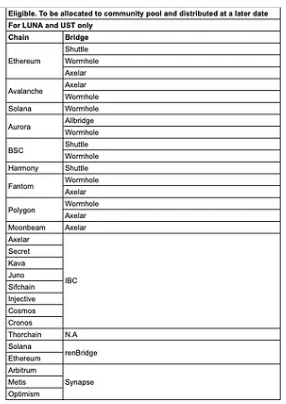
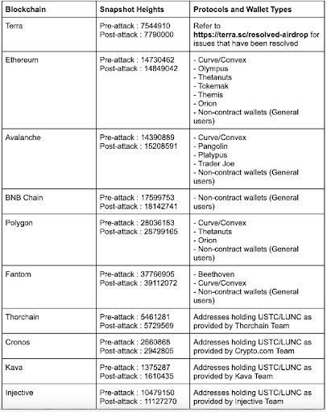
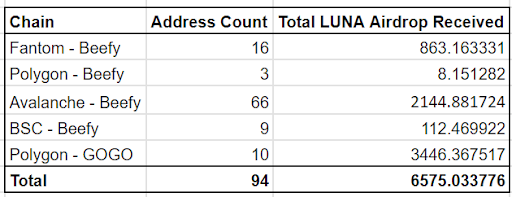

# Airdrop for Missed Protocols

- **Thread ID:** 13006
- **Author:** Somethingelse (`terra1scku27w5rsg4392zcaf2y9gnrh0w62t578ez7p`)
- **Created:** 2023-09-02T19:17:38.670Z
- **Last edited:** -
- **Stage:** discussion
- **Views:** 307
- **Reactions:** 1
- **Comments:** 5
- **Source:** https://common.xyz/terra/discussion/13006-airdrop-for-missed-protocols

---

I am representing myself as a community member of Terra. 

Executive Summary provided within this post for those with less time. Expanded details provided in the next post within this thread.

## **Background:**
TFL spent months working to index and account for every former holder of Classic assets so that they would be included in the Genesis airdrop as well as the follow-up airdrop. Unfortunately not all of those who held LUNC/USTC/aUSTC on other chains were accounted for. There remains LUNA in the Community Pool that is allocated to those who were not included in the previous airdrops. I have two such examples from Beefy Protocol and GOGO Protocol, representing 1200+ unique addresses from Polygon, Binance Chain, Avalanche, and Fantom. **These folks have waited patiently for well over a year to join the rest of the community in the revival. It's time to bring them home**.

## **Purpose:**
This proposal seeks to distribute the allocation of the airdrop. The snapshot, calculation, claim period, and vesting period terms will be exactly the same as outlined in [https://medium.com/terra-money/terra-2-0-luna-airdrop-calculation-logic-3eb752c25837](https://agora.terra.money/new/a).

## **Process:**
- On **September 9th**, the on-chain proposal formally requesting a Community Pool spend will be made.
- SCV Security will generate and post hashes from the contract code repository in a follow up post on this thread. The contracts admin will be the multisig upon approval of the proposal. 
- Big Labs will host the website for the duration of the airdrop. They are also managing the deployment and uploading of the contract code to the chain.
- If the on-chain proposal is approved, the funds will be distributed to the multisig. The multisig will then send the funds to the contracts. After 30 days, the claim period will end and any unclaimed funds will be returned to the community pool as soon as possible.


## **Implications for LUNA:**
In total, this proposal seeks 243,212.93 LUNA for vesting claims and an additional 50 LUNA to cover gas fees. Under the terms of the second airdrop, 25% of the airdrop will be released by May 23rd, 2023, which would be 60,803.23 LUNA available immediately if all users claim their airdrop at the time of release. The remaining will be released on the same schedule, vesting block by block till November 13th, 2024.

## **Multisig Members:**
Rebel Defi - terra1pnxgfvlaywamhykr4nfeep8n2ejd2mactz3un8
Rose - terra1vzxzwsm0rscya65jg9znu9jls9gtqrv7mc9yh9
Sasori - terra1q4j4ucmqz74vxew0kszsxqtmvxqgp5fen248p0
0xPhilipp - terra1alxk3fmhcl0ga80gl9yj9zp3ezjm4sdh8a9l9c
SomethingElse - terra1scku27w5rsg4392zcaf2y9gnrh0w62t578ez7p

**Multisig Address: terra1w2q5am5agfwpl7v5hwczc562v807ehd0aun0va3tzfteswc9drwqu3h9cs**

##

---

## Comments (5)

**Somethingelse (`terra1scku27w5rsg4392zcaf2y9gnrh0w62t578ez7p`)** — 2023-09-02T19:18:02.406Z (edited 2023-09-08T15:30:39.266Z) — 👍 1

As promised here is a more detailed post for those who practice trust but verify and those who trust no one. Terra needs folks like you, thank you.

**Special Note to the Beefy Protocol and GOGO Protocol Communities:**<br>
I want to personally apologize to all of you. The teams behind both protocols reached out and contacted me via the official discord server last year. I take full responsibility for any delays that contradicted earlier communications you may have received. The Beefy Protocol and GOGO Protocol members I’ve had the pleasure of working with have done everything they can do in the service of their users. If any users feel they have lied to you about working on this airdrop, I assure you, it was not a lie. Rather, I failed them and in turn you time after time. My personal life took turns I did not expect that kept me from working on this project to the fullest extent. And more so, the scope of this project was much larger but given my personal issues, I had to scale down. All these things led to broken promises on my part to these fine teams. I hope that you can find it in your hearts to forgive me and reaffirm your trust in the Beefy Protocol and GOGO Protocol team members.

## Verification:
Both protocols provided lists of addresses and quantities of LUNC/USTC/aUSTC at the time of the snapshots. All data reflects funds connected to Beefy/GOGO smart contracts at the time of the snapshot. Data provided does not include funds held in the user’s address as those were already accounted for in the last airdrop. Finally, GOGO was built on top of Orion contracts, Orion kindly shared the same data they provided to TFL for the follow-up airdrop.

Given the data was provided from the protocols directly, there is a need to verify two things:

1.	First, there must be verification that the addresses have not received the airdrop for quantities connected to Beefy and GOGO during the Genesis and follow-up airdrops.
2.	Second, there must be verification that these addresses and quantities are correct and reflect what independent sources report.

To verify that the addresses did not receive an allocation in the prior two airdrops we need to check the documentation, specifically:<br>
https://medium.com/terra-money/terra-2-0-luna-airdrop-cd08a6d9cfcd<br>
<br>
*Table 1*

This article informs that the Genesis Airdrop did not include the blockchains that GOGO and Beefy respectively used. As Table 1 shows, these addresses could not possibly have received the airdrop during Genesis. There is no further verification needed against any Genesis data for airdrops.

As for the follow-up airdrop, we know these chains were included based on the Agora forum proposal, https://agora.terra.money/discussion/6647-final-proposal-terra- phoenix-airdrop:<br>
<br>
*Table 2*

So it is clear that the blockchains in question were included in the follow-up airdrop! What is also clear is that neither GOGO or Beefy are included in this list. TFL provided a final list of addresses and quantities for the follow-up airdrop in the above forum post on Agora(at the very end): https://docs.google.com/spreadsheets/d/1cfXuMzpzVTskkxb6_E8w4OFhmflHl-AHMM37PWpgZnk/edit#gid=0. This document will serve as the source of truth for verification purposes.<br>This document allows for a comparison of the data provided by TFL with the data provided by GOOG/Beefy which is done here:

**Follow-Up Airdrop Verification:**<br>
https://docs.google.com/spreadsheets/d/1DS-tWxtbaSw5zVHdbzT_f_pSlXXRQTyyKe9LmwELSYs/<br>
<br>
*Table 3*

Table 3 is a summary of the results of the comparison. Out of a possible 1339 addresses, 94 appeared in the follow-up airdrop sheet. Clearly, these 94 addresses were given airdrops for reasons shown above in Table 2. There is verification that the addresses have not received the airdrop for quantities held in Beefy and GOGO during the Genesis and follow-up airdrops.An example verification of Beefy numbers is shown here: https://docs.google.com/spreadsheets/d/1pFLXwW0mQXdKiYi6PTtGYsNm2BaoPFODdiR_9dBF36Q/edit#gid=675037020&range=N7 

Verification of addresses and quantities can be performed from the calculation sheets for each chain. Links are provided to quickly review transaction history by contract to ease time spent. If there are any discrepancies, please flag them immediately. This is a manual process, however, many addresses have relatively few transactions involving the assets making verification trivial. Additionally, there are tools such as https://polygonscan.com/tokencheck-tool which allow for balance queries by block, very useful for verification. Finally, if one wants to go deep very fast, they could employ a tool like https://www.covalenthq.com/docs/api/balances/get-historical-token-balances-for-address/, an account is free and a generous amount of credits are given for free, queries should not cost anything.

## Calculation:

**GOGO Allocation Calculation:**<br>
https://docs.google.com/spreadsheets/d/1YGb3ek-8WxZwLZAtGCJwlh8jnP72Xr44oJiJzGqQrbI/edit?usp=sharing 

**Beefy > Final Calculation:**<br>
https://docs.google.com/spreadsheets/d/1pFLXwW0mQXdKiYi6PTtGYsNm2BaoPFODdiR_9dBF36Q/edit?usp=sharing 

The methodology for the calculation of the allocations is exactly the same as outlined in https://medium.com/terra-money/terra-2-0-luna-airdrop-calculation-logic-3eb752c25837. Both projects provided the necessary data at the specified block heights for each chain. Much of Beefy Protocol did not count towards Pre-Attack allocation because it did not make use of aUSTC but did use USTC and LUNC. GOGO Protocol was built on top of Orion Protocol, which indeed did use aUSTC and USTC but never touched LUNC. Calculation sheets have all formulas displayed for calculation. 

## Contract Code and Safety:
As mentioned in the executive summary post above, TFL wrote the code for the follow-up airdrop smart contract. During the testing of this contract, Big Labs found that a recent update to the blockchain had broken some functionality, making the contract unusable. Thanks to some sleuthing by a friendly developer at Cryptech Labs,, the issue was identified and rectified. The change is small and can be compared with the code TFL originally released. SCV Security has kindly offered to review(note, not audit) the code. Given the code change is small, most of TFL’s code is left unchanged, and that SCV Security will review the code(not audit), I believe the smart contract will meet the standard of safety the community finds acceptable.

More so, to ensure that the contract code on-chain is the same as the changed code given by Big Labs, SCV Security will post the hash of the smart contract code in a follow up post, this hash will match what is viewable through Chainscope. In total, there will be 4 smart contracts, one for each chain receiving the airdrop, so there will be 4 hashes to verify against. 

**Code Reference:**<br>
https://github.com/terra-money/airdrop

**Code Change:**<br>
https://github.com/BIG-Labs/terra-airdrop-contracts/commit/ae6905b56af0f6bfe5fc3a0484b02c84f8df198c 

Disclaimer:<br>
I, Somethingelse, only represent myself as a community member of Terra. I am not responsible for operating Terra or providing airdrops.

Any and all contributions by individuals or organizations to this project were done as members of the community. These contributors are not responsible for operating Terra or providing airdrops.

Multisig members are in no way signaling that they support this proposal by being on the multisig, these folks were selected strictly to secure these funds from malicious purposes and to give the community peace of mind. Multisig members are representing themselves as community members, any organization they may work for or associate with are not represented here.

> **Vini (`terra18ruqkccl5tp493uhvra0u6jylrzq8t8dv5qs4c`)** — 2023-09-21T13:40:19.324Z
> 
> Hi all,
> 
> As proposal suggests, the deployed hashes are correct!
> 
> This is the source code `https://github.com/BIG-Labs/terra-airdrop-contracts`
> 
> The contract `terra1w9qpvrt000e3jm8uxrlw9cxwzf4qmtv59xmete5zkdv76w4mwdcq7vfe4u` was instantiated from the code-id `1822`.
> 
> The source code compiles to the same on-chain hash as per below:
> 
> ## Compilation (./compile-contracts.sh eth)
> 
> ```
> Creating hashes ...
> 801e769dc55c70d119cb84ed8bc72c23651a27516f3c22f7d6e7f6be1dfa167b airdrop-eth.wasm
> ```
> 
> ## On-chain lookup
> 
> `terrad q wasm code-info 182 -o json|jq`
> 
> ```
> {
>  "code_id": "182",
>  "creator": "terra1vle5gvd8q5l7p6dg6h8y3rygylpnzmwzp0pdu9",
>  "data_hash": "11EA8EEB65356B47E235EF9962C97CF19C50394899A875A65967EBB702D4C7B2",
>  "instantiate_permission": {
>   "permission": "Everybody",
>   "address": "",
>   "addresses": []
>  }
> }
> ```
> 
> Thank you!

**Somethingelse (`terra1scku27w5rsg4392zcaf2y9gnrh0w62t578ez7p`)** — 2023-09-02T20:08:36.640Z (edited 2023-09-11T19:27:45.137Z)

As promised here is a more detailed post for those who practice trust but verify and those who trust no one. Terra needs folks like you, thank you.

## Special Note to the Beefy Protocol and GOGO Protocol Communities:
I want to personally apologize to all of you. The teams behind both protocols reached out and contacted me via the official discord server last year. I take full responsibility for any delays that contradicted earlier communications you may have received. The Beefy Protocol and GOGO Protocol members I’ve had the pleasure of working with have done everything they can do in the service of their users. If any users feel they have lied to you about working on this airdrop, I assure you, it was not a lie. Rather, I failed them and in turn you time after time. My personal life took turns I did not expect that kept me from working on this project to the fullest extent. And more so, the scope of this project was much larger but given my personal issues, I had to scale down. All these things led to broken promises on my part to these fine teams. I hope that you can find it in your hearts to forgive me and reaffirm your trust in the Beefy Protocol and GOGO Protocol team members. 

## Verification:
Both protocols provided lists of addresses and quantities of LUNC/USTC/aUSTC at the time of the snapshots. All data reflects funds connected to Beefy/GOGO smart contracts at the time of the snapshot. Data provided does not include funds held in the user’s address as those were already accounted for in the last airdrop. Finally, GOGO was built on top of Orion contracts, Orion kindly shared the same data they provided to TFL for the follow-up airdrop.

Given the data was provided from the protocols directly, there is a need to verify two things:
1. First, there must be verification that the addresses have not received the airdrop for quantities connected to Beefy and GOGO during the Genesis and follow-up airdrops.
2. Second, there must be verification that these addresses and quantities are correct and reflect what independent sources report.


To verify that the addresses did not receive an allocation in the prior two airdrops we need to check the documentation, specifically:
[https://medium.com/terra-money/terra-2-0-luna-airdrop-cd08a6d9cfcd](https://medium.com/terra-money/terra-2-0-luna-airdrop-cd08a6d9cfcd)

_Table 1_

This article informs that the Genesis Airdrop did not include the blockchains that GOGO and Beefy respectively used. As Table 1 shows, these addresses could not possibly have received the airdrop during Genesis. There is no further verification needed against any Genesis data for airdrops.

**MB aejir (`terra10ql0yxam88pg0a02946pzv36a3w699shl9r3mc`)** — 2023-09-02T22:49:33.020Z (edited 2023-09-11T17:45:59.422Z) — 👍 2

Thank you for your enormous effort with this ser.

**codeNoodle (`terra1hmrmqf2aszlnzdgz2crxr3d9vw6t6k68dxmjw2`)** — 2023-09-08T15:33:45.113Z

Indeed these community members have waited long and patiently for this and I know much effort was put into getting the right data to make good on this. I appreciate somethingelse and others' efforts that went into this, and hope this goes through smoothly so that none are left behind. Let's bring some lost community members back <3

