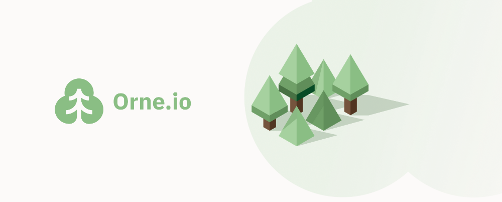
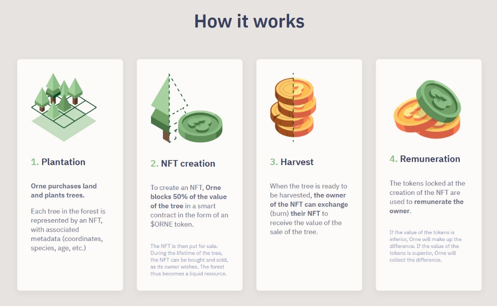
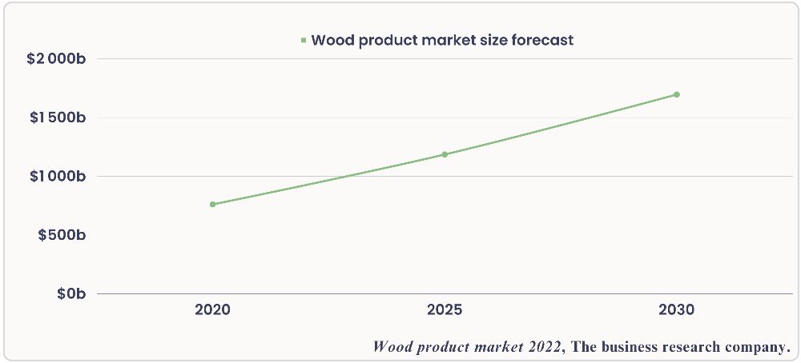

# Orne.io - Legal audit & Grant Proposal

- **Thread ID:** 13204
- **Author:** Orne (`terra102d7hvknwqegydy03kfpapj3zn3m7hschy90qy`)
- **Created:** 2023-09-13T08:16:09.603Z
- **Last edited:** 2023-09-25T14:19:52.096Z
- **Stage:** discussion
- **Views:** 200
- **Reactions:** 2
- **Comments:** 8
- **Source:** https://common.xyz/terra/discussion/13204-orne-io-legal-audit-grant-proposal

---

# Orne.io - Legal audit & Grant Proposal

## **Introduction**

Terra was once a land of wealth and a DeFi heaven, where most beautiful examples of what could be achieved in crypto were built. If everything went to smoke, there are still people thriving to rebuild from ashes and the Lunatics spirit is not dead.

As a leading development team, TFL showed us a way in the past but they can’t build DeFi anymore (for obvious legal reasons). Since they can’t do it anymore, they are developing tools to help us rebuild. The message is clear and means Terra is not just up to TFL to rebuild. Now it’s up to us to hatch that egg and make Terra great again.

Everyone of you that has that simple or crazy idea to make something useful for the world, to build the next generation of DeFi, you have to seize this chance to achieve something great.

Get ready for the new generation of projects that are bound to stay for generations.

Hello. We are Orne.io.

## **Presentation**

Orne.io is a Real World Asset based crypto project, using blockchain technology as a tool to revolutionize wood investment. We are designing the first collateralized NFT system which will represent the property of a real physical item that grows and takes value overtime.

Each tree purchased is represented by a unique non-fungible token (NFT), generated on blockchain. When the tree reaches maturity, all the profits from its exploitation will be returned to the holder of the NFT. This alternative, unique and modern financial model ensures a return on investment derived from an economy that is real and sustainable.

This sector is hardly accessible for the majority of people as it requires an important amount of capital and technical/legal knowledge. Orne solves this problem by allowing any user to buy and sell the yield from trees, represented by a NFT.

The NFTree, as we like to call it, represents the value of the wood of a specific tree from our forest. Once harvested, the funds gathered from the wood sale will be distributed to the NFTree owner. The sustainable forest market has grown since decades and became a real hedge against inflation. Any NFTree holder who wants to collect his profit before harvest time can simply sell it on the market.

Following our first land acquisition, we already planted thousands of trees and are planning for our second forest.

Understanding Orne.io, going further:

**Introduction to Orne.io, NFTs for sustainable forestry:_ _**[https://medium.com/@orne/introduction-to-orne-io-nfts-for-sustainable-forestry-a4ce8a715b3c](https://medium.com/@orne/introduction-to-orne-io-nfts-for-sustainable-forestry-a4ce8a715b3c)

**Tokenomics: **[https://medium.com/@orne/introduction-to-the-tokenomics-of-orne-5bba87dfa625](https://medium.com/@orne/introduction-to-the-tokenomics-of-orne-5bba87dfa625)

**Introducing our first land:  **[https://orne.io/our-first-forest/](https://orne.io/our-first-forest/)

**Introducing the Orne.io DAO: **[https://medium.com/@orne/introducing-the-orne-io-dao-c894f3338cb1](https://medium.com/@orne/introducing-the-orne-io-dao-c894f3338cb1)

**Biodiversity: **[https://medium.com/@orne/orne-and-biodiversity-ed6a41e11966](https://medium.com/@orne/orne-and-biodiversity-ed6a41e11966)

**Sustainable forestry: **[https://medium.com/@orne/orne-io-and-sustainable-forestry-156e4d945f5c](https://medium.com/@orne/orne-io-and-sustainable-forestry-156e4d945f5c)

**Climate change: **[https://medium.com/@orne/orne-and-climate-change-ed19b894e92e](https://medium.com/@orne/orne-and-climate-change-ed19b894e92e)

**The future of environmental protection: **[https://medium.com/@orne/orne-io-the-future-of-environmental-protection-f0d1d5a9272d](https://medium.com/@orne/orne-io-the-future-of-environmental-protection-f0d1d5a9272d)

**Yuri’s presentation:  **[https://medium.com/@orne/orne-io-the-future-of-environmental-protection-f0d1d5a9272d](https://medium.com/@orne/orne-io-the-future-of-environmental-protection-f0d1d5a9272d)

**Valentin’s presentation: **[https://medium.com/@orne/orne-io-and-sustainable-forestry-156e4d945f5c](https://medium.com/@orne/orne-io-and-sustainable-forestry-156e4d945f5c)

## **Is the model of planting to harvest realistic ?**

We are not hiding the fact that a forest doesn't grow in a single day and we are probably the crypto project with the longest plan around.

Our plan is realistic as long as we can turn a growing tree into a liquid asset. NFT allows it. As the tree grows, you don’t have to hold your NFT your whole life to make profit from it, NFT value should rise based on the tree age/size/conditions/wood price…

Keep in mind we buy existing forest as well and we already have grown up trees almost ready to be harvested, so we won’t have to wait 50 years to start to distribute any income.
Once we are perfectly settled, a realistic view between all different layers and species of a forest should allow us to cut a batch of trees every 10 years. With multiple forests we could regularly generate income.

We are not selling a quick gain high yield project but a marathon and a ride to enjoy, a way to invest long term money outside of a bank on a needed asset that grows overtime and should offer a better yield then saving.

We know we are very far from usual crypto degen life and project where everything should be going very fast, rising and dying in months 😅 we are here to stay and bring crypto adoption in our own way, when people can buy/offer a tree in few clicks with a credit card without even knowing they are using blockchain technology.

## **Some numbers:**

The global wood products market reached a value of nearly $761.2 billion in 2020, having increased at a compound annual growth rate (CAGR) of 7.0% since 2015. The global wood products market size is expected to grow from $761.2 billion in 2020 to $1,186.4 billion in 2025 at a rate of 9.3%. The global wood products market size is then expected to grow at a CAGR of 7.4% from 2025 and reach $1,696.7 billion in 2030.   

Going forward, increasing construction of wooden buildings, economic growth, urbanization and increasing demand for wooden furniture will drive the growth.

If Orne.io can capture even 0.005% of this market, it would still result in tens of millions of $, which a part of it would be reflected with our forest collateral on blockchain with a substantial TVL.

Our main competitor is already making more than $10m/year with their online shop while they don’t offer the possibility to sell your tree in an open market whenever you want.

## **Our current needs:**

**Legal :** If we want to sell our forest as a product of investment in a FIAT market, we need to obtain some certification from french financial market authority (AMF). For that, we need to define every legal aspect of our project, and we can only do that with the assistance of a lawyer cabinet specialized in that specific field, which is very expensive. We need $70k to cover all those fees.
This step is very important for Orne.io as it will allow us to build a FIAT market that generates TVL on blockchain, raising the attraction of the project to a new audience. We have several big investors already waiting for it to be live to buy thousands of trees.
This will also allow us to start marketing and push the SEO of our website, without the fear of operating illegally.

**Salary : **To keep a competent crew and on-board new talent we need to pay them salary (all of the current team works for free for more than a year). On an average of $5k/month for a team of 6 and a runway of 6 months which should let us get the AMF certification and launch our FIAT store, we currently need $180k.

**Land : **To expand our exploitation, we are currently looking to acquire a new land of at least 10Ha for an estimated price of $100k$.

**Equipment :** If most of our equipment was paid by the team member (brushcutter, auger, gps, shovels, tree caliper etc..), we are still lacking one of the most important, an adapted vehicle for working in the woods. We need around $20k to get a proper vehicle.

The funds we are missing now are basically what we lost in classic collapse. We have always supported terra 2, we did our best to survive with what’s left, bought our first land and worked hard to clean and plant what was promised. Orne is one of the pioneers of Real World Asset utilization with blockchain technology with a very cool product, but sadly we can't afford to absorb the bad debt left by classic collapse. And we tried.

That’s why we are here, we need your help.

## **Our proposal :**

This proposal aims to speed up the deployment of the FIAT market by helping us get the funding we need urgently. However, we do not ask for free help, we offer the community pool to invest in Orne.io in exchange for our product, our NFTree.

**Option 1 :** In exchange for 1250 NFTree, Orne.io shall receive $250k worth of $LUNA.
This option covers our legal needs and team salaries.

**Option 2 **: in exchange for 1850 NFTree, Orne.io shall receive $370k worth of $LUNA.
This option covers all our needs.

We’ll make sure to mixt new and aged trees to ensure community pool investment is fair and that the ROI is positive.

## **What benefits for Terra 2 and the community pool ?**

The community pool will benefit from receiving NFTrees, which will create a liquidity reserve composed of underlying real world assets known to be hedges against inflation.

Every NFTrees bought from our IRL store will be minted on the Terra 2 blockchain with their collateral. This means an injection of money from the FIAT market directly to the crypto world. It will raise liquidity and volume, and terra metrics will benefit from it.

Even if we sold NFTree on another chain, we will still lock the collateral in Terra 2.

Ultimately this grant will accelerate the $CO2 token and market set up. This token will be airdropped only to NFTrees holders. Community pool could get from then a regular rent issued from the carbon credit sales, thanks to an eco-friendly managed forest investment.

---

## Comments (8)

**Anonymous (`terra1sk90macu6l8g8mts5rxplsxa522c50x599jurj`)** — 2023-09-13T17:10:14.054Z

Very promising project, CEO Luc is working hard on it despite the bear market, let's support Orne together! <3

**Anonymous (`terra1fkj8kd2hluq7knzzd90pr3tphpykhx08p226re`)** — 2023-09-15T11:04:55.774Z

Hey, really nice proposition, very good explanation and vision, and with a real value for the community pool.
Team work hard despite the previous Luna crash, we need to support this RWA project !
Forests are the future ;)

**Anonymous (`terra1cy73w4hhry9h7jsqxtdy8980p6eg3vaf935ls5`)** — 2023-09-15T12:10:03.546Z

Hey, we need more RWA project like this - reforestation is an excellent NFT usecase.

**Anonymous (`terra17qats254xcyzke95d3wkstadntt8v6zzvupjcm`)** — 2023-09-21T17:03:13.788Z

Nice proposal, I would choose option 1 as I think you can get money for buying a new forest once the FIAT shop will be live and as demand grows, but funding the audit and the salary for the FIAT shop launch in return to have NFTrees that will pump if this succeeds seems to be a fair deal. Good luck and keep the good work on Terra !

**codeNoodle (`terra1hmrmqf2aszlnzdgz2crxr3d9vw6t6k68dxmjw2`)** — 2023-09-23T01:21:44.526Z (edited 2023-09-23T15:30:16.673Z) — 👍 2

I think it's great that Orne is working to advance RWAs, and have nothing against the project itself, but I really don't think this should be even up for vote. To ask for an investment from community pool for something that doesn't pay out for longer than Bitcoin has been around seems like a hard pill to swallow. Do we really think now is a good time for Terra community to be making such a risky long-term investment in something like this when it already needs additional funding to even get off the ground? I think Orne should be working on something with a much shorter time frame so that profit can be realized and used to fund this longer term investment themselves. Has any attempt even been made to secure outside funding at all? Has that completely fallen flat?

This proposal is asking for more than a quarter million dollars worth of Luna (to be sold no doubt) for something that provides very little value for more than decade(s) of wait time. To be clear, I don't think any carbon credit sales would amount to anything when compared to investment cost either. Yes, I get that the NFTrees can be sold in advance, but in that scenario what's the point of Terra community investing such a large amount of money in something like this just to cash out early, surely at a loss? Especially given that this request covers a mere 6 months of salary, but who will pay to maintain the land and such for decades, to harvest the trees, to sell the wood on market? Many of us realized losses in the previous collapse, and that is a great reason to band together and support ideas, but not to expand those losses towards something that doesn't make sense financially. I just can't see a scenario in which this would be a good idea to do.

> **Orne (`terra102d7hvknwqegydy03kfpapj3zn3m7hschy90qy`)** — 2023-09-23T17:59:30.883Z (edited 2023-09-23T19:09:02.607Z) — 👍 1
> 
> Hello, thank you for taking your time to leave a feedback on our proposal.
> 
> You think that it's not a good time to invest while the scarcity and the use of the product increase at a fast speed, so when is the right time? best time to plant a forest is right now.
> 
> We are here to drive the adoption of blockchain technology through a sustainable business with a product well known as hedge against inflation. Most people think adoption is aping on high yield degen dapp and projects that dies in few months but this is completely wrong. Adoption is when you actually use a technology without knowing you are using it. Do you care about how your car or your fridge work as long it serves his purpose ? With Orne.io, people will be able to simply invest in the forest, to buy an NFT representing a contract of investment in FIAT or crypto, creating liquidity and TVL onchain. All of that without any knowledge and with an user experience close to any ecommerce. This is true adoption. Seeking short time frame business can't drive that. Or maybe you think bitcoin and blockchain doesn't have a futur ? We are here to build generational wealth.
> 
> We raised money right before classic collapse, and we lost all our funding. Despite that, we didn't abandon the project nor Terra. We choose to make what's right with our investor, relaunched our token fully airdrop, we bought the land and the necessary equipment, worked for months to have a showcase without any salary, always supporting Terra 2.
> 
> Those 6 months of salary and that legal audit are simply the final stone before the company become sustainable, and be able to offer an investment contract within a legal framework supervised by the financial market authority. Product is ready and the whole maintenance of our forest is calculated and included in our NFTree price from germination to harvest, with insurance. How is this a riskier investment then anything else ? The grow projection is very positive, as much for b2b then b2c.
> 
> As most of the project who received large grant at genesis/emergency grant simply left terra or worst, didn't deliver anything, we are still here, building. Are we really asking for a large amount after community pool literally sponsored project's migration elsewhere with millions ? it's merely 0,18% of community pool so please don't treat us as bad actors because they all already left the ship.

**Survivor (`terra1w5cjcvdkl004fzf0gxl8g8wga90kgk7pu2rjna`)** — 2023-09-24T10:02:55.133Z (edited 2023-09-24T10:17:43.834Z) — 👍 1

On the whole, I see substantial potential in this project, much like many other commodities. Factors such as the anticipated rise in inflation and increasing scarcity suggest a promising outlook. As an NFT project, I'm genuinely optimistic about its potential.

However, a critical question arises concerning the allocation of resources from Terra's community pool. We must carefully assess how much this venture can contribute to increasing Terra's revenue. Equally vital is understanding the unique advantages that Terra can leverage when entering new ecosystems.

Given that Terra's community pool draws resources from Luna token holders, the pivotal issue is how Terra can best capitalize on this opportunity. In essence, the question becomes: How can Terra maximize its benefits to achieve the highest possible returns from this endeavor?

**Inspiration (`terra13ejj2nzmy2clgqkvx87hy9tpx840ktuj49l2g4`)** — 2023-09-24T15:58:10.871Z

Let me give my personal feedback and why i think we should vote NO right now meanwhile I like your project, idea and RWAs have a great future future furthermore that will make our chain net negative carbon emission, but right now 600.000 Luna is way too costly for our community pool, in the near future when Luna appreciate in price i think we can easily reconsider, some kind of 30/50k Luna could be fair, so i think you will need to have a bit of patience and keep building till Luna rebirth and we can afford it :)

