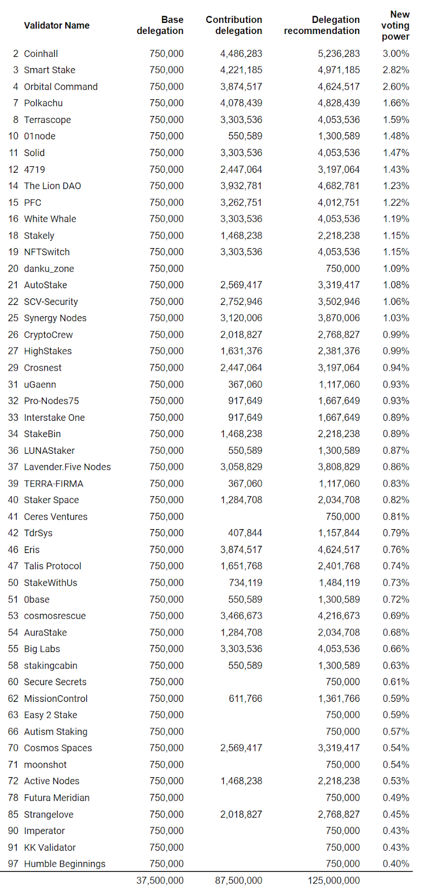

# Terra Delegation Committee - Phase 1 Recommendation

- **Thread ID:** 14807
- **Author:** MB aejir (`terra10ql0yxam88pg0a02946pzv36a3w699shl9r3mc`)
- **Created:** 2024-01-08T15:59:07.496Z
- **Last edited:** 2024-01-14T05:41:43.827Z
- **Stage:** discussion
- **Views:** 922
- **Reactions:** 2
- **Comments:** 3
- **Source:** https://common.xyz/terra/discussion/14807-terra-delegation-committee-phase-1-recommendation

---

**Introduction**

The community voted overwhelmingly in support of TFL’s recent community grant proposal. [https://commonwealth.im/terra/discussion/13682-tfl-community-grant](https://commonwealth.im/terra/discussion/13682-tfl-community-grant)
TFL appointed 11 community members to a newly formed Terra Delegation Committee in early December 2023. 

**Delegation Committee’s Directive from TFL **
Provide recommendations to distribute TFL's 125M LUNA received from the Terra Community Grant based on established guidelines. Deliver the first delegation recommendation by mid Jan 2024

**TFL's Objective **
To incentivise active participation in the Terra network by validators that provide services for the ecosystem. CEO Chris Amani: "We wanted to be sure we can direct stake to value add services, but the community is capable of doing that. We [will] create a community committee to direct the delegation of our stake." (see Grant proposal)

**Delegation Committee’s Objective**
The committee voted in favor of the following objective:

Develop a comprehensive framework and guidelines for TFL on how the 125M LUNA can be distributed amongst qualifying validators, optimizing to attract and retain those value-adding validators making significant contributions to the growth of the Terra Ecosystem and Terra’s success.

**The committee will prioritize:**
1. Existing validators who make significant value-added contributions to the Terra ecosystem in areas including: tooling, infrastructure, dev support, ecosystem development, and education
2. Validators established by existing dApps on Terra in need of runway support
3. New validators from dApps building on Terra, as well as new validators who intend to make significant value-added contributions to the Terra ecosystem

**Overview**

**The delegation committee’s role will be to:**
- Develop the guidelines for participation in the delegation program
- Monitor the performance of existing validators receiving delegations under this program
- Review applications from new validators wishing to be part of Terra’s active set
- Provide TFL with recommendations on delegations under this program
- Ensure that the primary objective of the program is maintained in all committee decisions

For transparency, committee discussions are available to read in the Delegation Committee channel on the Terra discord and meetings can be listened to in the voice channel.

Validators will be assessed on whether they fulfil the committee’s Objectives and contribute a significant value-adding service to the Terra ecosystem. Validators wishing to be assessed also need to meet and maintain minimum Criteria established by the committee. 

The delegation program aims to include as many validators as possible who meet its Objectives and Criteria. While the Criteria are important for program eligibility, and all validators are encouraged to meet these, validators will not automatically receive a delegation by fulfilling these. 

**Program Execution**

During the first 6 months of this program, the committee plans to make delegation recommendations in 2 Phases. (Further delegation phases will continue on a regular basis beyond this).

**Phase 1** is the committee’s initial LUNA delegation recommendation required by TFL per their timeline, in early January. The committee has been working under a very tight schedule through December-January to meet this deadline.  

**Phase 2 **is the creation of a more comprehensive delegation program framework and set of guidelines to support validator participation and committee recommendations. The committee will be providing clear communications to all interested parties on the requirements for applying for, receiving and retaining delegations. Work on phase 2 will begin immediately after phase 1.

**Phase 1 Summary**

Identify validators that meet the committee’s Objectives and Criteria and provide a recommendation on the distribution of 125m LUNA between these validators. 

- A notification was posted in the Terra Validators discord on 18th Dec for applications. 
- A further notification was posted on twitter prior to the closing of this first phase round of applications. 
- A total of 93 applications were received. 
- Of these, 45 current validators fulfilled the minimum Criteria and were considered eligible for a base delegation. 
- 8 new validators also applied for assessment.
- Committee members voted anonymously for each of the applicants to establish the significance of their contribution to the ecosystem (abstaining on their affiliated validators). 
- A ranking system of 0-3 was used, with 0 not being a significant contribution and 3 being a very significant contribution. 
- A formula for base and contributor delegations was then voted on.

**Criteria**
Minimum Criteria were discussed at length, with various other delegation programs used as guides. The result was finalized by vote on 4th January. It was decided that for eligibility in Phase 1, all validators must:

- Have commission between 5-10%, excluding any that had 0% commission in the last 6 months
- Have voting power <4%
- Have uptime >95% in last 90 days
- Have not been jailed or slashed in the last 90 days
- Have participated in 5/10 of the last government proposals
- Not be a CEX or custodial validator

It was agreed that all validators who meet the above criteria will receive a base delegation, and validators who provide over-and-above services will receive an allocation on top. New validators would also be considered.

**Distribution**
The committee’s recommendations for the distribution of TFL’s stake are below.

- This distribution results in an increased Nakamoto Coefficient for Terra, moving from 17 currently to 18 post-distribution.
- 5 new validators have qualified to enter the active set in this first phase. 
- The delegations of Phase 1 are not fixed and we expect there will be substantial changes made in Phase 2. 
 

**Phase 2 **

Guidelines to support validator participation in Phase 2 of this delegation program will be made available in coming months. The committee’s work on phase 2 will begin immediately after Phase 1.

While there may be adjustments to the Criteria in Phase 2, validators planning to apply for Phase 2 are encouraged to meet the minimum Criteria of Phase 1.

**Members of the 1st Delegation Committee**

pmp 						TFM (tfm.com)
Joseph					Coinhall.org + validator (Coinhall)
Luc 							Orne.io
MB Aejir 					Validator (Orbital Command) + GrowthDAO
4719 						Validator (4719)
Vini 							Validator (SCV Security)
PFC 						Validator (PFC) + Backbone Labs
RyanLion 				LionDAO + validator (The Lion Dao)
Philipp 					Eris + validator operations (The Lion Dao)
Rose 						Community moderator + validator (Cosmosrescue)
Something Else		Community moderator

**Limitations: **

- As the first committee nominated under this delegation program, there has been a learning process as the committee better understood and refined its approach
- The differing views of all committee members needed to be considered in reaching decisions 
- There has been a very short time frame allowed within which to complete the first phase of delegations
- All members have full time commitments and responsibilities in addition to the work they have been asked to do on the delegation committee
- There were also time constraints on the committee as it worked around the traditional end of year holiday period

---

## Comments (3)

**mc_ust (`terra1t3xp8c9nvvqu6e5kc63qztmk8v2xlvmuwnwdjv`)** — 2024-01-09T08:22:45.956Z (edited 2024-01-14T00:18:18.550Z) — 👍 1

I’d like to extend my thanks to the Delegation Committee for putting together the recommendation.

I know this wasn’t an easy process, and I would like to convey my deepest thanks to everyone especially to those who worked over the holidays to get this over the line.

Following the committee’s recommendations, TFL will proceed to delegate to these validators on 14 Jan 2024. 

For the new validators entering the set, please kindly share their Terra operator address. 

Thank you.

> **Qasim Saleem Qureshi (`cosmos17de5rquzac94s6xjn5pfcylsw8uwsp8syq2c3r`)** — 2024-01-14T12:46:47.831Z
> 
> Today is 14 Jan 2024
> Waiting for TFL to proceed with delegation

**mc_ust (`terra1t3xp8c9nvvqu6e5kc63qztmk8v2xlvmuwnwdjv`)** — 2024-01-14T19:46:06.966Z

The delegation based on the committee’s recommendation for Phase 1 is now complete. 
Thank you.

