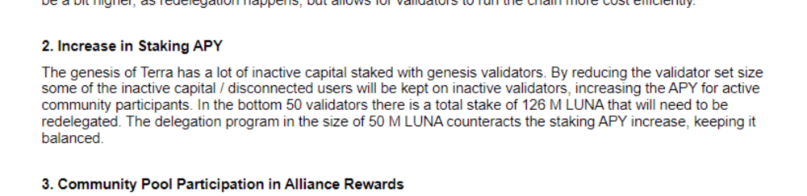
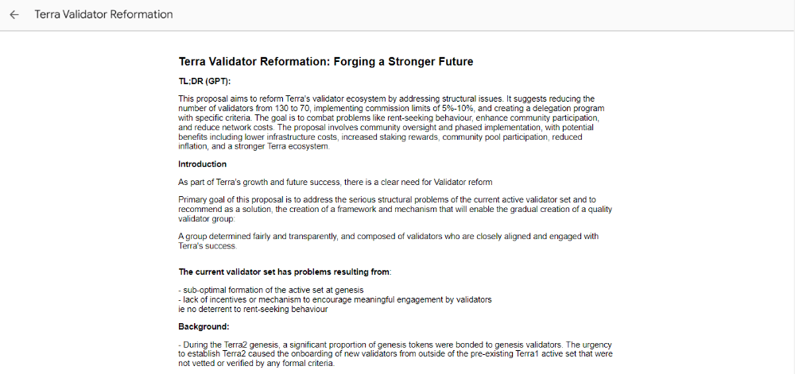
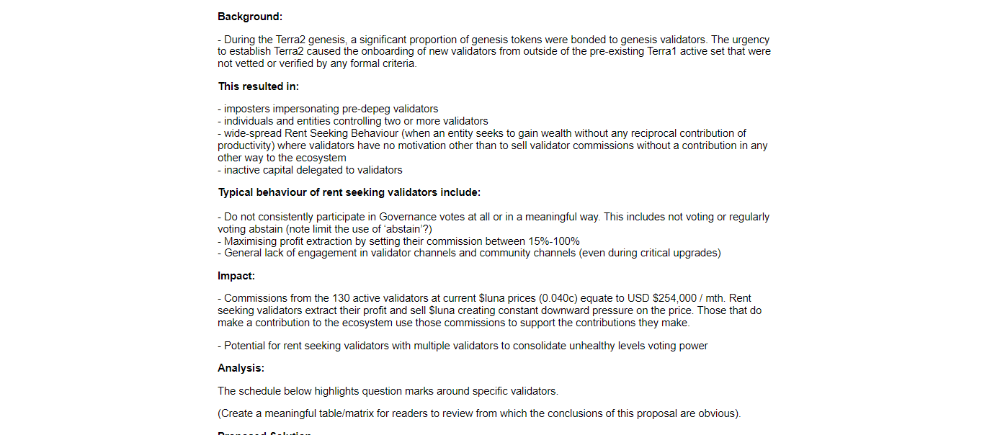
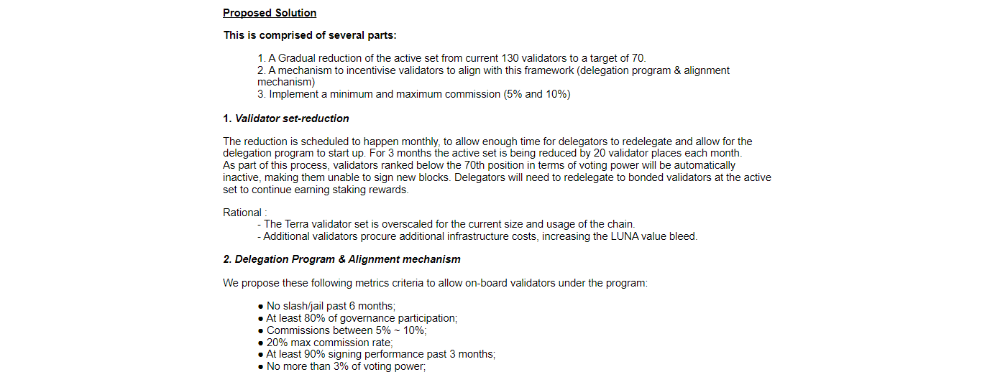
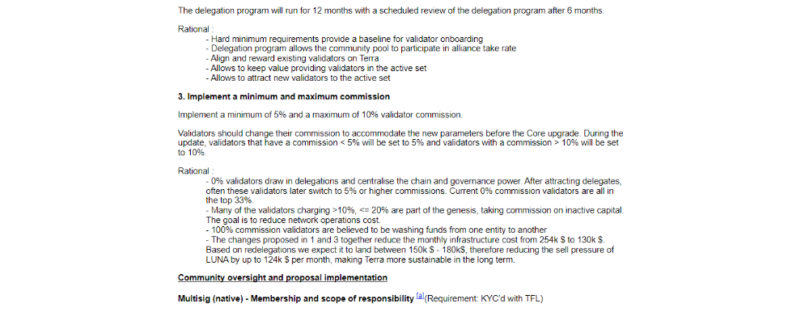
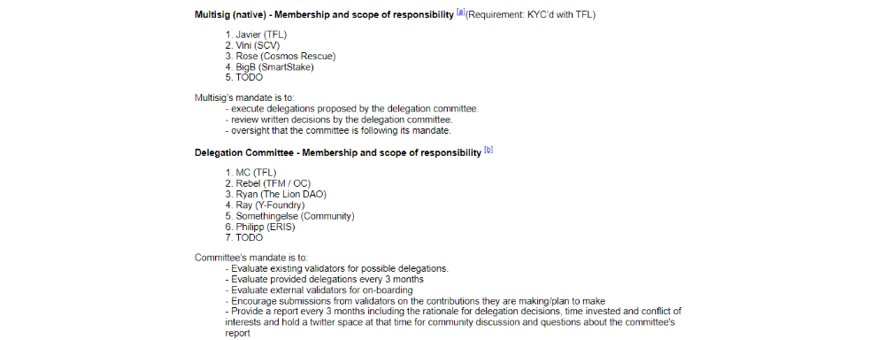
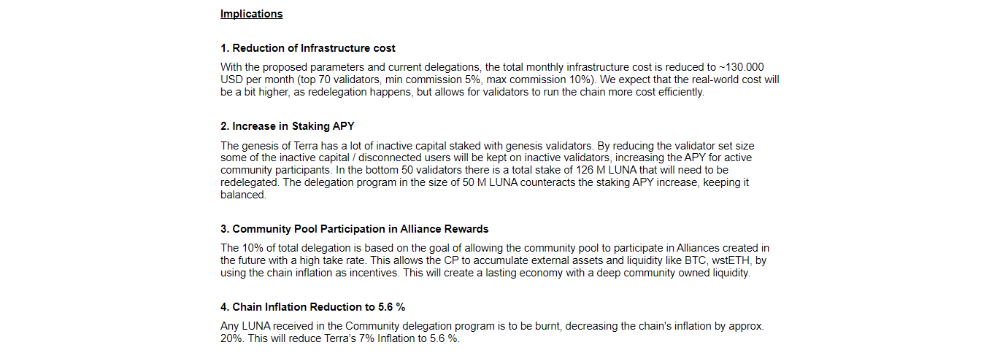
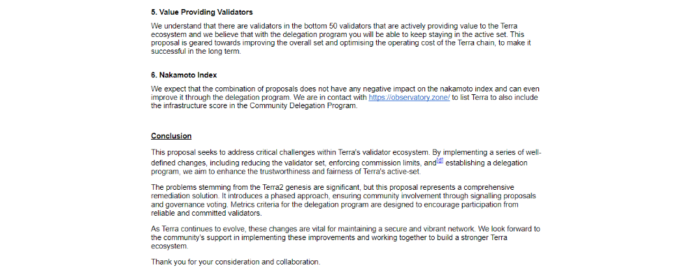
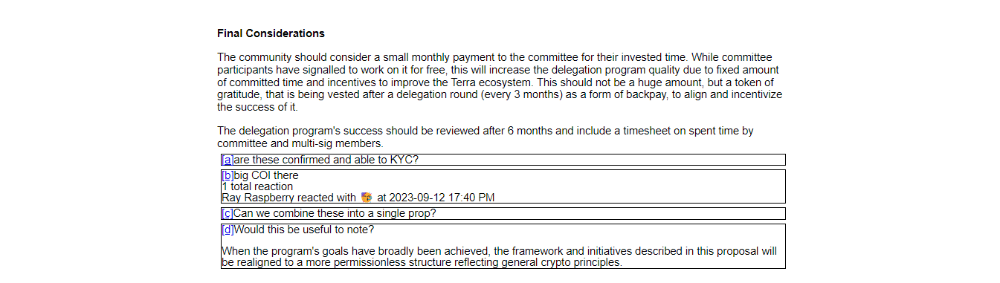
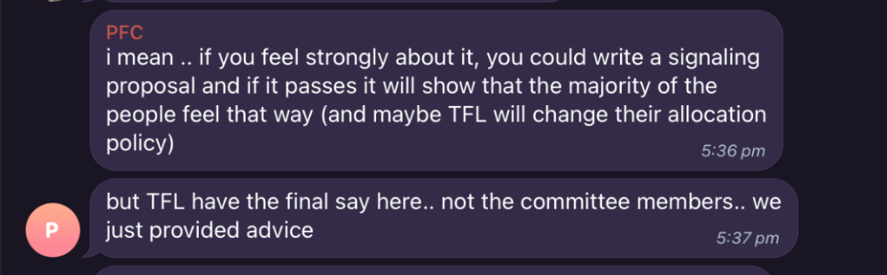

# TFL Delegation: Equal Amount Delegation for Fairness

- **Thread ID:** 14832
- **Author:** ExposingNepotism (`terra1leps96y5hmq37c0rdz0g8v4snnadn66nkh5jza`)
- **Created:** 2024-01-11T04:58:35.524Z
- **Last edited:** -
- **Stage:** discussion
- **Views:** 479
- **Reactions:** 2
- **Comments:** 55
- **Source:** https://common.xyz/terra/discussion/14832-tfl-delegation-equal-amount-delegation-for-fairness

---

**Summary:**

TFL plans to concentrate their 125M LUNA funded from the CP to delegate on a shortlist of validators is currently under consideration. However, a noteworthy concern has surfaced regarding potential conflicts of interest within the committee. Validators who sit on the delegation committee have the ability to shape and narrow the criteria for delegation, potentially leading to the delegation of significant amounts to themselves. This inherent conflict adds a layer of complexity to the governance structure, which poses risks of further centralization, manipulation and potential favoritism, prompting a critical reassessment of the delegation process. In response, there is a need to address fairness, transparency, and the mitigation of conflicts of interest within the Terra validator community. This proposal suggests that TFL allocates 100 million LUNA equally among all validators, with an additional 25 million LUNA reserved for new validators and those with contributions. This approach advocates for more transparency, fairness, and a more inclusive governance structure compared to the proposed shortlist of validators.

**Objective:**

The primary goal of this proposal is to enhance fairness, mitigate potential conflicts of interest, and simultaneously increase the balance of the voting power of all validators within the Terra ecosystem. By introducing an equal delegation system, the aim is to ensure equitable treatment of all validators, fostering transparency and preventing undue concentration of influence.

**Key Principles:**

**Equal Opportunity:** This proposal advocates for equal opportunity among all active validators to receive delegations, regardless of their size, affiliations, or contributions. Adopting an equal delegation system ensures that every validator, irrespective of their scale, has an equal chance of receiving delegations, aligning with the core principle of fairness.

**Conflict Avoidance:** Committee members with a direct interest in delegation outcomes should voluntarily recuse themselves from decisions related to their own allocations, minimizing the impact of individual biases. The equal delegation system inherently reduces the potential for conflicts of interest.

**Balance in Voting Power:** An equal distribution of delegations directly contributes to a more balanced voting power among validators. Smaller validators, often crucial for decentralization, gain increased influence, promoting a more democratic and inclusive governance structure.

**Implementation:**

**Equal Distribution:** Allocate a total of 100 million LUNA equally among all eligible validators, ensuring an unbiased and uniform distribution based on equal delegation.

**Reserved Allocation**: Reserve 25 million LUNA for new validators and existing validators who have demonstrated significant contributions to the Terra ecosystem. This reserved allocation is aimed at encouraging and supporting those actively contributing to the network's growth.

**Problems of the Original Proposal:**
**[[https://commonwealth.im/terra/discussion/14807-terra-delegation-committee-phase-1-recommendation]](https://commonwealth.im/terra/discussion/14807-terra-delegation-committee-phase-1-recommendation])**

The original proposal, with its short-listing of 45 validators, raises significant concerns regarding the potential for manipulation of criteria by committee members. This approach introduces inherent risks of subjectivity, bias, and undue influence in the selection process, as committee members may have the authority to shape or interpret the criteria to favor certain validators.

**Subjectivity and Lack of Objectivity: **The short-listing of validators creates a scenario where committee members might exercise subjective judgment in evaluating and selecting validators. This lack of clear, objective criteria increases the likelihood of personal biases influencing the selection process, compromising the objectivity that is crucial for fair governance.

**Risk of Favoritism:** The limited number of short-listed validators could inadvertently lead to favoritism, as committee members might be inclined to prioritize validators they are familiar with or those aligned with their interests. This potential favoritism undermines the principles of impartiality and equal opportunity within the delegation process.

**Potential for Criteria Manipulation: **The selection of a specific number of validators opens the door for committee members to manipulate the criteria to fit predetermined outcomes. This manipulation could favor validators aligned with certain interests, reducing the overall fairness and transparency of the delegation process.

**Exclusion of Worthy Participants: **A fixed short-listing may inadvertently exclude validators who may have valuable contributions but do not fit within the predetermined number. This exclusionary approach could hinder the inclusion of diverse perspectives and valuable expertise within the Terra ecosystem.

**Impact on Network Decentralization:** The subjective short-listing approach may inadvertently concentrate influence among a select group, potentially compromising the decentralized nature of the Terra network. A more open and objective process is crucial for maintaining a robust and resilient decentralized governance structure.

**Community Distrust: **The short-listing of validators may result in a perception of favoritism or opacity within the community. This can lead to a breakdown of trust in the governance process and diminish community confidence in the decisions made by the committee.

In summary, the short-listing of 45 validators introduces multiple risks that can undermine the integrity of the delegation process. A more transparent, objective, and inclusive approach is crucial to ensure that the governance decisions align with the principles of fairness, equality, and the broader interests of the Terra community. The equal delegation proposal, by contrast, provides a systematic and impartial approach that avoids these pitfalls, fostering a more robust and trustworthy governance structure.

---

## Comments (55)

**Sidel (`terra10yj0dynv0lq8shtxu5k6wf7rh7jzn8yazykgaw`)** — 2024-01-11T05:32:13.569Z (edited 2024-01-11T05:33:21.139Z)

the exclusion of community input either from validators or stakers in forming this committee is a direct breach of trust and in my opinion undermines the principles that should govern this blockchain. the whole strength of blockchain lies in its community, and sidelining this community sets a precedent that is disturbing....paving the way for centralized decision making.

its also alarming that the committee is full of individuals who advocated for halving the validator set. this raises  questions about the intentions and bias in who they decide get to have delegations. the proposal for cutting the validator list in half, which we know could compromise security and decentralization, casts a shadow on the legitimacy and motivations behind the current delegation strategy.

there seem to be indications that this committee may use the delegations to strategically knock certain validators, particularly those with dead wallets, from the active set. this is not just a tactical play on network yields but it is a manipulative tactic that erodes fairness and equity. it represents a blatant attempt to reshape the networks validator landscape under the guise of efficiency, disregarding the broader implications on network health and validator diversity.

i support this porposal

> **Rebel Defi (`terra17w74x9vrqq4a338ssh9y9r4m9s3f6zef7wy5ms`)** — 2024-01-12T02:16:33.198Z
> 
> Wish you'd put this much effort into providing a value add service to Terra LUNA. If you had, you surely have got a delegation.
> 
> But no. Provide no value, and expect free money!
> 
> What validator(s) do you run? Why do you think they deserve a delegation if you provide nothing other than validation?

> > **Sidel (`terra10yj0dynv0lq8shtxu5k6wf7rh7jzn8yazykgaw`)** — 2024-01-12T07:01:33.723Z
> > 
> > We aren't talking about me. 
> > 
> > We are talking about what and who gets to decide what are value-add services. And if every validator thats getting a delegaition adds value other than validating. Because fact is, you are delegating Luna to people who don't value-add as long as they meet your min/max commission and signing requirements. 
> > 
> > You're indirectly implementing a min/max commission without governance and forcing people to do it under threat of being kicked out of the active set from not receiving delegations from TFL.
> > 
> > You know exactly what is happening. Yet you sit there and support it. I'll remember you.

> > > **Rebel Defi (`terra17w74x9vrqq4a338ssh9y9r4m9s3f6zef7wy5ms`)** — 2024-01-12T07:56:48.105Z
> > > 
> > > That's like your opine, man.

**Anonymous (`terra1sa5ah0pl5ukm96n2xxznvt7fx989hfqhxq9ye6`)** — 2024-01-11T05:33:37.122Z (edited 2024-01-11T12:48:30.409Z) — 👍 4

Let us expose some untruths made here:

_**TFL plans to concentrate their 125M LUNA funded from the CP**_
If you had been following the process on the Terra Discord server, you would understand that it was the committee, not Terraform Labs (TFL), that made the decision.

_**Calls for transparency**_
The entire procedure is recorded on the Terra Discord server. Every dialogue, vote, and interaction with the committee is made public there. What additional transparency requirements do you have?

_**This proposal suggests that TFL allocates 100 million LUNA equally among all validators, with an additional 25 million LUNA reserved for new validators and those with contributions.**_
An even distribution isn't fairness; it's akin to socialism. And history shows that socialism hasn't been particularly successful. Why ought validators who have tangibly contributed more to the ecosystem (like participating in proposal votes, ensuring consistent uptime, and providing extra services) be awarded the same level of delegation as those who have been inactive or even fallen short of standard expectations (for example, not being jailed, keeping commission rates reasonable)?

_**Exclusion of Worthy Participants**_
Can you identify any deserving participant who has been overlooked? Providing specific examples would make your argument more persuasive than a general claim without evidence.

_**The subjective short-listing approach may inadvertently concentrate influence among a select group, potentially compromising the decentralized nature of the Terra network. **_
On the contrary, the nakomoto coefficient is set to increase as a result of this program

----
It appears that virtually all validators who meet the clearly defined, objective criteria have been awarded delegations through this program. Those advocating for a different approach are likely to be sycophants, primarily interested in extracting value from the ecosystem.

> **Sidel (`terra10yj0dynv0lq8shtxu5k6wf7rh7jzn8yazykgaw`)** — 2024-01-11T05:48:14.667Z (edited 2024-01-11T07:34:11.455Z)
> 
> > Can you identify any deserving participant who has been overlooked? Providing specific examples would make your argument more persuasive than a general claim without evidence.
> Every validator in the active set.
> 
> Unless your goal is to change the validator landscape? If thats the case then own it.
> 
> > An even distribution isn't fairness; it's akin to socialism. And history shows that socialism hasn't been particularly successful. Why ought validators who have tangibly contributed more to the ecosystem (like participating in proposal votes, ensuring consistent uptime, and providing extra services) be awarded the same level of delegation as those who have been inactive or even fallen short of standard expectations (for example, not being jailed, keeping commission rates reasonable)?
> So people who run at higher than 10% commission aren't worthy? Says who? Sounds like you're trying to implement a min/max commission without governance. Either get with the program or lose out on massive delegations which will eventually push you out of the active set.
> 
> This entire fiasco is just a way for TFL to take control of the validator set by pushing out certain validators they don't want having dead wallets etc. I can already hear the complaints about lower yield and how we should get rid of people who got delegated whale wallets at genesis and how we should push them out of the active set after this to increase rewards. Meanwhile TFL will suck a bunch of rewards in their wallets. Who gets those delegations? Let me guess, whoever meets your requirements. Eventually pushing out people who don't get with the program.
> 
> The proposal that was put up by Phillip shows exactly what they wanted to do. 
> 
> Everyone can read that here: [https://imgur.com/a/1souaT8](https://imgur.com/a/1souaT8)

**Rebel Defi (`terra17w74x9vrqq4a338ssh9y9r4m9s3f6zef7wy5ms`)** — 2024-01-11T06:31:00.449Z (edited 2024-01-11T07:27:43.264Z) — 👍 2

> This proposal advocates for equal opportunity among all active validators to receive delegations, regardless of their size, affiliations, or contributions.

This reads like: reward validators for validating. They may have contributed no value add services over the last 18 months, but they are entitled!

I think 18 months is enough time for validators to show that they want to contribute something more than just signing blocks.

[@Chris Amani](/profile/id/125848) stated:
> We wanted to be sure we can direct stake to value add services
[https://commonwealth.im/terra/discussion/13682-tfl-community-grant](https://commonwealth.im/terra/discussion/13682-tfl-community-grant)

The aim is to support validators who provide **value add services. **Signing blocks is not a value add service, that's a minimum requirement to be a validator.

If you provide legit value add services, and you have been overlooked, that is one thing. But if you just want a delegation because _it's not fair_, that's something else.

> **Sidel (`terra10yj0dynv0lq8shtxu5k6wf7rh7jzn8yazykgaw`)** — 2024-01-11T06:42:05.861Z (edited 2024-01-11T07:03:14.560Z) — 👍 1
> 
> **This reads like: reward validators for validating. They may have contributed no value add services over the last 18 months, but they are entitled!**
> **I think 18 months is enough time for validators to show that they want to contribute something more than just signing blocks.**
> 
> Interesting, so every validator that is getting a delegation has contributed a value-add service other than validating? Please tell us which validators these are and the value-added? Who gets to decide what is considered the baseline amount of "contribution" in order to obtain delegations then? Value is subjective. Do you think validators should run their validator for free or break even? Where do they get money then to build projects other than begging for it on proposals? What about those not in the active set that are getting brought in? I'm guessing you equally weighted someone who just validates but hasn't built something vs someone who has built something but hasn't validated? Who decides which contribution is more important or valuable than validating in and of itself? Why do you think that running a validator by itself is not good enough to be allowed into the active set?
> 
> **The aim is to support validators who provide value add services. Signing blocks is not a value add service, that's a minimum requirement to be a validator.**
> 
> but validating is a service and it has value none the less. just because certain validators aren't dev's or have dev teams doesn't mean they don't deserve to be in the active set and should get pushed out by TFL and the small group of cronies they prop up.
> 
> Again, sounds like this is nothing but a take over from a small group of validators and TFL

> > **Rebel Defi (`terra17w74x9vrqq4a338ssh9y9r4m9s3f6zef7wy5ms`)** — 2024-01-11T12:48:03.613Z (edited 2024-01-11T13:36:40.502Z) — 👍 1
> > 
> > I'm not on the committee. I am a community member (also part of Orbital Command) and been involved with the community since Terra 1 days. It's interesting you've suddenly started to get involved. Who are you and what validator(s) do you represent.
> > 
> > You don't have to validate the Terra LUNA network. This is TFL's LUNA to do with as they please. Majority of validators voted YES to award them a 150M LUNA grant! Presumably you voted YES too. Unless your validator doesn't bother to vote.
> > 
> > Chris Amani stated:
> > 
> > > We wanted to be sure we can direct stake to value add services
> > 
> > What value add services does your validator provide?

> > > **Sidel (`terra10yj0dynv0lq8shtxu5k6wf7rh7jzn8yazykgaw`)** — 2024-01-11T14:40:29.434Z
> > > 
> > > it's the communities luna that it granted to Terra to build. Not to cut up the validator set in order to try to artificially increase value by manipulating validator rewards and cutting out the ones who don't get in line

> > > **Sidel (`terra10yj0dynv0lq8shtxu5k6wf7rh7jzn8yazykgaw`)** — 2024-01-11T14:41:53.394Z
> > > 
> > > What value-add services does every validator thats getting delegations provide? I want detailed reports. Otherwise it's working off the good-ole-boy system or random subjective data or none at all.

> **Sidel (`terra10yj0dynv0lq8shtxu5k6wf7rh7jzn8yazykgaw`)** — 2024-01-11T14:43:17.081Z
> 
> you're completely ignoring everything I've posted in this about with documentation showing what you guys are actually trying to do.

> > **Rebel Defi (`terra17w74x9vrqq4a338ssh9y9r4m9s3f6zef7wy5ms`)** — 2024-01-12T02:13:39.816Z
> > 
> > I'm not on the committee. What validator do you represent and what is your contribution to Terra LUNA network?

**CosmoStake (`terra1cn632uud65sk0csh00uygdj2llyppcl66ym7w7`)** — 2024-01-11T06:51:31.407Z (edited 2024-01-11T06:55:48.722Z) — 👍 2

I'm inclined to agree with the OP, and other comments here, that the formation of the committee and the selection process for qualifying validators has been rushed, lacks transparency and contains significant conflicts of interest.

Chosen criteria were not communicated with adequate notice to give time for validators to adapt their operations, and the explanation given is the timeframe that TFL imposed on the committee for first round delegation recommendations, which lends to the appearance of TFL controlling the process, through the committee, from behind the scenes.

Why should it be acceptable for validators above a 10% commission level to be able to reduce their commission immediately to qualify, but 0% validators must increase their commission and wait 6 months to qualify? That seems like an arbitrary and unfair stipulation.

The issue of conflicts of interest are valid and not just limited to validator operators on the committee being involved in the selection and recommendation of their own validators to receive delegations, but also that some of those validators have TFL staff members/associates involved in their operation.

If the intention really is to make this a truly transparent and "arms-length" process, then in my opinion a different committee should be formed consisting of independent community members, for the purposes of establishing eligibility criteria, application process, and recommended delegation amounts. That new committee should contain no validator operators or TFL staff members/associates in its make-up.

> **Sidel (`terra10yj0dynv0lq8shtxu5k6wf7rh7jzn8yazykgaw`)** — 2024-01-11T07:01:27.337Z (edited 2024-01-11T07:30:02.678Z) — 👍 1
> 
> **Why should it be acceptable for validators above a 10% commission level to be able to reduce their commission immediately to qualify, but 0% validators must increase their commission and wait 6 months to qualify? That seems like an arbitrary and unfair stipulation.**
> 
> The bigger question is why are they trying to indirectly set a min/max commission without governance at all?
> 
> Oh i know why, because it couldn't pass governance the first two times

> > **Rebel Defi (`terra17w74x9vrqq4a338ssh9y9r4m9s3f6zef7wy5ms`)** — 2024-01-12T07:54:47.278Z
> > 
> > This is something to discuss with the committee. I'd agree these are valid questions.
> > 
> > Personally 0% commission already has an oversized stake, therefore I think some "cool down" period is reasonable.
> > 
> > Should there be a max commission? Should there be a "cool down" period on validators above the chosen max?
> > 
> > Should TFL delegate to 100% commission validators?

> > > **Sidel (`terra10yj0dynv0lq8shtxu5k6wf7rh7jzn8yazykgaw`)** — 2024-01-13T00:05:21.805Z
> > > 
> > > No not 100% but TFL set the max commission for GENESIS stake at 0% to 20% people who run at 20% should not be punished or left out because they used the max commission that was given to them at the start.

> > > > **Rebel Defi (`terra17w74x9vrqq4a338ssh9y9r4m9s3f6zef7wy5ms`)** — 2024-01-13T02:20:11.314Z
> > > > 
> > > > Disagree with 0% without some kind of cool down period, for the point mentioned above.
> > > > 
> > > > I have no issue with 20% if that was part of the genesis criteria, provided validators offer some kind of ecosystem value add. It's you're right to run at 20%. It's TFL's right to decide to delegate to "value add" validators.
> > > > 
> > > > Do you run nodes on other appchains? If so, do you run at 20%? If you run at lower commission on other chains? Why is it right to run at 20% on Terra only?

> > > > > **Sidel (`terra10yj0dynv0lq8shtxu5k6wf7rh7jzn8yazykgaw`)** — 2024-01-13T03:23:31.095Z (edited 2024-01-13T03:23:44.720Z)
> > > > > 
> > > > > there was no stipulation that said "validators must add value if they intend to run at 20%" you're wrong.
> > > > > 
> > > > > If TFL wants to implement a minimum and maximum commission they can do it through governance. stop acting like you aren't trying to force every validator to a min/max commission through these delegations.

**ExposingNepotism (`terra1leps96y5hmq37c0rdz0g8v4snnadn66nkh5jza`)** — 2024-01-11T07:01:39.430Z (edited 2024-01-11T07:02:35.734Z) — 👍 1

Fact: **125M LUNA will dramatically reduce staking rewards across the board for all validators (especially validators who will not receive delegation from the TFL pool)**

**How many validators excluded from the shortlist would have voted Yes to releasing 150M LUNA from the CP to TFL for them to push out smaller validators and increasing centralization of stakes on friends and entities related to TFL?**

There are small validators who have been signing blocks since the collapse of Luna with minimal revenue. **They are at risk of being pushed out of the active set by the committee delegating to "new validators" who are entirely opaque and unknown to the community.**

Big middle finger to the small validators being pushed out who have stuck around in the last 1.5 years.

The same group of people pushing to concentrate stake are the same group of people proposing to halve the active validator set.

**Sidel (`terra10yj0dynv0lq8shtxu5k6wf7rh7jzn8yazykgaw`)** — 2024-01-11T07:15:30.492Z (edited 2024-01-11T07:16:13.089Z)

Everyone should read this, because this is what is actually happening. Kind of disturbing that this amount of psychopathy exists.

This is what they are actually implementing, just slightly different.

**thor (`terra1k0hv40k8cc0vtsr62ds0meh6amwjvll5rj3vqj`)** — 2024-01-11T07:17:29.641Z (edited 2024-01-12T02:10:00.614Z) — 👍 1

Why TFL should reward validators that do nothing for the chain?
It is not a blockchain communism here, you get what you deserve. 
Useless validators would disagree of course, everybody likes free money.
Useless validators only appear when their grifting is threatened, that's their main activity "for the chain".

Your idea also means that even Jimmy, who stole from TFL and is selling ~$45k LUNA a month with his Charity Block, deserves a delegation.

> **Sidel (`terra10yj0dynv0lq8shtxu5k6wf7rh7jzn8yazykgaw`)** — 2024-01-11T07:22:13.613Z (edited 2024-01-11T07:25:05.821Z)
> 
> People who run validators are not useless. The very act of signing blocks and maintaining a secure and functioning validator node is not useless and that costs.
> 
> The only communism here is implementing min/max commissions without governance and forcing people through fear of losing their validator to comply.

> **Sidel (`terra10yj0dynv0lq8shtxu5k6wf7rh7jzn8yazykgaw`)** — 2024-01-11T07:28:58.316Z (edited 2024-01-11T07:36:27.824Z)
> 
> and who gets to decide who is useless? I don't remember voting for anyone. Last I checked that Luna for TFL is from the community fund. It should be decided by the community as a whole who gets delegations not who TFL decides.

> > **Rebel Defi (`terra17w74x9vrqq4a338ssh9y9r4m9s3f6zef7wy5ms`)** — 2024-01-12T02:12:49.311Z
> > 
> > Once the community voted to give the LUNA grant to TFL, it is no longer the community's LUNA.

> > > **Anonymous (`terra1hr7svdp2rga9vf3ry95sx7g5wyspgwmg94qac8`)** — 2024-01-12T03:29:08.131Z (edited 2024-01-12T06:56:36.754Z) — 👍 1
> > > 
> > > As you are aware.
> > > 
> > > The community could ask for it back. (they may not get it, but that's another thing)
> > > 
> > > In fact didn't you guys (OC) write a prop just like that to return the money we were going to pay confio (you know.. the group that just fixed that potential chain halting bug), and forced TFL to pay confio themselves?

> > > > **Rebel Defi (`terra17w74x9vrqq4a338ssh9y9r4m9s3f6zef7wy5ms`)** — 2024-01-12T05:49:46.355Z (edited 2024-01-12T05:51:51.173Z)
> > > > 
> > > > The Confio prop that you wrote was abysmal.
> > > > 
> > > > There should have been some kind of SLA. But it seemed to be - just give Confio free money.
> > > > 
> > > > Now TFL have decided to give them free money. But that's their choice.
> > > > 
> > > > We didn't force TFL to do anything. As if Rebel Defi is TFL puppet master. You crack me up :)

> > > **Sidel (`terra10yj0dynv0lq8shtxu5k6wf7rh7jzn8yazykgaw`)** — 2024-01-12T06:53:46.760Z (edited 2024-01-12T06:56:27.756Z)
> > > 
> > > It's a breach of trust and fraudulent when the proposal was voted on for them to use it to build. Not carve up the validator set as they see fit.
> > > 
> > > It was passed under false pretenses.
> > > 
> > > We did not approve the funds to be used to change the validator landscape. Which is what you are doing. That was never part of the agreement. So no, those funds belong to the community IMO because the community didn't vote to give 125m luna for TFL to change up the validator set. If I ask for a grant because I want to build something, but instead I use those funds for other things, its fraudulent. And any court of law will agree with that. You are playing with fire and you're going to get burned eventually.

> > > > **Rebel Defi (`terra17w74x9vrqq4a338ssh9y9r4m9s3f6zef7wy5ms`)** — 2024-01-12T07:47:36.257Z
> > > > 
> > > > The easy way to get a delegation from TFL is to provide value to Terra LUNA network. There are plenty of options.
> > > > 
> > > > Tooling, dapp, education, relayers + infrastructure, community building, etc.
> > > > 
> > > > Once your validator is contributing, apply for delegation in phase 2. Simples.
> > > > 
> > > > If you are a contributing validator and were overlooked, I can empathise with that. But you haven't identified your validator so we have no way of discussing your contribution over the last 18 months.
> > > > 
> > > > If all you want to max extraction, without providing any value, you'll have to cope harder.

> > > > > **Sidel (`terra10yj0dynv0lq8shtxu5k6wf7rh7jzn8yazykgaw`)** — 2024-01-12T18:23:55.158Z
> > > > > 
> > > > > No, because i am not going to run at your min/max commission that your trying ti impliment across the board like you pushed for in that proposal that you guys made.
> > > > > 
> > > > > Put up the min/max commission for governance before the delegations go out. 
> > > > > 
> > > > > Why won't you guys just admit what you're doing?

> > > > > **Sidel (`terra10yj0dynv0lq8shtxu5k6wf7rh7jzn8yazykgaw`)** — 2024-01-12T18:26:41.060Z
> > > > > 
> > > > > wow, so much value-add from running a relayer.
> > > > > 
> > > > > Who decided the dollar value for all of the tooling, dapps, education, relayers + infrastructure, community build etc? Or are they all equal?

> > > > > > **Rebel Defi (`terra17w74x9vrqq4a338ssh9y9r4m9s3f6zef7wy5ms`)** — 2024-01-13T02:14:34.520Z
> > > > > > 
> > > > > > Sounds like you expect a delegation for doing nothing other than validating. Am I right?
> > > > > > 
> > > > > > That's a pretty entitled world view. Share the validator(s) you run and let's have an open discussion.
> > > > > > 
> > > > > > The fact that you're being so coy is an indication that you know full well that you provide no value add to the Terra ecosystem. And now you're upset that you'll get less "free money".

> > > > > > > **Sidel (`terra10yj0dynv0lq8shtxu5k6wf7rh7jzn8yazykgaw`)** — 2024-01-13T03:18:12.952Z
> > > > > > > 
> > > > > > > Because this isn't about me. i don't care if i get a delegation or not.
> > > > > > > 
> > > > > > > What i care about are you guys trying to bypass governance, change the validator set to fit your view of how it should be by coercing people to do so under the veiled threat of being pushed out of the set, not by thousands of people, but by 1 large entity and a small group of validators that think they know better and what is best for everyone else just like every politician who's ever lived.
> > > > > > > 
> > > > > > > Youre doing this under the guise of efficiency and "value" yet there are plenty of people getting delegations who add no value other than validating, the difference is they meet your criteria of how a validator should be run NOW. You're literally bringing in people who didn't even run a validator prior to the vote.
> > > > > > > 
> > > > > > > So those people who voted for the proposal are now being pushed out by the same people they voted to help. It's repulsive. Those validators would never have voted for that if they had known you were going to push them out by adding new validators in and DO NOT say you didn't know that would happen. I watched you guys discuss it in your members only telegram group for terra validators and you can read it in the files posted. 
> > > > > > > 
> > > > > > > It's obvious that TFL and the delegation committee isn't to be trusted and they will bite the hand that feeds them.

> > **Rebel Defi (`terra17w74x9vrqq4a338ssh9y9r4m9s3f6zef7wy5ms`)** — 2024-01-12T07:43:16.531Z
> > 
> > You have no idea what you're talking about. The community decided as a whole to give TFL a grant of 150M LUNA.
> > 
> > Regardless of whether we agree/disagree with this grant, it happened.
> > 
> > Now the LUNA belongs to TFL, not the community.
> > 
> > TFL have entrusted a committee, whom they chose.

> **CosmoStake (`terra1cn632uud65sk0csh00uygdj2llyppcl66ym7w7`)** — 2024-01-11T07:43:39.262Z (edited 2024-01-11T07:56:36.160Z) — 👍 1
> 
> Why is it necessary to use slurs like "useless" and "grifting" to refer to people who exercise their right to launch and operate a validator node in compliance with the stipulations of the LUNA protocol? I think this kind of language is totally unnecessary. 
> 
> Clearly anyone who uses their own funds to set up and operate a validator node is not grifting or useless, and the rewards they receive are a function of their ability to court delegations and the protocol itself.
> 
> If someone has stolen funds as you claim, then they should be pursued through the courts, but that is a totally different and unrelated issue to that of ensuring this TFL delegation process is done in a transparent and arms-length way.

> > **Rebel Defi (`terra17w74x9vrqq4a338ssh9y9r4m9s3f6zef7wy5ms`)** — 2024-01-12T02:12:12.571Z
> > 
> > Of course you're free to set up and run a validator on Terra.
> > 
> > But what makes you think you should receive a delegation from TFL that set up a committee to support "value add validators"?
> > 
> > If you genuinely provide a value add service and were overlooked for phase 1, reach out to the committee, share what you do for the network and I am sure they will take that into consideration for phase 2.

> > > **Sidel (`terra10yj0dynv0lq8shtxu5k6wf7rh7jzn8yazykgaw`)** — 2024-01-12T06:49:41.011Z (edited 2024-01-12T06:49:52.272Z)
> > > 
> > > what value add did all of the validators add that are getting delegations?
> > > 
> > > none of you can say

> > > > **Rebel Defi (`terra17w74x9vrqq4a338ssh9y9r4m9s3f6zef7wy5ms`)** — 2024-01-12T07:41:24.410Z
> > > > 
> > > > Why don't you go and follow the discussion on Terra Discord: [https://discord.com/channels/983359798059892766/1179000806423408640](https://discord.com/channels/983359798059892766/1179000806423408640)

> > > > > **Sidel (`terra10yj0dynv0lq8shtxu5k6wf7rh7jzn8yazykgaw`)** — 2024-01-12T18:21:14.543Z
> > > > > 
> > > > > I have, and i see nothing but lip service to the correct cock and/or ass cheeks as the correct amount of value-add in that list.

> > > **CosmoStake (`terra1cn632uud65sk0csh00uygdj2llyppcl66ym7w7`)** — 2024-01-12T20:51:05.508Z (edited 2024-01-13T00:06:24.618Z) — 👍 1
> > > 
> > > I'm not sure what part of my comment made you think I was interested in receiving a delegation from TFL.
> > > 
> > > Nothing makes me think my validators should receive a delegation from TFL, which is why my team chose not to apply. We prefer to try and gain delegations organically as truly independent validators rather than jumping through the arbitrary hoops set by TFL's committee.
> > > 
> > > However, the issue I have is with the creation of a process that is pretending to be transparent and done arms-length through an independent body, when in fact the committee is neither operating at arms-length nor independent. Conflicts of interest abound and if TFL want to gain control over a large part of the validator set with the stake granted by the community, they don't need to go through this sham to do it.

> > > > **Sidel (`terra10yj0dynv0lq8shtxu5k6wf7rh7jzn8yazykgaw`)** — 2024-01-13T00:09:23.692Z (edited 2024-01-13T06:21:26.938Z) — 👍 1
> > > > 
> > > > it isn't control they want per-se.
> > > > 
> > > > They want to adjust the emissions etc that was set at genesis without going through governance by forcing validators to run at certain commissions and the commissions they do make have to be spent on  building stuff for the blockchain (because buying food and paying for your survival should come second) or else they get kicked out of the active set or not receive massive amounts of stake from TFL now and in perpituity because they will use the rewards going forward to add new validators to the set and kickout others who dont fall in line with the min/max commission and other guidelines etc....all in order to raise the price of Luna

> > > > > **CosmoStake (`terra1cn632uud65sk0csh00uygdj2llyppcl66ym7w7`)** — 2024-01-13T06:16:22.199Z (edited 2024-01-13T18:46:26.010Z) — 👍 1
> > > > > 
> > > > > Well I'm sure validators that receive the TFL stake will understand that unless they tow the TFL line, they will not keep it, especially if the TFL stake is critical to them remaining in the active set. It is a means of coercion to ensure validators meet TFL's definition of a "good validator" and also to ensure validators vote the way TFL wants in governance. Sure sounds like control to me.

> > > > > > **Sidel (`terra10yj0dynv0lq8shtxu5k6wf7rh7jzn8yazykgaw`)** — 2024-01-13T18:46:32.683Z
> > > > > > 
> > > > > > 100% agree

> > > > **Rebel Defi (`terra17w74x9vrqq4a338ssh9y9r4m9s3f6zef7wy5ms`)** — 2024-01-13T02:10:23.897Z (edited 2024-01-13T06:18:37.817Z) — 👍 1
> > > > 
> > > > This is an are where we could find common ground.
> > > > 
> > > > Unfortunately, the time to put procedures in place would have been before we decided, as a community, to award TFL 150M LUNA grant.

**Rebel Defi (`terra17w74x9vrqq4a338ssh9y9r4m9s3f6zef7wy5ms`)** — 2024-01-11T13:07:00.227Z

Why was this proposal put on-chain?

With all due respect, that's stupid.

TFL now owns the LUNA. This is not a Terra community spend proposal.

TFL have accepted the delegation program recommendation. Remember this is just phase 1. Improving the objective criteria for validators to receive a delegation will be an on-going process.

TFL has accepted the committee's recommendations. Chris Amani has stated public support for committee on his Twitter.

> **Sidel (`terra10yj0dynv0lq8shtxu5k6wf7rh7jzn8yazykgaw`)** — 2024-01-11T14:33:12.704Z (edited 2024-01-11T14:35:35.593Z)
> 
> The committee that he chose. so he's congratulating himself? 
> 
> The community should decide where a community grant gets delegated. and the community is now voting on that.

> **Sidel (`terra10yj0dynv0lq8shtxu5k6wf7rh7jzn8yazykgaw`)** — 2024-01-11T14:38:09.016Z
> 
> This wasn't a recommendation, it's the bullshit that you and other validators in the private telegram along with TFL thought up in order to increase your own bags at the expense of the blockchain. You really should be ashamed. Everyone here nows what you're doing.
> 
> You're doing it under color of "it's the right thing to do" when we all know what this actually is and you all are too chicken shit to say it. I'm sure the SEC is watching this and will want chat logs. Luckily a lot of people have them

> > **Rebel Defi (`terra17w74x9vrqq4a338ssh9y9r4m9s3f6zef7wy5ms`)** — 2024-01-12T02:09:47.646Z
> > 
> > What's your validator and what contribution do you make to the Terra LUNA network?

> > > **Sidel (`terra10yj0dynv0lq8shtxu5k6wf7rh7jzn8yazykgaw`)** — 2024-01-12T18:20:06.505Z
> > > 
> > > What contribution does every validator that is getting a delegation make to the Terra Luna Network? this shuts you up.

**Anonymous (`terra1hr7svdp2rga9vf3ry95sx7g5wyspgwmg94qac8`)** — 2024-01-11T22:55:43.251Z

1. I am on the committee.
2. I will not vote directly on this prop, but have place a poll on twitter, and will vote according to the poll

while I do acknowledge it is 100% TFL's decision on what to do with their funds. I do think that TFL will review this poll if it passes and will take the community sentiment into account.

> **Rebel Defi (`terra17w74x9vrqq4a338ssh9y9r4m9s3f6zef7wy5ms`)** — 2024-01-12T02:08:59.360Z
> 
> PFC loses the argument in the committee.
> 
> Cannot accept decision, so takes to social media to undermine the committee.
> 
> Classy.
> 
> 
> 

**Ryan Lion (`terra1ksk66lcvzwaanc47nvn3athj4yzcpay8z8ru04`)** — 2024-01-12T00:35:56.165Z (edited 2024-01-12T16:55:40.751Z) — 👍 2

Hi Capricious Sage

**Sidel (`terra10yj0dynv0lq8shtxu5k6wf7rh7jzn8yazykgaw`)** — 2024-01-13T18:48:58.792Z

Make no mistake, this is a hostile takeover of the validator set and the people on the commitee are letting it happen. Remember their names and do not delegate to them on other chains.

> **thor (`terra1k0hv40k8cc0vtsr62ds0meh6amwjvll5rj3vqj`)** — 2024-01-14T09:08:58.058Z
> 
> I would instead recommend to undelegate from grifter validators that do nothing for the chain.
> Good list would probably be those who voted yes to your nonsense communist prop.

**ExposingNepotism (`terra1leps96y5hmq37c0rdz0g8v4snnadn66nkh5jza`)** — 2024-01-14T11:16:34.572Z (edited 2024-01-14T14:21:07.430Z) — 👍 1

Be wary of those who claim this is a socialism or communist proposal.

Every validator sitting on the committee that decides which validator gets a delegation is set to receive a massive delegation. Those supporting TFL delegation will never be able to explain or justify this massive conflict of interest.

Cosmostation which runs mintscan and Allnodes which runs publicnode serves millions of users around the world but they are set to receive a grand total of ZERO.

Expose this nepotism rot.

Validators who invest a large sum of money themselves to be in the active set should take appropriate actions.

