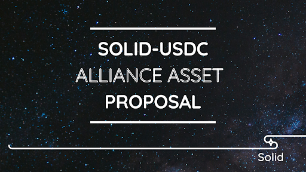
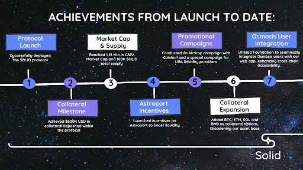
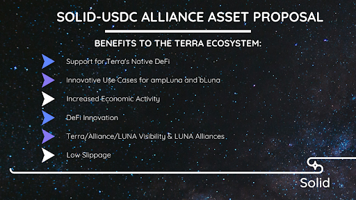

# SOLID LP Alliance Asset Proposal

- **Thread ID:** 15491
- **Author:** Anonymous (`osmo1ze48ss5wwc0udf590gf7hupn9d26krvxs5g3cn`)
- **Created:** 2024-02-28T20:19:56.011Z
- **Last edited:** 2024-03-13T20:47:27.627Z
- **Stage:** discussion
- **Views:** 1478
- **Reactions:** 1
- **Comments:** 7
- **Source:** https://common.xyz/terra/discussion/15491-solid-lp-alliance-asset-proposal

---

# Overview: 
This proposal aims to establish deep stablecoin and Cosmos token liquidity on Terra by whitelisting SOLID-noble USDC Liquidity Pool (LP) tokens from URA as Alliance Assets. 

Check out this [3-minute explainer video](https://www.youtube.com/watch?feature=shared&v=Xoe9hTzKyeo) or read the [Alliance Docs Overview](https://docs.alliance.money/overview/) for a brief overview of how Alliance works.

NOTE: A SOLID-USDC liquidity pool doesn’t yet exist on URA yet.

# What is SOLID and what have they contributed to Terra?
At its core, SOLID is engineered to redefine stability in the DeFi space through its overcollateralized stablecoin, soft-pegged to the US dollar. Our protocol simplifies the generation of SOLID tokens by allowing users to lock in collateral, thereby opening collateralized debt positions (CDPs) in a secure and stable manner. SOLID's innovative use of liquid staking derivatives (LSDs) as collateral introduces a mechanism that not only secures the protocol but also rewards users through auto-compounding features. With a governance system anchored by the CAPA token, SOLID places the power of protocol evolution in the hands of its community, ensuring a decentralized and user-centric pathway forward.

# Achievements from launch to date: 

From the inception of the project to date, SOLID has been fortunate to secure substantial support, initially receiving 24,566.62 Luna from the Emergency Builder Allocation, followed by an additional 113,772 Luna through Grant Proposals.
Leveraging these resources, we've accomplished the following milestones:
- Protocol Launch:
 Successfully deployed the SOLID protocol.
- Collateral Milestone:
 Achieved $500K USD in collateral deposited within the protocol.
- Market Cap & Supply:
 Reached 1,13 Mln in CAPA Market Cap and 100K SOLID total supply.
- Astroport Incentives:
 Launched incentives on Astroport to boost liquidity.
- Promotional Campaigns:
 Conducted an Airdrop campaign with Coinhall and a special campaign for URA liquidity providers.
- Collateral Expansion:
 Added BTC, ETH, SOL and BNB as collateral options, broadening our asset base.
- Osmosis User Integration:
 Utilized Foundation to seamlessly integrate Osmosis users with our web app, enhancing cross-chain accessibility.

And more to come…

# The Proposal: 
The proposal to list the SOLID-USDC LP token as an Alliance asset aims to increase liquidity, enhance users engagement and improve overall utility for SOLID and Terra users, offering direct benefits to the Terra ecosystem. 

Motivating these users to contribute liquidity and stake their LP tokens in exchange for LUNA rewards presents several benefits to the Terra ecosystem:

**Support for Terra's Native DeFi:** By backing one of the few native DeFi protocols on Terra, this initiative encourages transactions and leverages the full spectrum of liquidity introduced to Terra ecosystem.

**Innovative Use Cases for ampLuna and bLuna:** The proposal creates new opportunities for ampLuna and bLuna by enabling users to earn staking rewards and provide liquidity to the SOLID-USDC pool, thereby obtaining Alliance Rewards through leverage farming. This development fosters a dual earning mechanism, enhancing the utility and attractiveness of participating in Terra's ecosystem.

**Increased Economic Activity:** A significant influx from both within the Cosmos network and beyond, enriching the Terra ecosystem with user and financial engagement.

**DeFi Innovation:** Terra ecosystem is set to become an even more attractive environment for developers, thanks to enhanced liquidity for stablecoins laying the groundwork for the creation of innovative DeFi applications.

**Terra/Alliance/LUNA Visibility & LUNA Alliances:** The demonstration of Alliance in this context will elevate the profile of Terra, Alliance & LUNA across the industry, providing a powerful example of how Alliance can be utilized to strengthen decentralized economies and opening the door for future Alliances between LUNA and other chains.

**Low Slippage:** Users within the Terra ecosystem will enjoy the benefit of reduced slippage, ensuring efficient trades regardless of trade size.

These combined benefits underscore a strategic approach to not only enhancing the Terra ecosystem's liquidity and utility but also to promoting its DeFi protocols, fostering innovation and establishing Terra as a leading platform for blockchain partnerships and financial efficiency.

# Alliance Asset Parameters:

### SOLID-USDC:
- Target staked LP value: $5M

- Target APR: (when $5M SOLID-USDC LP tokens are staked): 40% (not including DEX swap fees)

- [Reward Weight:](https://docs.alliance.money/alliance#rewards) 0.065

- [Take Rate:](https://docs.alliance.money/concepts/rewards#takerate) 0%

Target APRs are set to rival USDC-USDT pool on Terra (excluding DEX swap fees), and Reward Weights are set to account for fluctuations in LUNA’s price.
Once the target staked LP value for the Alliance LP asset is hit, all unused LUNA will be returned to native LUNA stakers using the same contract from TFL described in the Alliance Proposal [“Whitelist USDC-USDT & ATOM-LUNA LP Tokens as Alliance Assets”](https://commonwealth.im/terra/discussion/15329-whitelist-usdcusdt-atomluna-lp-tokens-as-alliance-assets).
Reward Weights and Take Rates can be adjusted anytime through a Terra governance proposal. The initial 0% Take Rate is set to maximize the total amount of staked LP tokens, but in the future, as the ecosystem grows, the Terra community may elect to set a non-zero Take Rate, enabling LUNA stakers to earn LP tokens as part of their staking rewards
Similar to allied Liquid Staking Tokens (LSTs) on Terra (e.g., ampWHALE, rSWTH, etc.), allied LP tokens will have a 0-day unstaking period

# Conclusions: 
The SOLID-USDC Alliance Asset Proposal seeks to enhance Terra by significantly boosting liquidity and user engagement through the whitelisting of SOLID-USDC LP tokens from URA as Alliance Assets. It aims to support Terra's native DeFi innovation, unlock new opportunities for ampLuna and bLuna holders and elevate Terra as a leading platform for blockchain partnerships and financial efficiency.

---

## Comments (7)

**Ryan Lion (`terra1ksk66lcvzwaanc47nvn3athj4yzcpay8z8ru04`)** — 2024-03-01T20:51:25.555Z (edited 2024-03-29T09:38:09.929Z) — 👍 2

Hi Guys - in general very supportive of using Alliance to bootstrap liquidity and kick off the fly wheel for a decentralized stablecoin on Terra once again. Have appreciated that you guys have continued building through the bear market and have kept iterating your product by bringing more collateral options to the table to mint SOLID.

Given that the current supply of SOLID is only sat at $100K - it feels like your plan to get to $2.5M (a 25x from here) and have $5M of liquidity, and even at that range have a 40% APR is very ambitious and as such I think the weighting ask at this stage is very high. Having 40% APR on a stablecoin pool in itself is very high yield and leads to the risk of significant sell pressure on LUNA from mercenary capital.

I would suggest that the initial ask is halved and that if successful you return to governance to add additional Alliance weighting in in the future. Even with a halved APR you would have 20% APR in incentives on staking the pool + swap fees at your target liquidity level.

Wishing you every success the the proposal.

Ryan

**0xPhilipp (`cosmos142v8lp8m8fgj3zegg9mzsq9k5n2z2r06cn04h5`)** — 2024-03-01T21:32:13.255Z (edited 2024-03-02T04:33:54.323Z) — 👍 2

Hey,

as a CAPA holder I want to support this proposal, but in the current form I can't.

## 1. Liquidity and incentive ask is too high

Alliance asset parameters can be adjusted on demand and right now the liquidity on Astroport is 160 k$, and the proposal is asking for a goal liquidity of 5 M$, while asking to spend a yearly value of 3.5 M $ in incentives. (20 times the current liquidity, or just like 1x of the FDV of CAPA per year)

**For me a goal liquidity of 1 M$ makes more sense, so that Capapult can prove adoption and growth from it. The target of 40% APR is also too high, as we can see 20-26% is already accepted by LPs on Astroport.**

## 2. SOLID depeg

Over the last 3 months SOLID was consistently depegged from the 1 $ value and there seems to be no demand for it to reach 1 $ again. When looking at the current liquidity pool there is 110k SOLID matched with just 48k USDC

**Provide a plan on how to repeg SOLID and provide use cases / utility for it.**

## 3. Take rate

For incentivizing LP positions a take rate is essential for building a lasting economy. Reward without a take rate makes LUNA a farming coin. Liquidity will only be mercenary, and when LUNA dries up or price goes down, there will be nothing left in the ecosystem. More details about why this is required is described here:  

https://commonwealth.im/terra/discussion/11300-unleashing-the-power-of-alliance-a-framework-for-economic-growth

**A take rate of minimum 5 % should be used.**

## Conclusion

For the SOLID-USDC pair, the following settings should be used, so that Solid can prove adoption and bring more utility around SOLID:
20% APR, goal 1 M$ liquidity
- Reward Rate: 0.0037
- Take Rate 5 % yearly (Parameter value 4.879e-7)

This will come out to around 15% due to the take rate, or a bit lower liquidity goal, but without utility except "sell SOLID for USDC" it is too much anyways.

**Asking for 6% of Terra inflation (3.5 M$ per year) at the current point of the Solid project is just insanity for me.**

https://estimator.alliance.money/?importData=eyJhbGxpYW5jZUFzc2V0cyI6eyIxNjk5NjMxOTQyNzg5Ijp7Im5hbWUiOiJBbGxpYW5jZSBORlQiLCJpbnB1dFZhbHVlcyI6eyJsc2RBbm51YWxFc3RpbWF0ZSI6IjAiLCJhc3NldFByaWNlIjoiMTAwIiwiYWxsaWFuY2VSZXdhcmRXZWlnaHQiOiIuMDA4IiwiYW5udWFsaXplZFRha2VSYXRlIjoiMCIsImFzc2V0U3Rha2VkSW5BbGxpYW5jZSI6IjEwMDAwIn19LCIxNzA3NTM3ODcxODUyIjp7Im5hbWUiOiJBbGxpYW5jZSBDaGFpbnMiLCJpbnB1dFZhbHVlcyI6eyJsc2RBbm51YWxFc3RpbWF0ZSI6IjAiLCJhc3NldFByaWNlIjoiMCIsImFsbGlhbmNlUmV3YXJkV2VpZ2h0IjoiLjAzIiwiYW5udWFsaXplZFRha2VSYXRlIjoiMCIsImFzc2V0U3Rha2VkSW5BbGxpYW5jZSI6IjEwMDAifX0sIjE3MDgxMTE3MzUwNDIiOnsibmFtZSI6ImFtcFJPQVIiLCJpbnB1dFZhbHVlcyI6eyJsc2RBbm51YWxFc3RpbWF0ZSI6IjAiLCJhc3NldFByaWNlIjoiMC4wMDAwMDQyNzM3IiwiYWxsaWFuY2VSZXdhcmRXZWlnaHQiOiIuMDA0IiwiYW5udWFsaXplZFRha2VSYXRlIjoiMCIsImFzc2V0U3Rha2VkSW5BbGxpYW5jZSI6IjMwMDAwMDAwMDAwMCJ9fSwiMTcwOTMyODQ2NjE4NCI6eyJuYW1lIjoiU09MSUQtVVNEQyIsImlucHV0VmFsdWVzIjp7ImxzZEFubnVhbEVzdGltYXRlIjoiMCIsImFzc2V0UHJpY2UiOiIxIiwiYWxsaWFuY2VSZXdhcmRXZWlnaHQiOiIwLjAwMzciLCJhbm51YWxpemVkVGFrZVJhdGUiOiI1IiwiYXNzZXRTdGFrZWRJbkFsbGlhbmNlIjoiMTAwMDAwMCJ9fX0sIm5hdGl2ZUlucHV0VmFsdWVzIjp7ImNvbHVtbk5hbWUiOiJOYXRpdmUiLCJpbmZsYXRpb25SYXRlIjoiNyIsImxzZEFubnVhbEVzdGltYXRlIjoiMCIsInRvdGFsVG9rZW5TdXBwbHkiOiIxMTU5NTA4MjkxIiwiYXNzZXRQcmljZSI6Ii43IiwiYWxsaWFuY2VSZXdhcmRXZWlnaHQiOiIxIiwiYXNzZXRTdGFrZWRJbkFsbGlhbmNlIjoiNjExMzM5NDc5IiwiZGVub20iOiJMVU5BIn19

> **Anonymous (`osmo1ze48ss5wwc0udf590gf7hupn9d26krvxs5g3cn`)** — 2024-03-13T20:49:33.999Z
> 
> Thank you for your detailed feedback and for sharing your concerns. We value your input and understand your reservations about supporting the proposal in its current form. We aim to address your points clearly as follows:
> 
> **1. Liquidity and Incentive Ask:** We've taken the community's feedback to heart and have adjusted our liquidity and incentive targets accordingly. Our initial aim for a 40% APR on a $5 million liquidity target has been recalibrated to focus on achieving a $2 million liquidity target, effectively reducing our incentive request to approximately $800,000 in rewards to maintain the desired APR. This refined approach between the SOLID-USDC and SOLID-CAPA pools underscores our commitment to sustainable growth and adaptability. Furthermore, we're planning for future expansion with additional proposals for SOLID-LUNA, SOLID-BTC, and SOLID-ETH pools, aiming towards a comprehensive $5 million funding goal across all activities. The spotlight of this proposal remains on establishing a robust foundation for the SOLID-USDC and SOLID-CAPA pools with a $2 million liquidity target.
> 
> 
> **2. SOLID depeg:** This proposal aims to rectify that by creating demand for SOLID through the introduction of liquidity pools and incentives, thereby assisting in keeping the peg. The success of this proposal is pivotal for establishing SOLID's utility within the Terra ecosystem.
> 
> 
> **3. Take Rate:** The decision to initially set the take rate on LP tokens to 0% is strategic, focusing on activating not just transient liquidity but generating sustained activity on Terra and utility for assets like ampLuna, BTC, SOL, BNB & ETH. This approach is intended to maximize engagement and results from the outset. We plan to revisit and adjust the take rate in the future, drawing from the precedents set by the USDC-USDT Alliance Proposal, to ensure the long-term viability and economic stability of the ecosystem.
> 
> **4. Strategic Incentive Deployment:** Utilizing the TFL contract from the beginning allows us to streamline the incentive process, avoiding the need for a subsequent proposal to increase incentives, which would complicate and delay our efforts.
> Your feedback has been instrumental in refining the proposal to better serve the Terra community and ensure the success of the SOLID project. We believe the adjustments made address your concerns and invite you to reconsider your support.

**mbaejir (`cosmos165hv2wmzcxmw3nfstrsvg8ah3uut45x4errwqk`)** — 2024-03-02T05:07:24.164Z (edited 2024-03-02T05:07:48.978Z)

Hey Daniel, 

1. So Im curious, why the need to use Alliance to incentivise this pool? 
  
I thought the plan was for TFL to use their $astro holdings as vxAstro and direct incentives to the pools of Terra projects using Astroport. vxAstro is targeted to launch before the end of Q1, ie very soon.   

Can you explain the reasons for this different approach now? Why don't you wait a few weeks for vxAstro to launch and take advantage of the large voting power that TFL has to direct incentives to LPs established by Terra projects?

2. I think it is reasonable for this prop and similar Alliance props to include a time-frame within which they think that they can achieve their goals. I dont see the need to receive incentives in perpetuity. 

If after say 6 mths its clear that its worked and achieved what was planned then it should end and the luna staking rewards made available again to allocate to other projects on Terra that need support. 

Alternatively, the project can raise another prop in governance requesting an extension of another 6 mth and justify the reasons for this. This seems fair. 

I recommend that the prop be amended to include a timeframe within which the goals will be achieved and the prop if passed should only be for that timeframe. 

3. I agree with the comments made by Philipp and Ryan.

**Anonymous (`terra1nyau5wrqj500arqf6xncsum7f25dzqzhwl33k7`)** — 2024-03-03T14:58:14.179Z (edited 2024-03-03T14:58:45.025Z)

Hi!

 I participated in Solid's Lockdrop and, as a regular user of the Solid dApp, I would like to share my thoughts in a gentle manner. I agree with the opinions expressed by those who have written before. 

 I have doubts about whether the Alliance will significantly enhance Solid's utility. In the current proposal, cooperation from TFL is necessary from a promotional perspective.

 I believe that there are not many general users within Terra who fully understand and utilize the Alliance Module. Considering the scale of builders remaining in Terra and the size of the community, the utility of the Alliance seems relatively low.

 To make the Alliance more user-friendly, TFL needs to promote it extensively. However, in a situation where TFL is somewhat passive in promotion, I'm not sure how much this proposal from Solid can enhance the utility of the dApp.

 I'm curious about any detailed future plans for collaboration with TFL.

Sincerely, Jones

**7asir77 (`terra1pdelnf9tn3gdewjh3ewpyv2vmwle8sfn42u2fa`)** — 2024-03-03T22:15:06.976Z

Hey, I want to express my full support for the SOLID-USDC Alliance Asset Proposal. This initiative holds significant promise for enhancing the Terra ecosystem's liquidity, fostering user engagement, and advancing the utility of both SOLID and Terra for the wider blockchain community.

About the concerns raised by some members of the community, particularly regarding the utility of the Alliance Module and the ambitious nature of the proposal, I firmly believe that the potential benefits outweigh the perceived risks, and with some adjustments we can pave the way for a successful implementation.

### Enhanced Liquidity and Utility:

By establishing the SOLID-USDC LP token as an Alliance asset, we can significantly bolster liquidity within the Terra ecosystem, providing more avenues for users to participate in decentralized finance. The proposed rewards and incentives will not only attract liquidity providers but also encourage active engagement, thereby amplifying the overall utility of both SOLID and Terra.

The proposal aligns well with Terra's vision of becoming a leading platform for blockchain partnerships and financial efficiency. By leveraging the Alliance framework, we can showcase the innovative capabilities of Terra's native DeFi protocols, attracting developers and users alike. This strategic approach not only enhances the ecosystem's resilience but also positions Terra as a hub for DeFi innovation.

### APR Incentivization and Ecosystem Growth:

The inclusion of a competitive APR in the proposal serves as a powerful incentive mechanism, stimulating demand for SOLID and encouraging users to explore the ecosystem further. A higher APR not only attracts liquidity providers to the SOLID-USDC pool but also incentivizes collateral deposits, thereby driving liquidity and expanding the reach of the Terra ecosystem. Additionally, the heightened interest generated by the APR incentivization can serve as a marketing catalyst, drawing attention to Terra's DeFi offerings and attracting new users to the ecosystem.

### Flexibility of Reward Weight and Take Rate:

While the initial proposal suggests a 0% take rate, I agree that there's merit in considering the addition of a take rate in the future to further diversify stacking rewards. But I think starting without a take rate can enhance user confidence and incentivize early adoption. The flexibility to adjust the take rate and reward weight later provides an opportunity to fine-tune incentives based on evolving market dynamics and user behavior.

About the proposed reward weight, I think it's unlikely to generate significant sell pressure that could destabilize the ecosystem. Any potential sell pressure would likely be mitigated by the overall growth and stability of the ecosystem.

### Conclusion

I believe that the SOLID-USDC Alliance Asset Proposal represents a significant opportunity to propel Terra's ecosystem. By leveraging the strengths of both SOLID and Terra, we can drive innovation, foster economic growth, and establish Terra as a formidable force in the decentralized finance landscape.

Additionally, fostering a diverse and vibrant ecosystem through initiatives like the SOLID-USDC Alliance Asset Proposal can contribute to SOLID's broader adoption and utility, which in turn can bolster confidence in its value proposition. As the ecosystem matures and user participation increases, we can expect to see a more stabilized price trajectory for SOLID, aligning with its intended role as a reliable stablecoin alternative within the Terra ecosystem.

I look forward to seeing this proposal come to fruition!

**mbaejir (`cosmos165hv2wmzcxmw3nfstrsvg8ah3uut45x4errwqk`)** — 2024-03-27T07:28:01.615Z (edited 2024-04-09T22:03:57.618Z) — 👍 1

[Posted on behalf of Alliance DAO]

Alliance DAO is a community dedicated to promoting the adoption and positive use cases of the Alliance module throughout Cosmos. As ‘champions’ of the Alliance mission, we are committed to growing the understanding and awareness of how Alliance works.

**ALLIANCE DAO response to the SOLID proposal:**

The primary goal of the Alliance module is to increase the economic viability of blockchains. It does this in two ways:

1. By creating a more valuable token (or a valuable basket of tokens) for the chain’s stakers and validators, by setting up cross-chain staking agreements (AKA Alliances).
2. By incentivizing certain native assets that will benefit the entire ecosystem based on the ecosystem’s unique goals.

In both cases, the goal is to attract new users, activity, capital, and/or investment flows to the chain. That’s one lens through which to judge an Alliance proposal. The other is this: Is there an easier or better way to accomplish this goal?

Alliance DAO doesn’t think the SOLID proposal, in its current incarnation, is aligned with the objectives of Alliance.

- It does not advance the goals of Alliance by increasing cross-chain trade
- It reduces the rewards available through Alliance to expand cross-chain trade with Terra
- It takes away native staking rewards that could otherwise go to LUNA stakers
- These rewards cost the chain and will not be returned

What else is in the SOLID proposal, or missing from it?

- Native staking rewards to incentivise the SOLID pools have no end date, they can only be stopped by a new governance proposal that may or may not pass. SOLID’s pools would be receiving 6% of LUNA inflation indefinitely.
- There are no milestones or performance targets in the proposal. The proposal does not quantify what the expected benefit will be to Terra. There are no specific targets and goals and no way to measure the effectiveness of this large request.
- They have proposed a Reward Weight: 0.0065 and Take Rate of 0%. A 0% Take Rate means that native stakers who have given up their staking rewards for this project receive nothing. A Reward Rate without a Take Rate makes LUNA a farming coin as users seek high APRs but the providing chain and its stakers accrue no value.

What’s more, is there an easier or better way to achieve the proposal’s stated goal? Yes!

- The Terra Community pool has provided liquidity support to other projects in the past. Liquidity is owned by the CP and returned at a later date. This represents no cost to the project, as the community lends the liquidity. Funding from the CP is simple and does not have the complexity of contract changes and adjustments required in Alliance.

In general, we are opposed to projects extracting native inflation from the chain for domestic use cases when there are better alternatives available.

_We do not recommend that this proposal be supported. We suggest that SOLID make a proposal for liquidity support from Terra’s Community Pool rather than through Alliance._

