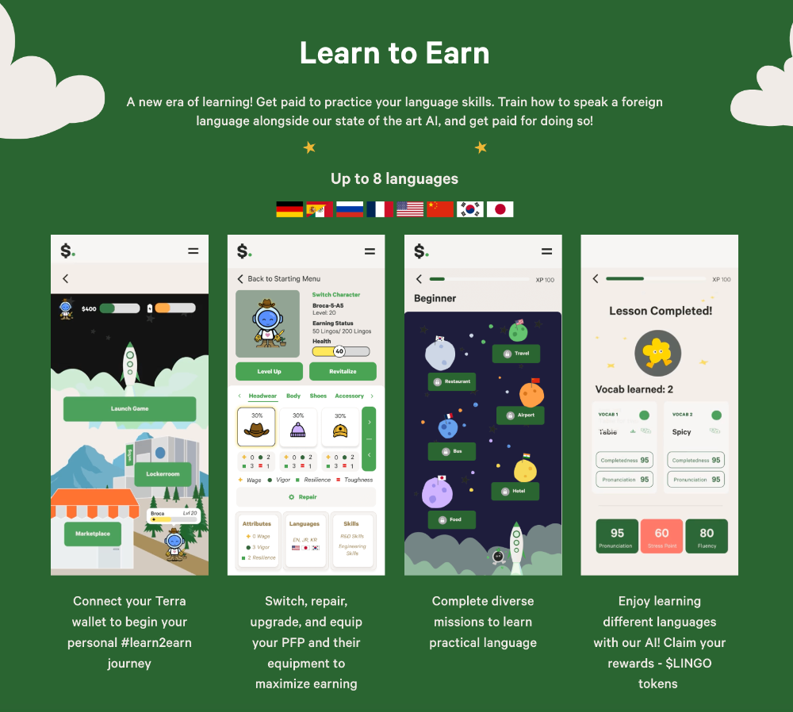

# Sayve Protocol | Community Grant Proposal

- **Thread ID:** 17299
- **Author:** Sayve Protocol (`terra17nwgfpcaml7hslyug72rdpfgnrcsgcf9g9kc0k`)
- **Created:** 2024-05-15T00:16:34.735Z
- **Last edited:** -
- **Stage:** discussion
- **Views:** 648
- **Reactions:** 1
- **Comments:** 1
- **Source:** https://common.xyz/terra/discussion/17299-sayve-protocol-community-grant-proposal

---

## Who We Are & Our Mission 
SAYVE is a pioneering language learning platform in the Web3 era, integrating educational gaming with blockchain technology. Our mission is to create an immersive and rewarding educational experience with our “Learn to Earn” mechanism, where users not only learn new languages but also earn tokens for their progress and participation. These tokens can be used within the game or exchanged for other cryptocurrencies, adding real value to the educational process.

## Summary of Contents 
Introduction
Our Products & Innovations
Achievements to Date
Collaboration with Terra
Grant Proposal & Funding Requirements
Team
Conclusion

## Introduction 
SAYVE introduces a groundbreaking "Learn-to-Earn" model on the Terra blockchain, akin to a Duolingo but enhanced with AI voice assessment and Chatgpt technology. Launched during the turbulent aftermath of the Terra Luna collapse, our platform utilizes NFTs not merely as digital assets but as integral components that enrich and personalize the learning experience. This proposal seeks funding to address liquidity challenges for our ongoing development and the broader revitalization of the Terra ecosystem.

## Our Products & Innovations 
Core Learning Platform: Interactive language learning combined with Metaverse exploration in the Vox galaxy, where players engage in missions either to support or thwart an AI's chaotic plans using languages as tools.
AI Voice Assessment: Leveraging AI to provide real-time feedback on pronunciation and language usage, enhancing the learning curve.
AI generated contents: Chatgpt-powered automatic contents generation based on users’ needs
NFT Integration: NFT with an actual utility. Characters and items as NFTs that players can use, trade, or evolve, deepening the gameplay experience.
Social & Cultural Exchange: A built-in feature allowing players from around the world to interact, exchange cultural insights, and practice languages together.

[Game Launch](https://x.com/sayve_protocol/status/1756199152558678129)

## Achievements to Date 
Despite the adverse market conditions following the Terra Luna fallout, SAYVE has successfully:
Launched a fully operational platform with hundreds of active users, available in Web and Android mobile platforms.
In just two months, user engagement on the app has notably increased, with 162 users successfully completing a total of 1,814 lessons. The total fee collected during this period amounts to 430.9 Sayve.
Developed and deployed unique AI technologies specific to language learning.

[Demo](https://x.com/sayve_protocol/status/1646632893773664257)

## Unwavering Collaboration with Terra

As an early adopter and steadfast supporter of Terra through its fluctuations, SAYVE embodies resilience, dedication, and potential. This proposal seeks to enhance SAYVE's offerings and contribute to Terra's resurgence as a leading blockchain platform.

## Grant Proposal & Funding Requirements 
We are requesting a grant of 200,000 LUNA.  The allocation of funds would be as follows:
- 30% to enhance operational infrastructure and platform development.
- 50% for marketing and user acquisition.
- 20% for liquidity support to facilitate token usability and exchange.

## Team 
Led by experts in both blockchain and educational technology, our team consists of:
2 developers with extensive experience in AI, gaming, and blockchain.
1 marketing and community engagement specialists.
1 educational content creators.

## Conclusion 
In the face of challenges, SAYVE has not only persisted but also laid down the groundwork for a unique educational platform that bridges blockchain technology with language learning. With the support of the Terra community, we aim to expand our reach, enhance our offerings, and contribute significantly to the revival and growth of the Terra ecosystem.

- WebApp: https://app.sayve.money/
- Twitter: https://twitter.com/sayve_protocol
- Telegram: https://t.me/SayveProtocolChat
- Discord: https://discord.gg/wQSbeb5N
- litepaper: https://sayve-protocol.gitbook.io/sayve-litepaper

---

## Comments (1)

**Anonymous (`terra1znfk8td7dh5p5fjsngjjt8yz77tjy7rz8lrth3`)** — 2024-05-18T12:20:50.954Z

hello sir, sayve is a good AI project. let us know what about the case of terra with the SEC. Thanks

