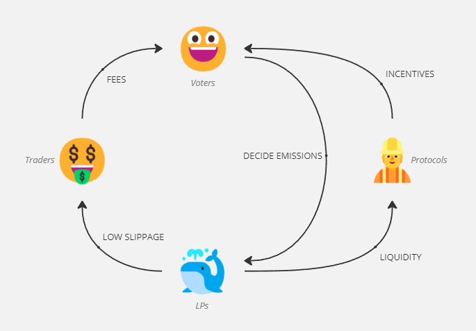
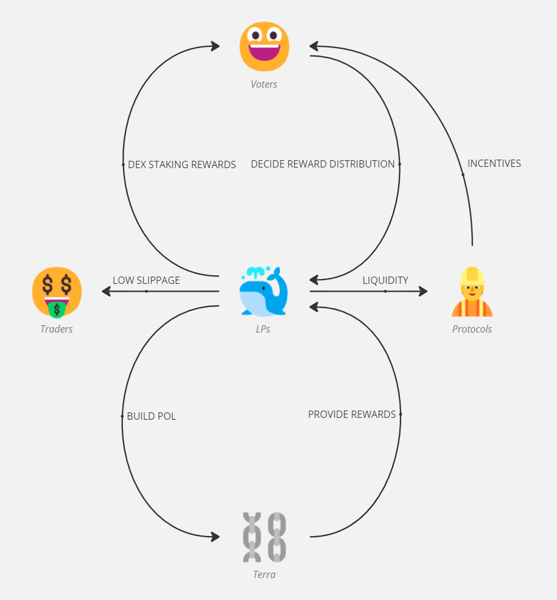
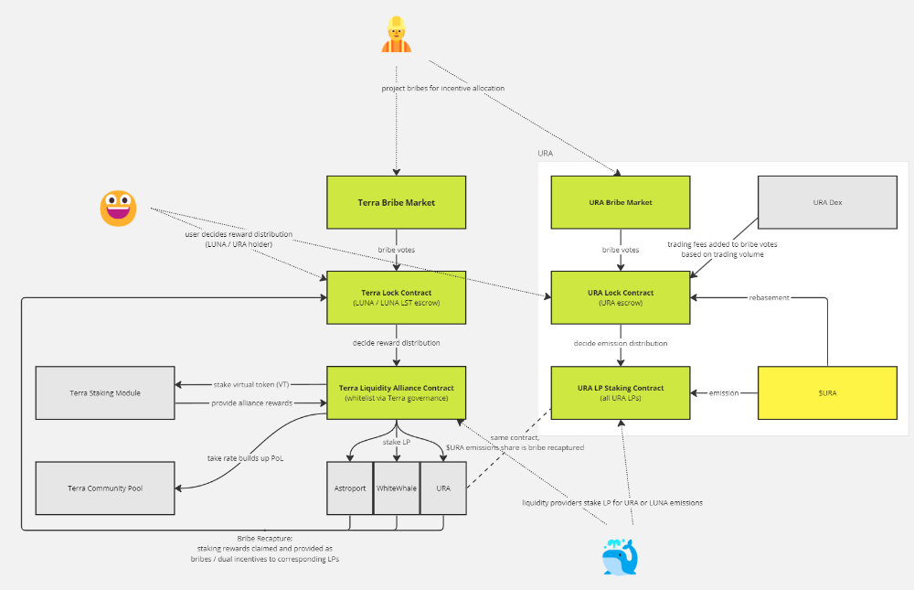

# Terra Liquidity Alliance

- **Thread ID:** 20123
- **Author:** 0xPhilipp (`cosmos142v8lp8m8fgj3zegg9mzsq9k5n2z2r06cn04h5`)
- **Created:** 2024-05-28T10:33:50.031Z
- **Last edited:** 2024-05-31T09:10:25.911Z
- **Stage:** discussion
- **Views:** 1963
- **Reactions:** 5
- **Comments:** 3
- **Source:** https://common.xyz/terra/discussion/20123-terra-liquidity-alliance

---

# Terra Liquidity Alliance

We would like to present to the Terra community what we believe to be a compelling proposal to address the longer term development needs of the Terra ecosystem through an advanced liquidity provisioning and DeFi solution.

This will primarily be achieved through an enhanced implementation of the URA DEX roadmap.This proposal combines the mechanics of Alliance, ve tokenomics, and fairly includes all 3 existing Terra DEXes.

While significant development work will be required to build the contracts for the project, we believe it will be well worth the investment and result in a sustainable path forward for both liquidity and project incentives in the ecosystem.

# Background
In the aftermath of TFL recalling its ecosystem liquidity initiatives liquidity,With the recall of the TFL provided liquidity, LUNA-Stablecoin liquidity on-chain is at an all-time low, decreasing chain usage and trading volume. This proposal significantly addresses this need. By building the proposed market, the Terra community will be able to decide on liquidity needs and distribute rewards in live voting, making the system decentralized and in favor of LUNA holders. Instead of having a centralized entity deciding liquidity deployments, the community will be able to decide on the most efficient application of liquidity to projects and drive ecosystem growth.

# Why URA? 
Ura is a native Terra focused DEX transitioning to community ownership. In search of new ownership, building out the full vision of URA will make it possible to launch the URA token in a truly decentralized fashion and a good place for implementing the successful ve(3,3) model in Cosmos.

The proposed implementation of URA ve(3,3) model has a high overlap with the proposed Terra Liquidity Alliance, making it more efficient to implement with a small increase in development cost (~20%). 

The additional costs created for URA can be seen as an investment into the Terra ecosystem, which is similar to the Astroport / White Whale emergency grants, or the White Whale Alliance rewards, helping URA to find a footing and accelerate its growth and restart building up. It allows the URA community to decide the tokenomics in a way to be fully decentralized and community owned without seeking new investors, while following up on the original intended roadmap.

# Benefits
- Implementation of ve(3,3) roadmap for URA DEX
- Bootstrapping of deep on-chain LUNA-Stablecoin liquidity to increase chain activity
- Creating new utility and revenue for LUNA holders
  - reducing circulating supply through lockup method
  - generating additional revenue through bribe market
- Building Protocol owned Liquidity via Take Rate of LP staking
- Creating a fair and market based incentive mechanism, so DEXes can compete for Alliance Rewards. DEX LP staking rewards are not sold, but redistributed as bribes to voters.
- Integration with the Alliance Module

**Simplified ve(3,3) model**

**Simplified Terra Liquidity Alliance**

**Detailed Model**

# How It Will Work

Implementation of ve(3,3) roadmap for URA DEX

The ve(3,3)* tokenomics model is a game-changer for DEXs and provides advanced liquidity provisioning, governance participation, and a base for sustainable ecosystem growth. (*voter escrow)

Key aspects include:
- Incentivizing LPs through emissions
- Locking tokens for increased farming rewards and governance influence
- Temporarily reducing token supply and selling pressure
- Rewarding ve-token holders with trading fees from voted pools, promoting efficient resource allocation
- Supporting permissionless pool creation, reward gauges, and bribes
- Offering traders low slippage
- Protocols paying bribes to gain liquidity

Bootstrapping of deep on-chain LUNA-Stablecoin liquidity to increase chain activity:

The initial launch will see  LUNA-USDC and LUNA-USDT LPs from any DEX on Terra and the target depth is 10 M$.

Note: The contract however will allow whitelisting additional LPs of ecosystem projects, e.g. ASTRO-LUNA, ROAR-LUNA, WHALE-LUNA, URA-LUNA etc. After whitelisting, voters will still need to vote to incentivize such LPs. These would however compete with LUNA-Stablecoin liquidity, so it should be considered to set up a secondary Alliance, explicitly for ecosystem project liquidity, which will open up a good and fair distribution and bribe mechanism.

Creating new utility and revenue for LUNA holders:

LUNA / LUNA LSTs will be locked, reducing the circulating supply.

Projects will be able to provide incentives to bribe voters to vote for certain LPs, creating incentives to participate in voting. These incentives will go to LUNA holders that voted for the incentivized LP.

Any LP deposit that can be staked in the underlying DEX will generate additional incentives for voters, creating a positive feedback loop for LUNA holders. (Bribe Recapture)

Building Protocol owned Liquidity via Take Rate of LP staking:

By using a high Take Rate of 10% annually, the Community Pool will start acquiring LUNA-USDC / LUNA-USDT LPs, therefore decreasing the necessity to spend incentives on attracting liquidity.

Creating a fair and market based incentive mechanism:

Any DEX can compete for Alliance Rewards, while DEX LP staking rewards are not sold, but redistributed as bribes to voters. DEXes or communities of DEXes will either need to acquire LUNA / LUNA LST to vote for LUNA rewards, or provide incentives to voters (LUNA holders).

Integration with Alliance: 

This alliance is using staking rewards to incentivize LUNA-Stablecoin liquidity. It will increase chain and trade volume on Terra due to arbitrage between the chain and CEXes.

_Proposed parameters (separate proposal to launch)_

An Alliance will be proposed to share 7.2% of staking rewards with the VT of the Terra Alliance Liquidity Contract
- Target liquidity: 10 M$
- Target APY: 50% (5 M$ per year, 13.6k $ per day, ~23k LUNA per day @0.6)
- Reward share: 9.1 %
- The reward share will slowly increase from 0% to the target over the span of 4 months.
- Take rate of Alliance: 0%, 
- Take rate of contract developed: 10%, changeable via Terra Governance

**Examples & clarifications**
- Terra bribe market and Ura bribe market are independent of each other
- Terra bribe market treats any DEX the same (no favoritism)
- URA voters always get the LP trading fees, LUNA voters get URA emissions (as bribe) based on the staked amount through the - - Terra bribe market.
- URA bribe market will allow votes for any URA LPs
- Terra bribe market will allow votes for any LUNA-USDC LP and LUNA-USDT LP of any Terra DEX (Astroport, WhiteWhale, URA)
- Liquidity providers need to decide to receive LUNA rewards OR DEX native rewards (depending on if they stake through Terra - - Liquidity Alliance or the DEX native contracts)
- There will be a second follow-up proposal to create a second alliance for LUNA-Project liquidity like LUNA-URA, LUNA-ROAR, LUNA-WHALE, LUNA-ASTRO, LUNA-SAYVE, LUNA-ORNE, LUNA-HALL, etc.
- If URA DEX can't decide on a valid plan with a dev team to take over, 20% of the grant will be refunded.

# Development Deliverables

- **Terra Liquidity Alliance Contract**
  * allows to stake LP positions from any dex (cw20 & tokenfactory)
  * Terra Governance defined yearly take rate (initially 10%) - Terra Community Pool starts acquiring LP positions - PoL across all DEXes
  * Initial LUNA-USDC / LUNA-USDT LPs from any DEX whitelisted
  * **Alliance Module**: stakes a virtual token VT in Alliance Module, claims rewards and distributes them based on reward distribution
  * **Bribe recapturing**: Deposited LPs will be restaked in the LP staking contract of each corresponding DEX, rewards received from staking will be captured and provided as bribe to voters in the Terra Lock Contract. 
  Example: In case of URA LPs, they are being staked in the URA LP Staking Contract to receive URA emission, these URA emissions are captured and provided as bribe to the corresponding voters for the LUNA-USDC URA LP 
- **Terra Lock Contract**
  * allows locking LUNA or LUNA LST
  * underlying LUNA amount as voting power
  * depositors / voters vote on reward distribution (example Restake Gauges on Migaloo)
- **Terra Bribe Market**
  * Projects can provide incentives for LP votes
* **URA LP Staking Contract**
  * stakers receive emissions based on the emission distribution
- **URA Lock Contract**
  - allows locking URA
  - depositors / voters vote on reward distribution
  - emissions for LPs offsetted through rebasement
- **URA Bribe Market**
  - Trading revenue added to corresponding LP as bribe

# Grant
- Community Pool funding of $200k paid in LUNA
- $50k for audit paid in LUNA (rough estimated amount)

# Why Eris as an implementation partner
- Eris has deep knowledge of DEX contracts, zapping and auto-compounders
- Eris is the leading provider in curve and restake gauges across cosmos
- Eris is deeply connected to Terra DEX teams (Astroport, WhiteWhale and helps develop the URA roadmap) as well as the Terra community.
- Eris is a highly skilled implementation partner of Terra and Alliance DAO focused on secure and audited CosmWasm development.
- Eris is a long term committed development Team on Terra

# Summary
This is an ambitious and exciting proposal, bringing together the different mechanics of alliance, ve tokenomics, and multiple DEXes without excluding or disadvantaging any team on Terra. It provides a significant value to all DEXes, to the Terra community, and towards implementing the roadmap for the Terra native DEX URA. While it will require a lot of work to develop the contracts to fit this use case, we believe the effort will be well worthwhile to provide a path forward for  liquidity and ecosystem incentives on Terra while building out the roadmap for URA DEX.

# Conclusion
We strongly believe that the success of this proposal will create a central building block for Terra’s future ecosystem development as we transition past the uncertainty of recent events.
We welcome all discussions and suggestions on how to improve any areas of the proposal and look forward to receiving unified community support for it.

---

## Comments (3)

**PhoenixPinion (`terra12g5a0p9yylfjcaw3ah83l0ct09gmn7dcwk54qh`)** — 2024-05-29T00:05:41.525Z (edited 2024-05-29T00:09:26.170Z)

An interesting proposal to restore liquidity. I especially like the part where the community pool could gather LP tokens via the take rate. This is a very innovative idea that could bring permanent liquidity of important pools. 

However, just to avoid confusion because it wasn't specifically clarified in your proposal (although I assume it to be the case): When you talk about Luna-USDC and Luna-USDT, you are talking about USDC (Noble) and USDT (Kava), and not the Axelar counterparts, is this correct?

> **0xPhilipp (`cosmos142v8lp8m8fgj3zegg9mzsq9k5n2z2r06cn04h5`)** — 2024-05-29T08:46:52.273Z (edited 2024-05-29T10:29:12.400Z) — 👍 1
> 
> yes, it would be only native USDC and USDT pairs. Except if Axelar would be interested in providing bribes for axl pairs.

**Qasim Saleem Qureshi (`cosmos17de5rquzac94s6xjn5pfcylsw8uwsp8syq2c3r`)** — 2024-07-05T12:54:19.057Z (edited 2024-08-17T07:59:00.359Z) — 👍 1

When Launching?
We are Waiting For LUNA comeback since 2 years.
Its a perfect opportunity to Kickstart LUNA once again.

