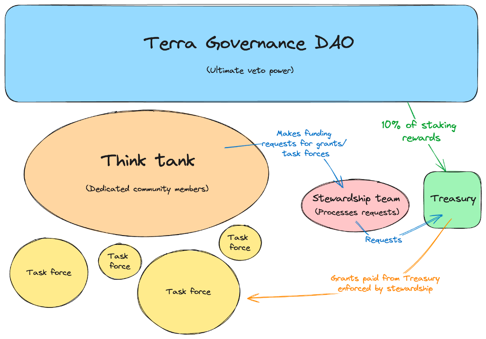

# The Phoenix Directive (Updated)

- **Thread ID:** 23826
- **Author:** PhoenixDirective (`terra18z50v7l3j37h7kfaj8tg2nn3qnekyy2v6dpelk`)
- **Collaborators:** 0xPhilipp, mbaejir, Rose | Phoenix Foundation, Vini
- **Created:** 2024-06-29T14:12:41.828Z
- **Last edited:** 2024-07-24T13:45:36.142Z
- **Stage:** discussion
- **Views:** 5118
- **Reactions:** 3
- **Comments:** 14
- **Source:** https://common.xyz/terra/discussion/23826-the-phoenix-directive-updated

---

## Intro

The announcement that TFL will disband over the next four months was received with mixed feelings by most. For those who have been through the journey this far, we applaud your resilience and commitment. We now ask that you prepare yourselves for what comes next.

Terra is ready to embark on a new journey, redefining itself and building on its foundations of innovation, technology, and community. Strong, united leadership is essential for focusing community energy in a common direction for the future.

The Phoenix Directive is the new community-led initiative that has been preparing for Terra’s future.

The document below outlines the mission at hand and the new structures being formed to manage Terra’s ongoing development. It proposes a leadership framework with enshrined community participation and outlines the scope of the work and the opportunities ahead of us.

We present this to you with confidence that the Directive has the resources, knowledge, and experience needed to be successful. However, it will need your support and involvement. We welcome all input and feedback as we set out on this journey together.

## Summary

The Phoenix Directive is a community-driven initiative for the Terra blockchain, focusing on organizing development and creating a strategic roadmap. It involves multiple teams working together to enhance the blockchain's growth and sustainability. Key goals include collaborating with community members to build a new vision for Terra, increasing usage and liquidity, project development, promoting builders, improving tokenomics, and ensuring transparent funding.

## Overview

We present the community with a path forward for Terra: The Phoenix Directive.

Formed by Terra community members, the Phoenix Directive will spearhead organizing chain development and building a strategic roadmap and vision for Terra.

The Phoenix Directive isn’t a single person or entity but rather a network of teams working together toward common goals set by the directive. The directive is designed to oversee and manage a smooth transition of chain leadership and development to this new community framework.

The mission of the Phoenix Directive is to foster the sustainable development and growth of the Terra blockchain and its community.

To achieve its mission, the directive will work on the following goals:

**Strategic Goals**

- Building confidence and stability within the Terra community by implementing a transparent and structured plan.
- Increasing usage, TVL, and liquidity across the Terra blockchain.
- Growing active projects and attracting new ones that will add strategic value to the chain.
- Building a cohesive vision and narrative for Terra in line with the goals of the community.
- Improving Luna tokenomics and creating healthier incentives for active users.
- Attracting a money market, perpetual trading, Real-World Assets (RWAs), and other core financial primitives to drive economic growth.
- Retaining and growing the avid LUNAtic community.

**Terra Infrastructure Goals**

Terra Core

- Maintaining and developing the Terra Core codebase, including security updates, module updates, Cosmos SDK version upgrades, and upgrade coordination.
- Working with core developers to ensure that the chain is maintained and upgraded.
- Collaborating with appropriate contributors to maintain RPC, LCD, and archive nodes and ensure that necessary chain infrastructure is functional.

Alliance Module

- Maintaining and updating the module.
- Maintaining the Alliance [dashboard](https://dashboard.alliance.money/?selected=phoenix-1) and creating an Alliance frontend to ensure that users can always access Alliance staking.
- Maintaining the [Alliance VT contract initiative](https://commonwealth.im/terra/discussion/11500-alliance-signaling-proposal) and dashboard to ensure that current alliances with [Migaloo and Carbon](https://commonwealth.im/terra/discussion/12477-alliance-followon-proposal) continue.
- Fostering new alliances between chains and communities.
- Developing and supporting new strategic alliances and use cases, such as the [Terra Alliance Liquidity Proposal](https://commonwealth.im/terra/discussion/20123-terra-liquidity-alliance).

Station

- Working with the community and the appropriate organizations to ensure continued support for Station users on Terra.
- Ensuring that users can always access their funds and positions.
- Facilitating a plan with the appropriate organizations and the community for the continued development of Station or the use of another wallet provider on Terra.
- Ensuring that Terra and its ecosystem are accessible with leading crypto wallets to access broader user participation.

Enterprise

- Working with DAOs, the community, and the appropriate organizations to ensure continued support for Enterprise on Terra.
- Ensuring that Enterprise DAOs can always access their funds and maintain necessary functions.

Warp

- Working with the community and the appropriate organizations to ensure continued support for Warp on Terra.

## Structure

The Phoenix Directive is structured to optimize transparency, community input, decentralization, and action for the development of the Terra ecosystem, while still being efficient in making progress and decisions.

The Directive uses a [BORG](https://delphilabs.medium.com/assimilating-the-borg-a-new-cryptolegal-framework-for-dao-adjacent-entities-569e54a43f83) structure which is an innovation in DAO implementation pioneered by [MetaLeX](https://metalex.substack.com/p/the-metalex-whitepaper). This framework allows on-chain DAOs and real-world entities (BORGs) to interact with each other in a decentralized yet effective manner.

The directive is structured into five parts:

**1. The Terra Governance DAO**

This is the Terra chain governance, and it represents all stakers who vote in Terra governance. Enforced by governance, Terra stakers and validators have the ultimate decision or veto power over any part of the Phoenix Directive, ensuring that the Directive must always be aligned with greater chain governance.

**2. Phoenix Think Tank**

The Think Tank is a group of individuals in charge of brainstorming novel ideas and objectives for the ecosystem, as well as making funding requests for task forces. They will participate in the decision-making process  and make recommendations on matters important to the chain, such as defining a cohesive vision and narrative, ecosystem growth, development, and community outreach.

Each member of the Think Tank will be a current, active builder and leader in the Terra community. This team must be dedicated to having the interests of Terra and its community in mind at all times, and they will help shape the future of the chain and ecosystem.

The Think Tank also holds veto power over any large spending requests from the treasury, as outlined in the Treasury section below. Initial membership of this group will be formed iteratively in consultation with other members and finalized by the Phoenix Stewardship Team.

If you are a leader in the Terra community and would like to join the Think Tank or contribute in any other way, an online application will be available shortly.

**3. Phoenix Task Forces**

Task forces are in charge of specific tasks. They are tasked with carrying out the objectives of the Phoenix Directive. Task forces will be established for specific purposes with clear goals. They represent different builders and doers of the Terra ecosystem, working on a per-project basis.

Funding for task forces will be proposed by the Think Tank and approved by the Stewardship Team, who will be responsible for holding the task forces accountable.

Task forces will carry out objectives across multiple axes, including:

Technical Objectives

- Ongoing chain maintenance & upgrades
- Public good funding and development
- Establishing maintenance, development, and/or transition plans for essential products like Enterprise, Station, Warp.
- Innovative protocol development

Organizational Objectives

- Building a clear vision and unique narrative for Terra’s future
- Facilitating the transition of essential assets such as Terra domains, repos, and social media/ communication channels (such as the x account and telegram channels) to the Terra community under the stewardship of the Phoenix Directive.
- Funding for strategic partnerships that will bring value back to Terra.

Establishing Programs

- Delegation Program
- Innovator grants
- Audit reimbursement
- Relaying

Community Building

- Implementing initiatives to reduce circulating supply
- Organizing hackathons to promote innovative building on Terra
- Implementing strategic marketing & user acquisition plans
- Incentivizing liquidity, the deployment of liquidity, and suggesting liquidity needs
- Identifying priority applications to build a unique and vibrant defi ecosystem
- Supporting community members needed to facilitate social channels

**4. Phoenix Stewardship Team**

The Stewardship Team is in charge of administrative oversight for the activities of the Phoenix Directive. They will ensure that all directives are met and that funds are distributed responsibly to Task Force teams. They will work with the Think Tank to set goals and objectives for the chain, and facilitate the funding and planning of the work to be carried out by the appropriate Task Force. The Stewardship Team will form the BORG portion of the Directive, called the Phoenix Foundation, which will facilitate interaction between on-chain organizations and off-chain entities to hold teams accountable with real-world business practice norms.

The Team will guide strategic alignment across the activities of the Directive, ensuring that all deliverables are met and that all teams are accountable to their commitments.

The Stewardship Team will be held accountable by Terra Governance, which retains veto rights to stop funding the Directive, and by the Think Tank, who can veto large spending requests as detailed below. The Team commits to working transparently and providing regular reports of activities to the community.

The Team will remain small and lean by design. A smaller Stewardship team ensures that all objectives of the Directive are aligned and that decisions can be made quickly and effectively.

The current members of the team are:

- Philipp (@0xPhilipp)
- MB Aejir (@MB_Aejir)
- Vini (@unl1k3ly)
- Rose (@rosanne_89)

The members of the Stewardship Team are well-known, long-standing leaders in the Terra community, and are committed to the continued development of the Terra chain and the growth of its ecosystem. The team has experience in running the Terra chain, building and designing protocols, creating delegation and grant programs, managing teams, and interfacing with other Cosmos protocols and chains. Most importantly, the team is passionate about the future of Terra and the needs of its community.

Participants of the Stewardship Team will not receive preferential treatment, and decisions regarding project funding related to parties of the Stewardship Team will need to go through the Phoenix Think Tank or Terra governance for approval.

**5. Phoenix Treasury**

The treasury is an important piece of the Directive, allowing for transparent, responsible, and sustainable funding in a decentralized manner. Rather than block grants or funding proposals that lack community recourse, the Phoenix Directive will be funded via a smart contract that interacts with the Alliance module. The treasury contract will mint a virtual token to be staked on the Terra chain via the Alliance module. Rewards from the staking of this token will be claimed and deposited into the treasury periodically, funding the various initiatives, task forces, and development of the Directive.

- The Reward Weight for the virtual asset will initially be set to 10%.
- The Directive will develop a Phoenix Delegation Program to oversee the delegation of the virtual asset in line with the goals of the community.
- At any time, Terra Governance can vote to stop the funding of the Directive treasury by delisting the virtual asset, avoiding the need for clawbacks and ensuring the continued alignment of the community and the Directive.
- 
- The treasury contract will be able to DCA into other assets on Terra to build up a diverse treasury to simplify funding requests and planning.
- Any spending requests > $50k have a 3-day lockup and can be vetoed by the Think Tank
- Any spending requests > $150k have a 10-day lockup and can be vetoed by Terra Governance.
- The Phoenix Directive can participate in the [Alliance Liquidity Wars](https://commonwealth.im/terra/discussion/20123-terra-liquidity-alliance) to have a strategic impact in liquidity recommendations (max 20% of total voting power)

## How the Phoenix Directive works

The Think Tank and Stewardship Team will work together to develop strategic initiatives and make spending recommendations for task forces. The Stewardship Team will review the recommendations and make a spending request to the treasury by sending an on-chain request message. Any spending requests for task forces greater than $50k will have a 3-day lockup period, during which time the Think Tank can veto the spending request and cancel the disbursement of funds. For amounts over $150k, there will be a 10-day lockup period, during which time Terra governance can vote to veto the spending request and cancel the disbursement of funds. Once the requisite lockup periods have elapsed, funds will be disbursed to task forces, who will be held accountable to their agreements by the Stewardship Team.

If Terra governance decides that the Phoenix Directive is not fulfilling its role, it can vote to stop funding the treasury at any time.  This system of checks and balances ensures that the Stewardship Team, Think Tank, and Terra Governance are aligned in their actions.

This post represents an initial overview of the Directive’s structure and funding. More detailed plans will be posted in the near future, detailing the intricacies of the Directive, funding, grants, and guidelines.

## Proposal Agenda

The Phoenix Directive is designed to be agile and will accomplish its objectives in a timely manner.

1. Signaling Proposal: after conferring with the community, this proposal will be voted on by governance, signaling the community’s adoption of the Phoenix Directive.
2. Formation of the Think Tank, detailed planning and community feedback, and the development and audit of the Phoenix Treasury contract.
3. Alliance Proposal: adding the virtual treasury token as an Alliance asset on Terra, providing funding for the Directive. This proposal will also detail funding and guidelines.
4. Proposals outlining new initiatives and a cohesive direction for the chain.
5. Continued community outreach and transparency, and the objective achievement of Phoenix Directive goals.

This proposal represents the hard work and dedication to the Terra community by those who want to see the phoenix spread its wings. Please provide your feedback in a respectful manner.

The greatest chapter of Terra’s history starts now. **Let the journey begin!**

Follow [@phoenix_dir](https://x.com/phoenix_dir) on X for the most up-to-date information.

---

## Comments (14)

**Anonymous (`terra15pctgphecfup3p5a84x5pk7ddkpc9hemjqp57d`)** — 2024-06-29T14:19:00.575Z (edited 2024-07-09T11:50:37.309Z) — 👍 4

GM LUNAtics!

I am participating in the Phoenix Directive as an independent member of the Terra community and with no other affiliation. 

I believe this proposal is a great foundation for the future of Terra. 

Together, the community will continue to build and write the next chapter of Terra's history.

**fred (`terra1apeyehuxqzz0c2gegg8p84w25ptqk8u6h39drz`)** — 2024-06-29T15:55:45.823Z (edited 2024-07-01T19:14:58.196Z) — 👍 3

Would love to be a part of the think tank team and contribute to the initiative!

All the best for the team

**Vini (`terra18ruqkccl5tp493uhvra0u6jylrzq8t8dv5qs4c`)** — 2024-06-30T00:46:48.264Z (edited 2024-07-01T19:14:55.452Z) — 👍 5

Awesome news! SCV-Security would support this path forward for Terra. Let's make Terra great again!!

> **Qasim Saleem Qureshi (`cosmos17de5rquzac94s6xjn5pfcylsw8uwsp8syq2c3r`)** — 2024-07-06T19:42:10.781Z
> 
> Kindly fast track the audit as whole community is waiting for its release as soon as possible.
> We are really waiting and hoping 1st phase before revisions would be completed by 12 July 2024 before end of the week.
> Kindly accelerate this as its the pioneer of phoenix directive start.
> Whole community eagerly waiting for its early completion as soon as possible.
> https://commonwealth.im/terra/discussion/20123-terra-liquidity-alliance

**Hexxagon (`cosmos16vpaqrv447slujrjytcud3u8w4x6lsa3qk5grt`)** — 2024-06-30T01:24:43.059Z (edited 2024-07-07T13:01:31.969Z) — 👍 2

Hi, echel0n here from Hexxagon, we can certainly help with Station and Infra if need, as well as anything else, just let us know!

**Anonymous (`terra1lxmgyvgecldfyd5ll5lk9yzh2n3vnjd0nqtvn4`)** — 2024-06-30T10:55:18.704Z

The Station Wallet is being sold? How can the Phoenix Directive undertake its maintenance unless it acquires it? Is that the plan?

> **PhoenixDirective (`terra18z50v7l3j37h7kfaj8tg2nn3qnekyy2v6dpelk`)** — 2024-07-01T12:33:37.618Z (edited 2024-07-05T14:18:31.786Z) — 👍 6
> 
> Thanks for your question!
> 
> For the short term, TFL has said that they will continue to support Station and Enterprise for the next 3-4 months. 
> 
> Meanwhile, Phoenix Directive will work with teams in the community to acquire Station, Enterprise, and Warp. 
> 
> The Directive will work with everyone involved to ensure continued support for these products on Terra and help teams in the community take over the development of these applications. 
> 
> In the case of Station, there are plans for other wallets to be supported on Terra as a backup for Station and to help bring in new users who want to use alternative wallets.

**Anonymous (`terra193k9f389sx58hxrx0jw05y44r7zlxq4lsu6n7s`)** — 2024-06-30T23:32:33.936Z (edited 2024-07-09T11:50:20.988Z) — 👍 6

Hi All. 

Firstly a disclosure: I have recently been approached about being a community member of the advisory ThinkTank. If I can contribute to Terra through this then I have an obligation to do so - can't just be a talker.

It's a great strength of Terra that we are a highly, if not the most, decentralised community blockchain. It means we can aspire to genuinely represent the interests of ordinary users and align with the libertarian dreams for cryptocurrency. We get to have genuine community debates about governance and the future. 

However there are risks and threats in a community chain that we have seen over the last couple of years - both here and on the original chain. My observation is that community governance doesn't work well for guiding cohesive strategic and technical development of the chain. The potential for constantly swirling argument and indecisiveness can make for an unfocussed development. 

I have a strong conviction that Terra requires a core leadership group to drive the development of the chain. Further, that the success of that group is dependant upon being granted a delegated authority with a meaningful degree of liberation from the type of community interference that has undone many types of collectives. We recognised this last year when we voted to empower TFL with their prop. Our hope was that they could provide the strong and innovative leadership that they did in the original iteration of Terra - leadership that was central to building an inspiring collective of developers. The history of that specific move is a fail but the need is unchanged and that need is a core condition for me to get behind this prop.

Philipp, MBAegir and Evan have created a strong proposal here that seems to get the balance right, certainly to get things started and moving. Community has ultimate control of the existence of Phoenix Directive via the Alliance funding model. The Alliance based model, funding development from inflation, allows for measured and sensible streamed financing while giving Community the power to quickly cease funding for malfeasance or simple failure. (It also leaves the Community Pool fully available to Community for other important initiatives), In return the leadership structure of Phoenix Directive will have genuine scope to make decisions, advised by community members, and run constructive programs. It's a brilliant use of our inflation to create economic drivers.

The Phoenix Directive structural model is also nicely balanced to me to get things started. A core leadership group of 3 high calibre builders/developers on our chain (with proven integrity and skill) working with and reporting to a sounding board/advisory (the ThinkTank). The ThinkTank also has some override powers for projects of a certain size or involving potential conflicts of interest. This provides good levels of transparency for the confidence of the broader community. 

The rest of the document shows the extent of engagement this leadership group has with Terra. They know the chain, they understand the issues and they get what the community needs to have a viable thriving blockchain. I'm behind them and for them. 

There's a lot to be done, many things that could be done. Given the current exhausted state of the community, the first big challenge is to get some discussion and enthusiasm going about this prop. Let's all encourage our Terra friends to engage and share their opinions. It's so important for our community's future.

**Qasim Saleem Qureshi (`cosmos17de5rquzac94s6xjn5pfcylsw8uwsp8syq2c3r`)** — 2024-07-05T13:01:22.504Z (edited 2024-07-05T13:03:29.285Z)

All community massively and totally support the above proposal. Kindly move to vote as it will still take 7 days to pass.

Adding amplunc or BLUNC(terraport Lst) liquidity on terra liquidity alliance can really fuel the LUNA growth.

[@0xPhilipp](/profile/id/56256) 
[@0xPhilipp](/profile/id/61123)
[@PhoenixDirective](/profile/id/154187) 
[@MB aejir](/profile/id/110864) 
[@EvanPhoen1x](/profile/id/154189) 
[@Evan_docs](/profile/id/132786)

**Anonymous (`terra18fypa607zd2dmg9a9n7v3mcm84n9qs0v5rx3u4`)** — 2024-07-05T15:13:51.602Z

I'd need to see some progress on the last proposal which granted $200.000 of LUNA to Philip, before voting him head of the chain and paying him another salary! https://commonwealth.im/terra/discussion/20123-terra-liquidity-alliance

> **0xPhilipp (`cosmos142v8lp8m8fgj3zegg9mzsq9k5n2z2r06cn04h5`)** — 2024-07-08T10:01:01.642Z (edited 2024-07-30T07:35:25.960Z) — 👍 4
> 
> Audit is currently in progress, and GUIs are being built.

**Anonymous (`terra1nyau5wrqj500arqf6xncsum7f25dzqzhwl33k7`)** — 2024-07-08T14:31:08.778Z (edited 2024-07-09T07:32:21.080Z)

Hi, [@EvanPhoen1x](/profile/id/154189) . May I have a question. Are there any plan to support SOLID-CAPA? [@Daniel](/profile/id/96985) said that SOLID will stay in Terra. Furthermore I think SOLID-CAPA needs more support in the current situation. SOLID dApp seems to be working well, but there is no further development.

**Anonymous (`terra15pctgphecfup3p5a84x5pk7ddkpc9hemjqp57d`)** — 2024-07-24T13:40:12.236Z (edited 2024-07-30T07:34:46.995Z) — 👍 2

GM LUNAtics,

After much deliberation, I am withdrawing my name from the Stewardship Team. I wholeheartedly believe in the Directive, and I 100% support the addition of Rose and Vini to the Strewardship Team. 

This decision is made in the best interest of the chain. The US has made clear its current stance on crypto. In order to set the Directive up for success, it is prudent that the Stewardship Team contains no US citizens as members at this time. 

I will still be involved in the community, and I look forward to seeing the Phoenix Directive come to fruition. Phillipp, MB, Vini, and Rose are excellent long-standing members of the community, and I know that they are dedicated to the long-term success of Terra. 

The future is bright, 

Evan 🌕

**terriekim63 (`terra1smxjlhxfvv5x2argdldux5s3grwceglhkl88an`)** — 2024-10-24T13:45:17.545Z

Mm

