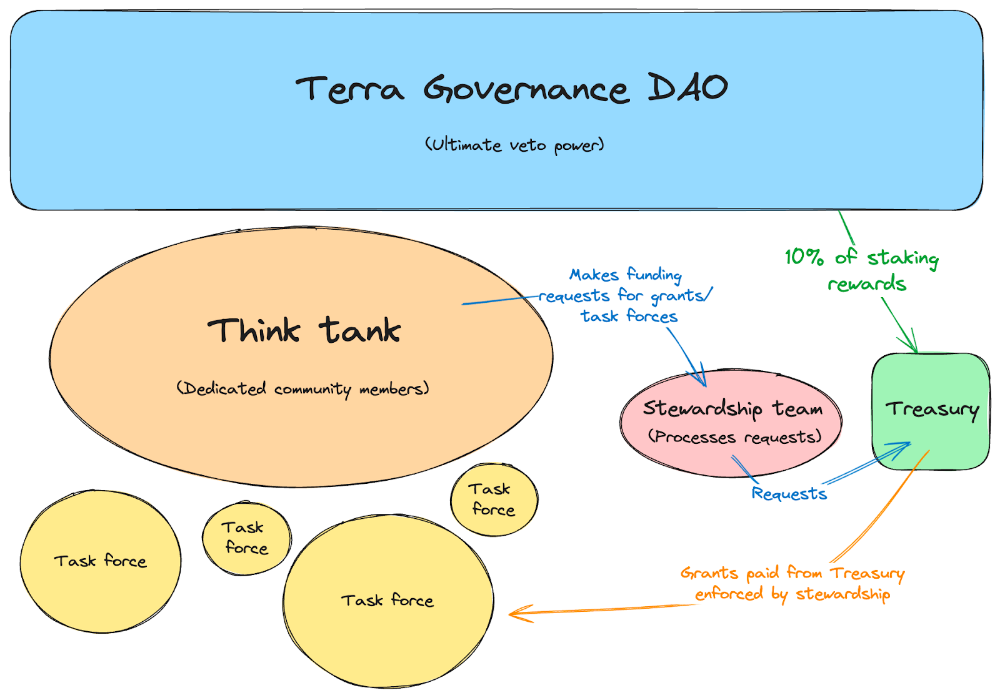

# Phoenix Directive - Launching Treasury

- **Thread ID:** 25020
- **Author:** Anonymous (`terra1ytd4m75a4cnv4e7aewkel0z47v0gadayrtg83a`)
- **Created:** 2024-09-26T09:47:22.960Z
- **Last edited:** 2024-10-07T11:51:10.343Z
- **Stage:** discussion
- **Views:** 1265
- **Reactions:** 2
- **Comments:** 8
- **Source:** https://common.xyz/terra/discussion/25020-phoenix-directive-launching-treasury

---

**Proposal**

This proposal is step 3 of the previously approved formation of Phoenix Directive #4816 ([https://chainsco.pe/terra2/governance/proposal/4816](https://chainsco.pe/terra2/governance/proposal/4816), [https://commonwealth.im/terra/discussion/23826-the-phoenix-directive-updated](https://commonwealth.im/terra/discussion/23826-the-phoenix-directive-updated)). The goal of this follow-up proposal is to set up the Treasury contract to receive 10% of staking rewards.

## Phoenix Treasury

The treasury is an important piece of the Directive, allowing for transparent, responsible, and sustainable funding in a decentralized manner. Rather than community pool grants or funding proposals that lack community recourse, the Phoenix Directive will be funded via an audited OSS smart contract that interacts with the Alliance module. The treasury contract will mint a virtual token to be staked on the Terra chain via the Alliance module. Rewards from the staking of this token will be claimed and deposited into the treasury periodically, funding the various initiatives, task forces, and development of the Directive.

* The Reward Weight for the virtual asset will initially be set to 14% (10% chain inflation).
* The Directive will develop a Phoenix Delegation Program to oversee the delegation of the virtual asset in line with the goals of the community.
* At any time, Terra Governance can vote to stop the funding of the Directive treasury by delisting the virtual asset, avoiding the need for clawbacks and ensuring the continued alignment of the community and the Directive.
* The treasury contract will be able to DCA into other assets on Terra to build up a diverse treasury to simplify funding requests and planning.
* Any spending requests > $50k have a 3-day lockup and can be vetoed by the Think Tank
* Any spending requests > $150k have a 10-day lockup and can be vetoed by Terra Governance.
* Phoenix Directive will provide a quarterly activity report for the Terra community.
* Terra Governance can dissolve the Phoenix Directive treasury by clawing back funds locked in the contract.
* Full Alliance parameter calculation: [Estimator](https://estimator.alliance.money/?importData=eyJhbGxpYW5jZUFzc2V0cyI6eyIxNzIzMjAyMzIxMjU4Ijp7Im5hbWUiOiJBbGxpYW5jZSBEQU8iLCJpbnB1dFZhbHVlcyI6eyJsc2RBbm51YWxFc3RpbWF0ZSI6IjAiLCJhc3NldFByaWNlIjoiMCIsImFsbGlhbmNlUmV3YXJkV2VpZ2h0IjoiMC4wMDgiLCJhbm51YWxpemVkVGFrZVJhdGUiOiIwIiwiYXNzZXRTdGFrZWRJbkFsbGlhbmNlIjoiMCJ9fSwiMTcyMzIwMjQzNDk5NyI6eyJuYW1lIjoiU3RhYmxlIExpcXVpZGl0eSIsImlucHV0VmFsdWVzIjp7ImxzZEFubnVhbEVzdGltYXRlIjoiMCIsImFzc2V0UHJpY2UiOiIwIiwiYWxsaWFuY2VSZXdhcmRXZWlnaHQiOiIwLjEiLCJhbm51YWxpemVkVGFrZVJhdGUiOiIwIiwiYXNzZXRTdGFrZWRJbkFsbGlhbmNlIjoiMCJ9fSwiMTcyMzIwMjQzNTU1NyI6eyJuYW1lIjoiUHJvamVjdCBMaXF1aWRpdHkiLCJpbnB1dFZhbHVlcyI6eyJsc2RBbm51YWxFc3RpbWF0ZSI6IjAiLCJhc3NldFByaWNlIjoiMCIsImFsbGlhbmNlUmV3YXJkV2VpZ2h0IjoiMC4wNSIsImFubnVhbGl6ZWRUYWtlUmF0ZSI6IjAiLCJhc3NldFN0YWtlZEluQWxsaWFuY2UiOiIwIn19LCIxNzIzMjAyNDM1ODc1Ijp7Im5hbWUiOiJCbHVlIExpcXVpZGl0eSIsImlucHV0VmFsdWVzIjp7ImxzZEFubnVhbEVzdGltYXRlIjoiMCIsImFzc2V0UHJpY2UiOiIwIiwiYWxsaWFuY2VSZXdhcmRXZWlnaHQiOiIwLjA1IiwiYW5udWFsaXplZFRha2VSYXRlIjoiMCIsImFzc2V0U3Rha2VkSW5BbGxpYW5jZSI6IjAifX0sIjE3MjY0Nzk2MDE0NDUiOnsibmFtZSI6IkFsbGlhbmNlIGFzc2V0IiwiaW5wdXRWYWx1ZXMiOnsibHNkQW5udWFsRXN0aW1hdGUiOiIwIiwiYXNzZXRQcmljZSI6IjAiLCJhbGxpYW5jZVJld2FyZFdlaWdodCI6IjAuMDUiLCJhbm51YWxpemVkVGFrZVJhdGUiOiIwIiwiYXNzZXRTdGFrZWRJbkFsbGlhbmNlIjoiMCJ9fSwiMTcyNzA4NjQwMzYwNiI6eyJuYW1lIjoiQWxsaWFuY2UgYXNzZXQiLCJpbnB1dFZhbHVlcyI6eyJsc2RBbm51YWxFc3RpbWF0ZSI6IjAiLCJhc3NldFByaWNlIjoiMCIsImFsbGlhbmNlUmV3YXJkV2VpZ2h0IjoiMC4xNCIsImFubnVhbGl6ZWRUYWtlUmF0ZSI6IjAiLCJhc3NldFN0YWtlZEluQWxsaWFuY2UiOiIwIn19fSwibmF0aXZlSW5wdXRWYWx1ZXMiOnsiY29sdW1uTmFtZSI6Ik5hdGl2ZSBBc3NldCIsImluZmxhdGlvblJhdGUiOiI3IiwibHNkQW5udWFsRXN0aW1hdGUiOm51bGwsInRvdGFsVG9rZW5TdXBwbHkiOiIxMjAwMDAwMDAwIiwiYXNzZXRQcmljZSI6IjAuMzgiLCJhbGxpYW5jZVJld2FyZFdlaWdodCI6IjEiLCJhc3NldFN0YWtlZEluQWxsaWFuY2UiOiI0MjM1NzUwMDAiLCJkZW5vbSI6IkxVTkEifX0=)

## Phoenix Task Forces

The treasury will be used for funding task forces and initiatives from the PD Think Tank and Terra Community.

Task forces are in charge of specific tasks. They are tasked with carrying out the objectives of the Phoenix Directive. Task forces will be established for specific purposes with clear goals. They represent different builders and doers of the Terra ecosystem, working on a per-project basis.

Funding for task forces will be proposed by the Think Tank and approved by the Stewardship Team, who will be responsible for holding the task forces accountable.

Task forces will carry out objectives across multiple axes, including:

Technical Objectives

* Ongoing chain maintenance & upgrades
* Public good funding and development
* Establishing maintenance, development, and/or transition plans for essential products like Enterprise, Station, Warp.
* Innovative protocol development

Organizational Objectives

* Building a clear vision and unique narrative for Terra’s future
* Facilitating the transition of essential assets such as Terra domains, repos, and social media/ communication channels (such as the x account and telegram channels) to the Terra community under the stewardship of the Phoenix Directive.
* Funding for strategic partnerships that will bring value back to Terra.

Establishing Programs

* Delegation Program
* Innovator grants
* Audit reimbursement
* Relaying

Community Building

* Implementing initiatives to reduce circulating supply
* Organizing hackathons to promote innovative building on Terra
* Implementing strategic marketing & user acquisition plans
* Incentivizing liquidity, the deployment of liquidity, and suggesting liquidity needs
* Identifying priority applications to build a unique and vibrant defi ecosystem
* Supporting community members needed to facilitate social channels

## **How the Phoenix Directive works**

The Think Tank and Stewardship Team will work together to develop strategic initiatives and make spending recommendations for task forces. The Stewardship Team will review the recommendations and make a spending request to the treasury by sending an on-chain request message. Any spending requests for task forces greater than $50k will have a 3-day lockup period, during which time the Think Tank can veto the spending request and cancel the disbursement of funds. For amounts over $150k, there will be a 10-day lockup period, during which time Terra governance can vote to veto the spending request and cancel the disbursement of funds. Once the requisite lockup periods have elapsed, funds will be disbursed to task forces, who will be held accountable to their agreements by the Stewardship Team.

If Terra governance decides that the Phoenix Directive is not fulfilling its role, it can vote to stop funding the treasury at any time. This system of checks and balances ensures that the Stewardship Team, Think Tank, and Terra Governance are aligned in their actions.

This post represents an initial overview of the Directive’s structure and funding. More detailed plans will be posted in the near future, detailing the intricacies of the Directive, funding, grants, and guidelines.

## Links

* **Original Proposal**: [https://commonwealth.im/terra/discussion/23826-the-phoenix-directive](https://commonwealth.im/terra/discussion/23826-the-phoenix-directive)
* **Contract Source Code**: [https://github.com/erisprotocol/contracts-ve3/tree/main/contracts/phoenix-treasury](https://github.com/erisprotocol/contracts-ve3/tree/main/contracts/phoenix-treasury)
* **Audit**: [https://github.com/SCV-Security/PublicReports/blob/main/Eris%20Protocol/Eris%20Protocol%20-%20Pheonix%20Treasury%20Contract%20-%20Audit%20Report%20v1.0.pdf](https://github.com/SCV-Security/PublicReports/blob/main/Eris%20Protocol/Eris%20Protocol%20-%20Pheonix%20Treasury%20Contract%20-%20Audit%20Report%20v1.0.pdf)
* **Contract**: terra16st8yfprkdl06kccktshd3p2vccq93xcn9mkhjl8s4jumyjtd4kqye0me5
* **Think Tank Veto Multi-Sig**: https://daodao.zone/dao/terra15l7567hhxttv2k5enmu4k8uez8e3cx3sxqfg6fsq4zzuwuzy2fqsjq00gr

4-out-of-6

- Philipp: terra1vm5azhvaxeanc7auxh02y8jmxrk8tj93f6aywp (auto abstain, helping with technical messages only)
- David: terra1j00tmfa8el568llp3y96dquc9j2fcczmccnsn0
- Rebel: terra1rnwr9zjgf6204lyk37w0l6hhtaptke5m2cfpmf
- 7183: terra18gqpvh0vktgqena9728zuharqhc4628w9muwjw
- Ryan: terra1y8350u474qeha06kexnkk6jzanjv25x7pnl03e
- 4719: terra13qjxhnw98lm36rxc9yjakkmulhpv7zctdc5zlz

(members can be added / removed after launch)

---

## Comments (8)

**Razzien (`terra1ja7w3eccf5n8qz0vrn2e2w39n546rh52mnlcmr`)** — 2024-09-26T11:44:58.837Z (edited 2024-09-26T23:21:02.420Z) — 👍 1

I don't think that Terra Phoniex Crown kings or play on the liquidity wars. 
Should Be neutral... 

Also i think 14% is too much we should start much lower and Phoenix should have some KPIS defined that needs to IT to get more funding. 
This way is a Trust me Bro type of deal! That in the past most of the times didn't work...

> **Anonymous (`terra193k9f389sx58hxrx0jw05y44r7zlxq4lsu6n7s`)** — 2024-09-27T14:30:54.327Z (edited 2024-09-30T22:16:52.066Z) — 👍 1
> 
> This isn't a prop for the liquidity wars. It's to fund that massive list of work areas and task forces. 
> 
> One small part of all that work is "Incentivizing liquidity, the deployment of liquidity, and suggesting liquidity needs". As the prop context shows, this is very different from what I read you saying here about Liquidity Wars. 
> 
> With all the work that needs doing PD could hardly be the controlling player if it was engaging in LA and that's before considering that any strategic action along those lines ultimately comes under final chain control via capacity to defund the Alliance token. I could see PD using LA to facilitate development projects though and that would be a good application.

**Anonymous (`terra193k9f389sx58hxrx0jw05y44r7zlxq4lsu6n7s`)** — 2024-09-27T14:21:30.270Z (edited 2024-10-02T06:26:46.320Z) — 👍 4

This is an implementation prop taken directly out of the originating and approved Phoenix Directive Prop:

https://commonwealth.im/terra/discussion/23826-the-phoenix-directive-updated#:~:text=governance%20for%20approval.-,5.%20Phoenix%20Treasury,-The%20treasury%20is

In other words, this has already been vetted and approved by governance so there should be no controversy about implementation. 

The prop itself provides an elegant system to efficiently and adequately fund the work of Phoenix Directive, which is the many areas of chain development listed. It's plain to all of us how much we need all of this work to be done. I think we also understand that this work has to be funded and doing it with inflation is the highest and best use of our inflation - sacrificing a small part of our gov staking yield in order to greatly expand the total pie and the substantial value of our Luna and Terra portfolios. 

If anyone does find controversy, I think it's worth noting that Terra's interests are protected via a solid system of checks and balances with ultimate override for the whole program being available to chain governance. 

I will be voting yes.

**NFTswitch Validator (`terra1zpkyhpc9chulve98fzztpt0xxjls5ug52sr5tc`)** — 2024-09-30T22:16:08.924Z (edited 2024-10-01T17:33:28.989Z) — 👍 2

We want to request that the proposal be broken down into smaller, more focused parts to enhance clarity, accountability, and community engagement. In its current form, the proposal asks for so many things at once that I can't confidently vote "Yes" on it as a whole. Refining each component allows the community to evaluate specific actions better and ensure informed, deliberate voting. This will also improve progress tracking and make holding teams accountable for deliverables easier. 

Breaking it down will increase the likelihood of approval, as stakeholders can support the parts they align with. Additionally, this flexibility will allow the community to refine and adapt each component without compromising the overall initiative.

Phoenix directive needs to step up and hold spaces. 

🏴‍☠️🌖🫡

**Usaf_ (`terra1gk5yxyasrl4q8y02ndzsqnlp2kwl3dn6zw83mv`)** — 2024-10-01T05:17:17.740Z (edited 2024-10-02T09:48:39.513Z) — 👍 2

While I am generally in favour of the Phoenix Directive having funding to fulfil a leadership role there are some issues with the current prop I would like to see addressed.

Firstly taking from Inflation, whilst repurposing "dead stake", will also dilute current Liquidity Alliance inflation share. Will a follow up proposal be done to adjust Liquidity Alliance to retain the current total inflation share? I believe this is important to solely repurpose LUNA staking rewards and not affect Liquidity Alliance.

Secondly in regards to community building and incentivising liquidity in Liquidity Alliance, Is there a framework for voting and locking? This is something i would like to see expanded on.

I do agree with [@NFTswitch Validator](/profile/id/143534) on having this proposal broken down into smaller components as right now it appears as an all or nothing vote with various parts contained.

> **Anonymous (`terra1ytd4m75a4cnv4e7aewkel0z47v0gadayrtg83a`)** — 2024-10-02T06:25:19.272Z (edited 2024-10-02T06:26:34.932Z)
> 
> A task force to develop a framework for clear listing requirements and voting guidance is planned. Creation of task forces need to be funded, so the treasury proposal needs to be passed so this can be done.
> 
> This proposal is not a single spend proposal, but a proposal to manage the chain and continue maintenance and development of Terra. This requires a fully fledged BORG foundation managing collaborations, strategy, development, security, economic planning.
> 
> Having a BORG owned by Terra, allows Terra having maximum oversight, while making spends accountable and contractual possible to interact with third parties.
> 
> Most community are already looking towards Phoenix Directive when they want problems to be solved and a complete management of chain activity is needed for a successful future for Terra.

**Anonymous (`terra1hr7svdp2rga9vf3ry95sx7g5wyspgwmg94qac8`)** — 2024-10-01T16:14:41.745Z (edited 2024-10-01T17:33:06.112Z) — 👍 1

finally got my login to work.

I would like to see this split into multiple proposals. 

Say one for each initiative. there is just too many things being agreed to here with a single yes/no, for what seems like a general replacement of most validator governance (100+) to a group of ~4 people, with minimal oversight.

I also don't see the need of validator governance be a veto after the fact. From recollection validator governance has never failed to reach a quorum on this chain, and things like relaying is being performed today, so not sure why we are solving for problems that don't actually exist.

I'd also like a firm COI policy being ratified. so that *ANY* decisions that would involve a positive gain be put back into validator governance, with those participating in validators abstaining from the vote.

> **Anonymous (`terra1ytd4m75a4cnv4e7aewkel0z47v0gadayrtg83a`)** — 2024-10-02T06:19:29.242Z (edited 2024-10-04T12:45:00.328Z) — 👍 1
> 
> This proposal is a continuation of the passed prop #4816.
> 
> There is maximum oversight, as:
> - any spends greater than $ 50000 and a rolling 30d spend of $ 150000 can be vetoed by the Phoenix Directive Think Tank. (3-day lock)
> - any spends greater than $ 150000 and a rolling 30d spend of $ 450000 can be vetoed by the Terra Governance. (10-day lock)
> - any spend can also be vetoed after the lock period (only amount that hasnt been claimed by recipient)
> - regular (monthly) spends will be published as a single package over 3-6 months, so veto limits apply
> 
> This proposal is not a single spend proposal, but a proposal to manage the chain and continue maintenance and development of Terra. This requires a fully fledged BORG foundation managing collaborations, strategy, development, security, economic planning.
> 
> Having a BORG owned by Terra, allows Terra having maximum oversight, while making spends accountable and contractual possible to interact with third parties.

