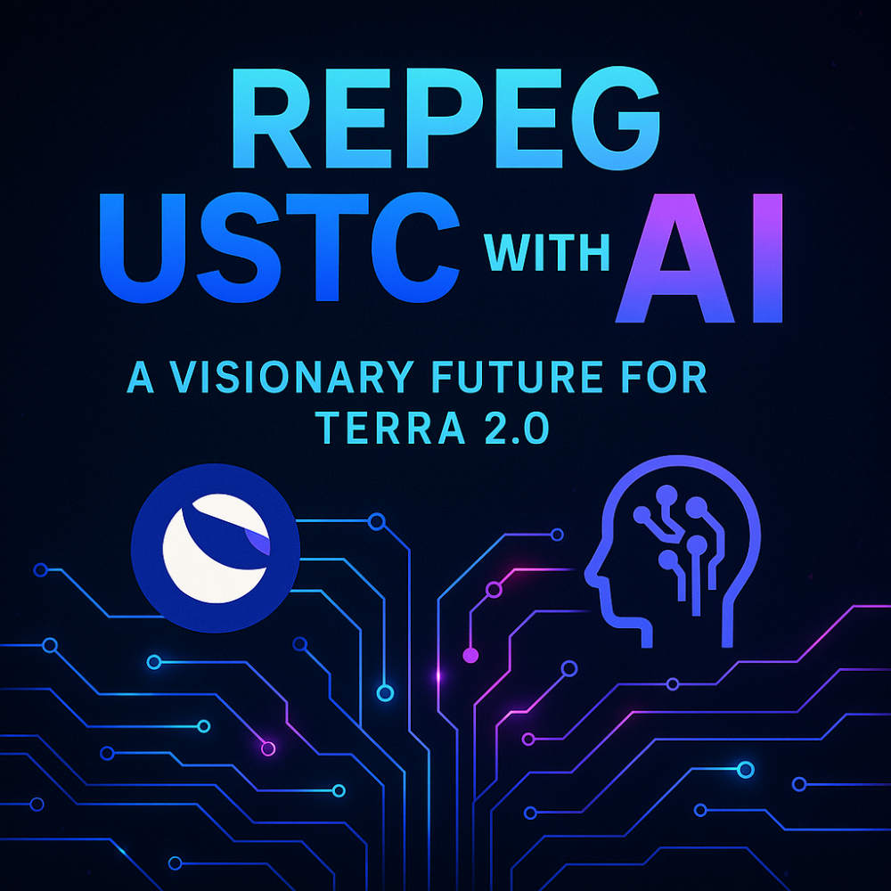

# [Proposal Discussion] Repeg $USTC with AI – A Visionary Future for Terra 2.0

- **Thread ID:** 1104816
- **Author:** DeLaBarcaNFT (`terra1uwukucezrsvkvyaa9ghfnymqq49t4a8rvljczv`)
- **Created:** 2025-04-09T22:27:20.472Z
- **Last edited:** -
- **Stage:** discussion
- **Views:** 27
- **Reactions:** 0
- **Comments:** 1
- **Source:** https://common.xyz/terra/discussion/1104816-proposal-discussion-repeg-ustc-with-ai-a-visionary-future-for-terra-2-

---

### Summary 
This proposal presents a bold and innovative vision to restore USTC’s $1 peg through a hybrid model powered by Artificial Intelligence. Unlike previous approaches relying solely on algorithmic mint/burn or static collateralization, this concept integrates AI-driven adaptability, real-time market responsiveness, and actual utility to create a truly intelligent and decentralized stablecoin for the next era of Web3.

---

### Motivation 
- The USTC depeg damaged trust, but also demonstrated the strong demand for decentralized stable assets. 
- Past algorithmic models lacked flexibility and were prone to exploitation. 
- Today, AI can enable real-time smart responses to market conditions. 
- Terra’s blockchain remains one of the fastest and most robust — it deserves a stablecoin to match. 
- A new AI-powered USTC could reignite community interest, investor confidence, and ecosystem expansion.

---

### Solution: Repeg USTC with an AI-powered hybrid mechanism

**Phase 1 – Restore narrative and trust** 
- Launch a campaign that repositions USTC not as a failure, but as a rebirth. 
- Showcase new leadership, transparency, and a forward-looking vision. 
- Position USTC as the first truly intelligent stablecoin in Web3. 
- Begin education and community engagement on AI’s role.

**Phase 2 – Adaptive infrastructure** 
- Introduce AI-powered oracles to track liquidity and sentiment in real time. 
- Establish a dynamic reserve fund (partially collateralized, partially algorithmic). 
- Implement smart burn-reward mechanisms based on live market data. 
- Test the system in a controlled environment (testnet) before activation.

**Phase 3 – AI-guided repeg activation** 
- Repeg occurs gradually: from $0.01 to $0.10, then $0.50, and finally $1 — each stage triggered by AI-monitored metrics. 
- Reward LPs, stakers, and USTC utility users based on their contribution to system stability. 
- Use soft caps and thresholds to prevent manipulation or system shocks.

**Phase 4 – Real utility and ecosystem expansion** 
- Integrate USTC into AI-powered dApps and autonomous systems. 
- Build a marketplace where USTC is used to pay for AI services, models, and automation tools. 
- Use USTC for governance bots, auto-yield engines, subscriptions, and actual decentralized economy flows. 
- Expand partnerships with other AI-driven Web3 projects to ensure cross-chain utility.

---

### Expected Impact 
- A progressive and sustainable repeg of USTC to $1. 
- Real demand for USTC through usage in AI and DeFi applications. 
- A scalable, adaptive stablecoin prepared for the future of crypto. 
- Terra’s narrative shifts from redemption… to innovation.

---

### Call to Action 
I invite the Terra 2.0 community to discuss, challenge, improve, and co-create this vision.

This isn’t just about restoring a peg — it’s about building the first decentralized, adaptive, intelligent stablecoin.

Let’s turn USTC into something the crypto world has never seen.

**This is not just a repeg. 
This is Terra’s rebirth.**

---

## Comments (1)

**Rose | Phoenix Foundation (`terra1vzxzwsm0rscya65jg9znu9jls9gtqrv7mc9yh9`)** — 2025-04-09T22:36:01.540Z

Hello, USTC isn't on the Terra 2.0 blockchain. Are you sure this is the right place for your proposal?

