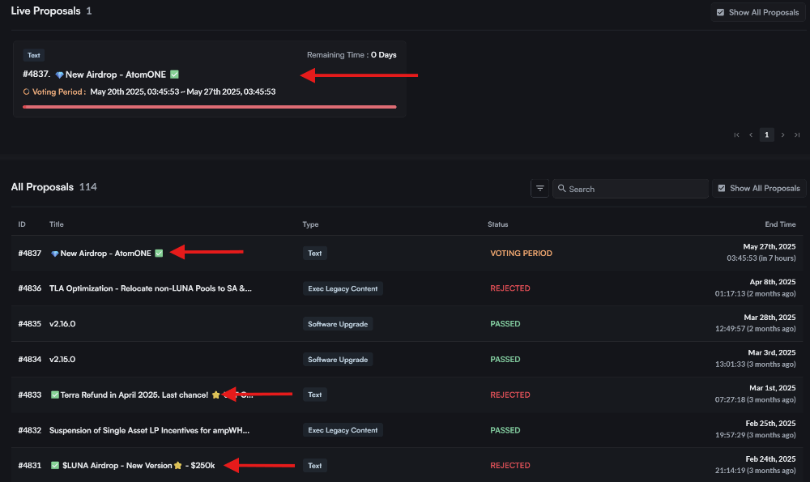

# Increase Minimum Deposit Amount for Terra Governance to 5000 LUNA

- **Thread ID:** 1269612
- **Author:** Rose | Phoenix Foundation (`terra1vzxzwsm0rscya65jg9znu9jls9gtqrv7mc9yh9`)
- **Created:** 2025-05-26T11:11:20.202Z
- **Last edited:** -
- **Stage:** discussion
- **Views:** 147
- **Reactions:** 1
- **Comments:** 0
- **Source:** https://common.xyz/terra/discussion/1269612-increase-minimum-deposit-amount-for-terra-governance-to-5000-luna

---

**Summary**

This proposal seeks to increase the minimum deposit amount required to submit a governance proposal on the Terra chain from 512 $LUNA to 5000 $LUNA to deter spam.

**Motivation**

For a proposal to enter the voting period, a minimum deposit of $LUNA, configurable by governance, is required. The current minimum deposit is set at 512 LUNA. It has not been adjusted since genesis.	

If a proposal is vetoed by more than 1/3 of the Quorum, all 512 LUNA is burned. This design is put in place to disincentivize spam and scam proposals.

The motivation to increase the Minimum Deposit is simple: to reduce scam proposals that target LUNA holders.

There have been 5 malicious proposals with embedded phishing links posted on-chain over the last year, including one currently in the voting stage. You can find them on https://www.mintscan.io/terra/proposals.

At the current value, the 512 LUNA required for anyone to submit a proposal is $100 USD. This does not effectively disincentivise spam. In comparison, Cosmos Hub has a minimum deposit of [500 ATOM](https://www.mintscan.io/cosmos/parameters) ($2400), Injective's minimum is [100 INJ](https://www.mintscan.io/injective/parameters) ($1400) and [Osmosis is proposing an increase to 6000 OSMO](https://forum.osmosis.zone/t/increase-deposit-for-proposals-to-6000-osmo/3730/1) ($1400) after a recent rise in scam proposals. 

Raising Terra's minimum deposit to 5000 LUNA brings it more in line with other chains in the ecosystem, at around $1000 current value, while still remaining accessible for regular users to be able to propose change.

**Implementation**

This is a parameter change. If approved, the proposed increase will be automatically applied by governance.

**Voting Options**

Yes: You’re in favour of increasing the minimum deposit amount from 512 $LUNA to 5000 $LUNA

No: You’re against increasing the minimum deposit amount from 512 $LUNA to 5000 $LUNA

Abstain: You’re neither for nor against but wish to contribute to quorum.

No with Veto: You strongly oppose the proposal and deem it spam, harmful to the chain.

---

## Comments (0)

_No comments._
