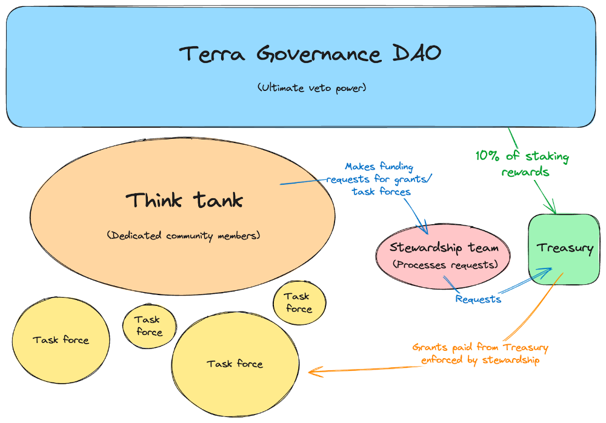

# The Phoenix Directive

The Phoenix Directive is a community-driven initiative for the Terra blockchain, focusing on organizing development and creating a strategic roadmap. It involves multiple teams working together to enhance the blockchain’s growth and sustainability. Key goals include collaborating with community members to build a new vision for Terra, increasing usage and liquidity, project development, promoting builders, improving tokenomics, and ensuring transparent funding.

## Overview

The mission of the Phoenix Directive is to foster the sustainable development and growth of the Terra blockchain and its community. To achieve its mission, the directive will work on the following goals:

### Strategic Goals

- Building confidence and stability within the Terra community by implementing a transparent and structured plan.
- Increasing usage, TVL, and liquidity across the Terra blockchain.
- Growing active projects and attracting new ones that will add strategic value to the chain.
- Building a cohesive vision and narrative for Terra in line with the goals of the community.
- Improving Luna tokenomics and creating healthier incentives for active users.
- Attracting a money market, perpetual trading, Real-World Assets (RWAs), and other core financial primitives to drive economic growth.
- Retaining and growing the avid LUNAtic community.

### Terra Core

- Maintaining and developing the Terra Core codebase, including security updates, module updates, Cosmos SDK version upgrades, and upgrade coordination.
- Working with core developers to ensure that the chain is maintained and upgraded.
  Collaborating with appropriate contributors to maintain RPC, LCD, and archive nodes and ensure that necessary chain infrastructure is functional.

### Alliance Module

- Maintaining and updating the module.
- Fostering new alliances between chains and communities.
- Developing and supporting new strategic alliances and use cases, such as the Terra Alliance Liquidity Proposal.

## Structure

The Phoenix Directive is structured to optimize transparency, community input, decentralization, and action for the development of the Terra ecosystem, while still being efficient in making progress and decisions.

The Directive uses a BORG structure which is an innovation in DAO implementation pioneered by MetaLeX. This framework allows on-chain DAOs and real-world entities (BORGs) to interact with each other in a decentralized yet effective manner.

The directive is structured into these parts:

### 1. The Terra Governance DAO

This is the Terra chain governance, and it represents all stakers who vote in Terra governance. Enforced by governance, Terra stakers and validators have the ultimate decision or veto power over any part of the Phoenix Directive, ensuring that the Directive must always be aligned with greater chain governance.

### 2. Phoenix Think Tank

The Think Tank is a group of individuals in charge of brainstorming novel ideas and objectives for the ecosystem, as well as making funding requests for task forces. They will participate in the decision-making process and make recommendations on matters important to the chain, such as defining a cohesive vision and narrative, ecosystem growth, development, and community outreach.

Each member of the Think Tank will be a current, active builder and leader in the Terra community. This team must be dedicated to having the interests of Terra and its community in mind at all times, and they will help shape the future of the chain and ecosystem.

Members of the Think Tank also holds veto power over any large spending requests from the treasury, as outlined in the Treasury section below. Initial membership of this group will be formed iteratively in consultation with other members and finalized by the Phoenix Stewardship Team, after the formation the Veto Multi-Sig is being self-organized.

If you are a leader in the Terra community and would like to join the Think Tank or contribute in any other way, an online application will be available shortly.

### 3. Phoenix Task Forces

Task forces are in charge of specific tasks. They are tasked with carrying out the objectives of the Phoenix Directive. Task forces will be established for specific purposes with clear goals. They represent different builders and doers of the Terra ecosystem, working on a per-project basis.

Funding for task forces will be proposed by the Think Tank and approved by the Stewardship Team, who will be responsible for holding the task forces accountable.

Task forces will carry out objectives across multiple axes, including:

#### Technical Objectives

- Ongoing chain maintenance & upgrades
- Public good funding and development
- Establishing maintenance, development, and/or transition plans for products
- Innovative protocol development

#### Organizational Objectives

- Building a clear vision and unique narrative for Terra’s future
- Facilitating the transition of essential assets such as Terra domains, repos, and social media/ communication channels (such as the x account and telegram channels) to the Terra community under the stewardship of the Phoenix Directive.
- Funding for strategic partnerships that will bring value back to Terra.

#### Establishing Programs

- Delegation Program
- Innovator grants
- Audit reimbursement
- Relaying

#### Community Building

- Implementing initiatives to reduce circulating supply
- Organizing hackathons to promote innovative building on Terra
- Implementing strategic marketing & user acquisition plans
- Incentivizing liquidity, the deployment of liquidity, and suggesting liquidity needs
- Identifying priority applications to build a unique and vibrant defi ecosystem
- Supporting community members needed to facilitate social channels

### 4. Phoenix Stewardship Team

The Stewardship Team is in charge of administrative oversight for the activities of the Phoenix Directive. They will ensure that all directives are met and that funds are distributed responsibly to Task Force teams. They will work with the Think Tank to set goals and objectives for the chain, and facilitate the funding and planning of the work to be carried out by the appropriate Task Force. The Stewardship Team will form the BORG portion of the Directive, called the Phoenix Foundation, which will facilitate interaction between on-chain organizations and off-chain entities to hold teams accountable with real-world business practice norms.

The Team will guide strategic alignment across the activities of the Directive, ensuring that all deliverables are met and that all teams are accountable to their commitments.

The Stewardship Team will be held accountable by Terra Governance, which retains veto rights to stop funding the Directive, and by the Think Tank, who can veto large spending requests as detailed below. The Team commits to working transparently and providing regular reports of activities to the community.

The Team will remain small and lean by design. A smaller Stewardship team ensures that all objectives of the Directive are aligned and that decisions can be made quickly and effectively.

The current members of the team are:

- Philipp (@0xPhilipp)
- MB Aejir (@MB_Aejir)
- Vini (@unl1k3ly)
- Rose (@rosanne_89)

The members of the Stewardship Team are well-known, long-standing leaders in the Terra community, and are committed to the continued development of the Terra chain and the growth of its ecosystem. The team has experience in running the Terra chain, building and designing protocols, creating delegation and grant programs, managing teams, and interfacing with other Cosmos protocols and chains. Most importantly, the team is passionate about the future of Terra and the needs of its community.

### 5. Phoenix Treasury

The treasury is an important piece of the Directive, allowing for transparent, responsible, and sustainable funding in a decentralized manner. Rather than block grants or funding proposals that lack community recourse, the Phoenix Directive will be funded via a smart contract that interacts with the Alliance module. The treasury contract will mint a virtual token to be staked on the Terra chain via the Alliance module. Rewards from the staking of this token will be claimed and deposited into the treasury periodically, funding the various initiatives, task forces, and development of the Directive.

- The Reward Weight for the virtual asset will initially be set to 14%.
- The Directive will develop a Phoenix Delegation Program to oversee the delegation of the virtual asset in line with the goals of the community.
- At any time, Terra Governance can vote to stop the funding of the Directive treasury by delisting the virtual asset, avoiding the need for clawbacks and ensuring the continued alignment of the community and the Directive.
- The treasury contract will be able to DCA into other assets on Terra to build up a diverse treasury to simplify funding requests and planning.
- Any spending requests > $50k have a 3-day lockup and can be vetoed by the Think Tank
- Any spending requests > $150k have a 10-day lockup and can be vetoed by Terra Governance.
- The Phoenix Directive can participate in the Alliance Liquidity Wars to have a strategic impact in liquidity recommendations (max 20% of total voting power)

## How the Phoenix Directive works

The Think Tank and Stewardship Team will work together to develop strategic initiatives and make spending recommendations for task forces. The Stewardship Team will review the recommendations and make a spending request to the treasury by sending an on-chain request message. Any spending requests for task forces greater than $50k will have a 3-day lockup period, during which time the Think Tank can veto the spending request and cancel the disbursement of funds. For amounts over $150k, there will be a 10-day lockup period, during which time Terra governance can vote to veto the spending request and cancel the disbursement of funds. Once the requisite lockup periods have elapsed, funds will be disbursed to task forces, who will be held accountable to their agreements by the Stewardship Team.

If Terra governance decides that the Phoenix Directive is not fulfilling its role, it can vote to stop funding the treasury at any time. This system of checks and balances ensures that the Stewardship Team, Think Tank, and Terra Governance are aligned in their actions.
